# Contract flows and anvil readiness

Generated by `npm run flowcharts:docs` from `data/contract-flows.json` plus the catalog. Do not edit by hand; `npm run flowcharts:check` fails when it is stale.

One flowchart per entry in `FORK_RECIPES`: the contracts a local Anvil fork actually touches, the calls between them, and the features the suite does **not** cover yet. Every address below already appears in this repo (`src/` or `output/fork-specs/`), so a diagram cannot point at an address nobody verified. `npm run flowcharts:check` re-checks that on every run.

## Run one locally

```bash
# terminal 1 — fork the chain the protocol lives on
CHAIN=ethereum node scripts/startFork.js

# terminal 2 — point that chain's RPC at the fork and run one action
ETHEREUM_RPC_URL=http://127.0.0.1:8545 npm run fork:aave:supply
```

`npm run fork:all` does that for every recipe (one Anvil per chain, `evm_snapshot` isolation per test). A chain with no RPC var is skipped, and `SKIP` is not a pass. Setup, fallbacks and the test contract are in [`04-fork-testing.md`](./04-fork-testing.md).

## Readiness

| | |
| --- | ---: |
| Fork recipes with a flowchart | 110 |
| Fork tests behind them | 166 |
| Recipes with a feature matrix | 98 |
| Features measured | 237 |
| Tested on a fork or linked to a test | 165 |
| Gap (permissionless, no test) | 31 |
| Failing because the protocol is paused | 3 |
| Not testable on an EVM fork | 38 |
| Chains | arbitrum, avalanche, base, bsc, ethereum, monad, optimism, polygon |
| Gap on rows with no fork recipe (see the last section) | 11 |

A **gap** is a public, permissionless feature with no fork test — the work queue. **Not testable** has a written reason (KYC, off-chain keeper, another chain). A recipe with `—` under *features* has no `src/catalog/protocolFeatures.js` entry, so its feature coverage is unmeasured; that is a gap in the matrix, not a pass.

| Rank | Protocol | Chain | Tests | Features tested | Gap | Not testable |
| --- | --- | --- | ---: | --- | ---: | ---: |
| #1 | [LayerZero V2](#flow-layerzero-v2) | ethereum | 1 | 2/3 | 0 | 1 |
| #2 | [Aave](#flow-aave) | ethereum | 7 | 8/8 | 0 | 0 |
| #3 | [SparkLend](#flow-sparklend) | ethereum | 6 | 6/6 | 0 | 0 |
| #4 | [Morpho](#flow-morpho) | ethereum | 6 | 7/7 | 0 | 0 |
| #6 | [Sentora Curator](#flow-sentora) | ethereum | 1 | 2/2 | 0 | 0 |
| #7 | [Lido](#flow-lido) | ethereum | 4 | 4/5 | 0 | 1 |
| #8 | [Hyperliquid Bridge](#flow-hyperliquid-bridge) | arbitrum | 1 | 1/2 | 0 | 1 |
| #10 | [Veda](#flow-veda) | ethereum | 2 | 2/2 | 0 | 0 |
| #12 | [Ethena](#flow-ethena) | ethereum | 3 | 3/4 | 0 | 1 |
| #13 | [Steakhouse Financial](#flow-steakhouse) | ethereum | 1 | 2/2 | 0 | 0 |
| #14 | [CCIP](#flow-ccip) | ethereum | 1 | 2/3 | 0 | 1 |
| #16 | [Binance staked ETH](#flow-binance-staked-eth) | ethereum | 1 | 1/2 | 0 | 1 |
| #21 | [RockawayX](#flow-rockawayx) | ethereum | 1 | 2/2 | 0 | 0 |
| #22 | [Tornado Cash](#flow-tornado-cash) | ethereum | 1 | 1/2 | 0 | 1 |
| #25 | [Polygon Bridge](#flow-polygon-bridge) | ethereum | 1 | 1/2 | 0 | 1 |
| #28 | [Upshift](#flow-upshift) | ethereum | 1 | 2/2 | 0 | 0 |
| #31 | [Concrete](#flow-concrete) | ethereum | 1 | 1/2 | 0 | 1 |
| #34 | [Robinhood Chain Bridge](#flow-robinhood-chain-bridge) | ethereum | 1 | 1/2 | 0 | 1 |
| #35 | [Hyperithm](#flow-hyperithm) | ethereum | 1 | 2/2 | 0 | 0 |
| #37 | [Lighter Bridge](#flow-lighter-bridge) | ethereum | 1 | 1/2 | 0 | 1 |
| #38 | [Gauntlet](#flow-gauntlet) | ethereum | 1 | 2/2 | 0 | 0 |
| #43 | [Aera](#flow-aera) | base | 1 | 1/2 | 0 | 1 |
| #46 | [Coinbase Wrapped Staked ETH](#flow-cbeth) | ethereum | 1 | 1/2 | 0 | 1 |
| #48 | [EtherFi Borrowing Market](#flow-etherfi-borrowing-market) | optimism | 1 | 1/2 | 0 | 1 |
| #50 | [PancakeSwap (DEX)](#flow-pancakeswap) | ethereum | 5 | 5/5 | 0 | 0 |
| #51 | [Clearstar](#flow-clearstar) | base | 1 | 2/2 | 0 | 0 |
| #52 | [Fluid Lite](#flow-fluid-lite) | ethereum | 1 | 2/2 | 0 | 0 |
| #57 | [Obol](#flow-obol) | ethereum | 1 | 1/2 | 0 | 1 |
| #58 | [Base Bridge](#flow-base-bridge) | ethereum | 1 | 1/2 | 0 | 1 |
| #59 | [Lista Liquid Staking](#flow-lista-liquid-staking) | bsc | 2 | 2/2 | 0 | 0 |
| #61 | [World Chain Bridge](#flow-world-chain) | ethereum | 1 | 1/2 | 0 | 1 |
| #69 | [NEAR Bridge](#flow-near-bridge) | ethereum | 1 | 1/2 | 0 | 1 |
| #70 | [Falcon Finance](#flow-falcon-finance) | ethereum | 1 | 1/3 | 1 | 1 |
| #72 | [StakeWise V3](#flow-stakewise-v3) | ethereum | 2 | 3/3 | 0 | 0 |
| #75 | [Curvance](#flow-curvance) | monad | 1 | 2/3 | 1 | 0 |
| #77 | [Galaxy Curation](#flow-galaxy-curation) | ethereum | 1 | 2/2 | 0 | 0 |
| #80 | [Compound Finance](#flow-compound) | ethereum | 6 | 6/7 | 0 | 1 |
| #82 | [mETH Protocol](#flow-meth-protocol) | ethereum | 1 | 2/2 | 0 | 0 |
| #85 | [KPK](#flow-kpk) | ethereum | 1 | 2/2 | 0 | 0 |
| #89 | [Zama](#flow-zama) | ethereum | 1 | 1/2 | 0 | 1 |
| #96 | [Arbitrum Bridge](#flow-arbitrum-bridge) | ethereum | 1 | 1/2 | 0 | 1 |
| #102 | [EigenCloud](#flow-eigenlayer) | ethereum | 2 | 2/4 | 2 | 0 |
| #105 | [USDT0](#flow-usdt0) | ethereum | 1 | 1/2 | 0 | 1 |
| #109 | [Optimism Bridge](#flow-optimism-bridge) | ethereum | 1 | 1/2 | 0 | 1 |
| #110 | [Liquity](#flow-liquity) | ethereum | 1 | 1/4 | 3 | 0 |
| #112 | [Saturn](#flow-saturn) | ethereum | 1 | 1/2 | 1 | 0 |
| #116 | [ether.fi Stake](#flow-etherfi) | ethereum | 3 | 3/3 | 0 | 0 |
| #121 | [Meta Pool](#flow-meta-pool) | ethereum | 1 | 1/2 | 1 | 0 |
| #123 | [Sky](#flow-maker) | ethereum | 5 | 5/6 | 1 | 0 |
| #125 | [Avant Protocol](#flow-avant) | avalanche | 1 | 1/1 | 0 | 0 |
| #126 | [Curve DEX](#flow-curve) | ethereum | 4 | 5/5 | 0 | 0 |
| #132 | [Fluid DEX](#flow-fluid-dex) | ethereum | 1 | 1/1 | 0 | 0 |
| #133 | [Venus Core Pool](#flow-venus-core-pool) | bsc | 1 | 1/4 | 3 | 0 |
| #134 | [SolvBTC](#flow-solvbtc) | ethereum | 1 | 1/2 | 1 | 0 |
| #142 | [Bedrock uniBTC](#flow-bedrock-unibtc) | ethereum | 1 | 1/1 | 0 | 0 |
| #145 | [Starknet Bridge](#flow-starknet-bridge) | ethereum | 1 | 1/2 | 0 | 1 |
| #146 | [Railgun](#flow-railgun) | ethereum | 1 | 1/2 | 0 | 1 |
| #151 | [Pendle V2](#flow-pendle) | ethereum | 1 | 2/4 | 2 | 0 |
| #153 | [Cooler Loans](#flow-cooler-loans) | ethereum | 1 | 1/2 | 1 | 0 |
| #155 | [CIAN Yield Layer](#flow-cian-yield-layer) | ethereum | 1 | 0/2 | 2 | 0 |
| #158 | [Portal](#flow-portal) | ethereum | 1 | 1/2 | 0 | 1 |
| #160 | [Polymarket](#flow-polymarket) | polygon | 1 | 1/2 | 0 | 1 |
| #164 | [Dolomite](#flow-dolomite) | ethereum | 1 | 0/2 | 1 | 1 |
| #165 | [Convex Finance](#flow-convex-finance) | ethereum | 1 | 1/2 | 1 | 0 |
| #169 | [BitFi Basis](#flow-bitfi-basis) | bsc | 1 | 1/1 | 0 | 0 |
| #171 | [xDai Stake Bridge](#flow-xdai-stake-bridge) | ethereum | 1 | 1/2 | 1 | 0 |
| #173 | [Fluid Lending](#flow-fluid-lending) | ethereum | 1 | 1/2 | 1 | 0 |
| #178 | [Fraxtal](#flow-fraxtal) | ethereum | 1 | 1/2 | 0 | 1 |
| #181 | [Rocket Pool](#flow-rocketpool) | ethereum | 2 | 2/2 | 0 | 0 |
| #182 | [USDD](#flow-usdd) | ethereum | 1 | 1/1 | 0 | 0 |
| #192 | [Armitage by Wintermute](#flow-armitage) | ethereum | 1 | 1/2 | 0 | 1 |
| #194 | [Grove Finance](#flow-grove) | base | 1 | 1/2 | 0 | 1 |
| #197 | [Yearn](#flow-yearn) | ethereum | 1 | 2/2 | 0 | 0 |
| — | [Across](#flow-across) | ethereum | 1 | 1/2 | 0 | 1 |
| — | [Aerodrome](#flow-aerodrome) | base | 1 | — | — | — |
| — | [Aster (Bridge)](#flow-aster-bridge) | bsc | 1 | 1/1 | 0 | 0 |
| — | [Axelar](#flow-axelar) | ethereum | 1 | 1/1 | 0 | 0 |
| — | [Balancer](#flow-balancer) | ethereum | 1 | 1/2 | 1 | 0 |
| — | [Benqi Lending](#flow-benqi-lending) | avalanche | 1 | 1/3 | 2 | 0 |
| — | [Benqi Staked Avax](#flow-benqi-staked-avax) | avalanche | 1 | 1/2 | 1 | 0 |
| — | [BlackRock BUIDL](#flow-buidl) | ethereum | 1 | 1/2 | 0 | 1 |
| — | [Circle USDC](#flow-circle) | ethereum | 1 | 1/2 | 0 | 1 |
| — | [Concentrator](#flow-concentrator) | ethereum | 1 | 2/2 | 0 | 0 |
| — | [Curve Llamalend](#flow-curve-llamalend) | ethereum | 4 | — | — | — |
| — | [Derive V3](#flow-derive-v3) | ethereum | 1 | — | — | — |
| — | [Ember Protocol](#flow-ember-protocol) | ethereum | 1 | — | — | — |
| — | [Euler](#flow-euler) | ethereum | 1 | 2/3 | 1 | 0 |
| — | [Frax](#flow-frax-finance) | ethereum | 1 | 1/2 | 1 | 0 |
| — | [Gmx](#flow-gmx) | arbitrum | 1 | — | — | — |
| — | [K3 Capital](#flow-k3-capital) | ethereum | 1 | — | — | — |
| — | [Kelp DAO](#flow-kelp) | ethereum | 2 | 2/2 | 0 | 0 |
| — | [Lista Dao](#flow-lista-dao) | bsc | 1 | — | — | — |
| — | [Mellow Core](#flow-mellow-core) | ethereum | 1 | 1/1 | 0 | 0 |
| — | [Monad](#flow-monad) | monad | 1 | — | — | — |
| — | [Ondo](#flow-ondo-finance) | ethereum | 1 | 1/2 | 0 | 1 |
| — | [Puffer](#flow-puffer) | ethereum | 1 | 1/1 | 0 | 0 |
| — | [Renzo](#flow-renzo) | ethereum | 2 | 2/2 | 0 | 0 |
| — | [Spark](#flow-spark) | ethereum | 1 | — | — | — |
| — | [Stake.Link Liquid](#flow-stakelink-liquid) | ethereum | 1 | — | — | — |
| — | [Stargate](#flow-stargate-finance) | ethereum | 2 | 2/2 | 0 | 0 |
| — | [Superstate](#flow-superstate) | ethereum | 1 | 1/2 | 0 | 1 |
| — | [SushiSwap](#flow-sushiswap) | ethereum | 2 | 2/3 | 1 | 0 |
| — | [Swell](#flow-swell) | ethereum | 1 | 0/1 | 1 | 0 |
| — | [Symbiotic](#flow-symbiotic) | ethereum | 1 | 1/2 | 1 | 0 |
| — | [Tether USDT](#flow-tether) | ethereum | 1 | 1/2 | 0 | 1 |
| — | [Theo](#flow-theo) | ethereum | 1 | 1/2 | 1 | 0 |
| — | [Uniswap](#flow-uniswap) | ethereum | 7 | — | — | — |
| — | [USD AI](#flow-usd-ai) | arbitrum | 1 | 1/2 | 1 | 0 |
| — | [Velodrome](#flow-velodrome) | optimism | 1 | — | — | — |
| — | [Vesper](#flow-vesper) | ethereum | 1 | 1/1 | 0 | 0 |

## How to read a diagram

Each arrow is one distinct call path between two contracts. Parallel calls between the same pair are collapsed into one arrow, and its label starts with the step range: `5 · approve(Pool, 1 WETH)` is step 5, `2–10 · …` is the run of steps 2 to 10. The full ordered list is the **Call log** in the showcase panel (`?view=flow` on a protocol page), which also plays the sequence arrow by arrow.

- **actor** — actor / impersonated account
- **contract** — protocol contract
- **token** — token or position
- **external** — external contract (oracle, router, bridge peer)
- **offchain** — off this machine (keeper, DVN, L2, solver)

Arrows: `-->` call, `==>` token movement, `-.->` event or a step that is off this machine. A cycle (supply → withdraw) is drawn as an arrow that points back at its source.

## Per protocol

<a id="flow-layerzero-v2"></a>

### #1 LayerZero V2

Chain: **ethereum** · 1 fork test · `ETHEREUM_RPC_URL` · 2/3 features tested

```mermaid
%%{init: {"flowchart": {"curve": "basis", "nodeSpacing": 34, "rankSpacing": 52}, "themeVariables": {"fontSize": "11px"}}}%%
flowchart LR
  user["fresh impersonated account"]
  oapp["USDT0 OFT Adapter, the<br/>OApp that sends the pa…<br/>0x6C96dE…1dee"]
  endpoint["LayerZero V2 EndpointV2 on<br/>Ethereum<br/>0x1a4407…728c"]
  sendlib["SendUln302, the send<br/>library getSendLibrary(o…<br/>0xbB2Ea7…dCe1"]
  usdt["USDT on Ethereum<br/>0xdAC17F…1ec7"]
  arbitrum["Arbitrum destination, DVN<br/>verification and ex…"]
  user -->|"1–9 · endpoint() pre-check is EndpointV2 (+…"| oapp
  user -->|"2–14 · eid() pre-check is 30101 (+3 more)"| endpoint
  user -->|"6 · approve(oapp, 100 USDT)"| usdt
  usdt ==>|"10 · 100 USDT locked in the OFT Adapter"| oapp
  oapp -->|"11 · endpoint.send to EID 30110"| endpoint
  endpoint -->|"12 · SendUln302 encodes the payload and ret…"| sendlib
  endpoint -.->|"13 · PacketSent(sendLibrary) equals getSend…"| user
  endpoint -.->|"15 · DVN verification and executor delivery…"| arbitrum
  classDef actor fill:#14160f,stroke:#14160f,color:#f7f8ef
  classDef contract fill:#eef2d9,stroke:#14160f,color:#14160f
  classDef token fill:#ffffff,stroke:#8a8f7a,color:#14160f
  classDef external fill:#f4f4ee,stroke:#b9beac,color:#14160f
  classDef offchain fill:#fff1e6,stroke:#c9743a,color:#14160f,stroke-dasharray:4 2
  class user actor
  class oapp,endpoint contract
  class usdt token
  class sendlib external
  class arbitrum offchain
```

**What this fork proves.** The Ethereum fork sends 100 USDT through the USDT0 OFT Adapter and asserts the LayerZero V2 messaging layer: endpoint() is EndpointV2 with eid 30101, send makes EndpointV2 emit PacketSent from exactly the send library getSendLibrary(oapp, 30110) returns, and outboundNonce(oapp, 30110, peer) rises by one. DVN verification and executor delivery on Arbitrum are not run.

Run it:

```bash
CHAIN=ethereum node scripts/startFork.js
ETHEREUM_RPC_URL=http://127.0.0.1:8545 npm run fork:layerzero:send
```

| Contract | Address | Chain | Role in the flow |
| --- | --- | --- | --- |
| USDT0 OFT Adapter, the OApp that sends the packet | `0x6C96dE32CEa08842dcc4058c14d3aaAD7Fa41dee` | ethereum | contract |
| LayerZero V2 EndpointV2 on Ethereum (EID 30101) | `0x1a44076050125825900e736c501f859c50fE728c` | ethereum | contract |
| SendUln302, the send library getSendLibrary(oapp, 30110) returns | `0xbB2Ea70C9E858123480642Cf96acbcCE1372dCe1` | ethereum | external |
| USDT on Ethereum (the locked asset) | `0xdAC17F958D2ee523a2206206994597C13D831ec7` | ethereum | token |

> LayerZero V2 is a messaging layer; its DefiLlama TVL is tokens locked in OFT adapters. The test sends USDT through the USDT0 OFT Adapter (an OApp) and asserts at the LayerZero layer: the OApp's endpoint() is EndpointV2, EndpointV2 emits PacketSent from the OApp's configured send library, and the outbound nonce to Arbitrum advances by one. DVN verification and executor delivery on the destination are off-chain/other-chain and not run on a fork.

Notes:

- Only the source side runs: the test reads PacketSent from the receipt and never delivers the message to Arbitrum.
- peers(30110) is read with provider.call because the flow's ABI carries only the OFT surface; the returned 32-byte peer is the receiver used for outboundNonce.
- A zero fee or a missing PacketSent is a FAIL: the assertion is sendLibrary == getSendLibrary and nonceAfter == nonceBefore + 1 with fee.nativeFee > 0.
- The adapter is the same USDT0 OFT Adapter as the usdt0 recipe, so the two recipes exercise the same send from different angles.

**Missing from the anvil suite.**

| Feature | Status | How to close it on a fork | Blocker |
| --- | --- | --- | --- |
| receive / lzReceive | not-testable | On an Arbitrum fork, replay the PacketSent payload from the Ethereum run: impersonate the receive library Arbitrum EndpointV2.getReceiveLibrary(oapp, 30101) returns, call EndpointV2.lzReceive(origin, oapp, guid, message, extraData) so the OApp's lzReceive handler runs, and assert USDT0.balanceOf(recipient) rose by the amountReceivedLD the Ethereum quoteOFT quoted. | EndpointV2.lzReceive only accepts a payload hash written by verify() from the configured DVN's attestation, and the executor submits the delivery; both happen off this machine and on the other chain. |

<a id="flow-aave"></a>

### #2 Aave

Chain: **ethereum** · 7 fork tests · `ETHEREUM_RPC_URL` · 8/8 features tested

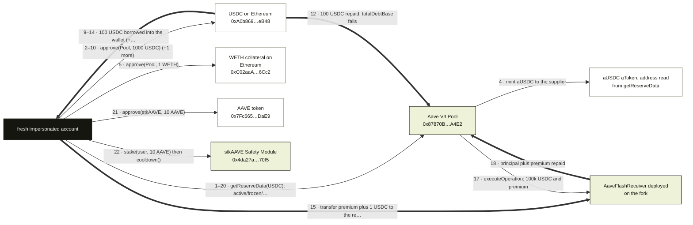

**What this fork proves.** Seven Aave V3 tests on an Ethereum fork: supply and withdraw move aUSDC, borrow lifts the USDC wallet and totalDebtBase while repay lowers debtBase, the flash loan pays FLASHLOAN_PREMIUM_TOTAL and the USDC held by the aToken rises by it, the collateral bit toggles off/on and e-mode reads 1 then 0 with a new LTV, and stkAAVE rises by the 10 AAVE staked as the cooldown timestamp records. Every PASS prints the delta.

Run it:

```bash
CHAIN=ethereum node scripts/startFork.js
ETHEREUM_RPC_URL=http://127.0.0.1:8545 npm run fork:aave:supply
ETHEREUM_RPC_URL=http://127.0.0.1:8545 npm run fork:aave:borrow
ETHEREUM_RPC_URL=http://127.0.0.1:8545 npm run fork:aave:repay
ETHEREUM_RPC_URL=http://127.0.0.1:8545 npm run fork:aave:withdraw
ETHEREUM_RPC_URL=http://127.0.0.1:8545 npm run fork:aave:flashloan
ETHEREUM_RPC_URL=http://127.0.0.1:8545 npm run fork:aave:emode
ETHEREUM_RPC_URL=http://127.0.0.1:8545 npm run fork:aave:stake
```

| Contract | Address | Chain | Role in the flow |
| --- | --- | --- | --- |
| Aave V3 Pool | `0x87870Bca3F3fD6335C3F4ce8392D69350B4fA4E2` | ethereum | contract |
| USDC on Ethereum | `0xA0b86991c6218b36c1d19D4a2e9Eb0cE3606eB48` | ethereum | token |
| WETH collateral on Ethereum | `0xC02aaA39b223FE8D0A0e5C4F27eAD9083C756Cc2` | ethereum | token |
| AAVE token | `0x7Fc66500c84A76Ad7e9c93437bFc5Ac33E2DDaE9` | ethereum | token |
| stkAAVE Safety Module | `0x4da27a545c0c5B758a6BA100e3a049001de870f5` | ethereum | contract |

Notes:

- Whales come from src/utils/impersonate.js; impersonateFunded falls back to anvil_dealERC20 when the whale is short.
- The aToken address is never hardcoded: it is read from Pool.getReserveData(USDC).aTokenAddress at run time, so the aUSDC node carries no address.
- The four aaveFlow actions (supply, borrow, repay, withdraw) read getReserveData flags before any tx and fail with no tx sent when the reserve is inactive, paused or frozen.
- repay warps 12 seconds because Aave rejects a borrow and repay in the same block (SAME_BLOCK_BORROW_REPAY).
- liquidate in the Aave feature matrix is covered by simulate:aave:liquidations, which is not one of this recipe's fork tests.
- stkAAVE uses the Safety Module stakersCooldowns slot; the V3 test is the one that must keep matching the live pool.

**Missing from the anvil suite.** None: every feature in the matrix has a fork test.

<a id="flow-sparklend"></a>

### #3 SparkLend

Chain: **ethereum** · 6 fork tests · `ETHEREUM_RPC_URL` · 6/6 features tested

```mermaid
%%{init: {"flowchart": {"curve": "basis", "nodeSpacing": 34, "rankSpacing": 52}, "themeVariables": {"fontSize": "11px"}}}%%
flowchart LR
  user["fresh impersonated account"]
  liquidator["second impersonated<br/>account (liquidator)"]
  pool["SparkLend Pool<br/>0xC13e21…E987"]
  ausdc["aToken for USDC"]
  usdc["USDC<br/>0xA0b869…eB48"]
  weth["WETH<br/>0xC02aaA…6Cc2"]
  oracle["Spark price oracle<br/>(ADDRESSES_PROVIDER().getP…"]
  receiver["AaveFlashReceiver deployed<br/>on the fork"]
  user -->|"1–22 · getReserveData(USDC) pre-check (+9 m…"| pool
  user -->|"2–18 · approve(pool, 1000 USDC) (+2 more)"| usdc
  pool -->|"4 · mint aUSDC to user"| ausdc
  user -->|"5 · approve(pool, 1 WETH)"| weth
  usdc ==>|"9–13 · 100 USDC borrowed into the wallet (+…"| user
  usdc ==>|"15 · 100000 USDC delivered before the callb…"| receiver
  pool -->|"16 · executeOperation callback"| receiver
  usdc ==>|"17 · approve then transferFrom amount + pre…"| pool
  user -->|"19 · getSourceOfAsset(WETH) / getAssetPrice…"| oracle
  user -.->|"21 · anvil_setCode MockPrice on the WETH so…"| oracle
  liquidator -->|"23 · approve(pool, cover = borrow/2)"| usdc
  liquidator -->|"24 · liquidationCall(WETH, USDC, user, cove…"| pool
  pool -->|"25 · getAssetPrice(WETH) during liquidation…"| oracle
  weth ==>|"26 · seized WETH to the liquidator"| liquidator
  classDef actor fill:#14160f,stroke:#14160f,color:#f7f8ef
  classDef contract fill:#eef2d9,stroke:#14160f,color:#14160f
  classDef token fill:#ffffff,stroke:#8a8f7a,color:#14160f
  classDef external fill:#f4f4ee,stroke:#b9beac,color:#14160f
  classDef offchain fill:#fff1e6,stroke:#c9743a,color:#14160f,stroke-dasharray:4 2
  class user,liquidator actor
  class pool,receiver contract
  class ausdc,usdc,weth token
  class oracle external
```

**What this fork proves.** SparkLend runs the Aave V3 flow against the Spark pool: supply, borrow, repay and withdraw assert aToken or debtBase deltas, flashLoanSimple hands 100000 USDC to the receiver callback which repays amount + premium (FLASHLOAN_PREMIUM_TOTAL 0 today), and liquidate shocks the WETH source to 70% and asserts health factor above 1 -> below 1 with debt down and WETH seized.

Run it:

```bash
CHAIN=ethereum node scripts/startFork.js
ETHEREUM_RPC_URL=http://127.0.0.1:8545 npm run fork:spark:supply
ETHEREUM_RPC_URL=http://127.0.0.1:8545 npm run fork:spark:borrow
ETHEREUM_RPC_URL=http://127.0.0.1:8545 npm run fork:spark:repay
ETHEREUM_RPC_URL=http://127.0.0.1:8545 npm run fork:spark:withdraw
ETHEREUM_RPC_URL=http://127.0.0.1:8545 npm run fork:spark:flashloan
ETHEREUM_RPC_URL=http://127.0.0.1:8545 npm run fork:spark:liquidate
```

| Contract | Address | Chain | Role in the flow |
| --- | --- | --- | --- |
| SparkLend Pool (Aave V3 fork) | `0xC13e21B648A5Ee794902342038FF3aDAB66BE987` | ethereum | contract |
| USDC | `0xA0b86991c6218b36c1d19D4a2e9Eb0cE3606eB48` | ethereum | token |
| WETH (collateral) | `0xC02aaA39b223FE8D0A0e5C4F27eAD9083C756Cc2` | ethereum | token |

> SparkLend is an Aave V3 fork. The same supply, borrow, repay and withdraw flow runs against the Spark pool.

Notes:

- FORK_TARGET=spark maps supply/borrow/repay/withdraw to src/simulation/fork/aaveFlow.js; only poolAddress() differs from Aave, so every Pool call uses the Aave V3 Pool ABI.
- flashLoanSimple and liquidationCall come from src/simulation/fork/lendingExtras.js, dispatched by protocol:action before run.js resolves FORK_TARGET.
- The flash loan premium is FLASHLOAN_PREMIUM_TOTAL, which the catalog records as 0 today, so the USDC gain asserted on the aToken is +0.
- liquidate opens a fresh 1 WETH position at 95% of the borrow limit, replaces the WETH price source with MockPrice at 70% via anvil_setCode, and restores the original code and storage slot in a finally block.
- Defaults come from the code: 1000 USDC supply/withdraw, 100 USDC borrow, 100000 USDC flash loan; FORK_AMOUNT overrides supply, withdraw, borrow and the flash loan, but repay is fixed at 100 USDC.

**Missing from the anvil suite.** None: every feature in the matrix has a fork test.

<a id="flow-morpho"></a>

### #4 Morpho

Chain: **ethereum** · 6 fork tests · `ETHEREUM_RPC_URL` · 7/7 features tested

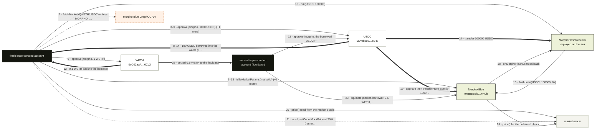

**What this fork proves.** Morpho Blue on the deepest listed WETH/USDC Ethereum market: supply raises supply shares, borrow raises borrow shares, repay cuts borrow shares and withdraws exactly 0.1 WETH, the lender withdraw returns exactly 500 USDC and burns supply shares, a fee-free flashLoan leaves Morpho's USDC unchanged with the receiver empty, and liquidate after a 70% oracle shock seizes 0.5 WETH and cuts borrow shares.

Run it:

```bash
CHAIN=ethereum node scripts/startFork.js
ETHEREUM_RPC_URL=http://127.0.0.1:8545 npm run fork:morpho:supply
ETHEREUM_RPC_URL=http://127.0.0.1:8545 npm run fork:morpho:borrow
ETHEREUM_RPC_URL=http://127.0.0.1:8545 npm run fork:morpho:repay
ETHEREUM_RPC_URL=http://127.0.0.1:8545 npm run fork:morpho:withdraw
ETHEREUM_RPC_URL=http://127.0.0.1:8545 npm run fork:morpho:flashloan
ETHEREUM_RPC_URL=http://127.0.0.1:8545 npm run fork:morpho:liquidate
```

| Contract | Address | Chain | Role in the flow |
| --- | --- | --- | --- |
| Morpho Blue | `0xBBBBBbbBBb9cC5e90e3b3Af64bdAF62C37EEFFCb` | ethereum | contract |
| USDC (loan token) | `0xA0b86991c6218b36c1d19D4a2e9Eb0cE3606eB48` | ethereum | token |
| WETH (collateral token) | `0xC02aaA39b223FE8D0A0e5C4F27eAD9083C756Cc2` | ethereum | token |

> Supply and borrow on the deepest listed WETH/USDC Morpho Blue market (or MORPHO_MARKET_ID).

Notes:

- supply/borrow/repay/withdraw come from src/simulation/fork/morphoBlue.js; flashLoan and liquidate come from src/simulation/fork/lendingExtras.js.
- The market id is the only off-chain input: it is fetched from blue-api.morpho.org unless MORPHO_MARKET_ID is set, and an API failure SKIPs instead of failing.
- flashLoan is fee-free, so the test asserts Morpho's own USDC balance is identical before and after the callback.
- liquidate reads price() from the market oracle, opens a fresh 1 WETH position at 95% of the LLTV, then replaces the oracle's code with MockPrice at 70% via anvil_setCode and restores it in a finally block.
- repay is a two-leg test: repay half the borrowed USDC, then withdrawCollateral 0.1 WETH, asserting both borrow shares and collateral.

**Missing from the anvil suite.** None: every feature in the matrix has a fork test.

<a id="flow-sentora"></a>

### #6 Sentora Curator

Chain: **ethereum** · 1 fork test · `ETHEREUM_RPC_URL` · 2/2 features tested

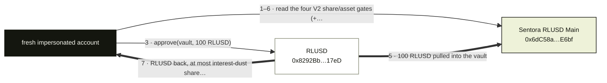

**What this fork proves.** Checks the four Morpho Vault V2 share/asset gates and the liquidity adapter on Sentora RLUSD Main, then deposits RLUSD and exits; it asserts the vault pulled exactly the deposit, minted shares and returned every RLUSD with at most interest-dust shares left, and a set gate turns the run into a labelled totalAssets/convertToAssets read with no transaction.

Run it:

```bash
CHAIN=ethereum node scripts/startFork.js
ETHEREUM_RPC_URL=http://127.0.0.1:8545 npm run fork:sentora:deposit
```

| Contract | Address | Chain | Role in the flow |
| --- | --- | --- | --- |
| Sentora RLUSD Main (Morpho Vault V2) | `0x6dC58a0FdfC8D694e571DC59B9A52EEEa780E6bf` | ethereum | contract |
| RLUSD | `0x8292Bb45bf1Ee4d140127049757C2E0fF06317eD` | ethereum | token |

> Sentora RLUSD Main is a Morpho Vault V2 on Ethereum. maxDeposit is 0, so the fork test reads totalAssets and convertToAssets and does not deposit.

Notes:

- Morpho Vault V2 maxDeposit always returns 0, so the four gates and liquidityAdapter are the pre-check; a non-zero gate makes the run a labelled read of totalAssets and convertToAssets that sends no tx.
- Without a liquidity adapter (the case today) the exit is withdraw(amount, user, user) and up to interest-dust shares can remain; with one it redeems every share instead and the leftover must be zero.
- RLUSD comes from the configured whale via src/utils/impersonate.js, with anvil_dealERC20 as the fallback.

**Missing from the anvil suite.** None: every feature in the matrix has a fork test.

<a id="flow-lido"></a>

### #7 Lido

Chain: **ethereum** · 4 fork tests · `ETHEREUM_RPC_URL` · 4/5 features tested

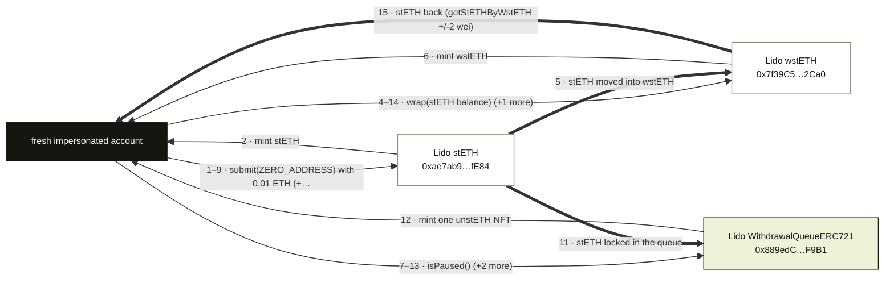

**What this fork proves.** Stakes ETH through Lido submit, wraps the stETH to wstETH and unwraps it back, and queues a stETH withdrawal as an unstETH NFT, asserting stETH and wstETH balances rise, unwrap returns getStETHByWstETH within 2 wei, and exactly one withdrawal NFT is minted to the user.

Run it:

```bash
CHAIN=ethereum node scripts/startFork.js
ETHEREUM_RPC_URL=http://127.0.0.1:8545 npm run fork:lido:submit
ETHEREUM_RPC_URL=http://127.0.0.1:8545 npm run fork:lido:wrap
ETHEREUM_RPC_URL=http://127.0.0.1:8545 npm run fork:lido:request
ETHEREUM_RPC_URL=http://127.0.0.1:8545 npm run fork:lido:unwrap
```

| Contract | Address | Chain | Role in the flow |
| --- | --- | --- | --- |
| Lido stETH | `0xae7ab96520DE3A18E5e111B5EaAb095312D7fE84` | ethereum | token |
| Lido wstETH | `0x7f39C581F595B53c5cb19bD0b3f8dA6c935E2Ca0` | ethereum | token |
| Lido WithdrawalQueueERC721 | `0x889edC2eDab5f40e902b864aD4d7AdE8E412F9B1` | ethereum | contract |

Notes:

- Each fork:lido test runs on its own evm_snapshot, so submit appears once per test that needs stETH rather than once in total.
- ETH comes from impersonateAccount on a random address; no ERC-20 whale is involved, so there is no funding leg to draw.
- The withdrawal request asserts the NFT and the request status but deliberately does not wait for finalization; that is the claim gap.

**Missing from the anvil suite.**

| Feature | Status | How to close it on a fork | Blocker |
| --- | --- | --- | --- |
| claim withdrawal | not-testable | After requestWithdrawals mints the unstETH NFT, impersonate the FINALIZE_ROLE holder (the Lido contract) and call WithdrawalQueueERC721.finalize(requestId, maxShareRate) with msg.value = the request's amountOfStETH, then claimWithdrawal(requestId) as the NFT owner and assert the NFT is burned and the ETH balance rises by the request's amountOfStETH. | finalize() has no permissionless caller: FINALIZE_ROLE sits with the Lido contract and the ETH it locks comes from the oracle report, so a fresh fork account cannot finalize the request and claimWithdrawal reverts RequestNotFoundOrNotFinalized. |

<a id="flow-hyperliquid-bridge"></a>

### #8 Hyperliquid Bridge

Chain: **arbitrum** · 1 fork test · `ARBITRUM_RPC_URL` · 1/2 features tested

```mermaid
%%{init: {"flowchart": {"curve": "basis", "nodeSpacing": 34, "rankSpacing": 52}, "themeVariables": {"fontSize": "11px"}}}%%
flowchart LR
  user["fresh impersonated account"]
  bridge["Hyperliquid Bridge<br/>0x2df1c5…3df7"]
  usdc["Arbitrum native USDC, the<br/>only asset the escr…<br/>0xaf88d0…5831"]
  hypercore["HyperCore ledger on the L1"]
  user -->|"1 · paused() and usdcToken() read-only gates"| bridge
  user -->|"2 · transfer(bridge, 10.0 USDC)"| usdc
  usdc ==>|"3 · 10.0 USDC escrowed, balance +10.0"| bridge
  usdc -.->|"4 · Transfer(depositor, bridge, 10.0 USDC)…"| bridge
  bridge -.->|"5 · HyperCore credit from the L1 validators…"| hypercore
  classDef actor fill:#14160f,stroke:#14160f,color:#f7f8ef
  classDef contract fill:#eef2d9,stroke:#14160f,color:#14160f
  classDef token fill:#ffffff,stroke:#8a8f7a,color:#14160f
  classDef external fill:#f4f4ee,stroke:#b9beac,color:#14160f
  classDef offchain fill:#fff1e6,stroke:#c9743a,color:#14160f,stroke-dasharray:4 2
  class user actor
  class bridge contract
  class usdc token
  class hypercore offchain
```

**What this fork proves.** Sends 10 Arbitrum USDC to the Hyperliquid Bridge2 escrow from a fresh account and asserts the escrow's USDC balance rises by exactly 10.0 and the USDC Transfer(depositor, escrow, 10.0) log, while the depositor falls by exactly 10.0. Bridge2 has no deposit hook: the deposit path is a plain ERC-20 transfer.

Run it:

```bash
CHAIN=arbitrum node scripts/startFork.js
ARBITRUM_RPC_URL=http://127.0.0.1:8545 npm run fork:hyperliquid-bridge:deposit
```

| Contract | Address | Chain | Role in the flow |
| --- | --- | --- | --- |
| Hyperliquid Bridge (Bridge2, Arbitrum USDC escrow) | `0x2df1c51e09aecf9cacb7bc98cb1742757f163df7` | arbitrum | contract |
| Arbitrum native USDC, the only asset the escrow holds | `0xaf88d065e77c8cC2239327C5EDb3A432268e5831` | arbitrum | token |

Notes:

- The escrow's own storage does not move on a deposit: the USDC balance delta and the Transfer log in the receipt are the whole assertion.
- The deposit is 10 USDC, above the documented 5 USDC minimum, and the bridge's usdcToken() must read back as Arbitrum native USDC or no tx is sent.
- paused() gates withdrawals and validator-set updates only, but a paused bridge is refused as a pre-flight failure because a locked bridge is not a working deposit route.
- HyperCore is not EVM and is not configured for forking here, so the credit on the L1 is out of scope for this test.

**Missing from the anvil suite.**

| Feature | Status | How to close it on a fork | Blocker |
| --- | --- | --- | --- |
| bridge withdraw | not-testable | Replay a real withdrawal on the Arbitrum fork: impersonate a Bridge2 finalizer and call Bridge2.batchedFinalizeWithdrawals([message]) after the matching Bridge2.batchedRequestWithdrawals has recorded the validator-signed request, then assert the escrow's USDC balance falls and the recipient's USDC rises by the withdrawal's usd amount, with a matching USDC Transfer(bridge, recipient). There is no user-callable withdraw function to call instead. | Withdrawals are requested on HyperCore and recorded on Arbitrum by Bridge2.batchedRequestWithdrawals with hot-validator signatures, then released after the dispute period; a fork has neither the HyperCore request nor the validator signatures to replay. |

<a id="flow-veda"></a>

### #10 Veda

Chain: **ethereum** · 2 fork tests · `ETHEREUM_RPC_URL` · 2/2 features tested

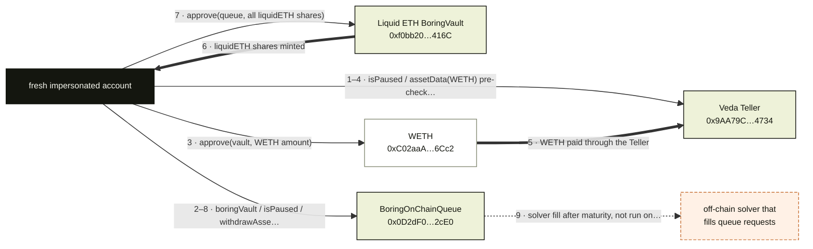

**What this fork proves.** Deposits WETH through the Veda Teller into the ether.fi Liquid ETH BoringVault and, in the request test, queues every share through BoringOnChainQueue: the first asserts liquidETH was minted, the second that all shares moved to the queue and exactly one requestId was added.

Run it:

```bash
CHAIN=ethereum node scripts/startFork.js
ETHEREUM_RPC_URL=http://127.0.0.1:8545 npm run fork:veda:deposit
ETHEREUM_RPC_URL=http://127.0.0.1:8545 npm run fork:veda:request
```

| Contract | Address | Chain | Role in the flow |
| --- | --- | --- | --- |
| Veda Teller (ether.fi Liquid ETH) | `0x9AA79C84b79816ab920bBcE20f8f74557B514734` | ethereum | contract |
| Liquid ETH BoringVault (liquidETH) | `0xf0bb20865277aBd641a307eCe5Ee04E79073416C` | ethereum | contract |
| WETH | `0xC02aaA39b223FE8D0A0e5C4F27eAD9083C756Cc2` | ethereum | token |
| BoringOnChainQueue | `0x0D2dF071207E18Ca8638b4f04E98c53155eC2cE0` | ethereum | contract |

> ether.fi Liquid ETH is a Veda BoringVault. The test deposits WETH through the Teller and asserts shares. Teller bulkWithdraw is not a public capability, so it does not redeem. WETH allowWithdraws was false. The ether.fi Liquid row and the Nonce Capital row (the curator of the ether.fi Liquid vaults, veda.tech/ecosystem/nonce-capital) share this vault; Liquid USD, Liquid BTC and Nonce's OP Mainnet Midas tokens are not exercised.

Notes:

- Deposit is the whole of fork:veda:deposit: WETH allowWithdraws is false and Teller bulkWithdraw is not a public capability, so it never redeems.
- requestOnChainWithdraw is denominated in the first open queue asset (weETH on 2026-11-02); the test warps past shareLockPeriod only when it is non-zero and never waits for the fill, which is off this machine.
- ether.fi Liquid and Nonce Capital share this vault; Liquid USD, Liquid BTC and Nonce OP Mainnet Midas tokens are not exercised.

**Missing from the anvil suite.** None: every feature in the matrix has a fork test.

<a id="flow-ethena"></a>

### #12 Ethena

Chain: **ethereum** · 3 fork tests · `ETHEREUM_RPC_URL` · 3/4 features tested

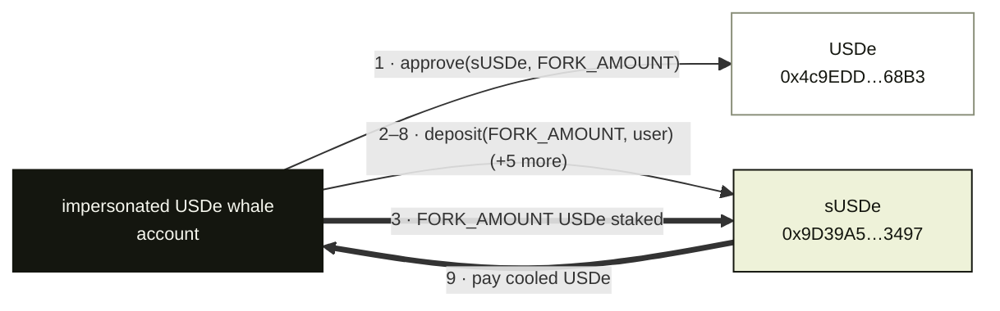

**What this fork proves.** Stakes USDe into sUSDe on a pinned Ethereum fork, reads convertToAssets, starts cooldownShares, warps one cooldownDuration and unstakes, asserting the sUSDe balance delta, the recorded cooldown, and an exact USDe payout: the wallet USDe rises by exactly cooldowns(user).underlyingAmount and the cooldown clears. USDe mint is whitelisted and never called.

Run it:

```bash
CHAIN=ethereum node scripts/startFork.js
ETHEREUM_RPC_URL=http://127.0.0.1:8545 npm run fork:ethena:stake
ETHEREUM_RPC_URL=http://127.0.0.1:8545 npm run fork:ethena:cooldown
ETHEREUM_RPC_URL=http://127.0.0.1:8545 npm run fork:ethena:unstake
```

| Contract | Address | Chain | Role in the flow |
| --- | --- | --- | --- |
| USDe | `0x4c9EDD5852cd905f086C759E8383e09bff1E68B3` | ethereum | token |
| sUSDe (staked USDe vault) | `0x9D39A5DE30e57443BfF2A8307A4256c8797A3497` | ethereum | contract |

> Minting USDe is whitelisted, so it is not tested. The public path is staking USDe into sUSDe and starting the cooldown.

Notes:

- fork:ethena:unstake advances the fork with evm_increaseTime(cooldownDuration + 1) and evm_mine before unstake, so the wait is simulated, not real.
- fork:ethena:cooldown stops after cooldownShares and only reads cooldowns(user); it does not warp or unstake.
- USDe comes from an impersonated whale or anvil_deal via src/utils/impersonate.js; no USDe is minted anywhere in the flow.

**Missing from the anvil suite.**

| Feature | Status | How to close it on a fork | Blocker |
| --- | --- | --- | --- |
| mint / redeem USDe | not-testable | Call EthenaMinting.mint(order, route, signature) with an EIP-712 order signed by a whitelisted minter (benefactor, beneficiary, collateral asset, amount, nonce, expiry), then assert USDe.balanceOf(beneficiary) rose by exactly the order amount and USDe.totalSupply() rose by it; EthenaMinting.redeem(order, signature) is the same order flow in reverse, burning USDe for collateral. | Mint and redeem each take an EIP-712 order signed by a whitelisted Ethena minter, so there is no permissionless mint path to call on a fork; the shipped test stakes USDe instead. |

<a id="flow-steakhouse"></a>

### #13 Steakhouse Financial

Chain: **ethereum** · 1 fork test · `ETHEREUM_RPC_URL` · 2/2 features tested

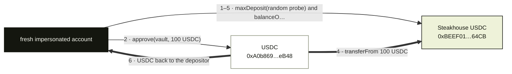

**What this fork proves.** ERC-4626 round trip on the MetaMorpho Steakhouse USDC vault: deposit pulls exactly the configured USDC amount and mints steakUSDC shares, redeem burns every share and returns the USDC within rounding, and the key prints USDC before -> after deposit -> after redeem.

Run it:

```bash
CHAIN=ethereum node scripts/startFork.js
ETHEREUM_RPC_URL=http://127.0.0.1:8545 npm run fork:steakhouse:deposit
```

| Contract | Address | Chain | Role in the flow |
| --- | --- | --- | --- |
| Steakhouse USDC (MetaMorpho V1) | `0xBEEF01735c132Ada46AA9aA4c54623cAA92A64CB` | ethereum | contract |
| USDC (vault asset) | `0xA0b86991c6218b36c1d19D4a2e9Eb0cE3606eB48` | ethereum | token |

> ERC-4626 deposit and redeem on the Ethereum MetaMorpho Steakhouse USDC vault.

Notes:

- The test default is VAULTS.steakhouse.defaultAmount = 100 USDC (vaultFlows.js uses FORK_AMOUNT ·· spec.defaultAmount); the forkFeatures row lists FORK_AMOUNT=1000, which a plain npm run fork:steakhouse:deposit does not set, so it deposits 100.
- maxDeposit is probed with a random address first: a 0 turns the run into a labelled read of totalAssets and convertToAssets with no tx, which is a PASS-shaped read, not a deposit.
- The vault is MetaMorpho V1: allocation to Morpho Blue markets is the curator's job, so the depositor only ever calls the ERC-4626 surface drawn here.
- A revert is a FAIL even when it looks like a gate; only the explicit maxDeposit 0 pre-check downgrades the run to a read.

**Missing from the anvil suite.** None: every feature in the matrix has a fork test.

<a id="flow-ccip"></a>

### #14 CCIP

Chain: **ethereum** · 1 fork test · `ETHEREUM_RPC_URL` · 2/3 features tested

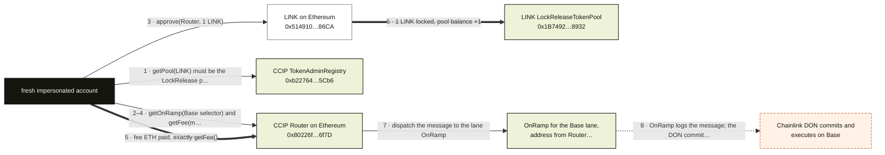

**What this fork proves.** Chainlink CCIP source leg on an Ethereum fork: Router.ccipSend sends 1 LINK to Base, and the test asserts the user's LINK drops and the LINK LockReleaseTokenPool gains exactly 1 LINK, the ETH fee paid equals getFee(), and the lane OnRamp logs the message. The DON commit and execution on Base are off this machine.

Run it:

```bash
CHAIN=ethereum node scripts/startFork.js
ETHEREUM_RPC_URL=http://127.0.0.1:8545 npm run fork:ccip:send
```

| Contract | Address | Chain | Role in the flow |
| --- | --- | --- | --- |
| CCIP Router on Ethereum | `0x80226fc0Ee2b096224EeAc085Bb9a8cba1146f7D` | ethereum | contract |
| CCIP TokenAdminRegistry | `0xb22764f98dD05c789929716D677382Df22C05Cb6` | ethereum | contract |
| LINK LockReleaseTokenPool | `0x1B7492C3bD23A4aDB448710e4275FF14A5288932` | ethereum | contract |
| LINK on Ethereum | `0x514910771AF9Ca656af840dff83E8264EcF986CA` | ethereum | token |

> CCIP Router ccipSend of LINK to Base. LINK uses a LockReleaseTokenPool on Ethereum; the DON commits and executes on Base, which a single Ethereum fork cannot verify. LINK's Ethereum pool does not list Arbitrum (ChainNotAllowed on 2026-10-23).

Notes:

- Only the source leg lands on this fork: user LINK -1, pool LINK +1, fee ETH = getFee() and a receipt log from the lane OnRamp. Base receives nothing here.
- The pool is read from TokenAdminRegistry.getPool(LINK) and must equal the documented LockReleaseTokenPool; a mismatch fails before any tx is sent.
- The OnRamp node carries no address: the flow asks Router.getOnRamp(Base selector) and only checks that the receipt has a log from the returned address.
- Target is Base selector 15971525489660198786; LINK's Ethereum pool does not list Arbitrum, which returned ChainNotAllowed on 2026-10-23.
- anvil_setBalance tops the account to fee + 1 ETH before ccipSend, so the ETH fee is not whale-funded; the LINK comes from impersonateFunded.
- The message is EVMExtraArgsV1 with gasLimit 0 and a token-only transfer to an EOA, so no receiver code runs on Base.

**Missing from the anvil suite.**

| Feature | Status | How to close it on a fork | Blocker |
| --- | --- | --- | --- |
| receive on destination | not-testable | Fork Base at a block after the DON executes the message, read the Base OffRamp's ExecutionStateChanged event for the messageId, then assert the receiver's LINK balance rose by the 1 LINK locked on Ethereum; to exercise receiver code, send the same message with EVMExtraArgsV1 gasLimit > 0 to a contract that implements CCIPReceiver and records the messageId in its ccipReceive handler, then assert that recorded state changed. | The message must first be committed and executed by the Chainlink DON on Base; a single Ethereum fork cannot produce the committed message or run the DON. |

<a id="flow-binance-staked-eth"></a>

### #16 Binance staked ETH

Chain: **ethereum** · 1 fork test · `ETHEREUM_RPC_URL` · 1/2 features tested

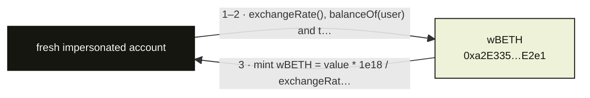

**What this fork proves.** Send 0.1 ETH to wBETH's payable deposit(referral) and assert the minted wBETH equals value * 1e18 / exchangeRate() to within 1 wei and that the contract keeps exactly the 0.1 ETH; redemption runs through a Binance account, so the fork only mints.

Run it:

```bash
CHAIN=ethereum node scripts/startFork.js
ETHEREUM_RPC_URL=http://127.0.0.1:8545 npm run fork:wbeth:deposit
```

| Contract | Address | Chain | Role in the flow |
| --- | --- | --- | --- |
| wBETH | `0xa2E3356610840701BDf5611a53974510Ae27E2e1` | ethereum | contract |

> wBETH mints on Ethereum for anyone who sends ETH to deposit(referral). Redemption runs through a Binance account, so the fork test only mints.

Notes:

- The actor is a brand-new impersonated address that anvil_setBalance funds with 100 ETH; no private key is used.
- The contract's ETH balance is read before and after at the receipt block, so the 0.1 ETH delta cannot be masked by a cached latest read.

**Missing from the anvil suite.**

| Feature | Status | How to close it on a fork | Blocker |
| --- | --- | --- | --- |
| redeem | not-testable | wBETH at 0xa2E3356610840701BDf5611a53974510Ae27E2e1 has a permissionless request half: mint with deposit(referral), then call requestWithdrawEth(wbethAmount) and assert the user's wBETH falls by exactly wbethAmount and the Unwrap contract it burns into records RequestWithdraw with ethAmount = wbethAmount * exchangeRate() / 1e18. The ETH only leaves that queue once the Unwrap operator's ETH is allocated to the request and lockTime passes, when the user's claimWithdraw(index) pays out and the test asserts the receiver's ETH rises by ethAmount. | The request half is permissionless, but the payout is not: the Unwrap contract's operator (a Binance role) must allocate the queued ETH, and claimWithdraw only pays after lockTime, so a single fork run cannot complete the redeem without impersonating Binance's operator. |

<a id="flow-rockawayx"></a>

### #21 RockawayX

Chain: **ethereum** · 1 fork test · `ETHEREUM_RPC_URL` · 2/2 features tested

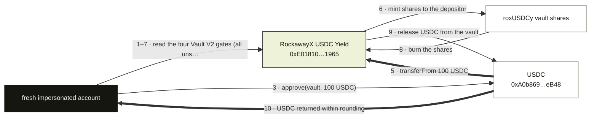

**What this fork proves.** Opens the RockawayX USDC Yield Morpho Vault V2 on a pinned Ethereum fork: reads the four share/asset gates and liquidityAdapter, deposits 100 USDC and exits, asserting the deposit pulled the full amount, shares were minted and burned, and the USDC came back within rounding.

Run it:

```bash
CHAIN=ethereum node scripts/startFork.js
ETHEREUM_RPC_URL=http://127.0.0.1:8545 npm run fork:rockawayx:deposit
```

| Contract | Address | Chain | Role in the flow |
| --- | --- | --- | --- |
| RockawayX USDC Yield (Morpho Vault V2) | `0xE0181090c22579B6A217f1522cbf8c9f1F0C1965` | ethereum | contract |
| USDC | `0xA0b86991c6218b36c1d19D4a2e9Eb0cE3606eB48` | ethereum | token |

> RockawayX USDC Yield is a Morpho Vault V2 on Ethereum. V2 maxDeposit always returns 0, so the test checks that all four gates are unset, then deposits USDC and redeems every share.

Notes:

- Morpho Vault V2 maxDeposit() always returns 0, so the four gate reads replace it; a set gate turns the test into a labelled read with no tx.
- USDC is funded through impersonateFunded (a whale, else anvil_dealERC20) into a fresh account, so the whale leg is setup, not part of the flow.
- Exit is withdraw(amount) when liquidityAdapter() is the zero address and redeem(shares) otherwise; idle-only exits allow interest dust to keep a few shares.

**Missing from the anvil suite.** None: every feature in the matrix has a fork test.

<a id="flow-tornado-cash"></a>

### #22 Tornado Cash

Chain: **ethereum** · 1 fork test · `ETHEREUM_RPC_URL` · 1/2 features tested

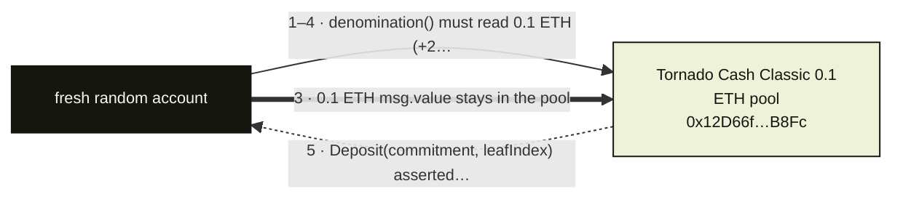

**What this fork proves.** A single Ethereum-fork deposit into the Tornado Cash Classic 0.1 ETH pool: deposit(commitment) payable with exactly denomination() raises the pool's own ETH balance by exactly 0.1 ETH, records commitments[commitment] and emits Deposit(commitment, leafIndex), with the commitment kept below the BN254 scalar field.

Run it:

```bash
CHAIN=ethereum node scripts/startFork.js
ETHEREUM_RPC_URL=http://127.0.0.1:8545 npm run fork:tornado-cash:deposit
```

| Contract | Address | Chain | Role in the flow |
| --- | --- | --- | --- |
| Tornado Cash Classic 0.1 ETH pool | `0x12D66f87A04A9E220743712cE6d9bB1B5616B8Fc` | ethereum | contract |

Notes:

- The pool is called directly; the Tornado Router is only needed to attach a relayer fee and is never touched by this test.
- The commitment is random 32 bytes reduced mod the BN254 scalar field, because the pool Poseidon-hashes the leaf and reverts above the field.
- The fresh random account is funded with anvil_setBalance instead of impersonateFunded, which is built for ERC-20 whales, because the deposit is payable.
- The ETH leg is the pool's own balance rather than a token contract, so no separate token node exists for it.
- deposits have never been paused, so this is the permissionless surface; withdraw is not tested by design and is described in the gaps entry.

**Missing from the anvil suite.**

| Feature | Status | How to close it on a fork | Blocker |
| --- | --- | --- | --- |
| withdraw | not-testable | Keep the secret and nullifier behind a deposited commitment, then call withdraw(proof, root, nullifierHash, recipient, relayer, fee, refund) on the same 0.1 ETH pool with a Groth16 proof from tornado-core's withdraw circuit and assert the recipient's ETH balance rises by exactly 0.1 ETH minus the fee while nullifierHashes[nullifierHash] flips to true. | The deposit test draws a random commitment and discards the secret/nullifier preimage, so no withdrawal proof can be generated against it. |

<a id="flow-polygon-bridge"></a>

### #25 Polygon Bridge

Chain: **ethereum** · 1 fork test · `ETHEREUM_RPC_URL` · 1/2 features tested

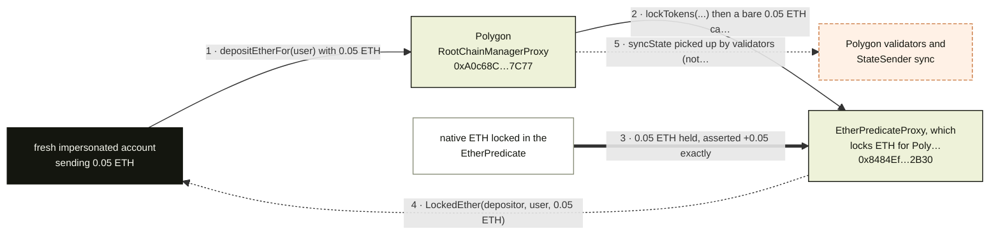

**What this fork proves.** Polygon PoS RootChainManagerProxy.depositEtherFor on a pinned Ethereum fork locks 0.05 ETH in the EtherPredicateProxy; the test asserts the predicate holds exactly the deposit more ETH and emitted LockedEther. The StateSender sync and the token minted on Polygon are off this machine.

Run it:

```bash
CHAIN=ethereum node scripts/startFork.js
ETHEREUM_RPC_URL=http://127.0.0.1:8545 npm run fork:polygon:deposit
```

| Contract | Address | Chain | Role in the flow |
| --- | --- | --- | --- |
| Polygon RootChainManagerProxy | `0xA0c68C638235ee32657e8f720a23ceC1bFc77C77` | ethereum | contract |
| EtherPredicateProxy, which locks ETH for Polygon | `0x8484Ef722627bf18ca5Ae6BcF031c23E6e922B30` | ethereum | contract |

> Polygon PoS RootChainManager.depositEtherFor locks ETH in the EtherPredicate. The StateSender sync is picked up by Polygon validators; this fork does not see the WETH minted on Polygon.

Notes:

- Only the source leg runs: the token minted on Polygon needs the StateSender sync and validators, so no destination balance is asserted.
- The measured delta is the EtherPredicate's ETH balance, not the manager's; the manager forwards the value to the predicate.
- The catalog proxy addresses are called directly; the test never upgrades or inspects the implementations.
- With ETHEREUM_RPC_URL unset requireFork throws and the run FAILs; it is not a skipped test.

**Missing from the anvil suite.**

| Feature | Status | How to close it on a fork | Blocker |
| --- | --- | --- | --- |
| PoS -> L1 exit | not-testable | On a Polygon PoS fork burn the mapped child token with withdraw(amount) (bridged WETH for an ETH deposit), wait for a Heimdall checkpoint that includes the burn block, then on Ethereum call RootChainManagerProxy.exit(inputData) with the RLP exit payload (checkpoint header number, block proof, burn block roots, receipt, receipt proof, branch mask and log index) and assert the recipient's ETH balance rose by the amount. | The exit proof needs a burn on Polygon plus a checkpointed Bor header, and checkpoints come from Heimdall; one Ethereum fork can produce neither. |

<a id="flow-upshift"></a>

### #28 Upshift

Chain: **ethereum** · 1 fork test · `ETHEREUM_RPC_URL` · 2/2 features tested

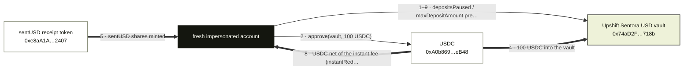

**What this fork proves.** Deposits 100 USDC into Upshift Sentora USD and exits immediately, asserting the deposit pulled the full amount, sentUSD was minted and instantRedeem paid the previewRedemption(shares, true) after-fee amount read before the exit, i.e. the gross minus instantRedemptionFee in basis points, with the gross within 1 bp of the deposit; a closed instant exit falls back to requestRedeem.

Run it:

```bash
CHAIN=ethereum node scripts/startFork.js
ETHEREUM_RPC_URL=http://127.0.0.1:8545 npm run fork:upshift:deposit
```

| Contract | Address | Chain | Role in the flow |
| --- | --- | --- | --- |
| Upshift Sentora USD vault | `0x74aD2F789Ed583DBd141bbdafC673fE1F033718b` | ethereum | contract |
| USDC | `0xA0b86991c6218b36c1d19D4a2e9Eb0cE3606eB48` | ethereum | token |
| sentUSD receipt token | `0xe8aA1A9eC6b9BC455D8f33E4BDC685dedFf82407` | ethereum | token |

> Upshift Sentora USD on Ethereum. Deposit USDC, then instantRedeem. The instant redemption fee (basis points) is taken out of the assets returned. If instant redeem is closed, requestRedeem is asserted instead of a completed withdrawal.

Notes:

- instantRedemptionFee is in basis points and is checked on the gross preview, because the exit share price can sit a fraction of a basis point below the deposit price.
- If depositsPaused or maxDepositAmount is 0 the test degrades to a labelled read of getSharePrice with no tx; if instantRedeem reverts as gated it sends requestRedeem and does not wait out the withdrawal.
- The code default is 100 USDC; the catalog lists FORK_AMOUNT=1000 as the player dial, so 100 is what a plain npm run fork:upshift:deposit executes.

**Missing from the anvil suite.** None: every feature in the matrix has a fork test.

<a id="flow-concrete"></a>

### #31 Concrete

Chain: **ethereum** · 1 fork test · `ETHEREUM_RPC_URL` · 1/2 features tested

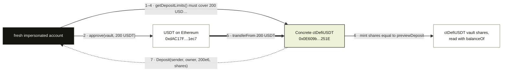

**What this fork proves.** Deposit-only test on an Ethereum fork: 200 USDT into Concrete ctDefiUSDT (Earn V2 async vault) after getDepositLimits() accepts the amount, asserting the vault pulled exactly 200 USDT, the share gain equals the pre-tx previewDeposit, and the Deposit event reports the same assets and shares. Withdrawals are an epoch queue, so nothing is redeemed.

Run it:

```bash
CHAIN=ethereum node scripts/startFork.js
ETHEREUM_RPC_URL=http://127.0.0.1:8545 npm run fork:concrete:deposit
```

| Contract | Address | Chain | Role in the flow |
| --- | --- | --- | --- |
| Concrete ctDefiUSDT (Earn V2 async vault) | `0x0E609b710da5e0AA476224b6c0e5445cCc21251E` | ethereum | contract |
| USDT on Ethereum | `0xdAC17F958D2ee523a2206206994597C13D831ec7` | ethereum | token |

> Concrete Earn V2 vaults are async: deposit is ERC-4626, withdrawal is an epoch queue processed about weekly, so the fork test deposits only. It uses ctDefiUSDT; the largest vault, ctDeltaWeETH, had getDepositLimits() of 0 on 2026-10-23 (deposits revert AssetAmountOutOfBounds).

Notes:

- The recipe default is FORK_AMOUNT=200 USDT (the ctDefiUSDT defaultAmount); an amount outside getDepositLimits() becomes a labelled read with no tx.
- Shares are the vault's own balanceOf: there is no separate receipt token to look up.
- ctDefiUSDT is the vault the test uses; ctDeltaWeETH in the address book had getDepositLimits() of 0 on 2026-10-23 (deposits revert AssetAmountOutOfBounds) and is not touched.
- USDT comes from impersonateFunded (Tether Treasury whale, else anvil_dealERC20); that funding is setup, not part of the flow.
- No redeem edge is drawn: withdrawal is an epoch queue processed about weekly by the operator, so the fork test stops after deposit.

**Missing from the anvil suite.**

| Feature | Status | How to close it on a fork | Blocker |
| --- | --- | --- | --- |
| vault withdraw | not-testable | After the deposit, call ctDefiUSDT.redeem(shares, user, user) or withdraw(200e6, user, user) and assert the 200 USDT lands back in the wallet; it only pays out at a block after the operator has processed the epoch queue. | Concrete processes the epoch withdrawal queue off-chain about weekly, so a same-block redeem on a fork cannot pay out. |

<a id="flow-robinhood-chain-bridge"></a>

### #34 Robinhood Chain Bridge

Chain: **ethereum** · 1 fork test · `ETHEREUM_RPC_URL` · 1/2 features tested

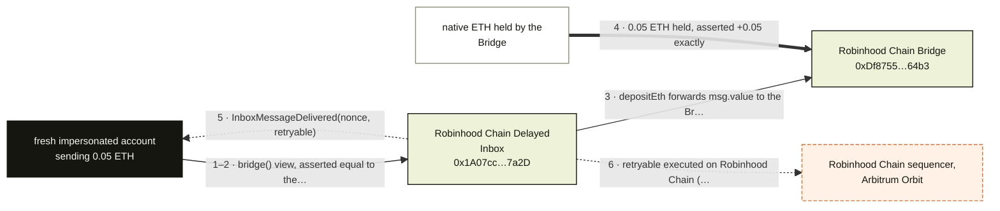

**What this fork proves.** Calls Robinhood Chain's Delayed Inbox depositEth with 0.05 ETH on a pinned Ethereum fork: the test first asserts Inbox.bridge() is the documented Bridge, then that the Bridge holds exactly 0.05 ETH more and InboxMessageDelivered was emitted for the retryable. The retryable's L2 execution needs the chain's sequencer.

Run it:

```bash
CHAIN=ethereum node scripts/startFork.js
ETHEREUM_RPC_URL=http://127.0.0.1:8545 npm run fork:robinhood:deposit
```

| Contract | Address | Chain | Role in the flow |
| --- | --- | --- | --- |
| Robinhood Chain Delayed Inbox | `0x1A07cc4BD17E0118BdB54D70990D2158AbAD7a2D` | ethereum | contract |
| Robinhood Chain Bridge (the Inbox.bridge() answer) | `0xDf8755334ce7A73cCF6b581C02eA649AE3E864b3` | ethereum | contract |

> Robinhood Chain is an Arbitrum Orbit chain. Delayed Inbox depositEth locks ETH in the Bridge and emits InboxMessageDelivered for the retryable. The L2 credit needs the chain's sequencer; this fork does not see it.

Notes:

- The Inbox must report the documented Bridge; any other answer fails the run before a tx is sent.
- ETH is measured on the Bridge, not the Inbox: the Inbox forwards msg.value, so the delta is read on the Bridge.
- Source chain only: the retryable is never executed on Robinhood Chain, so no L2 balance is asserted.
- InboxMessageDelivered's nonce is decoded from the indexed topic for the report, not asserted as a delta.

**Missing from the anvil suite.**

| Feature | Status | How to close it on a fork | Blocker |
| --- | --- | --- | --- |
| L2 -> L1 withdraw | not-testable | On a Robinhood Chain (Arbitrum Orbit) fork call ArbSys(0x64).withdrawEth(destination) with the amount as msg.value, let the rollup post the L2-to-L1 batch, then on the Ethereum fork call Outbox.executeTransaction(proof, index, l2Sender, to, l2Block, l1Block, l2Timestamp, value, data) with the proof from NodeInterface.constructOutboxProof and assert the recipient's ETH rose by the withdrawn amount. | Needs the Orbit L2 fork, a posted L2 to L1 batch and a valid Outbox proof after the confirmation window. |

<a id="flow-hyperithm"></a>

### #35 Hyperithm

Chain: **ethereum** · 1 fork test · `ETHEREUM_RPC_URL` · 2/2 features tested

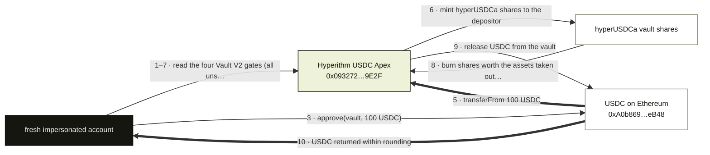

**What this fork proves.** Morpho Vault V2 round trip on an Ethereum fork: the test reads Hyperithm USDC Apex's four share/asset gates (all unset), deposits 100 USDC and exits, asserting the deposit pulled the full 100 USDC, shares were minted, the exit burned every share (or withdrew exactly the deposit when liquidityAdapter() is the zero address, leaving at most interest-dust shares), and the USDC came back within rounding.

Run it:

```bash
CHAIN=ethereum node scripts/startFork.js
ETHEREUM_RPC_URL=http://127.0.0.1:8545 npm run fork:hyperithm:deposit
```

| Contract | Address | Chain | Role in the flow |
| --- | --- | --- | --- |
| Hyperithm USDC Apex (Morpho Vault V2) | `0x093272C07700d3cA5301C3Bf9B3A392624179E2F` | ethereum | contract |
| USDC on Ethereum | `0xA0b86991c6218b36c1d19D4a2e9Eb0cE3606eB48` | ethereum | token |

> Hyperithm USDC Apex (Morpho Vault V2) on Ethereum. Most of the row's TVL is the Monad vault of the same name, listed for verification; the Ethereum vault runs the same V2 code.

Notes:

- Morpho Vault V2 maxDeposit() always returns 0, so the four gate reads replace it; a set gate turns the run into a labelled read with no tx.
- hyperUSDCa was idle-only when the code comment was written, and redeeming every share once interest accrued reverted TransferReverted, so the exit takes withdraw(amount) and can leave interest-dust shares.
- Most of the Hyperithm row's TVL is the Monad vault of the same name, listed in the catalog for verification; this fork runs only the Ethereum vault.
- USDC comes from impersonateFunded (Circle whale, else anvil_dealERC20); that funding is setup, not part of the flow.
- A revert is a FAIL even when it looks like a gate; only the explicit gate read downgrades the run to a labelled read.

**Missing from the anvil suite.** None: every feature in the matrix has a fork test.

<a id="flow-lighter-bridge"></a>

### #37 Lighter Bridge

Chain: **ethereum** · 1 fork test · `ETHEREUM_RPC_URL` · 1/2 features tested

```mermaid
%%{init: {"flowchart": {"curve": "basis", "nodeSpacing": 34, "rankSpacing": 52}, "themeVariables": {"fontSize": "11px"}}}%%
flowchart LR
  user["fresh impersonated account"]
  whale["impersonated USDC whale<br/>(Circle account)<br/>0x55FE00…44B8"]
  usdc["USDC<br/>0xA0b869…eB48"]
  lighter["Lighter<br/>0x3B4D79…5ca7"]
  rollup["Lighter zk-rollup"]
  whale ==>|"1 · transfer(20 USDC plus dust) funds the f…"| user
  user -->|"2–3 · balanceOf(user) and balanceOf(Lighter…"| usdc
  user -->|"4 · deposit(user, assetIndex 3, route 0, 20…"| lighter
  lighter -->|"5 · transferFrom(user, Lighter, 20 USDC)"| usdc
  usdc ==>|"6 · 20 USDC moved into the bridge"| lighter
  lighter -.->|"7 · deposit queued for the rollup to credit"| rollup
  classDef actor fill:#14160f,stroke:#14160f,color:#f7f8ef
  classDef contract fill:#eef2d9,stroke:#14160f,color:#14160f
  classDef token fill:#ffffff,stroke:#8a8f7a,color:#14160f
  classDef external fill:#f4f4ee,stroke:#b9beac,color:#14160f
  classDef offchain fill:#fff1e6,stroke:#c9743a,color:#14160f,stroke-dasharray:4 2
  class user,whale actor
  class lighter contract
  class usdc token
  class rollup offchain
```

**What this fork proves.** Deposit 20 USDC into Lighter's Ethereum contract with asset index 3 on the perps route, and assert the user's USDC falls by exactly 20 while the contract's USDC rises by 20 and it logs the deposit; crediting on the Lighter zk-rollup is off this machine.

Run it:

```bash
CHAIN=ethereum node scripts/startFork.js
ETHEREUM_RPC_URL=http://127.0.0.1:8545 npm run fork:lighter-bridge:deposit
```

| Contract | Address | Chain | Role in the flow |
| --- | --- | --- | --- |
| impersonated USDC whale (Circle account) | `0x55FE002aefF02F77364de339a1292923A15844B8` | ethereum | actor |
| USDC | `0xA0b86991c6218b36c1d19D4a2e9Eb0cE3606eB48` | ethereum | token |
| Lighter (ZkLighter proxy) | `0x3B4D794a66304F130a4Db8F2551B0070dfCf5ca7` | ethereum | contract |

> Lighter's Ethereum contract takes a direct USDC deposit (asset index 3, perps route) and queues it for the Lighter zk rollup. Crediting the Lighter account happens off this machine.

Notes:

- impersonateFunded moves the USDC from the impersonated Circle whale to a brand-new account, so the deposit is sent by a fresh address, not by the whale.
- The deposit is read back at the receipt block: the contract's USDC delta and a log emitted by the Lighter address are the two assertions besides the user's balance.

**Missing from the anvil suite.**

| Feature | Status | How to close it on a fork | Blocker |
| --- | --- | --- | --- |
| withdraw | not-testable | On the same fork, call Lighter's withdraw(accountIndex, 3, 0, amount) at 0x3B4D794a66304F130a4Db8F2551B0070dfCf5ca7 (selector 0xd20191bd; it takes no signature - the master account is resolved from msg.sender and the call only queues a Core priority request), then call withdrawPendingBalance(user, 3, amount) once the rollup has queued the exit, and assert USDC.balanceOf(user) rises by exactly the amount while the contract's USDC falls by it. | withdraw only queues a priority request for the Lighter Core rollup: the USDC is released once Core processes the withdrawal and records a pending balance, and withdrawPendingBalance can only claim that balance. A single Ethereum Anvil fork has neither the Core state nor the queue processing. |

<a id="flow-gauntlet"></a>

### #38 Gauntlet

Chain: **ethereum** · 1 fork test · `ETHEREUM_RPC_URL` · 2/2 features tested

```mermaid
%%{init: {"flowchart": {"curve": "basis", "nodeSpacing": 34, "rankSpacing": 52}, "themeVariables": {"fontSize": "11px"}}}%%
flowchart LR
  user["fresh impersonated account"]
  vault["Gauntlet USDC Prime<br/>0xdd0f28…490d"]
  usdc["USDC<br/>0xA0b869…eB48"]
  user -->|"1–5 · maxDeposit(random probe) and balanceO…"| vault
  user -->|"2 · approve(vault, 100 USDC)"| usdc
  usdc ==>|"4 · transferFrom 100 USDC"| vault
  usdc ==>|"6 · USDC back to the depositor"| user
  classDef actor fill:#14160f,stroke:#14160f,color:#f7f8ef
  classDef contract fill:#eef2d9,stroke:#14160f,color:#14160f
  classDef token fill:#ffffff,stroke:#8a8f7a,color:#14160f
  classDef external fill:#f4f4ee,stroke:#b9beac,color:#14160f
  classDef offchain fill:#fff1e6,stroke:#c9743a,color:#14160f,stroke-dasharray:4 2
  class user actor
  class vault contract
  class usdc token
```

**What this fork proves.** ERC-4626 round trip on the MetaMorpho Gauntlet USDC Prime vault (V1): deposit pulls the configured USDC amount and mints gtUSDC, redeem burns every share and returns the USDC within rounding, and a maxDeposit of 0 would downgrade the run to a labelled read with no tx.

Run it:

```bash
CHAIN=ethereum node scripts/startFork.js
ETHEREUM_RPC_URL=http://127.0.0.1:8545 npm run fork:gauntlet:deposit
```

| Contract | Address | Chain | Role in the flow |
| --- | --- | --- | --- |
| Gauntlet USDC Prime (MetaMorpho V1) | `0xdd0f28e19C1780eb6396170735D45153D261490d` | ethereum | contract |
| USDC (vault asset) | `0xA0b86991c6218b36c1d19D4a2e9Eb0cE3606eB48` | ethereum | token |

> ERC-4626 deposit and redeem on MetaMorpho Gauntlet USDC Prime. Gauntlet USDC Prime V2 maxDeposit is 0, so it is not the vault under test.

Notes:

- The recipe targets Gauntlet USDC Prime V1 at the address above; the recipe note records that V2 returns maxDeposit 0, so V2 is not the vault under test.
- The test default is VAULTS.gauntlet.defaultAmount = 100 USDC (vaultFlows.js uses FORK_AMOUNT ·· spec.defaultAmount); the forkFeatures row lists FORK_AMOUNT=1000, which a plain npm run fork:gauntlet:deposit does not set, so it deposits 100.
- maxDeposit is probed with a random address first: a 0 turns the run into a labelled read of totalAssets and convertToAssets with no tx.
- The vault is MetaMorpho V1: allocation to Morpho Blue markets is the curator's job, so the depositor only touches the ERC-4626 surface drawn here.

**Missing from the anvil suite.** None: every feature in the matrix has a fork test.

<a id="flow-aera"></a>

### #43 Aera

Chain: **base** · 1 fork test · `BASE_RPC_URL` · 1/2 features tested

```mermaid
%%{init: {"flowchart": {"curve": "basis", "nodeSpacing": 34, "rankSpacing": 52}, "themeVariables": {"fontSize": "11px"}}}%%
flowchart LR
  user["fresh impersonated account"]
  vault["gtUSDa MultiDepositorVault<br/>0x000000…40D5"]
  provisioner["gtUSDa ProvisionerV2<br/>0x128Afd…f731"]
  calculator["PriceAndFeeCalculator<br/>0xa90fd5…30db"]
  usdc["USDC on Base<br/>0x833589…2913"]
  solver["Aera solver, fills the<br/>request off this machi…"]
  user -->|"1–13 · provisioner() and feeCalculator() wi…"| vault
  user -->|"2–10 · tokensDetails(USDC): asyncDepositEna…"| provisioner
  user -->|"3–5 · isVaultPaused(gtUSDa) must be false (…"| calculator
  user -->|"4 · approve(ProvisionerV2, 100 USDC)"| usdc
  usdc ==>|"7 · transferFrom 100 USDC"| provisioner
  provisioner -.->|"9 · fill by Aera's solver, never executed h…"| solver
  provisioner -->|"11 · release the 100 USDC"| usdc
  usdc ==>|"12 · 100 USDC back, request hash cleared"| user
  classDef actor fill:#14160f,stroke:#14160f,color:#f7f8ef
  classDef contract fill:#eef2d9,stroke:#14160f,color:#14160f
  classDef token fill:#ffffff,stroke:#8a8f7a,color:#14160f
  classDef external fill:#f4f4ee,stroke:#b9beac,color:#14160f
  classDef offchain fill:#fff1e6,stroke:#c9743a,color:#14160f,stroke-dasharray:4 2
  class user actor
  class vault,provisioner,calculator contract
  class usdc token
  class solver offchain
```

**What this fork proves.** On a Base fork 100 USDC becomes an async requestDeposit on gtUSDa's ProvisionerV2 and, after the 1-hour deadline, refundRequest returns exactly 100 USDC: the Provisioner's USDC rises by the amount, the request hash is stored then cleared, and the user holds no gtUSDa units.

Run it:

```bash
CHAIN=base node scripts/startFork.js
BASE_RPC_URL=http://127.0.0.1:8545 npm run fork:aera:request
```

| Contract | Address | Chain | Role in the flow |
| --- | --- | --- | --- |
| gtUSDa MultiDepositorVault | `0x000000000001CdB57E58Fa75Fe420a0f4D6640D5` | base | contract |
| gtUSDa ProvisionerV2 | `0x128Afda4351deCE9d51Eb9d7e9C687C58cfff731` | base | contract |
| PriceAndFeeCalculator | `0xa90fd5C2020DBf19c6c29609dF85F7e4DBAC30db` | base | contract |
| USDC on Base | `0x833589fCD6eDb6E08f4c7C32D4f71b54bdA02913` | base | token |

> Aera V3 gtUSDa (Gauntlet USD Alpha) on Base, the multi-depositor vault Aera's integration guide documents. Entry is an async requestDeposit to the ProvisionerV2 that Aera's solver fills (usually within 6 hours); the test files one and, after its deadline, refunds it with refundRequest. Aera's Ethereum vaults and single-depositor vaults (treasury mandates) are not exercised.

Notes:

- The test stops at the refund on purpose: nothing on a Base fork fills the request, so no gtUSDa units are ever minted and the assertion is unitsHeld == 0.
- USDC is funded through impersonateFunded (a configured Base USDC whale, else anvil_dealERC20) into a fresh account; the funding leg is setup, not part of the flow.
- The vault and calculator addresses are the AERA spec in contracts.js and are re-read from gtUSDa.provisioner() and gtUSDa.feeCalculator() before any tx.
- minUnitsOut is 97% of convertTokenToUnits, the dial the integration guide uses; a price move wider than 3% before the fill is what that floor protects against.

**Missing from the anvil suite.**

| Feature | Status | How to close it on a fork | Blocker |
| --- | --- | --- | --- |
| solver fill / withdraw | not-testable | Take the request struct the test already builds (requestType 0, user, receiver, units, tokens, solverTip 0, deadline, maxPriceAge) and call the ProvisionerV2's solver-facing fill entry at 0x128Afda4351deCE9d51Eb9d7e9C687C58cfff731 before the deadline, then assert gtUSDa.balanceOf(receiver) rises by at least units and asyncRequestHashes(getRequestHash(USDC, request)) becomes false; the fill selector and the solver role are not in the repo ABI, so read them from the deployed implementation. | The fill is sent by Aera's solver, a role granted off-chain, and it must land before the request deadline, which the test has already warped past when it refunds. |

<a id="flow-cbeth"></a>

### #46 Coinbase Wrapped Staked ETH

Chain: **ethereum** · 1 fork test · `ETHEREUM_RPC_URL` · 1/2 features tested

```mermaid
%%{init: {"flowchart": {"curve": "basis", "nodeSpacing": 34, "rankSpacing": 52}, "themeVariables": {"fontSize": "11px"}}}%%
flowchart LR
  user["read-only reader (no<br/>account impersonated"]
  cbeth["cbETH token<br/>0xBe9895…9704"]
  coinbase["Coinbase custody"]
  user -->|"1–2 · exchangeRate() (+1 more)"| cbeth
  coinbase -.->|"3 · mint / redeem by Coinbase custody (off-…"| cbeth
  classDef actor fill:#14160f,stroke:#14160f,color:#f7f8ef
  classDef contract fill:#eef2d9,stroke:#14160f,color:#14160f
  classDef token fill:#ffffff,stroke:#8a8f7a,color:#14160f
  classDef external fill:#f4f4ee,stroke:#b9beac,color:#14160f
  classDef offchain fill:#fff1e6,stroke:#c9743a,color:#14160f,stroke-dasharray:4 2
  class user actor
  class cbeth token
  class coinbase offchain
```

**What this fork proves.** A pinned mainnet fork reads cbETH.exchangeRate() and asserts the raw rate is above 1e18, i.e. above 1 ETH per cbETH. No transaction is sent: cbETH has no public mint, so there is no balance delta to measure.

Run it:

```bash
CHAIN=ethereum node scripts/startFork.js
ETHEREUM_RPC_URL=http://127.0.0.1:8545 npm run fork:cbeth:rate
```

| Contract | Address | Chain | Role in the flow |
| --- | --- | --- | --- |
| cbETH token | `0xBe9895146f7AF43049ca1c1AE358B0541Ea49704` | ethereum | token |

> cbETH is minted by Coinbase. There is no public mint, so the fork script only reads exchangeRate().

Notes:

- Read-only: the test sends no transaction and impersonates nobody, so the rate is the only measured value.
- The recipe note says the same thing: cbETH is minted by Coinbase and the script only reads exchangeRate().

**Missing from the anvil suite.**

| Feature | Status | How to close it on a fork | Blocker |
| --- | --- | --- | --- |
| mint / redeem cbETH | not-testable | There is no public mint or redeem call to make: the only on-fork assertion is exchangeRate() > 1e18, falling back to getExchangeRate() when it reverts. A balance delta would need Coinbase custody to move cbETH to the impersonated account; a plain ERC-20 transfer would only prove balanceOf(user) rises, not that a mint ran. | Coinbase-only minter: cbETH is issued and redeemed through Coinbase custody, not by a permissionless on-chain function. |

<a id="flow-etherfi-borrowing-market"></a>

### #48 EtherFi Borrowing Market

Chain: **optimism** · 1 fork test · `OPTIMISM_RPC_URL` · 1/2 features tested

```mermaid
%%{init: {"flowchart": {"curve": "basis", "nodeSpacing": 34, "rankSpacing": 52}, "themeVariables": {"fontSize": "11px"}}}%%
flowchart LR
  user["fresh impersonated account"]
  usdc["native USDC on OP Mainnet,<br/>reserve 0<br/>0x0b2C63…Ff85"]
  spoke["ether.fi Cash Spoke, Aave<br/>V4<br/>0xdffcC3…5308"]
  hub["ether.fi Cash Liquidity<br/>Hub, Aave V4<br/>0x66753c…C572"]
  user -->|"1–6 · getReserve(0) and getReserveConfig(0)…"| spoke
  user -->|"2 · approve(Spoke, 100 USDC)"| usdc
  usdc ==>|"4 · exactly 100 USDC moved into the Liquidi…"| hub
  hub ==>|"7 · supplied assets plus up to 1 bp interes…"| user
  classDef actor fill:#14160f,stroke:#14160f,color:#f7f8ef
  classDef contract fill:#eef2d9,stroke:#14160f,color:#14160f
  classDef token fill:#ffffff,stroke:#8a8f7a,color:#14160f
  classDef external fill:#f4f4ee,stroke:#b9beac,color:#14160f
  classDef offchain fill:#fff1e6,stroke:#c9743a,color:#14160f,stroke-dasharray:4 2
  class user actor
  class spoke,hub contract
  class usdc token
```

**What this fork proves.** ether.fi Cash on OP Mainnet: approve and Spoke supply(0, 100 USDC, user) moves exactly 100 USDC into the Liquidity Hub and mints supply shares worth the amount within 1 wei; withdraw(0, MaxUint256, user) returns the supplied assets from the Hub (interest can add at most 1 bp) and leaves 0 shares.

Run it:

```bash
CHAIN=optimism node scripts/startFork.js
OPTIMISM_RPC_URL=http://127.0.0.1:8545 npm run fork:etherfi-cash:supply
```

| Contract | Address | Chain | Role in the flow |
| --- | --- | --- | --- |
| native USDC on OP Mainnet, reserve 0 | `0x0b2C639c533813f4Aa9D7837CAf62653d097Ff85` | optimism | token |
| ether.fi Cash Spoke, Aave V4 | `0xdffcC3536D932eb51Df51a7F5FA407c4270d5308` | optimism | contract |
| ether.fi Cash Liquidity Hub, Aave V4 | `0x66753c4e3fC84f1eD0e3C267C927284E9d90C572` | optimism | contract |

> ether.fi Cash lending is an ether.fi-managed Aave V4 instance on OP Mainnet (one Liquidity Hub, one Spoke). Borrowing is permissioned to ether.fi Safes, but anyone can supply, so the test supplies USDC and withdraws it. The Cash Liquid row is the collateral users hold in their ether.fi Safes on the same market; the Safes themselves are created by ether.fi for account holders and are not exercised here.

Notes:

- The Spoke is pre-checked against the catalog: getReserve(0).underlying must be native USDC and .hub the documented Liquidity Hub, and a paused or frozen reserve turns the run into a labelled read with no tx.
- withdraw uses MaxUint256 rather than the supplied amount read a block earlier; withdrawing the stale amount left a share behind once interest accrued.
- Borrowing is the only not-testable feature on this row and is not called; the Cash Liquid row reuses the same supply script and the same Hub and Spoke.
- The Hub holds the USDC and the Spoke holds the accounting, so the deposit transfer lands on the Hub even though the user approves and calls the Spoke.

**Missing from the anvil suite.**

| Feature | Status | How to close it on a fork | Blocker |
| --- | --- | --- | --- |
| borrow | not-testable | With an ether.fi UserSafe funded with USDC, call Spoke.supply(0, amount, safe) to post collateral, then call the Spoke's borrow entry point for reserve 0 with onBehalfOf = the safe and assert the Liquidity Hub's USDC falls by the borrowed amount while the safe's USDC rises by it and the Spoke's per-user debt read for the safe is non-zero; the same borrow from a plain impersonated EOA must revert. Only supply/withdraw are pinned in etherfiCashFlow.js as (reserveId, amount, onBehalfOf), so the borrow selector must be read from the deployed Spoke. | Borrowing on this market is limited to ether.fi Safes created for Cash card accounts and owner-signed, so a fork has no Safe to borrow from without ether.fi's account provisioning. |

<a id="flow-pancakeswap"></a>

### #50 PancakeSwap (DEX)

Chain: **ethereum** · 5 fork tests · `ETHEREUM_RPC_URL` · 5/5 features tested

```mermaid
%%{init: {"flowchart": {"curve": "basis", "nodeSpacing": 34, "rankSpacing": 52}, "themeVariables": {"fontSize": "11px"}}}%%
flowchart LR
  user["fresh account"]
  quoter["PancakeSwap V3 Quoter<br/>0xB048Bb…5997"]
  v3router["PancakeSwap V3 SwapRouter<br/>0x1b81D6…eB14"]
  weth["WETH on Ethereum<br/>0xC02aaA…6Cc2"]
  usdc["USDC on Ethereum<br/>0xA0b869…eB48"]
  v2router["PancakeSwap V2 Router on<br/>BSC<br/>0x10ED43…024E"]
  wbnb["WBNB on BSC<br/>0xbb4CdB…095c"]
  usdt["USDT on BSC<br/>0x55d398…7955"]
  npm["PancakeSwap V3<br/>NonfungiblePositionManager<br/>0x46A15B…4364"]
  factory["PancakeSwap V3 Factory<br/>0x0BFbCF…1865"]
  masterchef["PancakeSwap MasterChef V3<br/>0x556B93…d59e"]
  user -->|"1 · quoteExactInputSingle(0.05 WETH, 100/50…"| quoter
  user -->|"2 · approve(V3 router, 0.05 WETH)"| weth
  user -->|"3–23 · exactInputSingle(WETH, USDC, 0.05) (…"| v3router
  usdc ==>|"4 · USDC out, asserted to increase"| user
  user -->|"5–7 · getAmountsOut then swapExactETHForTok…"| v2router
  usdt ==>|"6 · USDT out, asserted at or above the quote"| user
  user -->|"8–22 · deposit() wraps 2 BNB (+2 more)"| wbnb
  user -->|"9 · getPool(WBNB, USDT, 500), then slot0()…"| factory
  user -->|"11 · approve(npm, max)"| usdt
  user -->|"12–21 · mint(WBNB/USDT 0.05% band, 20 spaci…"| npm
  wbnb ==>|"13 · WBNB leg deposited"| npm
  usdt ==>|"14 · USDT leg deposited"| npm
  npm ==>|"16 · both legs returned, 99.9% of mint"| user
  user -->|"17–24 · v3PoolAddressPid(pool) then poolInf…"| masterchef
  npm ==>|"19 · position NFT custody moves"| masterchef
  classDef actor fill:#14160f,stroke:#14160f,color:#f7f8ef
  classDef contract fill:#eef2d9,stroke:#14160f,color:#14160f
  classDef token fill:#ffffff,stroke:#8a8f7a,color:#14160f
  classDef external fill:#f4f4ee,stroke:#b9beac,color:#14160f
  classDef offchain fill:#fff1e6,stroke:#c9743a,color:#14160f,stroke-dasharray:4 2
  class user actor
  class v3router,v2router,npm,masterchef contract
  class weth,usdc,wbnb,usdt token
  class quoter,factory external
```

**What this fork proves.** Five PancakeSwap tests: a V3 WETH to USDC exactInputSingle on Ethereum (USDC rises), a BSC V2 swapExactETHForTokens (USDT at or above getAmountsOut), a V3 USDT/WBNB mint (NFT owned, liquidity = IncreaseLiquidity event, both legs used), decreaseLiquidity plus collect (liquidity 0, both legs back at 99.9%), and a MasterChef V3 stake (custody moves, userPositionInfos has user/pid/liquidity, pendingCake positive).

Run it:

```bash
CHAIN=ethereum node scripts/startFork.js
CHAIN=bsc node scripts/startFork.js
ETHEREUM_RPC_URL=http://127.0.0.1:8545 npm run fork:pancakeswap:v3
BSC_RPC_URL=http://127.0.0.1:8545 npm run fork:pancakeswap:v2-swap
BSC_RPC_URL=http://127.0.0.1:8545 npm run fork:pancakeswap:v3-mint
BSC_RPC_URL=http://127.0.0.1:8545 npm run fork:pancakeswap:v3-remove
BSC_RPC_URL=http://127.0.0.1:8545 npm run fork:pancakeswap:farm
```

| Contract | Address | Chain | Role in the flow |
| --- | --- | --- | --- |
| PancakeSwap V3 Quoter | `0xB048Bbc1Ee6b733FFfCFb9e9CeF7375518e25997` | ethereum | external |
| PancakeSwap V3 SwapRouter | `0x1b81D678ffb9C0263b24A97847620C99d213eB14` | ethereum | contract |
| WETH on Ethereum | `0xC02aaA39b223FE8D0A0e5C4F27eAD9083C756Cc2` | ethereum | token |
| USDC on Ethereum | `0xA0b86991c6218b36c1d19D4a2e9Eb0cE3606eB48` | ethereum | token |
| PancakeSwap V2 Router on BSC | `0x10ED43C718714eb63d5aA57B78B54704E256024E` | ethereum | contract |
| WBNB on BSC | `0xbb4CdB9CBd36B01bD1cBaEBF2De08d9173bc095c` | ethereum | token |
| USDT on BSC | `0x55d398326f99059fF775485246999027B3197955` | ethereum | token |
| PancakeSwap V3 NonfungiblePositionManager | `0x46A15B0b27311cedF172AB29E4f4766fbE7F4364` | ethereum | contract |
| PancakeSwap V3 Factory | `0x0BFbCF9fa4f9C56B0F40a671Ad40E0805A091865` | ethereum | external |
| PancakeSwap MasterChef V3 | `0x556B9306565093C855AEA9AE92A594704c2Cd59e` | ethereum | contract |

> PancakeSwap V3 on Ethereum (same router addresses as BSC). Set CHAIN=bsc to run it on BSC instead.

Notes:

- Every BSC flow starts from a fresh random account with anvil_setBalance, so no whale is needed; the V2 leg is bought on PancakeSwap's own router.
- The V3 router is the same CREATE2 deployment on Ethereum and BSC (so are the factory and NPM, which only the BSC LP flows call); CHAIN=bsc runs that swap script on BSC instead.
- MasterChef only books CAKE growth when the V3 pool is touched, hence the extra 0.01 WBNB swap and the one-hour evm_increaseTime before pendingCake is read.
- The four V3/NPM/farm assertions are on the NFT owner, liquidity against the IncreaseLiquidity event, collected amounts and pendingCake, not on a token balance alone.

**Missing from the anvil suite.** None: every feature in the matrix has a fork test.

<a id="flow-clearstar"></a>

### #51 Clearstar

Chain: **base** · 1 fork test · `BASE_RPC_URL` · 2/2 features tested

```mermaid
%%{init: {"flowchart": {"curve": "basis", "nodeSpacing": 34, "rankSpacing": 52}, "themeVariables": {"fontSize": "11px"}}}%%
flowchart LR
  user["fresh impersonated account"]
  vault["Clearstar cbAssets Vault<br/>0x91C056…3a3c"]
  usdc["USDC on Base<br/>0x833589…2913"]
  shares["CSCBUSDC vault shares"]
  user -->|"1–7 · read the four Vault V2 gates (all uns…"| vault
  user -->|"3 · approve(vault, 100 USDC)"| usdc
  usdc ==>|"5 · transferFrom 100 USDC"| vault
  vault -->|"6 · mint CSCBUSDC shares to the depositor"| shares
  shares -->|"8 · burn shares worth the assets taken out…"| vault
  vault -->|"9 · release USDC from the vault"| usdc
  usdc ==>|"10 · USDC returned within rounding"| user
  classDef actor fill:#14160f,stroke:#14160f,color:#f7f8ef
  classDef contract fill:#eef2d9,stroke:#14160f,color:#14160f
  classDef token fill:#ffffff,stroke:#8a8f7a,color:#14160f
  classDef external fill:#f4f4ee,stroke:#b9beac,color:#14160f
  classDef offchain fill:#fff1e6,stroke:#c9743a,color:#14160f,stroke-dasharray:4 2
  class user actor
  class vault contract
  class usdc,shares token
```

**What this fork proves.** Morpho Vault V2 round trip on a Base fork: the test reads Clearstar cbAssets' four share/asset gates (all unset), deposits 100 USDC and exits, asserting the deposit pulled the full 100 USDC, shares were minted, the exit burned every share (or withdrew exactly the deposit when liquidityAdapter() is the zero address, leaving at most interest-dust shares), and the USDC came back within rounding.

Run it:

```bash
CHAIN=base node scripts/startFork.js
BASE_RPC_URL=http://127.0.0.1:8545 npm run fork:clearstar:deposit
```

| Contract | Address | Chain | Role in the flow |
| --- | --- | --- | --- |
| Clearstar cbAssets Vault (USDC, Morpho Vault V2) | `0x91C056B6d4311a743614FBc03ac32d4E6A2d3a3c` | base | contract |
| USDC on Base | `0x833589fCD6eDb6E08f4c7C32D4f71b54bdA02913` | base | token |

> Clearstar cbAssets Vault (Morpho Vault V2) on Base, Clearstar's largest vault. V2 maxDeposit is 0 by design, so the pre-check is that all four gates are unset.

Notes:

- Morpho Vault V2 maxDeposit() always returns 0, so the four gate reads replace it; a set gate turns the run into a labelled read with no tx.
- Exit is withdraw(amount) when liquidityAdapter() is the zero address and redeem(shares) otherwise, so an idle-only vault can keep a few interest-dust shares.
- USDC comes from impersonateFunded on Base (whale, else anvil_dealERC20); that funding is setup, not part of the flow.
- The recipe names this the largest Clearstar vault; the Ethereum Clearstar USDC Core in the address book is not touched by this Base test.
- A revert is a FAIL even when it looks like a gate; only the explicit gate read downgrades the run to a labelled read.

**Missing from the anvil suite.** None: every feature in the matrix has a fork test.

<a id="flow-fluid-lite"></a>

### #52 Fluid Lite

Chain: **ethereum** · 1 fork test · `ETHEREUM_RPC_URL` · 2/2 features tested

```mermaid
%%{init: {"flowchart": {"curve": "basis", "nodeSpacing": 34, "rankSpacing": 52}, "themeVariables": {"fontSize": "11px"}}}%%
flowchart LR
  user["fresh impersonated account"]
  steth["stETH, the vault asset<br/>0xae7ab9…fE84"]
  vault["Fluid Lite iETHv2 stETH<br/>vault<br/>0xA0D370…Be78"]
  user -->|"1–6 · maxDeposit(random probe) pre-check (+…"| vault
  user -->|"2 · approve(iETHv2, 1 stETH)"| steth
  steth ==>|"5 · 1 stETH pulled, 1-2 wei rounding allowed"| vault
  vault ==>|"7 · previewRedeem(shares) minus the 500 ppm…"| user
  classDef actor fill:#14160f,stroke:#14160f,color:#f7f8ef
  classDef contract fill:#eef2d9,stroke:#14160f,color:#14160f
  classDef token fill:#ffffff,stroke:#8a8f7a,color:#14160f
  classDef external fill:#f4f4ee,stroke:#b9beac,color:#14160f
  classDef offchain fill:#fff1e6,stroke:#c9743a,color:#14160f,stroke-dasharray:4 2
  class user actor
  class vault contract
  class steth token
```

**What this fork proves.** Fluid Lite iETHv2 on Ethereum: approve stETH and deposit(1 stETH, user) pulls 1 stETH within 1-2 wei and mints exactly the pre-tx previewDeposit, then redeem every share burns them all and returns stETH equal to previewRedeem minus withdrawalFeePercentage (500 ppm on 2026-10-26) within 2 wei.

Run it:

```bash
CHAIN=ethereum node scripts/startFork.js
ETHEREUM_RPC_URL=http://127.0.0.1:8545 npm run fork:fluid-lite:deposit
```

| Contract | Address | Chain | Role in the flow |
| --- | --- | --- | --- |
| stETH, the vault asset | `0xae7ab96520DE3A18E5e111B5EaAb095312D7fE84` | ethereum | token |
| Fluid Lite iETHv2 stETH vault | `0xA0D3707c569ff8C87FA923d3823eC5D81c98Be78` | ethereum | contract |

> Fluid Lite (Instadapp Lite) iETHv2, the stETH vault that holds most of the row. The test deposits stETH and redeems it net of the vault's withdrawal fee. fLiteUSD (USDC) is listed for verification.

Notes:

- maxDeposit is probed with a random address first: below the amount the run becomes a labelled read of the vault with no tx, which is not a deposit.
- withdrawalFeePercentage() is read before the redeem and priced out of previewRedeem by the test itself; 1e6 means 100%, so the fee is ppm.
- The vault is the ERC-4626 surface only: the stETH strategy and Instadapp's rebalancing behind iETHv2 are not called by the test and are not drawn.
- A revert is a FAIL here; only the explicit maxDeposit pre-check downgrades the run to a read.

**Missing from the anvil suite.** None: every feature in the matrix has a fork test.

<a id="flow-obol"></a>

### #57 Obol

Chain: **ethereum** · 1 fork test · `ETHEREUM_RPC_URL` · 1/2 features tested

```mermaid
%%{init: {"flowchart": {"curve": "basis", "nodeSpacing": 34, "rankSpacing": 52}, "themeVariables": {"fontSize": "11px"}}}%%
flowchart LR
  user["fresh impersonated account"]
  obol["OBOL token<br/>0x0B0100…D5F7"]
  stobol["stOBOL<br/>0x6590cB…2fCC"]
  rstobol["rstOBOL<br/>0x1932e8…8BeA"]
  staker["ObolStaker<br/>0x306410…4259"]
  user -->|"1–7 · LST() and STAKE_TOKEN() pre-checks (+…"| stobol
  user -->|"2–5 · STAKER() and FIXED_LST() wiring pre-c…"| rstobol
  user -->|"3 · STAKE_TOKEN() pre-check"| staker
  user -->|"4 · approve(stOBOL, 1000 OBOL)"| obol
  obol ==>|"8 · 1000 OBOL pulled from the caller"| rstobol
  stobol -->|"9 · stake: 1000 OBOL routed into rstOBOL"| rstobol
  rstobol -->|"10 · stake into the default deposit (id 1)"| staker
  stobol ==>|"11 · mint stOBOL at the stake() quote, not…"| user
  stobol -.->|"12 · Fixed(user, 1000e18) and the mint Tran…"| user
  rstobol -.->|"13 · Staked(stOBOL, 1000e18) asserted"| user
  staker -.->|"14 · StakeDeposited(rstOBOL, 1, 1000e18) as…"| user
  classDef actor fill:#14160f,stroke:#14160f,color:#f7f8ef
  classDef contract fill:#eef2d9,stroke:#14160f,color:#14160f
  classDef token fill:#ffffff,stroke:#8a8f7a,color:#14160f
  classDef external fill:#f4f4ee,stroke:#b9beac,color:#14160f
  classDef offchain fill:#fff1e6,stroke:#c9743a,color:#14160f,stroke-dasharray:4 2
  class user actor
  class stobol,rstobol,staker contract
  class obol token
```

**What this fork proves.** One Ethereum-fork stake into Obol's liquid staking: stake(1000 OBOL) on stOBOL pulls the OBOL through rstOBOL into ObolStaker and asserts the caller's OBOL falls by exactly 1000, the stOBOL minted equals the pre-tx stake() quote (not 1:1), stOBOL totalSupply rises by those minted shares (1 wei rounding), and rstOBOL supply, ObolStaker.totalStaked and the default deposit each rise by exactly 1000 OBOL.

Run it:

```bash
CHAIN=ethereum node scripts/startFork.js
ETHEREUM_RPC_URL=http://127.0.0.1:8545 npm run fork:obol:stake
```

| Contract | Address | Chain | Role in the flow |
| --- | --- | --- | --- |
| OBOL token (the staked asset) | `0x0B010000b7624eb9B3DfBC279673C76E9D29D5F7` | ethereum | token |
| stOBOL (FixedStakedObol, non-rebasing) | `0x6590cBBCCbE6B83eF3774Ef1904D86A7B02c2fCC` | ethereum | contract |
| rstOBOL (rebasing accounting core, read from stOBOL.LST()) | `0x1932e815254c53B3Ecd81CECf252A5AC7f0e8BeA` | ethereum | contract |
| ObolStaker (reward-streaming staking contract) | `0x30641013934ec7625c9e73a4D63aab4201004259` | ethereum | contract |

Notes:

- rstOBOL is not in the token docs: it is read from stOBOL.LST() and checked to stake in the documented ObolStaker and to pair back to stOBOL before any tx.
- stOBOL is non-rebasing and not 1:1: the minted amount must equal the pre-tx stake() quote, about 796.82 stOBOL for 1000 OBOL at the pinned block.
- stake() parks the position in default deposit id 1 with the default delegatee; unstake, reward streaming, claimReward and a non-default delegatee are outside this test.
- OBOL has no configured whale, so impersonateFunded impersonates a fresh address and dealErc20 writes the OBOL balance slot before the approve.
- The receipt is checked for four events from three contracts: Fixed from stOBOL, Staked from rstOBOL, StakeDeposited from ObolStaker and the stOBOL mint Transfer (stOBOL emits both Fixed and the Transfer).

**Missing from the anvil suite.**

| Feature | Status | How to close it on a fork | Blocker |
| --- | --- | --- | --- |
| create DV cluster | not-testable | Generate the cluster's threshold BLS keyshares with Obol's DKG (charon), then call deposit(pubkey, withdrawalCredentials, signature, depositDataRoot) once per validator with 32 ETH on the Ethereum beacon deposit contract and assert the DepositEvent carries those pubkeys, 32 ETH and increasing indexes. | The keyshares come from an off-chain DKG and the validators only exist on the beacon chain, which a single-chain Anvil fork does not have. |

<a id="flow-base-bridge"></a>

### #58 Base Bridge

Chain: **ethereum** · 1 fork test · `ETHEREUM_RPC_URL` · 1/2 features tested

```mermaid
%%{init: {"flowchart": {"curve": "basis", "nodeSpacing": 34, "rankSpacing": 52}, "themeVariables": {"fontSize": "11px"}}}%%
flowchart LR
  user["fresh random account"]
  bridge["Base L1StandardBridge<br/>0x3154Cf…2C35"]
  portal["Base OptimismPortal<br/>0x490480…E97e"]
  l2["Base rollup and L2 credit"]
  user -->|"1 · ethLockbox() returns no lockbox on Base"| portal
  user -->|"2 · depositETH(200000, 0x) with 0.05 ETH"| bridge
  bridge ==>|"3 · 0.05 ETH locked (bridge + portal)"| portal
  bridge -.->|"4 · ETHDepositInitiated asserted on the rec…"| user
  bridge -.->|"5 · deposit relayed to Base (not run)"| l2
  classDef actor fill:#14160f,stroke:#14160f,color:#f7f8ef
  classDef contract fill:#eef2d9,stroke:#14160f,color:#14160f
  classDef token fill:#ffffff,stroke:#8a8f7a,color:#14160f
  classDef external fill:#f4f4ee,stroke:#b9beac,color:#14160f
  classDef offchain fill:#fff1e6,stroke:#c9743a,color:#14160f,stroke-dasharray:4 2
  class user actor
  class bridge,portal contract
  class l2 offchain
```

**What this fork proves.** A pinned Ethereum fork calls Base's L1StandardBridge.depositETH with 0.05 ETH and asserts bridge plus portal ETH rises by exactly 0.05 and ETHDepositInitiated fired; the L2 mint on Base is not executed.

Run it:

```bash
CHAIN=ethereum node scripts/startFork.js
ETHEREUM_RPC_URL=http://127.0.0.1:8545 npm run fork:base:deposit
```

| Contract | Address | Chain | Role in the flow |
| --- | --- | --- | --- |
| Base L1StandardBridge | `0x3154Cf16ccdb4C6d922629664174b904d80F2C35` | ethereum | contract |
| Base OptimismPortal | `0x49048044D57e1C92A77f79988d21Fa8fAF74E97e` | ethereum | contract |

> L1StandardBridge.depositETH locks ETH and emits ETHDepositInitiated. Destination delivery on Base needs the rollup; a single Ethereum fork cannot verify it.

Notes:

- Base's portal returned no ETHLockbox on 2026-10-10, so the lock check sums only the bridge and the portal.
- The actor is a random address: Anvil impersonates it and sets 100 ETH, so no private key is used.
- Only the source chain is checked; the L2 credit never lands on this fork.

**Missing from the anvil suite.**

| Feature | Status | How to close it on a fork | Blocker |
| --- | --- | --- | --- |
| L2 -> L1 withdraw | not-testable | Withdraw on a Base fork with L2StandardBridge.withdraw, then on the Ethereum fork call OptimismPortal.proveWithdrawalTransaction and finalizeWithdrawalTransaction after the 7-day window and assert the recipient's ETH balance rises. | Needs a proven L2 output root plus the 7-day challenge window; a single Ethereum fork cannot produce either. |

<a id="flow-lista-liquid-staking"></a>

### #59 Lista Liquid Staking

Chain: **bsc** · 2 fork tests · `BSC_RPC_URL` · 2/2 features tested

```mermaid
%%{init: {"flowchart": {"curve": "basis", "nodeSpacing": 34, "rankSpacing": 52}, "themeVariables": {"fontSize": "11px"}}}%%
flowchart LR
  user["fresh impersonated BNB<br/>account"]
  manager["ListaStakeManager<br/>0x1adB95…7fE6"]
  slisbnb["slisBNB<br/>0xB0b84D…4A1B"]
  user -->|"1–7 · deposit() with 0.1 BNB (stake test) (…"| manager
  manager -->|"2 · mint slisBNB to the depositor"| slisbnb
  user -->|"3–4 · balanceOf(user): slisBNB rose (+1 mor…"| slisbnb
  slisbnb ==>|"6 · slisBNB pulled from the wallet"| manager
  classDef actor fill:#14160f,stroke:#14160f,color:#f7f8ef
  classDef contract fill:#eef2d9,stroke:#14160f,color:#14160f
  classDef token fill:#ffffff,stroke:#8a8f7a,color:#14160f
  classDef external fill:#f4f4ee,stroke:#b9beac,color:#14160f
  classDef offchain fill:#fff1e6,stroke:#c9743a,color:#14160f,stroke-dasharray:4 2
  class user actor
  class manager contract
  class slisbnb token
```

**What this fork proves.** Stakes native BNB through ListaStakeManager.deposit() on a BSC fork and asserts slisBNB was minted; the second test approves the whole slisBNB balance and calls requestWithdraw, asserting slisBNB goes to 0 and getUserWithdrawalRequests records one new full-size request.

Run it:

```bash
CHAIN=bsc node scripts/startFork.js
BSC_RPC_URL=http://127.0.0.1:8545 npm run fork:lista:stake
BSC_RPC_URL=http://127.0.0.1:8545 npm run fork:lista:unstake
```

| Contract | Address | Chain | Role in the flow |
| --- | --- | --- | --- |
| ListaStakeManager | `0x1adB950d8bB3dA4bE104211D5AB038628e477fE6` | bsc | contract |
| slisBNB (liquid staking receipt) | `0xB0b84D294e0C75A6abe60171b70edEb2EFd14A1B` | bsc | token |

> ListaStakeManager.deposit() stakes native BNB and mints slisBNB. Withdrawal is a 7-day unbond queue, so the fork test only stakes.

Notes:

- The unstake test runs deposit() with 1 BNB first (ethSigner sets the balance with anvil_setBalance) and then exits the whole position; it never waits for the 7-day unbond, so nothing is claimed.
- The unstake test stops before any tx when ListaStakeManager.paused() is true; a paused manager is a labelled FAIL, not a read.
- requestWithdraw pulls the approved slisBNB with safeTransferFrom into a withdrawal request whose amountInSnBnb is asserted equal to the balance; the burn happens only after the 7-day unbond.

**Missing from the anvil suite.** None: every feature in the matrix has a fork test.

<a id="flow-world-chain"></a>

### #61 World Chain Bridge

Chain: **ethereum** · 1 fork test · `ETHEREUM_RPC_URL` · 1/2 features tested

```mermaid
%%{init: {"flowchart": {"curve": "basis", "nodeSpacing": 34, "rankSpacing": 52}, "themeVariables": {"fontSize": "11px"}}}%%
flowchart LR
  user["fresh impersonated account<br/>sending 0.05 ETH"]
  bridge["World Chain<br/>L1StandardBridgeProxy<br/>0x470458…1113"]
  portal["World Chain<br/>OptimismPortalProxy<br/>0xd5ec14…ea6C"]
  eth["native ETH held by the<br/>bridge and the portal"]
  l2["World Chain rollup and<br/>sequencer"]
  user -->|"1 · ethLockbox() read to pick the custody s…"| portal
  user -->|"2 · depositETH(200000, 0x) with 0.05 ETH"| bridge
  bridge -->|"3 · via L1CrossDomainMessenger to depositTr…"| portal
  eth ==>|"4 · 0.05 ETH locked, bridge + portal +0.05…"| bridge
  bridge -.->|"5 · ETHDepositInitiated(from, to, 0.05 ETH,…"| user
  bridge -.->|"6 · deposit relayed to World Chain (not ver…"| l2
  classDef actor fill:#14160f,stroke:#14160f,color:#f7f8ef
  classDef contract fill:#eef2d9,stroke:#14160f,color:#14160f
  classDef token fill:#ffffff,stroke:#8a8f7a,color:#14160f
  classDef external fill:#f4f4ee,stroke:#b9beac,color:#14160f
  classDef offchain fill:#fff1e6,stroke:#c9743a,color:#14160f,stroke-dasharray:4 2
  class user actor
  class bridge,portal contract
  class eth token
  class l2 offchain
```

**What this fork proves.** Calls World Chain's L1StandardBridgeProxy.depositETH with 0.05 ETH on a pinned Ethereum fork and asserts the combined ETH of the bridge and the OptimismPortalProxy (plus an ETHLockbox when the portal reports one, none on 2026-10-19) rose by exactly 0.05 ETH, with ETHDepositInitiated emitted. The World Chain credit needs the rollup.

Run it:

```bash
CHAIN=ethereum node scripts/startFork.js
ETHEREUM_RPC_URL=http://127.0.0.1:8545 npm run fork:world-chain:deposit
```

| Contract | Address | Chain | Role in the flow |
| --- | --- | --- | --- |
| World Chain L1StandardBridgeProxy | `0x470458C91978D2d929704489Ad730DC3E3001113` | ethereum | contract |
| World Chain OptimismPortalProxy | `0xd5ec14a83B7d95BE1E2Ac12523e2dEE12Cbeea6C` | ethereum | contract |

> World Chain is an OP Stack chain. L1StandardBridge.depositETH locks ETH in the OptimismPortal and emits ETHDepositInitiated. Delivery on World Chain needs the rollup; a single Ethereum fork cannot verify it.

Notes:

- Only the source leg runs: the L2 mint is the World Chain sequencer's job, so no recipient balance is asserted.
- The measured delta is ETH held by the bridge plus the portal, and the lockbox joins that sum when portal.ethLockbox() returns a non-zero address; World Chain reported none on 2026-10-19.
- Source chain only: the recipe carries that label and no World Chain fork is started.
- depositETH uses minGasLimit 200000 and empty extraData, both hard-coded in bridgeFlows.opDeposit.
- With ETHEREUM_RPC_URL unset requireFork throws and the run FAILs; it is not a skipped test.

**Missing from the anvil suite.**

| Feature | Status | How to close it on a fork | Blocker |
| --- | --- | --- | --- |
| L2 -> L1 withdraw | not-testable | Start a World Chain (OP Stack) fork, call L2ToL1MessagePasser.initiateWithdrawal(recipient, gasLimit, 0x) with the amount as msg.value, then on the Ethereum fork submit the output-root and withdrawal proofs with OptimismPortalProxy.proveWithdrawalTransaction(tx, disputeGameIndex, outputRootProof, withdrawalProof), wait out the 7-day finalization window, call finalizeWithdrawalTransaction(tx) and assert the recipient's ETH rose by the withdrawn amount. | Needs a World Chain L2 fork plus a proven output root and the 7-day dispute window; one Ethereum fork holds no L2 state. |

<a id="flow-near-bridge"></a>

### #69 NEAR Bridge

Chain: **ethereum** · 1 fork test · `ETHEREUM_RPC_URL` · 1/2 features tested

```mermaid
%%{init: {"flowchart": {"curve": "basis", "nodeSpacing": 34, "rankSpacing": 52}, "themeVariables": {"fontSize": "11px"}}}%%
flowchart LR
  user["fresh impersonated account"]
  omni["NEAR Omni Bridge<br/>0xe00c62…85B9"]
  near["NEAR chain and its<br/>Ethereum light client"]
  user -->|"1 · initTransfer(0x0, 0.05 ETH, 0, 0, near:…"| omni
  omni -.->|"2 · InitTransfer proved to NEAR via its Eth…"| near
  classDef actor fill:#14160f,stroke:#14160f,color:#f7f8ef
  classDef contract fill:#eef2d9,stroke:#14160f,color:#14160f
  classDef token fill:#ffffff,stroke:#8a8f7a,color:#14160f
  classDef external fill:#f4f4ee,stroke:#b9beac,color:#14160f
  classDef offchain fill:#fff1e6,stroke:#c9743a,color:#14160f,stroke-dasharray:4 2
  class user actor
  class omni contract
  class near offchain
```

**What this fork proves.** Call Omni Bridge initTransfer with the zero token address and 0.05 ETH for a near: account, and assert the bridge holds exactly 0.05 ETH more and emits InitTransfer with the same sender, token, amount, zero fees and recipient; the NEAR light-client credit is off this machine.

Run it:

```bash
CHAIN=ethereum node scripts/startFork.js
ETHEREUM_RPC_URL=http://127.0.0.1:8545 npm run fork:near-bridge:deposit
```

| Contract | Address | Chain | Role in the flow |
| --- | --- | --- | --- |
| NEAR Omni Bridge (Ethereum) | `0xe00c629aFaCCb0510995A2B95560E446A24c85B9` | ethereum | contract |

> DefiLlama's NEAR Bridge row is the Omni Bridge. initTransfer locks ETH on Ethereum and emits InitTransfer; NEAR verifies it through its Ethereum light client, which a single Ethereum fork cannot run.

Notes:

- The recipient string defaults to near:defi-scripts-fork.near and can be overridden with FORK_NEAR_RECIPIENT; it is only carrier data for the InitTransfer log.
- The test pins the after-read of the bridge's ETH balance to the receipt block, because ethers caches identical latest getBalance calls for about 250 ms.

**Missing from the anvil suite.**

| Feature | Status | How to close it on a fork | Blocker |
| --- | --- | --- | --- |
| unlock | not-testable | On the Ethereum side, call finTransfer(signatureData, payload) on the Omni Bridge at 0xe00c629aFaCCb0510995A2B95560E446A24c85B9 with an ECDSA signature by nearBridgeDerivedAddress over the transfer message and payload {destinationNonce, originChain, originNonce, tokenAddress = 0, amount, recipient, feeRecipient}, then assert the bridge's ETH falls by exactly the amount, the recipient's ETH rises by it, FinTransfer is emitted and a replay with the same payload reverts with NonceAlreadyUsed. | The unlock is authorised by a burn on NEAR and an ECDSA signature from nearBridgeDerivedAddress, the key the NEAR bridge holds; NEAR is not an EVM chain, so a single Ethereum Anvil fork has no NEAR state or signer to produce it. |

<a id="flow-falcon-finance"></a>

### #70 Falcon Finance

Chain: **ethereum** · 1 fork test · `ETHEREUM_RPC_URL` · 1/3 features tested

```mermaid
%%{init: {"flowchart": {"curve": "basis", "nodeSpacing": 34, "rankSpacing": 52}, "themeVariables": {"fontSize": "11px"}}}%%
flowchart LR
  user["fresh impersonated account"]
  susdf["sUSDf, ERC-4626 yield<br/>vault over USDf<br/>0xc8CF6D…a4B0"]
  usdf["USDf, the vault asset<br/>0xFa2B94…CeC2"]
  shares["sUSDf shares minted and<br/>burned by the vault"]
  user -->|"1–8 · asset() is USDf and maxDeposit() cove…"| susdf
  user -->|"2 · approve(sUSDf, 100 USDf)"| usdf
  usdf ==>|"5 · transferFrom 100 USDf into the vault"| susdf
  susdf -->|"6 · mint shares, Deposit event assets and s…"| shares
  shares -->|"9 · burn every share"| susdf
  susdf -->|"10 · release USDf from the vault"| usdf
  usdf ==>|"11 · USDf back, within 1 bp of previewRedeem"| user
  classDef actor fill:#14160f,stroke:#14160f,color:#f7f8ef
  classDef contract fill:#eef2d9,stroke:#14160f,color:#14160f
  classDef token fill:#ffffff,stroke:#8a8f7a,color:#14160f
  classDef external fill:#f4f4ee,stroke:#b9beac,color:#14160f
  classDef offchain fill:#fff1e6,stroke:#c9743a,color:#14160f,stroke-dasharray:4 2
  class user actor
  class susdf contract
  class usdf,shares token
```

**What this fork proves.** On a pinned Ethereum fork 100 USDf is staked into sUSDf and every share redeemed: the deposit pulls exactly 100 USDf and mints shares within 1 bp of previewDeposit, and the redeem returns USDf within 1 bp of both previewRedeem and the amount staked.

Run it:

```bash
CHAIN=ethereum node scripts/startFork.js
ETHEREUM_RPC_URL=http://127.0.0.1:8545 npm run fork:falcon:stake
```

| Contract | Address | Chain | Role in the flow |
| --- | --- | --- | --- |
| sUSDf, ERC-4626 yield vault over USDf | `0xc8CF6D7991f15525488b2A83Df53468D682Ba4B0` | ethereum | contract |
| USDf, the vault asset | `0xFa2B947eEc368f42195f24F36d2aF29f7c24CeC2` | ethereum | token |

> Falcon Finance: the row is USDf supply on Ethereum. Minting USDf from collateral needs Falcon KYC, so the test stakes USDf (funded from the Curve USDC/USDf pool) into sUSDf, the ERC-4626 yield vault anyone can enter, and redeems it. Restaking sUSDf into fixed-term boosted positions (Falcon Position NFT) is not exercised.

Notes:

- USDf is funded by impersonating the Curve USDC/USDf pool 0x72310DAAed61321b02B08A547150c07522c6a976, the USDf whale in runtime.js; anvil_dealERC20 tops the account up when that pool is short.
- sUSDf vests yield per second, so share and asset figures are compared within 1 bp while the Deposit/Withdraw event amounts and the vault's own USDf balance move are exact.
- The 2026-10-30 playground run turned 100 USDf into 87.694846 sUSDf; the assertion is the delta, not that number.
- Falcon Position NFT boosted positions at 0x8407e9864F42374Cb9DACfDEDe0e6962d634edCB are booked for verification only, nothing in the test touches them.

**Missing from the anvil suite.**

| Feature | Status | How to close it on a fork | Blocker |
| --- | --- | --- | --- |
| mint USDf | not-testable | Call Falcon's ClassicMinterV1.callerFundedMint with 100 USDC of collateral (the minter pulls the USDC, applies the 1:1 stablecoin rate and mints USDf to the beneficiary), then assert USDf.balanceOf(beneficiary) and USDf.totalSupply() both rose by exactly the minted amount; the minter is not in the repo ABI, so resolve its address from the app's mint transaction before wiring the call. | Minting USDf needs Falcon KYC: the collateral deposit and the Falcon account behind it are gated off-chain, so a fresh fork account cannot mint. |
| unstake cooldown | **gap** | Reuse the sUSDf round trip and add the timed exit: after deposit(100 USDf) at 0xc8CF6D7991f15525488b2A83Df53468D682Ba4B0 call cooldownShares(sUSDf.balanceOf(user)) and snapshot cooldowns(user).underlyingAmount, evm_increaseTime(cooldownDuration() + 1) plus evm_mine, then call unstake(user) and assert sUSDf.balanceOf(user) is 0 and USDf.balanceOf(user) rose by exactly the snapshotted underlyingAmount; cooldownShares and unstake are StakedUSDF selectors not in the repo ABI, so read them from the implementation. |  |

<a id="flow-stakewise-v3"></a>

### #72 StakeWise V3

Chain: **ethereum** · 2 fork tests · `ETHEREUM_RPC_URL` · 3/3 features tested

```mermaid
%%{init: {"flowchart": {"curve": "basis", "nodeSpacing": 34, "rankSpacing": 52}, "themeVariables": {"fontSize": "11px"}}}%%
flowchart LR
  user["fresh impersonated<br/>account: 100 ETH"]
  vault["StakeWise V3 Genesis Vault<br/>0xAC0F90…2885"]
  shares["Genesis Vault shares, read<br/>with getShares"]
  controller["OsTokenVaultController<br/>0x2A261e…0306"]
  oseth["osETH<br/>0xf1C9ac…0E38"]
  exitq["validator exit queue,<br/>ticket claimable after…"]
  user -->|"1–10 · isStateUpdateRequired() and capacity…"| vault
  user -->|"2 · convertToShares(0.05 ETH) sizes the osE…"| controller
  user ==>|"4–8 · 0.1 ETH in msg.value staked (+1 more)"| vault
  vault -->|"5–9 · mint vault shares, Deposited event (+…"| shares
  vault -->|"6 · mint the requested osETH shares to the…"| oseth
  vault -.->|"11 · ExitQueueEntered(all shares, positionT…"| exitq
  classDef actor fill:#14160f,stroke:#14160f,color:#f7f8ef
  classDef contract fill:#eef2d9,stroke:#14160f,color:#14160f
  classDef token fill:#ffffff,stroke:#8a8f7a,color:#14160f
  classDef external fill:#f4f4ee,stroke:#b9beac,color:#14160f
  classDef offchain fill:#fff1e6,stroke:#c9743a,color:#14160f,stroke-dasharray:4 2
  class user actor
  class vault,controller contract
  class shares,oseth token
  class exitq offchain
```

**What this fork proves.** Two StakeWise V3 tests on an Ethereum fork: depositAndMintOsToken stakes 0.1 ETH in the Genesis Vault and mints the requested osETH, asserting totalAssets +0.1, the Deposited event, shares within 1 wei of convertToShares and the osToken position; the exit test deposits 1 ETH and calls enterExitQueue, asserting shares go to 0 and ExitQueueEntered carries the full share amount and a position ticket.

Run it:

```bash
CHAIN=ethereum node scripts/startFork.js
ETHEREUM_RPC_URL=http://127.0.0.1:8545 npm run fork:stakewise:deposit
ETHEREUM_RPC_URL=http://127.0.0.1:8545 npm run fork:stakewise:exit
```

| Contract | Address | Chain | Role in the flow |
| --- | --- | --- | --- |
| StakeWise V3 Genesis Vault | `0xAC0F906E433d58FA868F936E8A43230473652885` | ethereum | contract |
| OsTokenVaultController | `0x2A261e60FB14586B474C208b1B7AC6D0f5000306` | ethereum | contract |
| osETH (OsToken) | `0xf1C9acDc66974dFB6dEcB12aA385b9cD01190E38` | ethereum | token |

> StakeWise V3 Genesis Vault. depositAndMintOsToken stakes ETH and mints osETH in one call; exits go through the validator exit queue, so the fork test does not redeem.

Notes:

- Both tests run as a fresh impersonated account: the deposit test gets 100 ETH from impersonateAccount, the exit test is topped to 10 ETH with anvil_setBalance.
- Pre-checks fail with no tx: isStateUpdateRequired() true (a deposit would revert NotHarvested) or a deposit over capacity().
- osTokenShares is OsTokenVaultController.convertToShares(value / 2), so the mint stays well inside the vault LTV.
- The exit is a queue ticket, not a payout: the test only checks shares go to 0, and claiming waits for the operators' validator exits.
- VaultsRegistry is in the address book but no call in either test touches it.
- The deposit test reads convertToShares(value) before the tx and accepts at most 1 wei of drift in the minted shares.

**Missing from the anvil suite.** None: every feature in the matrix has a fork test.

<a id="flow-curvance"></a>

### #75 Curvance

Chain: **monad** · 1 fork test · `MONAD_RPC_URL` · 2/3 features tested

```mermaid
%%{init: {"flowchart": {"curve": "basis", "nodeSpacing": 34, "rankSpacing": 52}, "themeVariables": {"fontSize": "11px"}}}%%
flowchart LR
  user["fresh impersonated account"]
  cwmon["cWMON of the Curvance WMON<br/>· USDC market<br/>0x1e240E…10D4"]
  wmon["WMON on Monad<br/>0x3bd359…433A"]
  user -->|"1–7 · marketManager() read, mismatch fails…"| cwmon
  user -->|"3–4 · deposit() payable, wraps native MON i…"| wmon
  wmon ==>|"6 · WMON pulled into cWMON"| cwmon
  wmon ==>|"8 · WMON back within rounding plus interest"| user
  classDef actor fill:#14160f,stroke:#14160f,color:#f7f8ef
  classDef contract fill:#eef2d9,stroke:#14160f,color:#14160f
  classDef token fill:#ffffff,stroke:#8a8f7a,color:#14160f
  classDef external fill:#f4f4ee,stroke:#b9beac,color:#14160f
  classDef offchain fill:#fff1e6,stroke:#c9743a,color:#14160f,stroke-dasharray:4 2
  class user actor
  class cwmon contract
  class wmon token
```

**What this fork proves.** Lends WMON into cWMON of Curvance's WMON · USDC market on a Monad fork after checking marketManager() is the documented manager, then redeems every share, asserting the deposit pulled the amount, shares were minted and the WMON came back within rounding plus a little interest.

Run it:

```bash
CHAIN=monad node scripts/startFork.js
MONAD_RPC_URL=http://127.0.0.1:8545 npm run fork:curvance:deposit
```

| Contract | Address | Chain | Role in the flow |
| --- | --- | --- | --- |
| cWMON of the Curvance WMON · USDC market | `0x1e240E30E51491546deC3aF16B0b4EAC8Dd110D4` | monad | contract |
| WMON on Monad | `0x3bd359C1119dA7Da1D913D1C4D2B7c461115433A` | monad | token |

> Curvance on Monad: lends WMON into cWMON of the WMON · USDC market and redeems it. cTokens are ERC-4626 in spirit; a collateral position would add a cooldown, so the test only lends. Needs MONAD_RPC_URL (the suite skips Monad without it).

Notes:

- cWMON.marketManager() is read and compared with the documented MarketManager 0xa6A2A92F126b79Ee0804845ee6B52899b4491093; the manager itself is never called by this test, which is why it is not drawn.
- Monad has no configured WMON whale, so runtime.wrapNative sets the account's MON balance and wraps it through WMON.deposit() on the fork.
- cUSDC of the same market is untouched: the test only lends WMON and redeems it, so borrowing stays a gap.
- MONAD_RPC_URL is required; without it the suite skips Monad, and SKIP is not a pass.
- A plain deposit is not a collateral action, so Curvance's 20-minute hold period never trips and no time warp is needed here.

**Missing from the anvil suite.**

| Feature | Status | How to close it on a fork | Blocker |
| --- | --- | --- | --- |
| borrow | **gap** | Deposit WMON into cWMON, post those shares as collateral (cWMON.postCollateral) so collateralPosted(user) rises, then borrow USDC through cUSDC 0x8EE9FC28B8Da872c38A496e9dDB9700bb7261774 and assert the user's USDC balance rises by the drawn amount while cUSDC's debt for the account and MarketManager.statusOf(user) both report it; the 20-minute hold period blocks a same-block repay, so warp first. |  |

<a id="flow-galaxy-curation"></a>

### #77 Galaxy Curation

Chain: **ethereum** · 1 fork test · `ETHEREUM_RPC_URL` · 2/2 features tested

```mermaid
%%{init: {"flowchart": {"curve": "basis", "nodeSpacing": 34, "rankSpacing": 52}, "themeVariables": {"fontSize": "11px"}}}%%
flowchart LR
  user["fresh impersonated account"]
  vault["Galaxy USDC Quality,<br/>gUSDCq<br/>0x91600E…e7d8"]
  usdc["USDC on Ethereum<br/>0xA0b869…eB48"]
  shares["gUSDCq vault shares"]
  user -->|"1–7 · receiveSharesGate through sendAssetsG…"| vault
  user -->|"3 · approve(vault, 100 USDC)"| usdc
  usdc ==>|"5 · transferFrom 100 USDC"| vault
  vault -->|"6 · mint gUSDCq to the depositor"| shares
  shares -->|"8 · burn the shares"| vault
  vault -->|"9 · release USDC from the vault"| usdc
  usdc ==>|"10 · USDC returned within rounding"| user
  classDef actor fill:#14160f,stroke:#14160f,color:#f7f8ef
  classDef contract fill:#eef2d9,stroke:#14160f,color:#14160f
  classDef token fill:#ffffff,stroke:#8a8f7a,color:#14160f
  classDef external fill:#f4f4ee,stroke:#b9beac,color:#14160f
  classDef offchain fill:#fff1e6,stroke:#c9743a,color:#14160f,stroke-dasharray:4 2
  class user actor
  class vault contract
  class usdc,shares token
```

**What this fork proves.** Morpho Vault V2 round trip on Galaxy USDC Quality: all four gates are unset, deposit pulls exactly 100 USDC and mints gUSDCq, and the exit redeems every share or withdraws the 100 USDC, with the wallet USDC back within rounding.

Run it:

```bash
CHAIN=ethereum node scripts/startFork.js
ETHEREUM_RPC_URL=http://127.0.0.1:8545 npm run fork:galaxy:deposit
```

| Contract | Address | Chain | Role in the flow |
| --- | --- | --- | --- |
| Galaxy USDC Quality, gUSDCq (Morpho Vault V2) | `0x91600E31fBeDc72433d4a57F16639cfe661Be7d8` | ethereum | contract |
| USDC on Ethereum | `0xA0b86991c6218b36c1d19D4a2e9Eb0cE3606eB48` | ethereum | token |

> Galaxy USDC Quality (Morpho Vault V2) on Ethereum, from Galaxy Curation's deployed-vaults page. Most of the row's TVL is the Galaxy USDC vault on Arc, which the repo does not fork; the other Ethereum vaults are listed for verification.

Notes:

- Morpho Vault V2 maxDeposit() always returns 0, so the four gate reads replace it; a set gate turns the run into a labelled read of totalAssets with no tx sent.
- Exit is withdraw(amount) when liquidityAdapter() is the zero address and redeem(shares) otherwise; idle-only exits allow interest dust to keep a few shares.
- USDC is funded through impersonateFunded (a whale, else anvil_dealERC20) into a fresh impersonated account, so the funding leg is setup, not part of the flow.
- Most of the row's TVL is the Galaxy USDC vault on Arc, which this repo does not fork; the other Ethereum Galaxy vaults are booked for verification and are never called.
- The 2026-10-30 playground run minted 97.847614 gUSDCq for 100 USDC; the assertion is shares > 0 plus the pulled, burned and returned deltas, not that figure.

**Missing from the anvil suite.** None: every feature in the matrix has a fork test.

<a id="flow-compound"></a>

### #80 Compound Finance

Chain: **ethereum** · 6 fork tests · `ETHEREUM_RPC_URL` · 6/7 features tested

```mermaid
%%{init: {"flowchart": {"curve": "basis", "nodeSpacing": 34, "rankSpacing": 52}, "themeVariables": {"fontSize": "11px"}}}%%
flowchart LR
  user["fresh impersonated account<br/>per test"]
  absorber["second impersonated<br/>account (absorber / buyer)"]
  comet["Compound III cUSDCv3<br/>0xc3d688…cdc3"]
  usdc["USDC<br/>0xA0b869…eB48"]
  weth["WETH<br/>0xC02aaA…6Cc2"]
  feed["ETH/USD price feed"]
  user -->|"1–14 · isSupplyPaused / isWithdrawPaused pr…"| comet
  user -->|"2–7 · approve(comet, 1000 USDC) (+1 more)"| usdc
  user -->|"4 · approve(comet, 1 WETH)"| weth
  usdc ==>|"10 · 500 USDC back to the wallet"| user
  comet -->|"12 · read the ETH/USD price (8 decimals)"| feed
  user -.->|"13 · anvil_setCode MockPrice at 70% (restor…"| feed
  absorber -->|"15–18 · absorb(absorber, [user]) (+2 more)"| comet
  absorber -->|"17 · approve(comet, 500 USDC)"| usdc
  weth ==>|"19 · quoteCollateral WETH to the buyer"| absorber
  classDef actor fill:#14160f,stroke:#14160f,color:#f7f8ef
  classDef contract fill:#eef2d9,stroke:#14160f,color:#14160f
  classDef token fill:#ffffff,stroke:#8a8f7a,color:#14160f
  classDef external fill:#f4f4ee,stroke:#b9beac,color:#14160f
  classDef offchain fill:#fff1e6,stroke:#c9743a,color:#14160f,stroke-dasharray:4 2
  class user,absorber actor
  class comet contract
  class usdc,weth token
  class feed external
```

**What this fork proves.** Compound III cUSDCv3 on an Ethereum fork: supply lifts the base balance, withdraw returns exactly 500 USDC and lowers it, borrow lifts borrowBalanceOf, repay cuts it by the USDC spent, absorb zeroes debt and WETH collateral and adds exactly 1 WETH to reserves, and buyCollateral takes exactly quoteCollateral WETH from reserves for 500 USDC and adds that USDC to base reserves.

Run it:

```bash
CHAIN=ethereum node scripts/startFork.js
ETHEREUM_RPC_URL=http://127.0.0.1:8545 npm run fork:compound:supply
ETHEREUM_RPC_URL=http://127.0.0.1:8545 npm run fork:compound:borrow
ETHEREUM_RPC_URL=http://127.0.0.1:8545 npm run fork:compound:repay
ETHEREUM_RPC_URL=http://127.0.0.1:8545 npm run fork:compound:withdraw
ETHEREUM_RPC_URL=http://127.0.0.1:8545 npm run fork:compound:absorb
ETHEREUM_RPC_URL=http://127.0.0.1:8545 npm run fork:compound:buycollateral
```

| Contract | Address | Chain | Role in the flow |
| --- | --- | --- | --- |
| Compound III cUSDCv3 (Comet) | `0xc3d688B66703497DAA19211EEdff47f25384cdc3` | ethereum | contract |
| USDC (Comet base asset) | `0xA0b86991c6218b36c1d19D4a2e9Eb0cE3606eB48` | ethereum | token |
| WETH (Comet collateral) | `0xC02aaA39b223FE8D0A0e5C4F27eAD9083C756Cc2` | ethereum | token |

Notes:

- supply/borrow/repay/withdraw come from src/simulation/fork/compoundV3.js; absorb and buyCollateral come from src/simulation/fork/lendingExtras.js.
- WETH collateral enters with supply(WETH, 1) and the borrow is withdraw(USDC, 100) against a 0 base balance on that test's fresh account, so both legs show up in one Comet contract.
- absorb moves the seized WETH into Comet's own collateral reserves, so no WETH leaves the contract on that leg; buyCollateral is the leg that pays WETH out.
- buyCollateral is a labelled FAIL, with no tx sent, when getReserves() is already at or above targetReserves(): the discount window is closed.
- A paused Comet is a labelled FAIL before any tx: isSupplyPaused or isWithdrawPaused short-circuits with no transaction.

**Missing from the anvil suite.**

| Feature | Status | How to close it on a fork | Blocker |
| --- | --- | --- | --- |
| claim COMP rewards | not-testable | After supply(USDC, 1000), warp the fork past a few blocks, call CometRewards.claim(cUSDCv3, user, true) from the impersonated account and assert the COMP balance delta equals the reward accrued while the position was open. | baseTrackingSupplySpeed and baseTrackingBorrowSpeed are 0 on every Ethereum Comet (cUSDCv3, cWETHv3, cUSDTv3, cUSDSv3) as of 2026-11-02, so claim pays nothing and no positive delta can be asserted. |

<a id="flow-meth-protocol"></a>

### #82 mETH Protocol

Chain: **ethereum** · 1 fork test · `ETHEREUM_RPC_URL` · 2/2 features tested

```mermaid
%%{init: {"flowchart": {"curve": "basis", "nodeSpacing": 34, "rankSpacing": 52}, "themeVariables": {"fontSize": "11px"}}}%%
flowchart LR
  user["fresh impersonated account"]
  staking["mETH Staking<br/>0xe3cBd0…9E8f"]
  meth["mETH on Ethereum<br/>0xd5F783…ADfa"]
  manager["UnstakeRequestsManager<br/>0x38fDF7…Dcf9"]
  pauser["pauser contract, address<br/>read from pauser"]
  eth["native ETH on Ethereum"]
  user -->|"1–10 · mETH() and unstakeRequestsManager()…"| staking
  user -->|"2 · isStakingPaused() and isUnstakeRequests…"| pauser
  eth ==>|"6 · 1 ETH into the Staking contract"| staking
  staking -->|"7 · mint ethToMETH mETH to the staker"| meth
  user -->|"9 · approve(Staking, every minted mETH)"| meth
  meth ==>|"11 · transferFrom every mETH into the manag…"| manager
  staking -.->|"12 · UnstakeRequested: mETHLocked and ethAm…"| user
  classDef actor fill:#14160f,stroke:#14160f,color:#f7f8ef
  classDef contract fill:#eef2d9,stroke:#14160f,color:#14160f
  classDef token fill:#ffffff,stroke:#8a8f7a,color:#14160f
  classDef external fill:#f4f4ee,stroke:#b9beac,color:#14160f
  classDef offchain fill:#fff1e6,stroke:#c9743a,color:#14160f,stroke-dasharray:4 2
  class user actor
  class staking,manager,pauser contract
  class meth,eth token
```

**What this fork proves.** On a pinned Ethereum fork 1 ETH goes through mETH Staking.stake and mints exactly ethToMETH(1 ETH) while the Staking contract's ETH rises by the value, then unstakeRequest locks every mETH in the UnstakeRequestsManager with ethAmount equal to the pre-tx mETHToETH.

Run it:

```bash
CHAIN=ethereum node scripts/startFork.js
ETHEREUM_RPC_URL=http://127.0.0.1:8545 npm run fork:meth:stake
```

| Contract | Address | Chain | Role in the flow |
| --- | --- | --- | --- |
| mETH Staking | `0xe3cBd06D7dadB3F4e6557bAb7EdD924CD1489E8f` | ethereum | contract |
| mETH on Ethereum | `0xd5F7838F5C461fefF7FE49ea5ebaF7728bB0ADfa` | ethereum | token |
| UnstakeRequestsManager | `0x38fDF7b489316e03eD8754ad339cb5c4483FDcf9` | ethereum | contract |

> mETH Protocol (Mantle LST) on Ethereum: stake ETH for mETH through the Staking contract, then file an unstake request that locks the mETH in the UnstakeRequestsManager. Request finalisation follows validator exits and is not waited out. cmETH restaking is not exercised.

Notes:

- Staking, mETH and UnstakeRequestsManager are the METH spec in contracts.js; mETH() and unstakeRequestsManager() are re-read and must match before any tx is sent.
- The pauser is never hardcoded: its address comes from Staking.pauser(), so that node carries no address.
- Finalisation follows validator exits and the claim is not executed; the test stops at the UnstakeRequested event with the mETH locked in the manager.
- impersonateAccount sets 100 ETH of balance, so a fresh account can pay the 1 ETH stake and gas without a whale.
- The Oracle at 0x8735049F496727f824Cc0f2B174d826f5c408192 is booked for verification only; ethToMETH and mETHToETH are what the test reads, cmETH restaking is out of scope.

**Missing from the anvil suite.** None: every feature in the matrix has a fork test.

<a id="flow-kpk"></a>

### #85 KPK

Chain: **ethereum** · 1 fork test · `ETHEREUM_RPC_URL` · 2/2 features tested

```mermaid
%%{init: {"flowchart": {"curve": "basis", "nodeSpacing": 34, "rankSpacing": 52}, "themeVariables": {"fontSize": "11px"}}}%%
flowchart LR
  user["fresh impersonated account"]
  vault["KPK USDC Prime<br/>0x4Ef53d…9ee6"]
  usdc["USDC on Ethereum<br/>0xA0b869…eB48"]
  shares["KPK USDC Prime vault<br/>shares"]
  user -->|"1–7 · receiveSharesGate through sendAssetsG…"| vault
  user -->|"3 · approve(vault, 100 USDC)"| usdc
  usdc ==>|"5 · transferFrom 100 USDC"| vault
  vault -->|"6 · mint shares to the depositor"| shares
  shares -->|"8 · burn the shares"| vault
  vault -->|"9 · release USDC from the vault"| usdc
  usdc ==>|"10 · USDC returned within rounding"| user
  classDef actor fill:#14160f,stroke:#14160f,color:#f7f8ef
  classDef contract fill:#eef2d9,stroke:#14160f,color:#14160f
  classDef token fill:#ffffff,stroke:#8a8f7a,color:#14160f
  classDef external fill:#f4f4ee,stroke:#b9beac,color:#14160f
  classDef offchain fill:#fff1e6,stroke:#c9743a,color:#14160f,stroke-dasharray:4 2
  class user actor
  class vault contract
  class usdc,shares token
```

**What this fork proves.** Morpho Vault V2 round trip on KPK USDC Prime: all four gates are unset, deposit pulls exactly 100 USDC and mints shares, and the exit redeems every share or withdraws the 100 USDC, with the wallet USDC back within rounding.

Run it:

```bash
CHAIN=ethereum node scripts/startFork.js
ETHEREUM_RPC_URL=http://127.0.0.1:8545 npm run fork:kpk:deposit
```

| Contract | Address | Chain | Role in the flow |
| --- | --- | --- | --- |
| KPK USDC Prime (Morpho Vault V2) | `0x4Ef53d2cAa51C447fdFEEedee8F07FD1962C9ee6` | ethereum | contract |
| USDC on Ethereum | `0xA0b86991c6218b36c1d19D4a2e9Eb0cE3606eB48` | ethereum | token |

> KPK USDC Prime (Morpho Vault V2) on Ethereum, one of the vaults KPK curates (docs.kpk.io). The row also counts KPK's Gearbox Earn Pools, a Symbiotic vault, kpk Funds and Safes KPK manages through Zodiac roles, which are not exercised. USDC Prime Core is listed for verification.

Notes:

- Morpho Vault V2 maxDeposit() always returns 0, so the four gate reads replace it; a set gate turns the run into a labelled read of totalAssets with no tx sent.
- Exit is withdraw(amount) when liquidityAdapter() is the zero address and redeem(shares) otherwise; idle-only exits allow interest dust to keep a few shares.
- USDC is funded through impersonateFunded (a whale, else anvil_dealERC20) into a fresh impersonated account, so the funding leg is setup, not part of the flow.
- KPK's Gearbox Earn Pools, Symbiotic vault and Zodiac-managed Safes are not exercised; USDC Prime Core 0x1a1985F50352b58090eb36425AfdFacbaC7806F4 is booked for verification only.
- The 2026-10-30 playground run minted 96.232201 shares for 100 USDC; the assertion is shares > 0 plus the pulled, burned and returned deltas, not that figure.

**Missing from the anvil suite.** None: every feature in the matrix has a fork test.

<a id="flow-zama"></a>

### #89 Zama

Chain: **ethereum** · 1 fork test · `ETHEREUM_RPC_URL` · 1/2 features tested

```mermaid
%%{init: {"flowchart": {"curve": "basis", "nodeSpacing": 34, "rankSpacing": 52}, "themeVariables": {"fontSize": "11px"}}}%%
flowchart LR
  user["fresh impersonated account"]
  registry["Zama Wrappers Registry<br/>0xeb5015…bBA0"]
  cusdc["Confidential USDC (cUSDC)<br/>ERC-7984 wrapper<br/>0xe978F2…72B2"]
  usdc["USDC on Ethereum, the<br/>wrapper underlying<br/>0xA0b869…eB48"]
  kms["Zama KMS and gateway for<br/>decrypt and unwrap"]
  user -->|"1 · getConfidentialTokenAddress(USDC) retur…"| registry
  user -->|"2–9 · underlying() is USDC and rate() is re…"| cusdc
  user -->|"3–4 · approve(cUSDC, 100 USDC) (+1 more)"| usdc
  usdc ==>|"7 · 100 USDC locked in the wrapper"| cusdc
  cusdc -.->|"10 · decrypt the handle and unwrap need the…"| kms
  classDef actor fill:#14160f,stroke:#14160f,color:#f7f8ef
  classDef contract fill:#eef2d9,stroke:#14160f,color:#14160f
  classDef token fill:#ffffff,stroke:#8a8f7a,color:#14160f
  classDef external fill:#f4f4ee,stroke:#b9beac,color:#14160f
  classDef offchain fill:#fff1e6,stroke:#c9743a,color:#14160f,stroke-dasharray:4 2
  class user actor
  class registry contract
  class cusdc,usdc token
  class kms offchain
```

**What this fork proves.** Zama on an Ethereum fork: the Wrappers Registry confirms cUSDC is the valid wrapper for USDC and underlying() is USDC, then 100 USDC are wrapped. The test asserts the wrapper's USDC rises by 100, inferredTotalSupply rises by amount/rate, and the account's confidential balance goes from zero to a non-zero handle; nothing inside the handle is ever read.

Run it:

```bash
CHAIN=ethereum node scripts/startFork.js
ETHEREUM_RPC_URL=http://127.0.0.1:8545 npm run fork:zama:wrap
```

| Contract | Address | Chain | Role in the flow |
| --- | --- | --- | --- |
| Zama Wrappers Registry | `0xeb5015fF021DB115aCe010f23F55C2591059bBA0` | ethereum | contract |
| Confidential USDC (cUSDC) ERC-7984 wrapper | `0xe978F22157048E5DB8E5d07971376e86671672B2` | ethereum | token |
| USDC on Ethereum, the wrapper underlying | `0xA0b86991c6218b36c1d19D4a2e9Eb0cE3606eB48` | ethereum | token |

> Zama's confidential token wrappers on Ethereum (ERC-7984): the row's TVL is ERC-20s locked in them. The test wraps USDC into cUSDC. Balances become FHE handles, so the encrypted amount is not read, and unwrapping needs the Zama decryption network, which a fork does not have.

Notes:

- Balances are FHE ciphertexts: the test only checks that the handle becomes non-zero and never reads the encrypted amount.
- wrap(user, 100 USDC) is called on cUSDC after approve, so the USDC is locked in the wrapper rather than sent to the account.
- inferredTotalSupply is a clear-side counter, so the expected delta is amount divided by rate(); a rate change would change the number the test asserts.
- Unwrapping and decryption need Zama's KMS/gateway, which a fork does not run; that is the not-testable gap.
- cUSDT and cWETH wrappers are listed in the catalog for verification, but only the cUSDC wrapper is exercised.

**Missing from the anvil suite.**

| Feature | Status | How to close it on a fork | Blocker |
| --- | --- | --- | --- |
| unwrap / decrypt | not-testable | Call unwrap on cUSDC 0xe978F22157048E5DB8E5d07971376e86671672B2 with the balance handle from confidentialBalanceOf(user) plus the gateway input proof, then assert USDC.balanceOf(user) rose by the decrypted amount and inferredTotalSupply fell by that amount divided by rate. | Decryption happens on Zama's KMS/gateway off this machine: a fork holds only the ciphertext handle and cannot produce the input proof, so unwrap cannot be executed on a local fork. |

<a id="flow-arbitrum-bridge"></a>

### #96 Arbitrum Bridge

Chain: **ethereum** · 1 fork test · `ETHEREUM_RPC_URL` · 1/2 features tested

```mermaid
%%{init: {"flowchart": {"curve": "basis", "nodeSpacing": 34, "rankSpacing": 52}, "themeVariables": {"fontSize": "11px"}}}%%
flowchart LR
  user["fresh random account"]
  inbox["Arbitrum Delayed Inbox<br/>0x4Dbd4f…AB3f"]
  bridge["Arbitrum Bridge<br/>0x831517…ed3a"]
  l2["Arbitrum rollup and<br/>retryable ticket"]
  user -->|"1 · depositEth() with 0.05 ETH"| inbox
  inbox ==>|"2 · 0.05 ETH locked in the Bridge"| bridge
  inbox -.->|"3 · InboxMessageDelivered(nonce, message) a…"| user
  inbox -.->|"4 · retryable ticket delivered on Arbitrum…"| l2
  classDef actor fill:#14160f,stroke:#14160f,color:#f7f8ef
  classDef contract fill:#eef2d9,stroke:#14160f,color:#14160f
  classDef token fill:#ffffff,stroke:#8a8f7a,color:#14160f
  classDef external fill:#f4f4ee,stroke:#b9beac,color:#14160f
  classDef offchain fill:#fff1e6,stroke:#c9743a,color:#14160f,stroke-dasharray:4 2
  class user actor
  class inbox,bridge contract
  class l2 offchain
```

**What this fork proves.** A pinned Ethereum fork calls the Arbitrum Delayed Inbox depositEth with 0.05 ETH and asserts the Bridge holds exactly 0.05 ETH more and that InboxMessageDelivered fired; the retryable on Arbitrum is not executed.

Run it:

```bash
CHAIN=ethereum node scripts/startFork.js
ETHEREUM_RPC_URL=http://127.0.0.1:8545 npm run fork:arbitrum:deposit
```

| Contract | Address | Chain | Role in the flow |
| --- | --- | --- | --- |
| Arbitrum Delayed Inbox | `0x4Dbd4fc535Ac27206064B68FfCf827b0A60BAB3f` | ethereum | contract |
| Arbitrum Bridge (L1 ETH escrow) | `0x8315177aB297bA92A06054cE80a67Ed4DBd7ed3a` | ethereum | contract |

> L1 Inbox.depositEth locks ETH and emits InboxMessageDelivered. Destination delivery on Arbitrum needs the rollup; a single Ethereum fork cannot verify it.

Notes:

- The actor is a random address: Anvil impersonates it and sets 100 ETH, so no private key is used.
- Only the source chain is checked; the L2 retryable never runs on this fork.

**Missing from the anvil suite.**

| Feature | Status | How to close it on a fork | Blocker |
| --- | --- | --- | --- |
| L2 -> L1 withdraw | not-testable | On an Arbitrum fork call ArbSys(0x64).withdrawEth(destination) with the amount as msg.value and let the rollup post the L2-to-L1 batch, then on the Ethereum fork call Outbox.executeTransaction with the NodeInterface.constructOutboxProof data after the challenge window and assert the recipient's ETH balance rose by the withdrawn amount. | Needs the L2 withdrawal proof and the 7-day challenge window; a single Ethereum fork cannot produce either. |

<a id="flow-eigenlayer"></a>

### #102 EigenCloud

Chain: **ethereum** · 2 fork tests · `ETHEREUM_RPC_URL` · 2/4 features tested

```mermaid
%%{init: {"flowchart": {"curve": "basis", "nodeSpacing": 34, "rankSpacing": 52}, "themeVariables": {"fontSize": "11px"}}}%%
flowchart LR
  user["fresh impersonated account"]
  whale["stETH whale: the wstETH<br/>contract holding stETH<br/>0x7f39C5…2Ca0"]
  steth["stETH<br/>0xae7ab9…fE84"]
  manager["EigenLayer StrategyManager<br/>0x858646…075A"]
  strategy["EigenLayer stETH strategy<br/>0x93c4b9…564D"]
  delegation["EigenLayer<br/>DelegationManager<br/>0x39053D…f37A"]
  whale ==>|"1 · transfer(FORK_AMOUNT + rounding stETH)…"| user
  user -->|"2–11 · stakerDepositShares(user, strategy)…"| manager
  user -->|"3 · approve(StrategyManager, FORK_AMOUNT)"| steth
  manager ==>|"5 · transferFrom(user, strategy, amount)"| steth
  manager -->|"6 · deposit(stETH, amount) mints staker sha…"| strategy
  user -->|"8–10 · cumulativeWithdrawalsQueued(user) be…"| delegation
  classDef actor fill:#14160f,stroke:#14160f,color:#f7f8ef
  classDef contract fill:#eef2d9,stroke:#14160f,color:#14160f
  classDef token fill:#ffffff,stroke:#8a8f7a,color:#14160f
  classDef external fill:#f4f4ee,stroke:#b9beac,color:#14160f
  classDef offchain fill:#fff1e6,stroke:#c9743a,color:#14160f,stroke-dasharray:4 2
  class user actor
  class whale,manager,strategy,delegation contract
  class steth token
```

**What this fork proves.** Approve and deposit stETH into the EigenLayer stETH strategy through the StrategyManager, then queue that position for withdrawal on the DelegationManager. The fork asserts the deposit-share delta and that exactly one withdrawal is queued (cumulativeWithdrawalsQueued +1) while the staker's deposit shares return to their starting value.

Run it:

```bash
CHAIN=ethereum node scripts/startFork.js
ETHEREUM_RPC_URL=http://127.0.0.1:8545 npm run fork:eigenlayer:deposit
ETHEREUM_RPC_URL=http://127.0.0.1:8545 npm run fork:eigenlayer:queue
```

| Contract | Address | Chain | Role in the flow |
| --- | --- | --- | --- |
| stETH whale: the wstETH contract holding stETH | `0x7f39C581F595B53c5cb19bD0b3f8dA6c935E2Ca0` | ethereum | contract |
| stETH | `0xae7ab96520DE3A18E5e111B5EaAb095312D7fE84` | ethereum | token |
| EigenLayer StrategyManager | `0x858646372CC42E1A627fcE94aa7A7033e7CF075A` | ethereum | contract |
| EigenLayer stETH strategy | `0x93c4b944D05dfe6df7645A86cd2206016c51564D` | ethereum | contract |
| EigenLayer DelegationManager | `0x39053D51B77DC0d36036Fc1fCc8Cb819df8Ef37A` | ethereum | contract |

> StrategyManager.depositIntoStrategy on the stETH strategy, then DelegationManager.queueWithdrawals. The withdrawal delay is not advanced, so completion is not asserted.

Notes:

- No stETH whale is configured: impersonateFunded uses the wstETH contract as the stETH holder and transfers the amount to a brand-new impersonated account.
- The recipe note stands: the withdrawal delay is not advanced, so completion is not asserted; the queue assertion is cumulativeWithdrawalsQueued +1 and shares back to the start.
- queueWithdrawals takes one tuple of strategies, deposit shares and withdrawer, and the share count is the amount minted by the deposit in the same run.

**Missing from the anvil suite.**

| Feature | Status | How to close it on a fork | Blocker |
| --- | --- | --- | --- |
| complete withdrawal | **gap** | After queueWithdrawals, read the queued Withdrawal back with DelegationManager.getQueuedWithdrawals(user), anvil_mine(minWithdrawalDelayBlocks() + 1), then call completeQueuedWithdrawal(withdrawal, [stETH], receiveAsTokens=true) as the withdrawer and assert the withdrawer's stETH balance rose by the strategy's sharesToUnderlyingView(queuedShares) within 2 wei and the withdrawal is no longer queued. |  |
| delegate to operator | **gap** | Pick an operator that DelegationManager.isOperator(operator) confirms and whose operatorDetails(operator).delegationApprover is address(0), then call delegateTo(operator, SignatureWithExpiry({signature: '0x', expiry: 0}), bytes32(0)) from the staker and assert isDelegated(staker) is true and delegatedTo(staker) == operator. |  |

<a id="flow-usdt0"></a>

### #105 USDT0

Chain: **ethereum** · 1 fork test · `ETHEREUM_RPC_URL` · 1/2 features tested

```mermaid
%%{init: {"flowchart": {"curve": "basis", "nodeSpacing": 34, "rankSpacing": 52}, "themeVariables": {"fontSize": "11px"}}}%%
flowchart LR
  user["fresh impersonated account"]
  adapter["USDT0 OFT Adapter on<br/>Ethereum<br/>0x6C96dE…1dee"]
  usdt["USDT on Ethereum<br/>0xdAC17F…1ec7"]
  arbitrum["USDT0 mint on Arbitrum<br/>after DVN and executor…"]
  user -->|"1–5 · token() pre-check returns USDT (+3 mo…"| adapter
  user -->|"2 · approve(adapter, 100 USDT)"| usdt
  usdt ==>|"6 · 100 USDT locked by the adapter"| adapter
  adapter -.->|"7 · OFTSent(guid, 30110, sent, received) as…"| user
  adapter -.->|"8 · USDT0 minted on Arbitrum after delivery…"| arbitrum
  classDef actor fill:#14160f,stroke:#14160f,color:#f7f8ef
  classDef contract fill:#eef2d9,stroke:#14160f,color:#14160f
  classDef token fill:#ffffff,stroke:#8a8f7a,color:#14160f
  classDef external fill:#f4f4ee,stroke:#b9beac,color:#14160f
  classDef offchain fill:#fff1e6,stroke:#c9743a,color:#14160f,stroke-dasharray:4 2
  class user actor
  class adapter contract
  class usdt token
  class arbitrum offchain
```

**What this fork proves.** The Ethereum fork sends 100 USDT through the USDT0 OFT Adapter to Arbitrum (EID 30110): token() is USDT, quoteOFT sets minAmountLD and quoteSend prices the LayerZero fee, and send is asserted to take exactly 100 USDT from the wallet, raise the adapter's locked USDT by the quoted amountSentLD, and emit OFTSent for EID 30110. The USDT0 mint on Arbitrum is not run.

Run it:

```bash
CHAIN=ethereum node scripts/startFork.js
ETHEREUM_RPC_URL=http://127.0.0.1:8545 npm run fork:usdt0:send
```

| Contract | Address | Chain | Role in the flow |
| --- | --- | --- | --- |
| USDT0 OFT Adapter on Ethereum (locks USDT, an OApp) | `0x6C96dE32CEa08842dcc4058c14d3aaAD7Fa41dee` | ethereum | contract |
| USDT on Ethereum (the locked asset) | `0xdAC17F958D2ee523a2206206994597C13D831ec7` | ethereum | token |

> USDT0 is Tether's LayerZero OFT. On Ethereum the OFT Adapter locks USDT (the row's TVL) and other chains mint USDT0. The test sends USDT to Arbitrum through the adapter; the mint on Arbitrum needs LayerZero DVNs and an executor, which a fork does not run. The XAUT0 adapter and the IOTA lockbox are listed for verification.

Notes:

- FORK_AMOUNT (default 100) sets the send size; the account is funded by impersonating a USDT whale, with anvil_dealERC20 as the fallback.
- quoteOFT is called once with minAmountLD 0; the test copies the returned amountReceivedLD into minAmountLD before quoteSend, so the send cannot be front-run by more than that quote.
- The deltas are exact: wallet -100 USDT and adapter locked +quoted amountSentLD, and OFTSent's sent and received amounts must equal the quote.
- The native fee is paid as msg.value on send; the destination mint and the DVN/executor work are off this machine.

**Missing from the anvil suite.**

| Feature | Status | How to close it on a fork | Blocker |
| --- | --- | --- | --- |
| receive | not-testable | On an Arbitrum fork, take the guid, nonce and encoded message out of the PacketSent payload the Ethereum run produced, impersonate the OApp's configured receive library (EndpointV2.getReceiveLibrary(oapp, 30101) on Arbitrum), and call EndpointV2.lzReceive(origin(srcEid 30101, sender, nonce), oapp, guid, message, extraData); only that library may call lzReceive. The assertion is that the OApp's receive path mints and USDT0.balanceOf(recipient) rises by exactly the amountReceivedLD the Ethereum quoteOFT returned. | lzReceive only accepts a packet the configured DVN has verified, and the executor's destination transaction plus the DVN signatures are produced off this machine. |

<a id="flow-optimism-bridge"></a>

### #109 Optimism Bridge

Chain: **ethereum** · 1 fork test · `ETHEREUM_RPC_URL` · 1/2 features tested

```mermaid
%%{init: {"flowchart": {"curve": "basis", "nodeSpacing": 34, "rankSpacing": 52}, "themeVariables": {"fontSize": "11px"}}}%%
flowchart LR
  user["fresh random account"]
  bridge["Optimism L1StandardBridge<br/>0x99C9fc…4bE1"]
  portal["OptimismPortal<br/>0xbEb5Fc…06Ed"]
  lockbox["ETHLockbox reported by<br/>portal.ethLockbox"]
  l2["OP Mainnet rollup and L2<br/>credit"]
  user -->|"1 · ethLockbox()"| portal
  user -->|"2 · depositETH(200000, 0x) with 0.05 ETH"| bridge
  bridge ==>|"3 · 0.05 ETH locked in the ETHLockbox"| lockbox
  bridge -.->|"4 · ETHDepositInitiated asserted on the rec…"| user
  bridge -.->|"5 · message relayed to OP Mainnet (not run)"| l2
  classDef actor fill:#14160f,stroke:#14160f,color:#f7f8ef
  classDef contract fill:#eef2d9,stroke:#14160f,color:#14160f
  classDef token fill:#ffffff,stroke:#8a8f7a,color:#14160f
  classDef external fill:#f4f4ee,stroke:#b9beac,color:#14160f
  classDef offchain fill:#fff1e6,stroke:#c9743a,color:#14160f,stroke-dasharray:4 2
  class user actor
  class bridge,portal,lockbox contract
  class l2 offchain
```

**What this fork proves.** A pinned Ethereum fork reads the portal's ethLockbox, calls L1StandardBridge.depositETH with 0.05 ETH and asserts bridge, portal and ETHLockbox ETH rises by exactly 0.05 and ETHDepositInitiated fired; the L2 credit is not executed.

Run it:

```bash
CHAIN=ethereum node scripts/startFork.js
ETHEREUM_RPC_URL=http://127.0.0.1:8545 npm run fork:optimism:deposit
```

| Contract | Address | Chain | Role in the flow |
| --- | --- | --- | --- |
| Optimism L1StandardBridge | `0x99C9fc46f92E8a1c0deC1b1747d010903E884bE1` | ethereum | contract |
| OptimismPortal | `0xbEb5Fc579115071764c7423A4f12eDde41f106Ed` | ethereum | contract |

> L1StandardBridge.depositETH locks ETH (into the ETHLockbox that OptimismPortal.ethLockbox() reports) and emits ETHDepositInitiated. Destination delivery on OP Mainnet needs the rollup; a single Ethereum fork cannot verify it.

Notes:

- OP Mainnet keeps the locked ETH in the ETHLockbox the portal reports, so the test sums bridge, portal and lockbox balances.
- The actor is a random address: Anvil impersonates it and sets 100 ETH, so no private key is used.
- Only the source chain is checked; the L2 credit never lands on this fork.

**Missing from the anvil suite.**

| Feature | Status | How to close it on a fork | Blocker |
| --- | --- | --- | --- |
| L2 -> L1 withdraw | not-testable | Withdraw on an OP Mainnet fork with L2StandardBridge.withdraw, then on the Ethereum fork call OptimismPortal.proveWithdrawalTransaction and finalizeWithdrawalTransaction after the 7-day window and assert the recipient's ETH balance rises. | Needs a proven L2 output root plus the 7-day challenge window; a single Ethereum fork cannot produce either. |

<a id="flow-liquity"></a>

### #110 Liquity

Chain: **ethereum** · 1 fork test · `ETHEREUM_RPC_URL` · 1/4 features tested

```mermaid
%%{init: {"flowchart": {"curve": "basis", "nodeSpacing": 34, "rankSpacing": 52}, "themeVariables": {"fontSize": "11px"}}}%%
flowchart LR
  user["fresh impersonated account"]
  pool["Liquity V1 Stability Pool<br/>0x66017D…21bb"]
  lusd["LUSD<br/>0x5f9880…8bA0"]
  user -->|"1–9 · lusdToken() pre-check is LUSD (+5 mor…"| pool
  user -->|"2 · balanceOf(user) before"| lusd
  lusd ==>|"5 · 1000 LUSD into the Stability Pool"| pool
  pool ==>|"8 · 1000 LUSD back, 0 deposit left"| user
  classDef actor fill:#14160f,stroke:#14160f,color:#f7f8ef
  classDef contract fill:#eef2d9,stroke:#14160f,color:#14160f
  classDef token fill:#ffffff,stroke:#8a8f7a,color:#14160f
  classDef external fill:#f4f4ee,stroke:#b9beac,color:#14160f
  classDef offchain fill:#fff1e6,stroke:#c9743a,color:#14160f,stroke-dasharray:4 2
  class user actor
  class pool contract
  class lusd token
```

**What this fork proves.** Liquity V1 on an Ethereum fork: 1000 LUSD into the Stability Pool and straight back out. The test asserts provideToSP pulls exactly 1000 LUSD, getTotalLUSDDeposits rises by 1000 while getCompoundedLUSDDeposit equals 1000, then withdrawFromSP returns all 1000 LUSD, leaves a zero deposit and restores the pool total. No liquidation lands between the two txs.

Run it:

```bash
CHAIN=ethereum node scripts/startFork.js
ETHEREUM_RPC_URL=http://127.0.0.1:8545 npm run fork:liquity:deposit
```

| Contract | Address | Chain | Role in the flow |
| --- | --- | --- | --- |
| Liquity V1 Stability Pool | `0x66017D22b0f8556afDd19FC67041899Eb65a21bb` | ethereum | contract |
| LUSD (Liquity USD) | `0x5f98805A4E8be255a32880FDeC7F6728C6568bA0` | ethereum | token |

> Liquity V1: LUSD into the Stability Pool and back. Opening a trove (ETH collateral, 2,000 LUSD minimum debt) is not exercised. Liquity V2 (BOLD, ETH / wstETH / rETH branches) is part of the row; its core contracts are listed for verification.

Notes:

- The pool's lusdToken() is read before any tx and must equal the documented LUSD, otherwise the test FAILs without sending.
- No trove is opened by this test, so there is no debt position and no ETH collateral leg on the chart.
- The round trip is exact only because no liquidation lands between provideToSP and withdrawFromSP; the test asserts the compounded deposit is still 1000.
- Liquity V2 (BOLD, ETH / wstETH / rETH branches) is part of the row but is not exercised; only the V1 Stability Pool runs.

**Missing from the anvil suite.**

| Feature | Status | How to close it on a fork | Blocker |
| --- | --- | --- | --- |
| open trove | **gap** | Fund an impersonated account with anvil_setBalance and call BorrowerOperations.openTrove(0.5e18 max fee, 5 ETH, 2000 LUSD, 0x0 upper hint, 0x0 lower hint), then assert TroveManager.getTroveDebt(user) rose by the 2000 LUSD plus the gas compensation and LUSD.balanceOf(user) rose by 2000e18. |  |
| redeem | **gap** | Against the 2000 LUSD trove opened above, fund a second impersonated account with 1000 LUSD and call TroveManager.redeemCollateral(1000e18, firstRedemptionHint, upperHint, lowerHint, partialHintNICR, 0, 0.5e18) with the hints from HintHelpers.getRedemptionHints, then assert the redeemer's ETH balance rose by the collateral redeemed, the trove's debt fell by 1000e18 and LUSD.totalSupply() fell by 1000e18. |  |
| liquidate | **gap** | Open a trove through BorrowerOperations.openTrove(0.5e18, 5e18, 2000e18, address(0), address(0)), deposit 1000 LUSD into the Stability Pool with provideToSP(1000e18, address(0)), then write a sub-110 answer into both the current and previous round of the aggregator PriceFeed.priceAggregator() returns with anvil_setStorageAt, so the >50% deviation check does not fall back to Tellor; call TroveManager.liquidate(user) from a second impersonated account and assert getTroveStatus(user) reads 3 (closedByLiquidation), getTotalLUSDDeposits fell and the liquidator's LUSD balance rose by the 200 LUSD gas compensation. |  |

<a id="flow-saturn"></a>

### #112 Saturn

Chain: **ethereum** · 1 fork test · `ETHEREUM_RPC_URL` · 1/2 features tested

```mermaid
%%{init: {"flowchart": {"curve": "basis", "nodeSpacing": 34, "rankSpacing": 52}, "themeVariables": {"fontSize": "11px"}}}%%
flowchart LR
  user["fresh impersonated account"]
  susdat["sUSDat<br/>0xD16633…2Df7"]
  usdat["USDat on Ethereum<br/>0x23238f…aa71"]
  user -->|"1–5 · paused() pre-check (+3 more)"| susdat
  user -->|"3 · approve(sUSDat, amount)"| usdat
  usdat ==>|"6 · USDat pulled by the vault"| susdat
  susdat -.->|"7 · shares minted, asserted against the Dep…"| user
  classDef actor fill:#14160f,stroke:#14160f,color:#f7f8ef
  classDef contract fill:#eef2d9,stroke:#14160f,color:#14160f
  classDef token fill:#ffffff,stroke:#8a8f7a,color:#14160f
  classDef external fill:#f4f4ee,stroke:#b9beac,color:#14160f
  classDef offchain fill:#fff1e6,stroke:#c9743a,color:#14160f,stroke-dasharray:4 2
  class user actor
  class susdat contract
  class usdat token
```

**What this fork proves.** Stakes USDat into sUSDat, Saturn's ERC-4626 vault over USDat, on an Ethereum fork, asserting the vault pulled exactly the amount, the shares equal the pre-tx previewDeposit (which prices the deposit fee) and the Deposit event reports the same assets, shares and owner.

Run it:

```bash
CHAIN=ethereum node scripts/startFork.js
ETHEREUM_RPC_URL=http://127.0.0.1:8545 npm run fork:saturn:stake
```

| Contract | Address | Chain | Role in the flow |
| --- | --- | --- | --- |
| sUSDat (StakedUSDat, ERC-4626 over USDat) | `0xD166337499E176bbC38a1FBd113Ab144e5bd2Df7` | ethereum | contract |
| USDat on Ethereum | `0x23238f20b894f29041f48D88eE91131C395Aaa71` | ethereum | token |

> Saturn sUSDat (StakedUSDat, ERC-4626 over USDat). Staking is open with a deposit fee (25 bps on 2026-10-26) that previewDeposit prices in. Unstaking is request, processing and claim through WithdrawalQueueERC721, run by Saturn's processor, so the fork test deposits only. Minting USDat itself goes through Saturn's swap facility and is not tested.

Notes:

- The test is deposit-only: src/simulation/fork/vaultFlows.js calls depositOnly because StakedUSDat disables the plain ERC-4626 withdraw and redeem paths, so the chart stops at the deposit.
- USDat is funded through impersonateFunded from the USDC/USDat Curve pool 0xF4d0CF32908b2C7f1021339c43Df0F77f06896d7, so that transfer is setup, not flow.
- The deposit fee (25 bps on 2026-10-26) is why shares are compared to previewDeposit rather than to the deposited amount.
- The Withdraw contract 0x4Bc9FEC04F0F95e9b42a3EF18F3C96fB57923D2e is in the catalog but is never called by this test, so it is not drawn.

**Missing from the anvil suite.**

| Feature | Status | How to close it on a fork | Blocker |
| --- | --- | --- | --- |
| unstake | **gap** | After the deposit, call sUSDat.requestRedeem(shares, minUsdatReceived); assert the shares are burned and WithdrawalQueueERC721 at 0x4Bc9FEC04F0F95e9b42a3EF18F3C96fB57923D2e mints a request NFT whose getRequest(tokenId) records those shares, then claim(tokenId) pays the USDat once the processor has run processRequests. | Saturn's processor has to run WithdrawalQueueERC721.processRequests before claim, so a pinned fork can open the request but never reach the USDat payout. |

<a id="flow-etherfi"></a>

### #116 ether.fi Stake

Chain: **ethereum** · 3 fork tests · `ETHEREUM_RPC_URL` · 3/3 features tested

```mermaid
%%{init: {"flowchart": {"curve": "basis", "nodeSpacing": 34, "rankSpacing": 52}, "themeVariables": {"fontSize": "11px"}}}%%
flowchart LR
  user["fresh impersonated account"]
  pool["ether.fi LiquidityPool<br/>0x308861…F216"]
  eeth["eETH<br/>0x35fA16…8ac2"]
  weeth["weETH<br/>0xCd5fE2…b7ee"]
  nft["WithdrawRequestNFT<br/>0x7d5706…4E2c"]
  oracle["ether.fi oracle"]
  user -->|"1–11 · deposit() with FORK_AMOUNT ETH (+3 m…"| pool
  pool -->|"3 · mint eETH to the depositor"| eeth
  user -->|"4–13 · approve(weETH, eETH balance) (+2 mor…"| eeth
  user -->|"5 · wrap(eETH amount)"| weeth
  weeth ==>|"6 · transferFrom(user, weETH, eETH amount)"| eeth
  user -->|"8–14 · paused() pre-check (+2 more)"| nft
  pool -->|"12 · mint WithdrawRequestNFT to the user"| nft
  nft -.->|"15 · oracle finalizes, then user claims (no…"| oracle
  classDef actor fill:#14160f,stroke:#14160f,color:#f7f8ef
  classDef contract fill:#eef2d9,stroke:#14160f,color:#14160f
  classDef token fill:#ffffff,stroke:#8a8f7a,color:#14160f
  classDef external fill:#f4f4ee,stroke:#b9beac,color:#14160f
  classDef offchain fill:#fff1e6,stroke:#c9743a,color:#14160f,stroke-dasharray:4 2
  class user actor
  class pool,nft contract
  class eeth,weeth token
  class oracle offchain
```

**What this fork proves.** Deposit ETH into the ether.fi LiquidityPool for eETH and wrap it to weETH; the request test also deposits ETH, then calls requestWithdraw, minting one WithdrawRequestNFT. The fork asserts eETH rises on deposit, weETH rises on wrap, and for the request the NFT balance rises by one to the user, eETH is taken (at most 4 wei left) and isFinalized(requestId) is false.

Run it:

```bash
CHAIN=ethereum node scripts/startFork.js
ETHEREUM_RPC_URL=http://127.0.0.1:8545 npm run fork:etherfi:deposit
ETHEREUM_RPC_URL=http://127.0.0.1:8545 npm run fork:etherfi:wrap
ETHEREUM_RPC_URL=http://127.0.0.1:8545 npm run fork:etherfi:request
```

| Contract | Address | Chain | Role in the flow |
| --- | --- | --- | --- |
| ether.fi LiquidityPool | `0x308861A430be4cce5502d0A12724771Fc6DaF216` | ethereum | contract |
| eETH | `0x35fA164735182de50811E8e2E824cFb9B6118ac2` | ethereum | token |
| weETH | `0xCd5fE23C85820F7B72D0926FC9b05b43E359b7ee` | ethereum | token |
| WithdrawRequestNFT | `0x7d5706f6ef3F89B3951E23e557CDFBC3239D4E2c` | ethereum | contract |

Notes:

- FORK_AMOUNT sets the ETH sent: the code defaults to 0.05 ETH for deposit and wrap, 1 ETH for the withdrawal request.
- The deposit() overload is tried first; deposit(address) with address(0) is the fallback the code retries with.
- The NFT is only asserted unfinalized: finalization is the oracle's, so the ETH claim never runs on this fork.

**Missing from the anvil suite.** None: every feature in the matrix has a fork test.

<a id="flow-meta-pool"></a>

### #121 Meta Pool

Chain: **ethereum** · 1 fork test · `ETHEREUM_RPC_URL` · 1/2 features tested

```mermaid
%%{init: {"flowchart": {"curve": "basis", "nodeSpacing": 34, "rankSpacing": 52}, "themeVariables": {"fontSize": "11px"}}}%%
flowchart LR
  user["fresh impersonated account"]
  speth["spETH<br/>0xD06f6a…4A0E"]
  pool["Meta Pool Liquid Unstake<br/>Pool<br/>0xdF261F…03Cc"]
  user -->|"1–2 · previewDeposit(0.1 ETH) and balanceOf…"| speth
  speth -->|"3 · buys spETH with the ETH when the pool h…"| pool
  speth -->|"4 · delivers previewDeposit shares and emit…"| user
  classDef actor fill:#14160f,stroke:#14160f,color:#f7f8ef
  classDef contract fill:#eef2d9,stroke:#14160f,color:#14160f
  classDef token fill:#ffffff,stroke:#8a8f7a,color:#14160f
  classDef external fill:#f4f4ee,stroke:#b9beac,color:#14160f
  classDef offchain fill:#fff1e6,stroke:#c9743a,color:#14160f,stroke-dasharray:4 2
  class user actor
  class speth,pool contract
```

**What this fork proves.** Deposit 0.1 ETH through spETH's payable depositETH(receiver) and assert the shares minted match the ERC-4626 Deposit event and sit within 1 bp of the pre-tx previewDeposit, while spETH plus the Liquid Unstake Pool hold exactly 0.1 ETH more because the fill may come from the pool instead of a mint.

Run it:

```bash
CHAIN=ethereum node scripts/startFork.js
ETHEREUM_RPC_URL=http://127.0.0.1:8545 npm run fork:meta-pool:deposit
```

| Contract | Address | Chain | Role in the flow |
| --- | --- | --- | --- |
| spETH (ERC-4626 staking) | `0xD06f6a56c5f599cB375B616DF306f32B7F6f4A0E` | ethereum | contract |
| Meta Pool Liquid Unstake Pool | `0xdF261F967E87B2aa44e18a22f4aCE5d7f74f03Cc` | ethereum | contract |

> Meta Pool spETH (Ethereum) is ERC-4626; depositETH may be filled from the Liquid Unstake Pool. Most of this row's TVL is NEAR staking (stNEAR), which the repo cannot fork. The older mpETH contract is paused.

Notes:

- The custody check sums the ETH held by spETH and by the Liquid Unstake Pool, because depositETH may fill an order from the pool's inventory instead of minting new shares.
- The share price accrues every second, so minted shares are compared with the pre-tx previewDeposit within 1 bp rather than exactly.
- Most of this row's TVL is NEAR staking (stNEAR), which the repo cannot fork; the older mpETH contract is paused, so only spETH is exercised.

**Missing from the anvil suite.**

| Feature | Status | How to close it on a fork | Blocker |
| --- | --- | --- | --- |
| withdraw request | **gap** | Mint spETH with depositETH, then take the 2-9 day queue path: call spETH.withdraw(assets, receiver, owner) at 0xD06f6a56c5f599cB375B616DF306f32B7F6f4A0E (requestWithdraw on the Withdrawal contract is onlyStaking, so the Staking burns the shares and queues the request), advance the fork past the next epoch start plus validatorsDisassembleTime with evm_increaseTime and evm_mine, call completeWithdraw() on the Withdrawal contract spETH.withdrawal() returns, and assert the receiver's ETH rises by exactly the requested amount while that contract's ETH falls by it. |  |

<a id="flow-maker"></a>

### #123 Sky

Chain: **ethereum** · 5 fork tests · `ETHEREUM_RPC_URL` · 5/6 features tested

```mermaid
%%{init: {"flowchart": {"curve": "basis", "nodeSpacing": 34, "rankSpacing": 52}, "themeVariables": {"fontSize": "11px"}}}%%
flowchart LR
  user["fresh impersonated account"]
  dai["DAI<br/>0x6B1754…1d0F"]
  usds["USDS<br/>0xdC035D…384F"]
  converter["DAI/USDS converter<br/>0x322573…276A"]
  susds["sUSDS<br/>0xa3931d…7fbD"]
  sdai["sDAI<br/>0x83F20F…BEeA"]
  psm["Sky LitePSM wrapper<br/>0xA188EE…f98c"]
  usdc["USDC<br/>0xA0b869…eB48"]
  user -->|"1–13 · approve(converter, FORK_AMOUNT) (+1…"| dai
  user -->|"2–5 · daiToUsds(user, FORK_AMOUNT) (+1 more)"| converter
  converter ==>|"3 · mint USDS 1:1"| usds
  user -->|"4–25 · approve(converter, FORK_AMOUNT) (+2…"| usds
  converter ==>|"6 · pay DAI 1:1 back"| dai
  user -->|"8–11 · deposit(FORK_AMOUNT, user) (+2 more)"| susds
  user ==>|"9 · FORK_AMOUNT USDS in"| susds
  susds ==>|"12 · USDS out after 1 day"| usds
  user -->|"14–16 · deposit(FORK_AMOUNT, user) (+1 more)"| sdai
  user ==>|"15 · FORK_AMOUNT DAI in"| sdai
  sdai ==>|"17 · DAI out"| dai
  user -->|"18–26 · tin() (+5 more)"| psm
  user -->|"22 · approve(psmWrapper, gemAmt)"| usdc
  psm ==>|"24 · USDS out at tin"| usds
  psm ==>|"27 · USDC out at tout"| usdc
  classDef actor fill:#14160f,stroke:#14160f,color:#f7f8ef
  classDef contract fill:#eef2d9,stroke:#14160f,color:#14160f
  classDef token fill:#ffffff,stroke:#8a8f7a,color:#14160f
  classDef external fill:#f4f4ee,stroke:#b9beac,color:#14160f
  classDef offchain fill:#fff1e6,stroke:#c9743a,color:#14160f,stroke-dasharray:4 2
  class user actor
  class converter,susds,sdai,psm contract
  class dai,usds,usdc token
```

**What this fork proves.** Five permissionless Sky routes on one pinned Ethereum fork: DAI to USDS and back 1:1 on the converter, USDS into sUSDS and DAI into sDAI with a full redeem, a 1-day sUSDS redeem that leaves 0 sUSDS and pays at least previewRedeem and the deposit, and a USDC to USDS LitePSM round trip whose amounts must equal tin/tout.

Run it:

```bash
CHAIN=ethereum node scripts/startFork.js
ETHEREUM_RPC_URL=http://127.0.0.1:8545 npm run fork:sky:convert
ETHEREUM_RPC_URL=http://127.0.0.1:8545 npm run fork:sky:susds
ETHEREUM_RPC_URL=http://127.0.0.1:8545 npm run fork:sky:sdai
ETHEREUM_RPC_URL=http://127.0.0.1:8545 npm run fork:sky:redeem
ETHEREUM_RPC_URL=http://127.0.0.1:8545 npm run fork:sky:psm
```

| Contract | Address | Chain | Role in the flow |
| --- | --- | --- | --- |
| DAI | `0x6B175474E89094C44Da98b954EedeAC495271d0F` | ethereum | token |
| USDS | `0xdC035D45d973E3EC169d2276DDab16f1e407384F` | ethereum | token |
| DAI/USDS converter | `0x3225737a9Bbb6473CB4a45b7244ACa2BeFdB276A` | ethereum | contract |
| sUSDS (ERC-4626 savings vault) | `0xa3931d71877C0E7a3148CB7Eb4463524FEc27fbD` | ethereum | contract |
| sDAI (ERC-4626 savings vault) | `0x83F20F44975D03b1b09e64809B757c47f942BEeA` | ethereum | contract |
| Sky LitePSM wrapper (USDS/USDC) | `0xA188EEC8F81263234dA3622A406892F3D630f98c` | ethereum | contract |
| USDC | `0xA0b86991c6218b36c1d19D4a2e9Eb0cE3606eB48` | ethereum | token |

> Permissionless Sky routes: DAI↔USDS on the official converter, USDS↔sUSDS and DAI↔sDAI through the ERC-4626 vaults.

Notes:

- Each of the five scripts runs its own approvals and txs, so the chart lists each function once: the sUSDS block covers fork:sky:susds plus the deposit leg of fork:sky:redeem, and previewRedeem/redeem belong to the 1-day redeem script.
- fork:sky:redeem deals USDS directly and warps 86400s with evm_increaseTime before redeem, so the DAI to USDS converter leg is skipped there.
- The redeem assert allows the redeem to pay more than the one-block-earlier previewRedeem: got >= preview and got - preview <= got/1e6.
- sDAI deposit and redeem call pot.drip(), so both are sent with an explicit 1M gas limit because fork gas estimation undershoots.

**Missing from the anvil suite.**

| Feature | Status | How to close it on a fork | Blocker |
| --- | --- | --- | --- |
| open vault / draw USDS | **gap** | Impersonate the account, call Sky Vat.frob(ilk, urn, account, account, 0, dart) to draw dart of internal DAI, then DaiJoin.exit(account, dart) and convert that DAI to USDS 1:1 on SKY.converter; assert the wallet USDS rises by exactly dart and Vat.urns(ilk, urn).art rises by the same. |  |

<a id="flow-avant"></a>

### #125 Avant Protocol

Chain: **avalanche** · 1 fork test · `AVALANCHE_RPC_URL` · 1/1 features tested

```mermaid
%%{init: {"flowchart": {"curve": "basis", "nodeSpacing": 34, "rankSpacing": 52}, "themeVariables": {"fontSize": "11px"}}}%%
flowchart LR
  user["fresh impersonated account"]
  savusd["savUSD<br/>0x06d47F…219E"]
  avusd["avUSD<br/>0x24dE87…E346"]
  minting["AvantMintingV2, the only<br/>avUSD minter<br/>0xcb4313…A49c"]
  user -->|"1–11 · asset, symbol, decimals, cooldownDur…"| savusd
  user -->|"3–6 · minters(fresh) and minters(AvantMinti…"| avusd
  user -->|"4 · hasRole(MINTER_ROLE, fresh) read"| minting
  user ==>|"8 · 100 avUSD moved into the vault"| savusd
  savusd -->|"9 · mint 82.425633865240743429 savUSD shares"| user
  savusd -.->|"10 · Transfer(0x0 - staker) matches the to…"| user
  classDef actor fill:#14160f,stroke:#14160f,color:#f7f8ef
  classDef contract fill:#eef2d9,stroke:#14160f,color:#14160f
  classDef token fill:#ffffff,stroke:#8a8f7a,color:#14160f
  classDef external fill:#f4f4ee,stroke:#b9beac,color:#14160f
  classDef offchain fill:#fff1e6,stroke:#c9743a,color:#14160f,stroke-dasharray:4 2
  class user actor
  class savusd,minting contract
  class avusd token
```

**What this fork proves.** Stakes 100 avUSD into savUSD on an Avalanche fork and asserts the exact ERC-4626 mint: 82.425633865240743429 savUSD shares, equal to previewDeposit with 0 wei drift, savUSD totalSupply +82.425633865240743429, and the vault's avUSD and totalAssets each +100 with no unvested change. The mint leg is measured as gated, never called.

Run it:

```bash
CHAIN=avalanche node scripts/startFork.js
AVALANCHE_RPC_URL=http://127.0.0.1:8545 npm run fork:avant:stake
```

| Contract | Address | Chain | Role in the flow |
| --- | --- | --- | --- |
| savUSD (Staked avUSD, ERC-4626 vault) | `0x06d47F3fb376649c3A9Dafe069B3D6E35572219E` | avalanche | contract |
| avUSD (Avant USD, the vault asset) | `0x24dE8771bC5DdB3362Db529Fc3358F2df3A0E346` | avalanche | token |
| AvantMintingV2, the only avUSD minter (read-only gate) | `0xcb43139E90f019624e3B76C56FB05394B162A49c` | avalanche | contract |

Notes:

- savUSD keeps cooldownDuration > 0, which disables withdraw and redeem, so the test only exercises the entry leg; the 1-day-cooldown exit is not covered by any fork test.
- avUSD has no whale in the runtime table, so impersonateFunded falls back to a fresh random account and runtime.dealErc20 writes the avUSD balance slot before the approve.
- The expected share count is recomputed on chain as amount * supply / (vault avUSD - unvested) rather than hardcoded; 82.425633865240743429 is the value at fork block 99237527.
- The mint gate is evidence only: avUSD.minters(AvantMintingV2) is read back, and mint needs MINTER_ROLE plus an Avant-signed EIP-712 order, so no mint tx is attempted.
- avUSD is 18 decimals and savUSD is 18 decimals, so the share and asset amounts print without a decimal shift.

**Missing from the anvil suite.** None: every feature in the matrix has a fork test.

<a id="flow-curve"></a>

### #126 Curve DEX

Chain: **ethereum** · 4 fork tests · `ETHEREUM_RPC_URL` · 5/5 features tested

```mermaid
%%{init: {"flowchart": {"curve": "basis", "nodeSpacing": 34, "rankSpacing": 52}, "themeVariables": {"fontSize": "11px"}}}%%
flowchart LR
  user["fresh impersonated account"]
  usdc["USDC<br/>0xA0b869…eB48"]
  usdt["USDT<br/>0xdAC17F…1ec7"]
  threecrv["3Crv<br/>0x6c3F90…E490"]
  threepool["Curve 3pool<br/>0xbEbc44…F1C7"]
  gauge["Curve 3pool LiquidityGauge<br/>0xbFcF63…952A"]
  uni_v2_router["Uniswap V2 Router02<br/>0x7a250d…488D"]
  user -->|"1–15 · get_dy(1, 2, 100 USDC) (+5 more)"| threepool
  user -->|"2–9 · approve(3pool, 100 USDC) (+1 more)"| usdc
  usdc ==>|"4–12 · 100 USDC in (+1 more)"| threepool
  threepool ==>|"5–16 · USDT out (+2 more)"| user
  user -->|"6–7 · getAmountsOut(WETH, USDC, 0.5 ETH) (+…"| uni_v2_router
  uni_v2_router ==>|"8 · USDC from the buy"| user
  user -->|"17–19 · lp_token() (+1 more)"| gauge
  user -->|"18 · approve(gauge, lp)"| threecrv
  threecrv ==>|"20 · 3Crv staked"| gauge
  classDef actor fill:#14160f,stroke:#14160f,color:#f7f8ef
  classDef contract fill:#eef2d9,stroke:#14160f,color:#14160f
  classDef token fill:#ffffff,stroke:#8a8f7a,color:#14160f
  classDef external fill:#f4f4ee,stroke:#b9beac,color:#14160f
  classDef offchain fill:#fff1e6,stroke:#c9743a,color:#14160f,stroke-dasharray:4 2
  class user actor
  class threepool,gauge contract
  class usdc,usdt,threecrv token
  class uni_v2_router external
```

**What this fork proves.** Four pinned Ethereum-fork actions on Curve 3pool: get_dy then exchange raises the USDT balance for 100 USDC in; add_liquidity mints 3Crv ≥ 99% of calc_token_amount, worth ≥ 99% of the USDC at virtual price; remove_liquidity_one_coin returns ≥ calc_withdraw_one_coin and ≥ 99% of the USDC in, 0 3Crv left; gauge deposit: gauge balance = 3Crv staked, wallet 3Crv 0.

Run it:

```bash
CHAIN=ethereum node scripts/startFork.js
ETHEREUM_RPC_URL=http://127.0.0.1:8545 npm run fork:curve:swap
ETHEREUM_RPC_URL=http://127.0.0.1:8545 npm run fork:curve:add
ETHEREUM_RPC_URL=http://127.0.0.1:8545 npm run fork:curve:remove
ETHEREUM_RPC_URL=http://127.0.0.1:8545 npm run fork:curve:gauge
```

| Contract | Address | Chain | Role in the flow |
| --- | --- | --- | --- |
| USDC | `0xA0b86991c6218b36c1d19D4a2e9Eb0cE3606eB48` | ethereum | token |
| USDT | `0xdAC17F958D2ee523a2206206994597C13D831ec7` | ethereum | token |
| 3Crv (3pool LP token) | `0x6c3F90f043a72FA612cbac8115EE7e52BDe6E490` | ethereum | token |
| Curve 3pool | `0xbEbc44782C7dB0a1A60Cb6fe97d0b483032FF1C7` | ethereum | contract |
| Curve 3pool LiquidityGauge | `0xbFcF63294aD7105dEa65aA58F8AE5BE2D9d0952A` | ethereum | contract |
| Uniswap V2 Router02 (USDC setup buy) | `0x7a250d5630B4cF539739dF2C5dAcb4c659F2488D` | ethereum | external |

Notes:

- Each of the three LP tests re-runs the same setup first: fund a fresh account with anvil_setBalance and buy USDC with 0.5 native ETH on Uniswap V2 Router02; the chart shows that buy once, before add_liquidity.
- The quote feature is measured by simulate:dex:curve (get_dy), while fork:curve:swap executes the same get_dy through src/swaps/curveSwap.js before exchange.

**Missing from the anvil suite.** None: every feature in the matrix has a fork test.

<a id="flow-fluid-dex"></a>

### #132 Fluid DEX

Chain: **ethereum** · 1 fork test · `ETHEREUM_RPC_URL` · 1/1 features tested

```mermaid
%%{init: {"flowchart": {"curve": "basis", "nodeSpacing": 34, "rankSpacing": 52}, "themeVariables": {"fontSize": "11px"}}}%%
flowchart LR
  user["fresh impersonated account"]
  resolver["FluidDexResolver<br/>0x11D80C…cC07"]
  pool["FluidDexT1 USDC/native-ETH<br/>pool<br/>0x836951…34bf"]
  weth["WETH on Ethereum<br/>0xC02aaA…6Cc2"]
  usdc["USDC on Ethereum<br/>0xA0b869…eB48"]
  user -->|"1–2 · getAllDexAddresses and getDexTokens(p…"| resolver
  user -->|"3 · withdraw(1 WETH) to native ETH"| weth
  weth ==>|"4 · 1 ETH unwrapped to the account"| user
  user -->|"5 · swapIn(false, 1 WETH, minOut, user) wit…"| pool
  pool ==>|"6 · USDC out equal to the Swap amountOut"| user
  pool -.->|"7 · Swap(false, 1 WETH, amountOut, user) as…"| user
  classDef actor fill:#14160f,stroke:#14160f,color:#f7f8ef
  classDef contract fill:#eef2d9,stroke:#14160f,color:#14160f
  classDef token fill:#ffffff,stroke:#8a8f7a,color:#14160f
  classDef external fill:#f4f4ee,stroke:#b9beac,color:#14160f
  classDef offchain fill:#fff1e6,stroke:#c9743a,color:#14160f,stroke-dasharray:4 2
  class user actor
  class resolver,pool contract
  class weth,usdc token
```

**What this fork proves.** One Ethereum-fork swap on Fluid DEX, which has no router: 1 WETH is withdrawn to native ETH and spent as msg.value in swapIn on the USDC/native-ETH Dex pool, asserting the WETH falls by exactly 1, the USDC received equals the pool's Swap amountOut and is within 0.01% of the DexResolver quote, and only gas leaves the ETH balance.

Run it:

```bash
CHAIN=ethereum node scripts/startFork.js
ETHEREUM_RPC_URL=http://127.0.0.1:8545 npm run fork:fluid-dex:swap
```

| Contract | Address | Chain | Role in the flow |
| --- | --- | --- | --- |
| FluidDexResolver (quote and pool discovery) | `0x11D80CfF056Cef4F9E6d23da8672fE9873e5cC07` | ethereum | contract |
| FluidDexT1 USDC/native-ETH pool | `0x836951EB21F3Df98273517B7249dCEFF270d34bf` | ethereum | contract |
| WETH on Ethereum | `0xC02aaA39b223FE8D0A0e5C4F27eAD9083C756Cc2` | ethereum | token |
| USDC on Ethereum | `0xA0b86991c6218b36c1d19D4a2e9Eb0cE3606eB48` | ethereum | token |

Notes:

- Fluid DEX has no router: the documented integration path is swapIn on the pool itself, and the quote comes from FluidDexResolver.estimateSwapIn.
- Fluid's ETH-sided pools use the native sentinel instead of WETH, so the 1 WETH is withdrawn 1:1 and that exact ETH becomes msg.value with swap0to1 false.
- ETH spent is asserted equal to the two transaction fees, so the unwrapped ETH is spent entirely in the swap rather than left in the wallet.
- The quote and the swap land in different blocks, so the assertion allows up to 0.01% drift; observed drift is 0.
- FluidDexFactory and Fluid Liquidity are only getCode-checked, never called, so they are not drawn.

**Missing from the anvil suite.** None: every feature in the matrix has a fork test.

<a id="flow-venus-core-pool"></a>

### #133 Venus Core Pool

Chain: **bsc** · 1 fork test · `BSC_RPC_URL` · 1/4 features tested

```mermaid
%%{init: {"flowchart": {"curve": "basis", "nodeSpacing": 34, "rankSpacing": 52}, "themeVariables": {"fontSize": "11px"}}}%%
flowchart LR
  user["fresh impersonated USDC<br/>holder"]
  vusdc["vUSDC<br/>0xecA881…67C8"]
  usdc["USDC on BSC<br/>0x8AC76a…580d"]
  user -->|"1–5 · underlying() must return BSC USDC (+2…"| vusdc
  user -->|"2 · approve(vUSDC, 100 USDC)"| usdc
  usdc ==>|"4 · transferFrom 100e18 USDC"| vusdc
  vusdc ==>|"6 · 100e18 USDC back within dust"| usdc
  classDef actor fill:#14160f,stroke:#14160f,color:#f7f8ef
  classDef contract fill:#eef2d9,stroke:#14160f,color:#14160f
  classDef token fill:#ffffff,stroke:#8a8f7a,color:#14160f
  classDef external fill:#f4f4ee,stroke:#b9beac,color:#14160f
  classDef offchain fill:#fff1e6,stroke:#c9743a,color:#14160f,stroke-dasharray:4 2
  class user actor
  class vusdc contract
  class usdc token
```

**What this fork proves.** Mints 100 BSC USDC into vUSDC on a Venus Core Pool fork and redeems every share: the test asserts mint pulled exactly 100e18 USDC, vUSDC shares were minted, redeem burned all of them and returned the USDC within 100e18/1000 + 2 wei dust.

Run it:

```bash
CHAIN=bsc node scripts/startFork.js
BSC_RPC_URL=http://127.0.0.1:8545 npm run fork:venus:supply
```

| Contract | Address | Chain | Role in the flow |
| --- | --- | --- | --- |
| vUSDC (Venus Core Pool market) | `0xecA88125a5ADbe82614ffC12D0DB554E2e2867C8` | bsc | contract |
| USDC on BSC | `0x8AC76a51cc950d9822D68b83fE1Ad97B32Cd580d` | bsc | token |

> Venus Core Pool vUSDC mint and redeem on BSC (Compound V2-style). Borrow is not exercised.

Notes:

- BSC USDC is an 18-decimal token, so all amounts are parsed with 18 decimals even though the symbol is USDC.
- The script never calls the Comptroller (Unitroller) directly: accrueInterest and mintAllowed happen inside vUSDC.mint, and the asserted state is only the USDC and vUSDC balances.
- Dust tolerance on the redeem leg is amount/1000 + 2 wei, so the round trip is exact on the pull and within rounding on the return.

**Missing from the anvil suite.**

| Feature | Status | How to close it on a fork | Blocker |
| --- | --- | --- | --- |
| borrow | **gap** | Mint vUSDC with 100 USDC, call Comptroller.enterMarkets([vUSDC]) so the vTokens count as collateral, then vUSDC.borrow(50e18) and assert the wallet's USDC balance rose by exactly 50e18 and vUSDC.borrowBalanceStored(user) reads 50e18 in the same block. |  |
| repay | **gap** | After Comptroller.enterMarkets([vUSDC]) and vUSDC.borrow(50e18), approve 50e18 USDC to vUSDC and call vUSDC.repayBorrow(50e18); assert the wallet's USDC fell by exactly 50e18 and vUSDC.borrowBalanceStored(user) is below 0.001 USDC, because repaying exactly 50e18 cannot clear the interest accrued between the borrow and the repay. |  |
| redeem | **gap** | Mint vUSDC with 100 USDC then call vUSDC.redeemUnderlying(50e18); assert exactly 50e18 USDC reached the wallet and vUSDC.balanceOf(user) fell by the shares that amount represents at exchangeRateStored(), i.e. 50e18 * 1e18 / exchangeRateStored() rounded up. |  |

<a id="flow-solvbtc"></a>

### #134 SolvBTC

Chain: **ethereum** · 1 fork test · `ETHEREUM_RPC_URL` · 1/2 features tested

```mermaid
%%{init: {"flowchart": {"curve": "basis", "nodeSpacing": 34, "rankSpacing": 52}, "themeVariables": {"fontSize": "11px"}}}%%
flowchart LR
  user["fresh impersonated account"]
  router["SolvBTC Router<br/>0x1fF7d7…B823"]
  wbtc["WBTC, currency of the WBTC<br/>storage pool<br/>0x2260FA…C599"]
  solvbtc["SolvBTC, minted by the<br/>router<br/>0x7A56E1…2F97"]
  openfund["Solv Open Fund redemption<br/>and settlement"]
  user -->|"1–5 · checkPoolPermission(WBTC pool) is tru…"| router
  user -->|"2 · approve(router, 0.01 WBTC)"| wbtc
  user -->|"3 · balanceOf(user) and totalSupply() before"| solvbtc
  wbtc ==>|"6 · 0.01 WBTC paid into the router"| router
  router -->|"7 · mint, totalSupply rises by the quoted a…"| solvbtc
  solvbtc ==>|"8 · quoted SolvBTC minted, within 1% of 1:1…"| user
  router -.->|"9 · CreateSubscription(pool, user, SolvBTC,…"| user
  router -.->|"10 · redemption is an Open Fund request Sol…"| openfund
  classDef actor fill:#14160f,stroke:#14160f,color:#f7f8ef
  classDef contract fill:#eef2d9,stroke:#14160f,color:#14160f
  classDef token fill:#ffffff,stroke:#8a8f7a,color:#14160f
  classDef external fill:#f4f4ee,stroke:#b9beac,color:#14160f
  classDef offchain fill:#fff1e6,stroke:#c9743a,color:#14160f,stroke-dasharray:4 2
  class user actor
  class router contract
  class wbtc,solvbtc token
  class openfund offchain
```

**What this fork proves.** SolvBTC on an Ethereum fork: 0.01 WBTC approved to the SolvBTC Router and minted through the permissionless WBTC storage pool. createSubscription is static-called first, then asserted to take exactly the WBTC, mint the quoted SolvBTC (within 1% of 1:1 after Solv's fee), raise SolvBTC totalSupply by the same amount and emit CreateSubscription.

Run it:

```bash
CHAIN=ethereum node scripts/startFork.js
ETHEREUM_RPC_URL=http://127.0.0.1:8545 npm run fork:solvbtc:subscribe
```

| Contract | Address | Chain | Role in the flow |
| --- | --- | --- | --- |
| SolvBTC Router (subscription entry point) | `0x1fF7d7C0A7D8E94046708C611DeC5056A9d2B823` | ethereum | contract |
| WBTC, currency of the WBTC storage pool | `0x2260FAC5E5542a773Aa44fBCfeDf7C193bc2C599` | ethereum | token |
| SolvBTC, minted by the router | `0x7A56E1C57C7475CCf742a1832B028F0456652F97` | ethereum | token |

> Most of the row is BTC on Bitcoin, which the repo does not fork. On Ethereum, the SolvBTC Router mints SolvBTC from WBTC through the permissionless WBTC storage pool; the test does that. Redemption is an Open Fund request Solv settles and is not run. xSolvBTC and the LST router are listed for verification.

Notes:

- checkPoolPermission for the WBTC pool and the fresh account is read before any tx, so a closed pool FAILs without sending.
- createSubscription runs twice: a staticCall supplies the expected SolvBTC and the real tx must mint exactly that amount.
- WBTC has 8 decimals and SolvBTC 18, so 0.01 WBTC is compared against 0.01e18 SolvBTC less at most 1% for the deposit fee.
- CollectDepositFee is read from the receipt for the WBTC fee, but its recipient and amount are not asserted.
- Redeeming SolvBTC back to WBTC is the Open Fund request in the gaps table and is never called by this test.

**Missing from the anvil suite.**

| Feature | Status | How to close it on a fork | Blocker |
| --- | --- | --- | --- |
| redeem | **gap** | Add fork:solvbtc:redeem: submit the redemption request for the WBTC pool 0x716db7dc196abe78d5349c7166896f674ab978af26ada3e5b3ea74c5a1b48307 through the SolvBTC Router at 0x1fF7d7C0A7D8E94046708C611DeC5056A9d2B823, which is the caller Solv's Open Fund market accepts, then assert SolvBTC.balanceOf(user) fell by exactly the requested amount and the request is recorded. | Redemption is an Open Fund request that Solv settles off this machine, and the tested router ABI declares only createSubscription and checkPoolPermission, so the redemption selector has to be read from the deployed router before the call can be wired. |

<a id="flow-bedrock-unibtc"></a>

### #142 Bedrock uniBTC

Chain: **ethereum** · 1 fork test · `ETHEREUM_RPC_URL` · 1/1 features tested

```mermaid
%%{init: {"flowchart": {"curve": "basis", "nodeSpacing": 34, "rankSpacing": 52}, "themeVariables": {"fontSize": "11px"}}}%%
flowchart LR
  user["impersonated WBTC holder"]
  vault["Bedrock Vault<br/>(TransparentUpgradeableProxy),…<br/>0x047D41…d6Da"]
  unibtc["uniBTC (8 decimals), the<br/>Vault is its only MI…<br/>0x004E9C…0568"]
  wbtc["WBTC (8 decimals), the<br/>token minted against<br/>0x2260FA…C599"]
  feed["uniBTC PoR Chainlink feed,<br/>chainlinkReserveFe…"]
  user -->|"1 · approve(Vault, 0.1 WBTC)"| wbtc
  user -->|"2 · mint(WBTC, 0.1 WBTC)"| vault
  vault -->|"3 · checkReserve reads latestRoundData + he…"| feed
  wbtc ==>|"4 · safeTransferFrom pulls exactly 0.1 WBTC"| vault
  vault -->|"5 · mint exactly 0.1 uniBTC, totalSupply ri…"| unibtc
  unibtc ==>|"6 · 0.1 uniBTC lands in the caller's wallet"| user
  vault -.->|"7 · Minted(WBTC, 10000000)"| user
  classDef actor fill:#14160f,stroke:#14160f,color:#f7f8ef
  classDef contract fill:#eef2d9,stroke:#14160f,color:#14160f
  classDef token fill:#ffffff,stroke:#8a8f7a,color:#14160f
  classDef external fill:#f4f4ee,stroke:#b9beac,color:#14160f
  classDef offchain fill:#fff1e6,stroke:#c9743a,color:#14160f,stroke-dasharray:4 2
  class user actor
  class vault contract
  class unibtc,wbtc token
  class feed external
```

**What this fork proves.** One Bedrock test on an Ethereum fork mints uniBTC through the Vault's permissionless mint(WBTC, 0.1) and asserts the 1:1 deltas: the caller's uniBTC +0.1 exactly, uniBTC.totalSupply() +0.1, the caller's WBTC -0.1, the Vault's WBTC +0.1, and a Minted(WBTC, 10000000) event.

Run it:

```bash
CHAIN=ethereum node scripts/startFork.js
ETHEREUM_RPC_URL=http://127.0.0.1:8545 npm run fork:bedrock-unibtc:mint
```

| Contract | Address | Chain | Role in the flow |
| --- | --- | --- | --- |
| Bedrock Vault (TransparentUpgradeableProxy), the mint entry point | `0x047D41F2544B7F63A8e991aF2068a363d210d6Da` | ethereum | contract |
| uniBTC (8 decimals), the Vault is its only MINTER_ROLE holder | `0x004E9C3EF86bc1ca1f0bB5C7662861Ee93350568` | ethereum | token |
| WBTC (8 decimals), the token minted against | `0x2260FAC5E5542a773Aa44fBCfeDf7C193bc2C599` | ethereum | token |

Notes:

- uniBTC has 8 decimals and WBTC has 8, so the Vault's _amounts() returns amount 1:1 and every delta is compared exactly, not within a tolerance.
- The pre-flight repeats the Vault's own state guards: outOfService false, allowedTokenList(WBTC) true, paused(WBTC) false and feederSupply + amount under caps(WBTC).
- checkReserve() is mirrored off-chain against chainlinkReserveFeeder: the PoR answer must be fresh within feederHeartbeat and cover supply * adequacyRatio / 1000.
- The Vault's MINTER_ROLE on uniBTC is verified with hasRole before the mint, since a wrong token would make the delta meaningless.

**Missing from the anvil suite.** None: every feature in the matrix has a fork test.

<a id="flow-starknet-bridge"></a>

### #145 Starknet Bridge

Chain: **ethereum** · 1 fork test · `ETHEREUM_RPC_URL` · 1/2 features tested

```mermaid
%%{init: {"flowchart": {"curve": "basis", "nodeSpacing": 34, "rankSpacing": 52}, "themeVariables": {"fontSize": "11px"}}}%%
flowchart LR
  user["fresh impersonated account<br/>sending 0.05 ETH"]
  bridge["StarkGate ETH bridge on L1<br/>0xae0Ee0…D419"]
  eth["native ETH<br/>0x000000…5448"]
  core["Starknet core contract on<br/>L1<br/>0xc662c4…C8c4"]
  sn["Starknet sequencer, Cairo<br/>VM"]
  user -->|"1–2 · estimateDepositFeeWei() (+1 more)"| bridge
  eth ==>|"3 · 0.05 ETH locked, balance asserted +0.05…"| bridge
  bridge -->|"4 · sendMessageToL2, message fee forwarded"| core
  bridge -.->|"5 · Deposit(from, token, amount, l2Recipien…"| user
  core -.->|"6 · LogMessageToL2 consumed on Starknet (no…"| sn
  classDef actor fill:#14160f,stroke:#14160f,color:#f7f8ef
  classDef contract fill:#eef2d9,stroke:#14160f,color:#14160f
  classDef token fill:#ffffff,stroke:#8a8f7a,color:#14160f
  classDef external fill:#f4f4ee,stroke:#b9beac,color:#14160f
  classDef offchain fill:#fff1e6,stroke:#c9743a,color:#14160f,stroke-dasharray:4 2
  class user actor
  class bridge,core contract
  class eth token
  class sn offchain
```

**What this fork proves.** StarkGate deposit(ETH, 0.05 ETH, l2Recipient) with msg.value = amount + estimateDepositFeeWei() on a pinned Ethereum fork; the bridge keeps exactly 0.05 ETH, emits Deposit, and the Starknet core contract emits LogMessageToL2. The sequencer's L2 credit is not seen here.

Run it:

```bash
CHAIN=ethereum node scripts/startFork.js
ETHEREUM_RPC_URL=http://127.0.0.1:8545 npm run fork:starknet:deposit
```

| Contract | Address | Chain | Role in the flow |
| --- | --- | --- | --- |
| StarkGate ETH bridge on L1 | `0xae0Ee0A63A2cE6BaeEFFE56e7714FB4EFE48D419` | ethereum | contract |
| native ETH (StarkGate sentinel token 0x0000...0455448) | `0x0000000000000000000000000000000000455448` | ethereum | token |
| Starknet core contract on L1 (messaging) | `0xc662c410C0ECf747543f5bA90660f6ABeBD9C8c4` | ethereum | contract |

> StarkGate locks ETH in the L1 bridge and the Starknet core contract emits LogMessageToL2. The sequencer consumes that message on Starknet; a single Ethereum fork cannot verify the L2 credit.

Notes:

- The L2 recipient is the sender's address reinterpreted as a Starknet felt; the destination credit is not checked.
- The deposit's token argument is StarkGate's ETH sentinel 0x0000...0455448, not a contract; only native ETH moves.
- The message fee travels with sendMessageToL2 to the core contract, so only the bridge's amount is asserted as a balance delta.
- Source chain only: LogMessageToL2 is emitted, but consuming it needs the Cairo VM.

**Missing from the anvil suite.**

| Feature | Status | How to close it on a fork | Blocker |
| --- | --- | --- | --- |
| withdraw | not-testable | On a Starknet (Cairo) fork call the L2 StarkGate bridge initiate_token_withdraw(l1_token, l1_recipient, amount) with the ETH sentinel 0x0000...0455448 to burn the ETH and send the L2->L1 message, then after the next L1 state update call the L1 bridge withdraw(token, amount, recipient) (0x69328dec), which consumes the message via the Starknet core contract, and assert the recipient's ETH rose by the amount. | The burn and the L2->L1 message need the Cairo VM, which Anvil cannot fork, and the release also needs a proven Starknet state update recorded on L1. |

<a id="flow-railgun"></a>

### #146 Railgun

Chain: **ethereum** · 1 fork test · `ETHEREUM_RPC_URL` · 1/2 features tested

```mermaid
%%{init: {"flowchart": {"curve": "basis", "nodeSpacing": 34, "rankSpacing": 52}, "themeVariables": {"fontSize": "11px"}}}%%
flowchart LR
  user["fresh impersonated account"]
  wallet["RailgunSmartWallet proxy,<br/>the public shield e…<br/>0xFA7093…A4b9"]
  usdc["USDC on Ethereum, the<br/>shielded token<br/>0xA0b869…eB48"]
  treasury["Railgun Treasury, receives<br/>the 0.25% shield d…<br/>0xE8A8B4…FF40"]
  user -->|"1–15 · hashLeftRight(1, 2) must be circomli…"| wallet
  user -->|"9 · approve(RailgunSmartWallet, 10 USDC)"| usdc
  usdc ==>|"11 · 9.975 USDC after the 0.25% deduction"| wallet
  usdc ==>|"12 · 0.025 USDC shield deduction"| treasury
  wallet -.->|"13 · Shield(treeNumber, startPosition, comm…"| user
  classDef actor fill:#14160f,stroke:#14160f,color:#f7f8ef
  classDef contract fill:#eef2d9,stroke:#14160f,color:#14160f
  classDef token fill:#ffffff,stroke:#8a8f7a,color:#14160f
  classDef external fill:#f4f4ee,stroke:#b9beac,color:#14160f
  classDef offchain fill:#fff1e6,stroke:#c9743a,color:#14160f,stroke-dasharray:4 2
  class user actor
  class wallet,treasury contract
  class usdc token
```

**What this fork proves.** Shield 10 USDC into RailgunSmartWallet on an Ethereum fork and assert the post-deduction deltas: the wallet's USDC rises by exactly 9.975, the treasury receives the 0.025 USDC 0.25% deduction, nextLeafIndex advances by exactly 1, and the new merkleRoot is recorded in rootHistory with the Shield event carrying the submitted note preimage.

Run it:

```bash
CHAIN=ethereum node scripts/startFork.js
ETHEREUM_RPC_URL=http://127.0.0.1:8545 npm run fork:railgun:shield
```

| Contract | Address | Chain | Role in the flow |
| --- | --- | --- | --- |
| RailgunSmartWallet proxy, the public shield entry point | `0xFA7093CDD9EE6932B4eb2c9e1cde7CE00B1FA4b9` | ethereum | contract |
| USDC on Ethereum, the shielded token | `0xA0b86991c6218b36c1d19D4a2e9Eb0cE3606eB48` | ethereum | token |
| Railgun Treasury, receives the 0.25% shield deduction | `0xE8A8B458BcD1Ececc6b6b58F80929b29cCecFF40` | ethereum | contract |

Notes:

- The leaf is PoseidonT4: the flow calls the deployed wallet's own hashLeftRight/hashCommitment instead of porting circomlib, gated on poseidon([1,2]).
- shieldFee() and getFee() are read on chain (25 bps at the fork block), so a fee change moves the assertion rather than hardcoding 9.975.
- The ShieldCiphertext is zeroed because the contract neither validates nor hashes it; that is why the note is unspendable and unshield stays a gap.
- Funding is impersonateFunded pulling 10 USDC from a USDC whale, with dealErc20 as the fallback; no PRIVATE_KEY anywhere.
- nextLeafIndex and merkleRoot move with the fork head, so every check is a delta measured inside the run, never an absolute value.

**Missing from the anvil suite.**

| Feature | Status | How to close it on a fork | Blocker |
| --- | --- | --- | --- |
| unshield | not-testable | Call transaction() on RailgunSmartWallet 0xFA7093CDD9EE6932B4eb2c9e1cde7CE00B1FA4b9 with a Groth16 proof that spends a note we own and unshields to a recipient, then assert the recipient's USDC rises by the value minus the 0.25% fee, nextLeafIndex advances by 2 (nullifier and change leaves), and the spent note is marked in nullifiers(treeNumber, nullifier). | Unshield needs a Groth16 zk-SNARK built off-chain over a spendable note; the shield flow zeroes the ShieldCiphertext, so no note can be decrypted or proved, and a fork has no prover. |

<a id="flow-pendle"></a>

### #151 Pendle V2

Chain: **ethereum** · 1 fork test · `ETHEREUM_RPC_URL` · 2/4 features tested

```mermaid
%%{init: {"flowchart": {"curve": "basis", "nodeSpacing": 34, "rankSpacing": 52}, "themeVariables": {"fontSize": "11px"}}}%%
flowchart LR
  user["impersonated wstETH holder"]
  router["Pendle Router V4<br/>0x888888…F946"]
  router-static["Pendle RouterStatic<br/>0x263833…B14C"]
  market["Pendle market<br/>PT-stETH-30DEC2027<br/>0x342808…be3b"]
  sy["SY stETH, the market's<br/>wrapped-stETH token<br/>0xcbC72d…C0BC"]
  pt["PT-stETH-30DEC2027, the<br/>position the test mea…<br/>0xb253Ef…5a2c"]
  wsteth["wstETH, the market's<br/>underlying input token<br/>0x7f39C5…2Ca0"]
  user -->|"1 · swapExactTokenForPtStatic(market, wstET…"| router-static
  user -->|"2 · approve(Router V4, 1 wstETH)"| wsteth
  user -->|"3 · swapExactTokenForPt(user, market, minPt…"| router
  router -->|"4 · SY.deposit mints SY from the wstETH"| sy
  wsteth ==>|"5 · exactly 1 wstETH spent, allowance falls…"| sy
  router -->|"6 · swapExactSyForPt(PT to the buyer, minPt…"| market
  market ==>|"7 · PT out of the market, must equal netPtO…"| pt
  classDef actor fill:#14160f,stroke:#14160f,color:#f7f8ef
  classDef contract fill:#eef2d9,stroke:#14160f,color:#14160f
  classDef token fill:#ffffff,stroke:#8a8f7a,color:#14160f
  classDef external fill:#f4f4ee,stroke:#b9beac,color:#14160f
  classDef offchain fill:#fff1e6,stroke:#c9743a,color:#14160f,stroke-dasharray:4 2
  class user actor
  class router,market,sy contract
  class pt,wsteth token
  class router-static external
```

**What this fork proves.** One Pendle V2 test on an Ethereum fork buys PT with 1 wstETH through Router V4 swapExactTokenForPt on the PT-stETH-30DEC2027 market and asserts the measured deltas: wstETH -1.0 exactly with the router allowance fully consumed, PT +netPtOut (1.280734577840052519) matching the router's own traced return, netSyInterm > 0, and the PT out within 0.5% of the RouterStatic quote.

Run it:

```bash
CHAIN=ethereum node scripts/startFork.js
ETHEREUM_RPC_URL=http://127.0.0.1:8545 npm run fork:pendle:buy-pt
```

| Contract | Address | Chain | Role in the flow |
| --- | --- | --- | --- |
| Pendle Router V4 | `0x888888888889758F76e7103c6CbF23ABbF58F946` | ethereum | contract |
| Pendle RouterStatic (swapExactTokenForPtStatic quote only) | `0x263833d47eA3fA4a30f269323aba6a107f9eB14C` | ethereum | external |
| Pendle market PT-stETH-30DEC2027 (SY/PT AMM) | `0x34280882267ffa6383b363e278b027be083bbe3b` | ethereum | contract |
| SY stETH, the market's wrapped-stETH token | `0xcbC72d92b2dc8187414F6734718563898740C0BC` | ethereum | contract |
| PT-stETH-30DEC2027, the position the test measures | `0xb253Eff1104802b97aC7E3aC9FdD73AecE295a2c` | ethereum | token |
| wstETH, the market's underlying input token | `0x7f39C581F595B53c5cb19bD0b3f8dA6c935E2Ca0` | ethereum | token |

Notes:

- Market, SY and PT are read from the Pendle API (2026-11-03) and re-checked on-chain before the swap: readTokens() must return them, isExpired() must be false and SY.getTokensIn() must list wstETH.
- netPtOut is the router's own return value decoded from debug_traceTransaction callTracer on the mined tx; when the node cannot trace, a pre-tx staticCall is used and the tolerance is 1/1e5.
- RouterStatic.swapExactTokenForPtStatic is read before approve, and the PT received must stay within 500/1e5 (0.5%) of that quote; observed drift is 6/1e5.
- The pre-tx staticCall of swapExactTokenForPt is only a simulation fallback for the return value and moves no state.
- Funding and approve both come from the impersonated signer: no PRIVATE_KEY, and anvil_dealERC20 covers a dry wstETH whale.

**Missing from the anvil suite.**

| Feature | Status | How to close it on a fork | Blocker |
| --- | --- | --- | --- |
| mint PT/YT | **gap** | On the same fork call Pendle Router V4 mintPyFromToken(receiver, YT, minPyOut, TokenInput(wstETH, 1e18), empty LimitOrderData) on the PT-stETH market, then assert the YT balance rises by netPyOut, the PT balance rises by the same PY amount and netSyInterm > 0. |  |
| add liquidity | **gap** | On the same fork call Router V4 addLiquiditySingleToken(receiver, market, minLpOut, guessPtReceivedFromSy, TokenInput(wstETH, 1e18), empty limit) and assert the market LP balance rises by netLpOut and market.totalSupply() rises by the same netLpOut. |  |

<a id="flow-cooler-loans"></a>

### #153 Cooler Loans

Chain: **ethereum** · 1 fork test · `ETHEREUM_RPC_URL` · 1/2 features tested

```mermaid
%%{init: {"flowchart": {"curve": "basis", "nodeSpacing": 34, "rankSpacing": 52}, "themeVariables": {"fontSize": "11px"}}}%%
flowchart LR
  user["fresh impersonated account"]
  cooler["Olympus Cooler V2<br/>0xdb591E…e7cC"]
  gohm["gOHM collateral<br/>0x0ab870…a52f"]
  usds["USDS debt token<br/>0xdC035D…384F"]
  user -->|"1–11 · collateralToken() and debtToken() mu…"| cooler
  user -->|"3 · approve(MonoCooler, collateral)"| gohm
  gohm ==>|"5 · gOHM posted as collateral"| cooler
  usds ==>|"7 · 1500 USDS drawn into the wallet"| user
  user -->|"8 · approve(MonoCooler, type(uint256).max)"| usds
  usds ==>|"10 · repaid USDS plus per-second interest"| cooler
  gohm ==>|"12 · every gOHM of collateral back"| user
  classDef actor fill:#14160f,stroke:#14160f,color:#f7f8ef
  classDef contract fill:#eef2d9,stroke:#14160f,color:#14160f
  classDef token fill:#ffffff,stroke:#8a8f7a,color:#14160f
  classDef external fill:#f4f4ee,stroke:#b9beac,color:#14160f
  classDef offchain fill:#fff1e6,stroke:#c9743a,color:#14160f,stroke-dasharray:4 2
  class user actor
  class cooler contract
  class gohm,usds token
```

**What this fork proves.** Posts gOHM collateral, borrows 1500 USDS, repays in full and withdraws the collateral on Olympus Cooler V2 (MonoCooler) on an Ethereum fork, asserting accountCollateral and the wallet move by the posted gOHM, the USDS arrives and accountDebt equals it, the repay clears the debt plus per-second interest, and every gOHM comes back.

Run it:

```bash
CHAIN=ethereum node scripts/startFork.js
ETHEREUM_RPC_URL=http://127.0.0.1:8545 npm run fork:cooler:borrow
```

| Contract | Address | Chain | Role in the flow |
| --- | --- | --- | --- |
| Olympus Cooler V2 (MonoCooler) | `0xdb591Ea2e5Db886dA872654D58f6cc584b68e7cC` | ethereum | contract |
| gOHM collateral | `0x0ab87046fBb341D058F17CBC4c1133F25a20a52f` | ethereum | token |
| USDS debt token | `0xdC035D45d973E3EC169d2276DDab16f1e407384F` | ethereum | token |

> Olympus Cooler V2 (MonoCooler): gOHM collateral, USDS debt at a fixed rate. The test posts gOHM, borrows USDS, repays in full and withdraws the collateral. gOHM comes from the DLGTE module listed in the Olympus docs, because anvil_deal is unavailable.

Notes:

- The gOHM leg is funded from the DLGTE module 0xD3204Ae00d6599Ba6e182c6D640A79d76CdAad74 (1 gOHM) and the interest top-up from the sUSDS holder 0xa3931d71877C0E7a3148CB7Eb4463524FEc27fbD (1 USDS); both are impersonated setup, not flow.
- loanToValues() is read from MonoCooler itself; the listed LTV oracle 0x9ee9f0c2e91E4f6B195B988a9e6e19efcf91e8dc is never called by this test, so it is not drawn.
- The USDS the borrow pays out is not traced to the Treasury Borrower; the test only asserts the wallet balance and accountDebt, so any funding path inside MonoCooler stays invisible here.
- Interest accrues per second, so the full repay costs a few wei more than was borrowed; the test tops up 1 USDS for that and asserts repaid - borrowAmount < 1 USDS.

**Missing from the anvil suite.**

| Feature | Status | How to close it on a fork | Blocker |
| --- | --- | --- | --- |
| repay | **gap** | Add a partial-repay test: after borrow, warp a day so interest accrues, call MonoCooler.repay(1 USDS, user) and assert accountDebt falls by exactly the USDS transferred while the position stays open, then close it with repay(type(uint128).max); today the borrow round trip only repays in full. |  |

<a id="flow-cian-yield-layer"></a>

### #155 CIAN Yield Layer

Chain: **ethereum** · 1 fork test · `ETHEREUM_RPC_URL` · 0/2 features tested

```mermaid
%%{init: {"flowchart": {"curve": "basis", "nodeSpacing": 34, "rankSpacing": 52}, "themeVariables": {"fontSize": "11px"}}}%%
flowchart LR
  user["fresh impersonated account"]
  vault["CIAN rsETH Yield Layer<br/>vault<br/>0xd87a19…DE4e"]
  rseth["rsETH<br/>0xA1290d…e5A7"]
  operator["rsETH Yield Layer<br/>RedeemOperator queue<br/>0x47DBD7…239E"]
  settlement["CIAN operator settlement<br/>and rsETH payout"]
  user -->|"1–11 · asset() is rsETH and paused() false…"| vault
  user -->|"3 · approve(vault, 1 rsETH)"| rseth
  rseth ==>|"6 · 1 rsETH into the vault"| vault
  vault ==>|"10 · every share moved into the RedeemOpera…"| operator
  operator -.->|"12 · queue settled and rsETH paid out off t…"| settlement
  classDef actor fill:#14160f,stroke:#14160f,color:#f7f8ef
  classDef contract fill:#eef2d9,stroke:#14160f,color:#14160f
  classDef token fill:#ffffff,stroke:#8a8f7a,color:#14160f
  classDef external fill:#f4f4ee,stroke:#b9beac,color:#14160f
  classDef offchain fill:#fff1e6,stroke:#c9743a,color:#14160f,stroke-dasharray:4 2
  class user actor
  class vault,operator contract
  class rseth token
  class settlement offchain
```

**What this fork proves.** CIAN's rsETH Yield Layer on an Ethereum fork: 1 rsETH deposited for exactly previewDeposit shares with totalSupply rising by the same amount, then requestRedeem(shares, rsETH) moves every share into the documented RedeemOperator queue. CIAN settles that queue off the fork, so the rsETH payout is not asserted.

Run it:

```bash
CHAIN=ethereum node scripts/startFork.js
ETHEREUM_RPC_URL=http://127.0.0.1:8545 npm run fork:cian:deposit
```

| Contract | Address | Chain | Role in the flow |
| --- | --- | --- | --- |
| CIAN rsETH Yield Layer vault (ylrsETH) | `0xd87a19fF681AE98BF10d2220D1AE3Fbd374ADE4e` | ethereum | contract |
| rsETH (Kelp), the vault asset() | `0xA1290d69c65A6Fe4DF752f95823fae25cB99e5A7` | ethereum | token |
| rsETH Yield Layer RedeemOperator queue | `0x47DBD71Db64617f6cBD45eB9D9Ba876F40ED239E` | ethereum | contract |

> CIAN rsETH Yield Layer on Ethereum, the largest public Yield Layer vault in CIAN's vault API. The test deposits rsETH and queues a redemption with the RedeemOperator, which CIAN's operator settles. The stETH Yield Layer is listed for verification; Mantle and other chains are not forked.

Notes:

- Deposits revert PriceNotUpdated() once the operator's exchange-price window lapses, so remainingUpdateTime() is read first and a 0 window FAILs without sending.
- maxDeposit is probed with a fresh random address; the test FAILs when it is below the 1 rsETH default, which FORK_AMOUNT overrides.
- The chart stops at the queue: the RedeemOperator holds the shares and CIAN settles the payout off the fork.
- The stETH Yield Layer vault and its RedeemOperator are listed in the catalog for verification, but this test only runs the rsETH vault.

**Missing from the anvil suite.**

| Feature | Status | How to close it on a fork | Blocker |
| --- | --- | --- | --- |
| vault deposit | failing-paused | — |  |
| withdraw request | **gap** | Add fork:cian:claim: after deposit(1 rsETH, user) call vault.requestRedeem(shares, rsETH), have the RedeemOperator call the vault's redeem for the settled queue, then assert rsETH.balanceOf(user) rose by the queued assets and the operator's share balance fell by shares. | The RedeemOperator at 0x47DBD71Db64617f6cBD45eB9D9Ba876F40ED239E is operated by CIAN off this machine; nothing on an Ethereum fork makes it settle the queue, so the rsETH payout cannot be produced on demand. |

<a id="flow-portal"></a>

### #158 Portal

Chain: **ethereum** · 1 fork test · `ETHEREUM_RPC_URL` · 1/2 features tested

```mermaid
%%{init: {"flowchart": {"curve": "basis", "nodeSpacing": 34, "rankSpacing": 52}, "themeVariables": {"fontSize": "11px"}}}%%
flowchart LR
  user["fresh impersonated account"]
  bridge["Wormhole Token Bridge<br/>0x3ee18B…a585"]
  weth["WETH<br/>0xC02aaA…6Cc2"]
  core["Wormhole Core Contract<br/>0x98f3c9…288B"]
  guardians["Wormhole Guardians"]
  user -->|"1 · messageFee() read before the call"| core
  user -->|"2 · balanceOf(Token Bridge) before and after"| weth
  user -->|"3 · wrapAndTransferETH(23, recipient, 0, 0)…"| bridge
  bridge -->|"4 · deposit() wraps 0.05 ETH into WETH"| weth
  weth ==>|"5 · 0.05 WETH kept by the Token Bridge"| bridge
  bridge -->|"6 · publishMessage(type-1 transfer payload)"| core
  core -.->|"7 · LogMessagePublished; the VAA is signed…"| guardians
  classDef actor fill:#14160f,stroke:#14160f,color:#f7f8ef
  classDef contract fill:#eef2d9,stroke:#14160f,color:#14160f
  classDef token fill:#ffffff,stroke:#8a8f7a,color:#14160f
  classDef external fill:#f4f4ee,stroke:#b9beac,color:#14160f
  classDef offchain fill:#fff1e6,stroke:#c9743a,color:#14160f,stroke-dasharray:4 2
  class user actor
  class bridge,core contract
  class weth token
  class guardians offchain
```

**What this fork proves.** Send 0.05 ETH through the Wormhole Token Bridge's wrapAndTransferETH toward chain 23 (Arbitrum), and assert the bridge's WETH rises by exactly 0.05 and the Core Contract's LogMessagePublished carries a type-1 transfer payload with the amount at 8 decimals, WETH on chain 2 and the recipient; guardian signing is off this machine.

Run it:

```bash
CHAIN=ethereum node scripts/startFork.js
ETHEREUM_RPC_URL=http://127.0.0.1:8545 npm run fork:portal:transfer
```

| Contract | Address | Chain | Role in the flow |
| --- | --- | --- | --- |
| Wormhole Token Bridge (WTT) | `0x3ee18B2214AFF97000D974cf647E7C347E8fa585` | ethereum | contract |
| WETH | `0xC02aaA39b223FE8D0A0e5C4F27eAD9083C756Cc2` | ethereum | token |
| Wormhole Core Contract | `0x98f3c9e6E3fAce36bAAd05FE09d375Ef1464288B` | ethereum | contract |

> Portal is the Wormhole Token Bridge (Wrapped Token Transfers). wrapAndTransferETH keeps WETH in the bridge and the Core Contract publishes the transfer; the Guardians sign it and the destination redeems it off this machine.

Notes:

- The test sends value + messageFee and reads the fee from the Core Contract, so the bridge keeps exactly the 0.05 ETH that was wrapped, not the fee.
- The payload check decodes the raw bytes: type 1, amount divided by 1e10 for 8 decimals, the WETH address, token chain 2 and recipient chain 23.

**Missing from the anvil suite.**

| Feature | Status | How to close it on a fork | Blocker |
| --- | --- | --- | --- |
| redeem on destination | not-testable | On an Arbitrum fork, call completeTransfer(encodedVm) on the destination Wormhole Token Bridge with the VAA the Guardians signed for this sequence, then assert the recipient's WETH balance rises by the 8-decimal amount encoded in the payload and that a second call with the same VAA reverts because it is already consumed. | The VAA must be signed by a supermajority of the Wormhole Guardians after they observe LogMessagePublished; a fork cannot produce those signatures, and the message names Arbitrum, which this Ethereum fork does not contain. |

<a id="flow-polymarket"></a>

### #160 Polymarket

Chain: **polygon** · 1 fork test · `POLYGON_RPC_URL` · 1/2 features tested

```mermaid
%%{init: {"flowchart": {"curve": "basis", "nodeSpacing": 34, "rankSpacing": 52}, "themeVariables": {"fontSize": "11px"}}}%%
flowchart LR
  user["fresh impersonated account"]
  ctf["ConditionalTokens<br/>0x4D97DC…6045"]
  usdc["USDC.e, the CTF collateral<br/>on Polygon<br/>0x2791Bc…4174"]
  uma["Polymarket UMA CTF Adapter<br/>V4<br/>0x65070B…f2A7"]
  collateral["CtfCollateralAdapter V2<br/>0xADa100…9718"]
  exchange["CTF Exchange V2<br/>0xE11118…996B"]
  positions["YES and NO CTF position<br/>balances"]
  user -->|"1 · getCtf() and getCollateral() identity g…"| exchange
  user -->|"2 · CONDITIONAL_TOKENS, USDCE, paused(USDC)…"| collateral
  user -->|"3 · ctf() read; ConditionPreparation logs f…"| uma
  user -->|"4–7 · getOutcomeSlotCount and payoutDenomin…"| ctf
  user -->|"6 · approve(CTF, 10 USDC)"| usdc
  usdc ==>|"8 · 10.0 USDC collateral locked in the CTF"| ctf
  ctf -->|"9 · mint 10 YES and 10 NO to the splitter"| positions
  ctf -.->|"10 · PositionSplit(stakeholder, conditionId…"| user
  classDef actor fill:#14160f,stroke:#14160f,color:#f7f8ef
  classDef contract fill:#eef2d9,stroke:#14160f,color:#14160f
  classDef token fill:#ffffff,stroke:#8a8f7a,color:#14160f
  classDef external fill:#f4f4ee,stroke:#b9beac,color:#14160f
  classDef offchain fill:#fff1e6,stroke:#c9743a,color:#14160f,stroke-dasharray:4 2
  class user actor
  class ctf contract
  class usdc,positions token
  class uma,collateral,exchange external
```

**What this fork proves.** Splits 10 USDC.e into the Conditional Tokens Framework on a Polygon fork for the newest unresolved binary condition prepared by Polymarket's UMA CTF Adapter: the account spends exactly 10.0, the CTF holds exactly 10.0 more, and the YES and NO position balances each go 0 -> 10.0 with a matching PositionSplit.

Run it:

```bash
CHAIN=polygon node scripts/startFork.js
POLYGON_RPC_URL=http://127.0.0.1:8545 npm run fork:polymarket:split
```

| Contract | Address | Chain | Role in the flow |
| --- | --- | --- | --- |
| ConditionalTokens (Gnosis CTF, Polymarket deployment) | `0x4D97DCd97eC945f40cF65F87097ACe5EA0476045` | polygon | contract |
| USDC.e, the CTF collateral on Polygon | `0x2791Bca1f2de4661ED88A30C99A7a9449Aa84174` | polygon | token |
| Polymarket UMA CTF Adapter V4 (condition oracle) | `0x65070BE91477460D8A7AeEb94ef92fe056C2f2A7` | polygon | external |
| CtfCollateralAdapter V2 (identity gate only) | `0xADa100874d00e3331D00F2007a9c336a65009718` | polygon | external |
| CTF Exchange V2 (getCtf gate only) | `0xE111180000d2663C0091e4f400237545B87B996B` | polygon | external |

Notes:

- The condition is found at run time: the newest binary ConditionPreparation in the last 6000 Polygon blocks whose oracle is the UMA CTF Adapter and whose payoutDenominator is 0, so the conditionId is never hardcoded.
- CtfCollateralAdapter is read as a gate only: splitPosition is called on the CTF directly with USDC.e, not through the exchange or the pUSD wrapper.
- pUSD 0xC011a7E12a19f7B1f670d46F03B03f3342E82DFB is only compared against getCollateral() and COLLATERAL_TOKEN(); no pUSD moves in this test, so it is not drawn.
- Neg-risk markets are prepared with the NegRiskAdapter and collateralised in Wrapped Collateral, so the UMA-topic filter keeps the scan on USDC markets.
- The exchange node is read-only here: CLOB matching is the missing trade feature, and this test proves the CTF split underneath it.

**Missing from the anvil suite.**

| Feature | Status | How to close it on a fork | Blocker |
| --- | --- | --- | --- |
| trade | not-testable | Sign a CLOB order off-chain, have the operator match it, then on the Polygon fork call CTF Exchange V2 matchOrders with the operator-signed maker and taker orders and assert the Fill events plus the CTF position and collateral movements. | The CLOB is matched off-chain by Polymarket's operator, so a fork has neither the order book nor a valid operator signature to settle. |

<a id="flow-dolomite"></a>

### #164 Dolomite

Chain: **ethereum** · 1 fork test · `ETHEREUM_RPC_URL` · 0/2 features tested

```mermaid
%%{init: {"flowchart": {"curve": "basis", "nodeSpacing": 34, "rankSpacing": 52}, "themeVariables": {"fontSize": "11px"}}}%%
flowchart LR
  user["fresh impersonated account"]
  margin["DolomiteMargin<br/>0x003Ca2…b97D"]
  router["Dolomite<br/>DepositWithdrawalRouter<br/>0xf8b2c6…2dFf"]
  usdc["USDC<br/>0xA0b869…eB48"]
  user -->|"1–9 · getMarketIdByTokenAddress(USDC) (+3 m…"| margin
  user -->|"4 · approve(router, 100 USDC)"| usdc
  user -->|"5–10 · depositWei(0, 0, marketId, 100 USDC,…"| router
  usdc ==>|"6 · transferFrom 100 USDC"| router
  router -->|"7–11 · depositWei credits account 0 (+1 mor…"| margin
  router ==>|"8 · USDC into the market"| margin
  margin -->|"12 · release the USDC"| usdc
  usdc ==>|"13 · USDC returned to the wallet"| user
  classDef actor fill:#14160f,stroke:#14160f,color:#f7f8ef
  classDef contract fill:#eef2d9,stroke:#14160f,color:#14160f
  classDef token fill:#ffffff,stroke:#8a8f7a,color:#14160f
  classDef external fill:#f4f4ee,stroke:#b9beac,color:#14160f
  classDef offchain fill:#fff1e6,stroke:#c9743a,color:#14160f,stroke-dasharray:4 2
  class user actor
  class margin,router contract
  class usdc token
```

**What this fork proves.** Supplies 100 USDC to DolomiteMargin through the official DepositWithdrawalRouter into account 0 and withdraws the whole balance with BalanceCheckFlag.From, asserting the deposit pulled the amount, getAccountWei rose by it, the account ended at 0 and the USDC came back.

Run it:

```bash
CHAIN=ethereum node scripts/startFork.js
ETHEREUM_RPC_URL=http://127.0.0.1:8545 npm run fork:dolomite:supply
```

| Contract | Address | Chain | Role in the flow |
| --- | --- | --- | --- |
| DolomiteMargin | `0x003Ca23Fd5F0ca87D01F6eC6CD14A8AE60c2b97D` | ethereum | contract |
| Dolomite DepositWithdrawalRouter | `0xf8b2c637A68cF6A17b1DF9F8992EeBeFf63d2dFf` | ethereum | contract |
| USDC | `0xA0b86991c6218b36c1d19D4a2e9Eb0cE3606eB48` | ethereum | token |

> Supplies USDC to DolomiteMargin through the official DepositWithdrawalRouter (account 0) and withdraws the full balance with BalanceCheckFlag.From. Borrowing and isolation-mode vaults are not exercised.

Notes:

- forkStatus marks fork:dolomite:supply failing-paused (closing since 2026-10-29), so the suite currently stops at getMarketIsClosing before any tx.
- A zero market price reverts Storage: Price cannot be zero, so getMarketPrice is read first and a revert fails with a label instead of a tx.
- BorrowPositionRouter is in contracts.js but this supply test never calls it; only DepositWithdrawalRouter sends the two txs.

**Missing from the anvil suite.**

| Feature | Status | How to close it on a fork | Blocker |
| --- | --- | --- | --- |
| supply | failing-paused | Once DolomiteMargin.getMarketIsClosing(marketId) reads false, rerun fork:dolomite:supply: approve 100e6 USDC to DepositWithdrawalRouter, call depositWei(0, 0, marketId, 100e6, EVENT_NONE), then withdrawWei(0, 0, marketId, MaxUint256, BALANCE_CHECK_FROM), and assert DolomiteMargin.getAccountWei(account 0, marketId) rises by 100e6 on the deposit and is back to 0 after the withdraw. | Dolomite's Ethereum markets return getMarketIsClosing=true since 2026-11-02, so the script fails at the pre-check and sends no tx. |
| borrow | not-testable | Deposit WETH collateral with DepositWithdrawalRouter.depositWei(0, 0, wethMarketId, amount, EVENT_NONE), then call BorrowPositionRouter.openBorrowPosition(0, 0, usdcMarketId, 50e6) and assert DolomiteMargin.getAccountWei(account 0, usdcMarketId) reports a borrow (sign=false, value 50e6) and the wallet's USDC balance rose by exactly 50e6. | Every Dolomite Ethereum market is closing (getMarketIsClosing=true), so no borrow position can be opened on the fork. |

<a id="flow-convex-finance"></a>

### #165 Convex Finance

Chain: **ethereum** · 1 fork test · `ETHEREUM_RPC_URL` · 1/2 features tested

```mermaid
%%{init: {"flowchart": {"curve": "basis", "nodeSpacing": 34, "rankSpacing": 52}, "themeVariables": {"fontSize": "11px"}}}%%
flowchart LR
  user["fresh impersonated account"]
  booster["Convex Booster<br/>0xF403C1…AE31"]
  lptoken["Curve 3pool LP"]
  gauge["Curve 3pool gauge, address<br/>read from poolInfo"]
  rewards["3pool BaseRewardPool,<br/>poolInfo(9).crvRewards<br/>0x689440…e1c8"]
  user -->|"1–5 · poolInfo(9) gives LP token, gauge and…"| booster
  user -->|"3–11 · approve(Booster, 100 3Crv) (+2 more)"| lptoken
  user -->|"4–12 · totalSupply() before the deposit (+2…"| rewards
  lptoken ==>|"6 · 100 3Crv staked into the Curve gauge"| gauge
  booster -->|"7 · stake credits the account: balance and…"| rewards
  gauge ==>|"10 · 100 3Crv released back to the account"| user
  classDef actor fill:#14160f,stroke:#14160f,color:#f7f8ef
  classDef contract fill:#eef2d9,stroke:#14160f,color:#14160f
  classDef token fill:#ffffff,stroke:#8a8f7a,color:#14160f
  classDef external fill:#f4f4ee,stroke:#b9beac,color:#14160f
  classDef offchain fill:#fff1e6,stroke:#c9743a,color:#14160f,stroke-dasharray:4 2
  class user actor
  class booster,rewards contract
  class lptoken token
  class gauge external
```

**What this fork proves.** Convex on an Ethereum fork: 100 Curve 3pool LP go through the Booster with stake=true into pid 9 and come back out with withdrawAndUnwrap. The test asserts the wallet LP falls by exactly 100, the Curve gauge LP and the BaseRewardPool totalSupply rise by 100, no loose reward token is left, and the withdrawal restores the gauge balance and clears the stake.

Run it:

```bash
CHAIN=ethereum node scripts/startFork.js
ETHEREUM_RPC_URL=http://127.0.0.1:8545 npm run fork:convex:deposit
```

| Contract | Address | Chain | Role in the flow |
| --- | --- | --- | --- |
| Convex Booster (main deposit contract) | `0xF403C135812408BFbE8713b5A23a04b3D48AAE31` | ethereum | contract |
| 3pool BaseRewardPool, poolInfo(9).crvRewards | `0x689440f2Ff927E1f24c72F1087E1FAF471eCe1c8` | ethereum | contract |

> Convex for Curve on Ethereum: deposit Curve LP through the Booster with stake=true and withdraw it from the pool's BaseRewardPool. Pid 9 (Curve 3pool) by default; CONVEX_PID picks another pool. cvxCRV staking and vlCVX locking are not exercised; their contracts are listed for verification.

Notes:

- poolInfo(9) supplies the LP token, gauge and BaseRewardPool at run time, so those nodes carry no address; CONVEX_PID overrides pid 9.
- The Booster and the chosen pool are checked for shutdown before any tx, so a shut-down pool FAILs without sending.
- The account is funded by impersonating a 3Crv whale; impersonateFunded falls back to anvil_dealERC20 when the whale is short.
- CRV and CVX reward claims are not exercised: the test only asserts the stake balance and the LP deltas.
- cvxCRV staking and vlCVX locking are listed in the catalog for verification, but the fork test never touches those contracts.

**Missing from the anvil suite.**

| Feature | Status | How to close it on a fork | Blocker |
| --- | --- | --- | --- |
| claim rewards | **gap** | After deposit(9, 100 3Crv, true), advance the fork with evm_increaseTime past the BaseRewardPool reward period and evm_mine, then call getReward(user, true) on the BaseRewardPool 0x689440f2Ff927E1f24c72F1087E1FAF471eCe1c8 and assert the account's CRV balance rose and its reward debt was reset to 0. |  |

<a id="flow-bitfi-basis"></a>

### #169 BitFi Basis

Chain: **bsc** · 1 fork test · `BSC_RPC_URL` · 1/1 features tested

```mermaid
%%{init: {"flowchart": {"curve": "basis", "nodeSpacing": 34, "rankSpacing": 52}, "themeVariables": {"fontSize": "11px"}}}%%
flowchart LR
  user["impersonated BTCB holder"]
  bfbtc["bfBTC (BitFi Bitcoin), the<br/>BSC basis vault an…<br/>0x623F27…d9DF"]
  btcb["BTCB on BSC, the vault's<br/>underlyingAsset<br/>0x7130d2…ad9c"]
  user -->|"1 · approve(bfBTC, 0.01 BTCB)"| btcb
  user -->|"2 · deposit(0.01 BTCB, minAmount = previewD…"| bfbtc
  btcb ==>|"3 · exactly 0.01 BTCB pulled into the vault"| bfbtc
  bfbtc ==>|"4 · bfBTC minted = previewDeposit, totalSup…"| user
  classDef actor fill:#14160f,stroke:#14160f,color:#f7f8ef
  classDef contract fill:#eef2d9,stroke:#14160f,color:#14160f
  classDef token fill:#ffffff,stroke:#8a8f7a,color:#14160f
  classDef external fill:#f4f4ee,stroke:#b9beac,color:#14160f
  classDef offchain fill:#fff1e6,stroke:#c9743a,color:#14160f,stroke-dasharray:4 2
  class user actor
  class bfbtc contract
  class btcb token
```

**What this fork proves.** One BitFi test on a BSC fork deposits 0.01 BTCB into the bfBTC basis vault and asserts the measured deltas: bfBTC minted 0.00895896 equal to previewDeposit exactly, vault totalSupply +0.00895896, the depositor's BTCB -0.01 exactly, and the minted shares valuing back to 0.009999991182019973 BTCB at currentRatio within 0.01%.

Run it:

```bash
CHAIN=bsc node scripts/startFork.js
BSC_RPC_URL=http://127.0.0.1:8545 npm run fork:bitfi-basis:deposit
```

| Contract | Address | Chain | Role in the flow |
| --- | --- | --- | --- |
| bfBTC (BitFi Bitcoin), the BSC basis vault and its own ERC-20 | `0x623F2774d9f27B59bc6b954544487532CE79d9DF` | bsc | contract |
| BTCB on BSC, the vault's underlyingAsset | `0x7130d2A12B9BCbFAe4f2634d864A1Ee1Ce3Ead9c` | bsc | token |

Notes:

- bfBTC is the BSC basis vault; BitFi's bfUSD, hbfUSD and pbfUSD stablecoin vaults are Ethereum-mainnet only, so there is no BSC stablecoin vault to deposit into.
- Pre-flight reads symbol, underlyingAsset, paused, currentRatio, minDepositTokenAmount and previewDeposit; no tx is sent when paused or below the minimum, and a 0 preview aborts.
- The minted amount is compared to the same-block previewDeposit, so the epoch ratio must not move inside that block; the 1% minAmount guard is the docs' recommendation.
- The value check is minted bfBTC converted at currentRatio, deliberately not a spot BTC price, so the assertion stays on-chain.

**Missing from the anvil suite.** None: every feature in the matrix has a fork test.

<a id="flow-xdai-stake-bridge"></a>

### #171 xDai Stake Bridge

Chain: **ethereum** · 1 fork test · `ETHEREUM_RPC_URL` · 1/2 features tested

```mermaid
%%{init: {"flowchart": {"curve": "basis", "nodeSpacing": 34, "rankSpacing": 52}, "themeVariables": {"fontSize": "11px"}}}%%
flowchart LR
  user["fresh impersonated account"]
  bridge["xDAI Stake Bridge,<br/>Ethereum side<br/>0x4aa421…5016"]
  usds["USDS, the bridge<br/>collateral<br/>0xdC035D…384F"]
  gnosis["Gnosis Chain native xDAI<br/>mint"]
  user -->|"1–4 · erc20token, getBridgeMode, minPerTx,…"| bridge
  user -->|"3 · approve(bridge, 100 USDS)"| usds
  user ==>|"5 · 100 USDS locked; totalSpentPerDay(day)…"| bridge
  bridge -.->|"6 · xDAI minted on Gnosis Chain (not run)"| gnosis
  classDef actor fill:#14160f,stroke:#14160f,color:#f7f8ef
  classDef contract fill:#eef2d9,stroke:#14160f,color:#14160f
  classDef token fill:#ffffff,stroke:#8a8f7a,color:#14160f
  classDef external fill:#f4f4ee,stroke:#b9beac,color:#14160f
  classDef offchain fill:#fff1e6,stroke:#c9743a,color:#14160f,stroke-dasharray:4 2
  class user actor
  class bridge contract
  class usds token
  class gnosis offchain
```

**What this fork proves.** Bridges 100 USDS on an Ethereum fork with relayTokens and asserts the bridge's USDS collateral rises by exactly 100, its totalSpentPerDay bucket for the deposit day rises by exactly 100, and the depositor's USDS falls by exactly 100. The xDAI mint happens on Gnosis Chain and is not observable.

Run it:

```bash
CHAIN=ethereum node scripts/startFork.js
ETHEREUM_RPC_URL=http://127.0.0.1:8545 npm run fork:xdai-stake-bridge:deposit
```

| Contract | Address | Chain | Role in the flow |
| --- | --- | --- | --- |
| xDAI Stake Bridge, Ethereum side (POA EternalStorageProxy) | `0x4aa42145Aa6Ebf72e164C9bBC74fbD3788045016` | ethereum | contract |
| USDS, the bridge collateral (erc20token()) | `0xdC035D45d973E3EC169d2276DDab16f1e407384F` | ethereum | token |

Notes:

- The identity gates are real: erc20token() must be USDS, getBridgeMode() must be the erc-to-native 0x18762d46, validatorContract() must match and isInitialized() must be true, or no tx is sent.
- The amount is also checked against minPerTx, maxPerTx and the remaining dailyLimit before relayTokens is called, so a limit breach is a pre-flight FAIL, not a revert.
- Only the Ethereum lock and the bridge's own accounting are measured; xDAI is minted on Gnosis Chain, which this fork does not run.
- The older SAI bridge 0x7301CFA0e1756B71869E93d4e4Dca5c7d0eb0AA6 (maxPerTx 0) and the OmniBridge sibling are excluded by the erc20token() gate, not by their addresses alone.
- USDS comes from impersonateFunded with an anvil_deal fallback, so no private key and no USDS whale is required.

**Missing from the anvil suite.**

| Feature | Status | How to close it on a fork | Blocker |
| --- | --- | --- | --- |
| OmniBridge relayTokens (erc-to-erc sibling) | **gap** | On an Ethereum fork, approve USDC to the OmniBridge 0x88ad09518695c6c3712AC10a214bE5109a655671, call relayTokens(USDC, freshAccount, amount), and assert the bridge's USDC balance rises by exactly amount and the caller's falls by exactly amount, after asserting its bridge mode and mediator. |  |

<a id="flow-fluid-lending"></a>

### #173 Fluid Lending

Chain: **ethereum** · 1 fork test · `ETHEREUM_RPC_URL` · 1/2 features tested

```mermaid
%%{init: {"flowchart": {"curve": "basis", "nodeSpacing": 34, "rankSpacing": 52}, "themeVariables": {"fontSize": "11px"}}}%%
flowchart LR
  user["fresh impersonated account"]
  ftoken["Fluid fUSDC fToken, the<br/>ERC-4626 lending shar…<br/>0x9Fb7b4…1B33"]
  liquidity["Fluid Liquidity, holds all<br/>fToken underlying<br/>0x52Aa89…e497"]
  usdc["USDC on Ethereum, the<br/>fUSDC underlying<br/>0xA0b869…eB48"]
  user -->|"1–10 · asset() is USDC, maxDeposit and minD…"| ftoken
  user -->|"3–11 · approve(fUSDC, 100 USDC) (+1 more)"| usdc
  ftoken -->|"5 · operate(USDC, +100 USDC, abi.encode(sen…"| liquidity
  liquidity -->|"6 · liquidityCallback re-enters the fToken"| ftoken
  usdc ==>|"7 · transferFrom(user, Liquidity, 100 USDC)"| liquidity
  ftoken ==>|"8 · shares minted equal previewDeposit"| user
  ftoken -.->|"9 · Deposit(sender, owner, 100 USDC, shares)"| user
  classDef actor fill:#14160f,stroke:#14160f,color:#f7f8ef
  classDef contract fill:#eef2d9,stroke:#14160f,color:#14160f
  classDef token fill:#ffffff,stroke:#8a8f7a,color:#14160f
  classDef external fill:#f4f4ee,stroke:#b9beac,color:#14160f
  classDef offchain fill:#fff1e6,stroke:#c9743a,color:#14160f,stroke-dasharray:4 2
  class user actor
  class ftoken,liquidity contract
  class usdc token
```

**What this fork proves.** Deposit 100 USDC into Fluid's fUSDC on an Ethereum fork and assert the ERC-4626 outcome: minted shares equal previewDeposit, totalSupply rises by exactly the mint, totalAssets by ~100 USDC, exactly 100 USDC lands in the Fluid Liquidity contract that holds all fToken underlying, and the fToken emits Deposit.

Run it:

```bash
CHAIN=ethereum node scripts/startFork.js
ETHEREUM_RPC_URL=http://127.0.0.1:8545 npm run fork:fluid-lending:deposit
```

| Contract | Address | Chain | Role in the flow |
| --- | --- | --- | --- |
| Fluid fUSDC fToken, the ERC-4626 lending share token | `0x9Fb7b4477576Fe5B32be4C1843aFB1e55F251B33` | ethereum | contract |
| Fluid Liquidity, holds all fToken underlying | `0x52Aa899454998Be5b000Ad077a46Bbe360F4e497` | ethereum | contract |
| USDC on Ethereum, the fUSDC underlying | `0xA0b86991c6218b36c1d19D4a2e9Eb0cE3606eB48` | ethereum | token |

Notes:

- fUSDC never holds funds: the underlying sits in the Fluid Liquidity contract, which is why that balance is the asserted delta.
- deposit() routes through LIQUIDITY.operate() and back into fToken.liquidityCallback(); that callback gate is internal plumbing, not a whitelist on deposit.
- Shares trade above 1 USDC (exchange price ~1.225), so 100 USDC mints ~81.61 fUSDC; FORK_AMOUNT overrides the 100 USDC default.
- maxDeposit is read and reported but deliberately not gated on, mirroring the other vault flows' caution about limit readings.
- totalAssets is re-derived from totalSupply * exchange price, so the assertion allows 10 micro-USDC of rounding and one block of accrued interest.

**Missing from the anvil suite.**

| Feature | Status | How to close it on a fork | Blocker |
| --- | --- | --- | --- |
| vault borrow | **gap** | Call operate() on Fluid's USDC FluidVaultT1 (address from the deployments registry, the vault is the msg.sender of LIQUIDITY.operate() on 0x52Aa899454998Be5b000Ad077a46Bbe360F4e497) to supply collateral and borrow USDC, then assert the borrower's USDC rises by the borrowed amount and the Liquidity contract's USDC balance falls by exactly that amount. |  |

<a id="flow-fraxtal"></a>

### #178 Fraxtal

Chain: **ethereum** · 1 fork test · `ETHEREUM_RPC_URL` · 1/2 features tested

```mermaid
%%{init: {"flowchart": {"curve": "basis", "nodeSpacing": 34, "rankSpacing": 52}, "themeVariables": {"fontSize": "11px"}}}%%
flowchart LR
  user["fresh impersonated account"]
  bridge["Fraxtal<br/>L1StandardBridgeProxy on<br/>Ethereum<br/>0x34C0bD…BDE2"]
  messenger["Fraxtal<br/>L1CrossDomainMessengerProxy,<br/>carries…<br/>0x126bcc…42Ed"]
  portal["Fraxtal<br/>OptimismPortalProxy,<br/>enqueues the L2…<br/>0x36cb65…6f6D"]
  frxusd["frxUSD on Ethereum, the<br/>18-decimal token lock…<br/>0x853d95…b99e"]
  fraxtal-l2["Fraxtal L2: sequencer<br/>derives the deposit and…"]
  user -->|"1–7 · messenger() is the Fraxtal L1CrossDom…"| bridge
  user -->|"3 · paused() is false"| portal
  user -->|"4–6 · decimals() is 18, symbol() read for t…"| frxusd
  frxusd ==>|"8 · 100 frxUSD escrowed, bridge balance +100"| bridge
  bridge -.->|"9 · ERC20DepositInitiated(l1Token, l2Token,…"| user
  bridge -->|"10 · sendMessage: relay the deposit to the…"| messenger
  messenger -->|"11 · depositTransaction enqueues the L2 dep…"| portal
  portal -.->|"12 · TransactionDeposited(from, to, 100, da…"| user
  portal -.->|"13 · L2 derivation mints frxUSD at 0xFc00..…"| fraxtal-l2
  classDef actor fill:#14160f,stroke:#14160f,color:#f7f8ef
  classDef contract fill:#eef2d9,stroke:#14160f,color:#14160f
  classDef token fill:#ffffff,stroke:#8a8f7a,color:#14160f
  classDef external fill:#f4f4ee,stroke:#b9beac,color:#14160f
  classDef offchain fill:#fff1e6,stroke:#c9743a,color:#14160f,stroke-dasharray:4 2
  class user actor
  class bridge,messenger,portal contract
  class frxusd token
  class fraxtal-l2 offchain
```

**What this fork proves.** depositERC20 locks 100 frxUSD in the Fraxtal L1StandardBridge on an Ethereum fork: the bridge's frxUSD rises by exactly 100, the depositor's falls by 100, ERC20DepositInitiated matches the submitted pair, the OptimismPortal enqueues TransactionDeposited, and depositETH is proved to revert because Fraxtal uses a custom gas token.

Run it:

```bash
CHAIN=ethereum node scripts/startFork.js
ETHEREUM_RPC_URL=http://127.0.0.1:8545 npm run fork:fraxtal:deposit-erc20
```

| Contract | Address | Chain | Role in the flow |
| --- | --- | --- | --- |
| Fraxtal L1StandardBridgeProxy on Ethereum | `0x34C0bD5877A5Ee7099D0f5688D65F4bB9158BDE2` | ethereum | contract |
| Fraxtal L1CrossDomainMessengerProxy, carries the deposit | `0x126bcc31Bc076B3d515f60FBC81FddE0B0d542Ed` | ethereum | contract |
| Fraxtal OptimismPortalProxy, enqueues the L2 transaction | `0x36cb65c1967A0Fb0EEE11569C51C2f2aA1Ca6f6D` | ethereum | contract |
| frxUSD on Ethereum, the 18-decimal token locked | `0x853d955aCEf822Db058eb8505911ED77F175b99e` | ethereum | token |

Notes:

- Only the L1 leg lands on this fork: the escrow, ERC20DepositInitiated and the portal's TransactionDeposited; the L2 mint needs the Fraxtal sequencer.
- The bridge must report the Fraxtal L1CrossDomainMessenger and the 0x4200...0010 L2 predeploy, and neither bridge nor portal may be paused, or the flow fails before sending.
- The L1 token 0x853d... still answers symbol() FRAX because it is the pre-2025 FRAX renamed frxUSD; the native gas token FRAX is a different token.
- depositETH is exercised as a static call that must revert with the custom-gas-token error, which is the proof that native ETH cannot be bridged.
- frxUSD is dealt to a fresh account by impersonateFunded/dealErc20; there is no configured frxUSD whale.

**Missing from the anvil suite.**

| Feature | Status | How to close it on a fork | Blocker |
| --- | --- | --- | --- |
| L1 ETH deposit | not-testable | Call depositETH(200000, 0x) on the Fraxtal L1StandardBridgeProxy 0x34C0bD5877A5Ee7099D0f5688D65F4bB9158BDE2 with 1 ETH from a funded account and assert the OptimismPortal emits TransactionDeposited with value 1e18, then on a Fraxtal fork assert the depositor's L2 FRAX balance rises by 1 ETH. | Fraxtal is a custom-gas-token chain: SystemConfig.gasPayingToken is FRAX, so depositETH reverts with StandardBridge: cannot bridge ETH with custom gas token and the bridge holds no ETH. |

<a id="flow-rocketpool"></a>

### #181 Rocket Pool

Chain: **ethereum** · 2 fork tests · `ETHEREUM_RPC_URL` · 2/2 features tested

```mermaid
%%{init: {"flowchart": {"curve": "basis", "nodeSpacing": 34, "rankSpacing": 52}, "themeVariables": {"fontSize": "11px"}}}%%
flowchart LR
  user["fresh impersonated account"]
  pool["Rocket Pool deposit pool<br/>0xCE1529…4fdC"]
  reth["rETH<br/>0xae7873…6393"]
  user -->|"1–4 · getMaximumDepositAmount() (+2 more)"| pool
  pool -->|"3–5 · mint rETH to the depositor (+1 more)"| reth
  user -->|"6–7 · getEthValue(burnAmt) / getTotalCollat…"| reth
  reth ==>|"8 · ETH out = getEthValue"| user
  classDef actor fill:#14160f,stroke:#14160f,color:#f7f8ef
  classDef contract fill:#eef2d9,stroke:#14160f,color:#14160f
  classDef token fill:#ffffff,stroke:#8a8f7a,color:#14160f
  classDef external fill:#f4f4ee,stroke:#b9beac,color:#14160f
  classDef offchain fill:#fff1e6,stroke:#c9743a,color:#14160f,stroke-dasharray:4 2
  class user actor
  class pool contract
  class reth token
```

**What this fork proves.** Deposits 0.05 ETH into the Rocket Pool deposit pool and reads the rETH gain, then deposits 1 ETH and burns half the rETH back, asserting rETH rises on deposit, falls by exactly the burned amount, and the ETH out equals getEthValue.

Run it:

```bash
CHAIN=ethereum node scripts/startFork.js
ETHEREUM_RPC_URL=http://127.0.0.1:8545 npm run fork:rocketpool:deposit
ETHEREUM_RPC_URL=http://127.0.0.1:8545 npm run fork:rocketpool:burn
```

| Contract | Address | Chain | Role in the flow |
| --- | --- | --- | --- |
| Rocket Pool deposit pool | `0xCE15294273CFb9D9b628F4D61636623decDF4fdC` | ethereum | contract |
| rETH | `0xae78736Cd615f374D3085123A210448E74Fc6393` | ethereum | token |

Notes:

- The deposit test SKIPs when getMaximumDepositAmount() is below the amount (the forkFeature marks it gated) instead of asserting a deposit.
- The burn test adds the gas cost back before comparing the ETH received with getEthValue, so the equality is exact rather than approximate.
- The test calls only the deposit pool and rETH; RocketStorage is read inside those contracts, never called directly by the test.

**Missing from the anvil suite.** None: every feature in the matrix has a fork test.

<a id="flow-usdd"></a>

### #182 USDD

Chain: **ethereum** · 1 fork test · `ETHEREUM_RPC_URL` · 1/1 features tested

```mermaid
%%{init: {"flowchart": {"curve": "basis", "nodeSpacing": 34, "rankSpacing": 52}, "themeVariables": {"fontSize": "11px"}}}%%
flowchart LR
  user["fresh impersonated account"]
  psm["USDD Peg Stability Module<br/>MCD_PSM_USDT_A<br/>0xcE3554…2897"]
  usdtjoin["USDT Join JOIN_PSM_USDT_A<br/>0x217e42…60A3"]
  usdd["USDD 2.0 token on Ethereum<br/>0x4f8e5D…CD1A"]
  usdt["USDT (6 decimals) on<br/>Ethereum<br/>0xdAC17F…1ec7"]
  user -->|"1–4 · ilk / usdd / gemJoin / tin pre-checks…"| psm
  user -->|"2 · gem() / dec() / live() pre-checks"| usdtjoin
  user -->|"3 · approve(USDT Join, 100 USDT)"| usdt
  psm -->|"5 · join(urn, 100e18, user)"| usdtjoin
  usdt ==>|"6 · 100 USDT pulled by the Join"| usdtjoin
  psm ==>|"7 · 100 USDD minted to the caller at tin 0"| usdd
  user -->|"8 · balanceOf and totalSupply delta checks"| usdd
  psm -.->|"9 · SellGem(user, 100e6, 0) asserted"| user
  classDef actor fill:#14160f,stroke:#14160f,color:#f7f8ef
  classDef contract fill:#eef2d9,stroke:#14160f,color:#14160f
  classDef token fill:#ffffff,stroke:#8a8f7a,color:#14160f
  classDef external fill:#f4f4ee,stroke:#b9beac,color:#14160f
  classDef offchain fill:#fff1e6,stroke:#c9743a,color:#14160f,stroke-dasharray:4 2
  class user actor
  class psm,usdtjoin contract
  class usdd,usdt token
```

**What this fork proves.** One Ethereum-fork mint through the USDD Peg Stability Module: sellGem(user, 100 USDT) pulls the USDT through the gem Join, frobs the PSM urn at tin 0 and exits USDD 1:1, so the caller's USDD balance and USDD totalSupply each rise by exactly 100 USDD while the caller's USDT falls by exactly 100 and SellGem reports a 0 fee.

Run it:

```bash
CHAIN=ethereum node scripts/startFork.js
ETHEREUM_RPC_URL=http://127.0.0.1:8545 npm run fork:usdd:mint
```

| Contract | Address | Chain | Role in the flow |
| --- | --- | --- | --- |
| USDD Peg Stability Module MCD_PSM_USDT_A | `0xcE355440c00014A229bbEc030A2B8f8EB45a2897` | ethereum | contract |
| USDT Join JOIN_PSM_USDT_A (the approval target) | `0x217e42CEB2eAE9ECB788fDF0e31c806c531760A3` | ethereum | contract |
| USDD 2.0 token on Ethereum | `0x4f8e5DE400DE08B164E7421B3EE387f461beCD1A` | ethereum | token |
| USDT (6 decimals) on Ethereum | `0xdAC17F958D2ee523a2206206994597C13D831ec7` | ethereum | token |

Notes:

- Approval goes to the gem Join, not the PSM: AuthGemJoin.join does the transferFrom and the PSM passes the original caller through as msgSender.
- tin() is asserted 0, so 100 USDT mints exactly 100 USDD and the SellGem fee is 0; a non-zero tin fails the run instead of passing an inexact mint.
- USDT is 6 decimals and USDD 18, so the expected mint is amount times 1e12 and the assertion is that exact wei delta.
- sellGem frobs the PSM urn in the Vat and exits through the USDD Join; neither the Vat nor the USDD Join is called by the test directly, so neither is drawn.
- Only the sellGem direction is tested: buyGem, the USDC PSM with its non-zero tin and the sUSDD savings vault are outside this recipe.

**Missing from the anvil suite.** None: every feature in the matrix has a fork test.

<a id="flow-armitage"></a>

### #192 Armitage by Wintermute

Chain: **ethereum** · 1 fork test · `ETHEREUM_RPC_URL` · 1/2 features tested

```mermaid
%%{init: {"flowchart": {"curve": "basis", "nodeSpacing": 34, "rankSpacing": 52}, "themeVariables": {"fontSize": "11px"}}}%%
flowchart LR
  user["fresh impersonated account"]
  vault["Wintermute USDC Select<br/>0xA2EAaD…68cd"]
  usdc["USDC, the vault asset on<br/>Ethereum<br/>0xA0b869…eB48"]
  user -->|"1–8 · name, symbol, asset, curator reads as…"| vault
  user -->|"3 · approve(vault, 100 USDC)"| usdc
  user ==>|"5 · 100 USDC pulled into the vault"| vault
  vault -->|"6 · mint armUSDCs shares, drift within prev…"| user
  vault -.->|"7 · Transfer(0x0 - depositor) matches the…"| user
  classDef actor fill:#14160f,stroke:#14160f,color:#f7f8ef
  classDef contract fill:#eef2d9,stroke:#14160f,color:#14160f
  classDef token fill:#ffffff,stroke:#8a8f7a,color:#14160f
  classDef external fill:#f4f4ee,stroke:#b9beac,color:#14160f
  classDef offchain fill:#fff1e6,stroke:#c9743a,color:#14160f,stroke-dasharray:4 2
  class user actor
  class vault contract
  class usdc token
```

**What this fork proves.** Deposits 100 USDC into Wintermute USDC Select, an Armitage-curated Morpho Vault V2, from a fresh account and asserts the shares minted match previewDeposit within the drift bound, totalSupply rises by exactly the shares, totalAssets rises by 100 USDC plus at most one block of interest, and the shares convert back to about 100 USDC.

Run it:

```bash
CHAIN=ethereum node scripts/startFork.js
ETHEREUM_RPC_URL=http://127.0.0.1:8545 npm run fork:armitage:deposit
```

| Contract | Address | Chain | Role in the flow |
| --- | --- | --- | --- |
| Wintermute USDC Select (Morpho Vault V2, armUSDCs) | `0xA2EAaD0D586cF9FD73bb2c09cF6A7E3e187D68cd` | ethereum | contract |
| USDC, the vault asset on Ethereum | `0xA0b86991c6218b36c1d19D4a2e9Eb0cE3606eB48` | ethereum | token |

Notes:

- maxDeposit() always returns 0 on every Morpho Vault V2, so the test does not gate on it: deposit() succeeding plus the measured deltas is the gate.
- totalAssets accrues interest on every read, so the delta is bounded by 100 percent APY on the prior TVL for the elapsed seconds plus 2 USDC rather than asserted exactly.
- Shares are 18 decimals while the asset is 6-decimal USDC; that is why the share count and the USDC amount are printed in different units.
- curator() must be the Armitage Safe and name() must start with Wintermute or Pendle Ecosystem, otherwise the run stops before any tx.
- The curator and owner are Gnosis Safe proxies, so the matrix marks the allocation path not-testable as a user feature; a fork can only impersonate the Safe to check the gate.

**Missing from the anvil suite.**

| Feature | Status | How to close it on a fork | Blocker |
| --- | --- | --- | --- |
| curator / owner functions | not-testable | Impersonate the Armitage curator Safe 0x4687E45bB5518a995913a24BB2816fe2031d74D8 on an Ethereum fork, call the vault's curator-gated allocation function for a Morpho market, and assert the market's supply and the vault's totalAssets move; a call from a non-curator account must revert. |  |

<a id="flow-grove"></a>

### #194 Grove Finance

Chain: **base** · 1 fork test · `BASE_RPC_URL` · 1/2 features tested

```mermaid
%%{init: {"flowchart": {"curve": "basis", "nodeSpacing": 34, "rankSpacing": 52}, "themeVariables": {"fontSize": "11px"}}}%%
flowchart LR
  user["fresh impersonated account"]
  vault["Grove x Steakhouse USDC<br/>0xbeef07…e7c7"]
  usdc["USDC on Base<br/>0x833589…2913"]
  user -->|"1–7 · asset() and owner() pre-checks (+4 mo…"| vault
  user -->|"3 · approve(vault, 100 USDC)"| usdc
  usdc ==>|"5 · 100 USDC pulled into the vault"| vault
  classDef actor fill:#14160f,stroke:#14160f,color:#f7f8ef
  classDef contract fill:#eef2d9,stroke:#14160f,color:#14160f
  classDef token fill:#ffffff,stroke:#8a8f7a,color:#14160f
  classDef external fill:#f4f4ee,stroke:#b9beac,color:#14160f
  classDef offchain fill:#fff1e6,stroke:#c9743a,color:#14160f,stroke-dasharray:4 2
  class user actor
  class vault contract
  class usdc token
```

**What this fork proves.** A Base-fork ERC-4626 deposit of 100 USDC into Grove's Base Morpho Vault V2 (Grove x Steakhouse USDC, owner() = Grove Base Executor): the test asserts the shares minted equal previewDeposit, totalSupply rises by exactly those shares and totalAssets by 100 USDC plus at most a block of Morpho interest.

Run it:

```bash
CHAIN=base node scripts/startFork.js
BASE_RPC_URL=http://127.0.0.1:8545 npm run fork:grove:deposit
```

| Contract | Address | Chain | Role in the flow |
| --- | --- | --- | --- |
| Grove x Steakhouse USDC (Morpho Vault V2) | `0xbeef0786756810478b88982DE00F3CD7fdB8e7c7` | base | contract |
| USDC on Base | `0x833589fCD6eDb6E08f4c7C32D4f71b54bdA02913` | base | token |

Notes:

- owner() is asserted equal to the Grove Base Executor 0x491EDFB0B8b608044e227225C715981a30F3A44E; the executor is only compared, never called, so it is not drawn.
- Grove's ALMProxy / ForeignController / RateLimits stack is governance gated, so the test uses the permissionless ERC-4626 vault Grove owns on Base.
- maxDeposit() reads 0 on this Vault V2 instance while deposit() still succeeds, so the flow deliberately does not gate on maxDeposit.
- Vault assets are supplied to Morpho markets, so totalAssets can accrue interest in the deposit block; the test bounds that at 100% APY on the prior TVL plus 2 USDC.
- Shares are 18 decimals while USDC is 6, so the assertion is shares vs previewDeposit and convertToAssets(minted) vs 100 USDC, not a 1:1 rate.

**Missing from the anvil suite.**

| Feature | Status | How to close it on a fork | Blocker |
| --- | --- | --- | --- |
| allocator doCall / controller actions | not-testable | Impersonate the Grove Base ForeignController, which holds the ALMProxy CONTROLLER role, and call ALMProxy.doCall(USDC, transfer(recipient, amount)), then assert the proxy's USDC balance falls and the recipient's rises by exactly amount; a fresh unprivileged EOA calling the same doCall must revert. | doCall is CONTROLLER-only and every fund-moving ForeignController action is RELAYER-only, so no permissionless account can reach the allocator stack. |

<a id="flow-yearn"></a>

### #197 Yearn

Chain: **ethereum** · 1 fork test · `ETHEREUM_RPC_URL` · 2/2 features tested

```mermaid
%%{init: {"flowchart": {"curve": "basis", "nodeSpacing": 34, "rankSpacing": 52}, "themeVariables": {"fontSize": "11px"}}}%%
flowchart LR
  user["fresh impersonated account"]
  vault["Yearn V3 USDC-1<br/>0xBe53A1…6204"]
  usdc["USDC<br/>0xA0b869…eB48"]
  user -->|"1–5 · maxDeposit(probe) pre-check (+2 more)"| vault
  user -->|"2 · approve(vault, 100 USDC)"| usdc
  usdc ==>|"4 · 100 USDC into the vault"| vault
  usdc ==>|"6 · USDC back within rounding dust"| user
  classDef actor fill:#14160f,stroke:#14160f,color:#f7f8ef
  classDef contract fill:#eef2d9,stroke:#14160f,color:#14160f
  classDef token fill:#ffffff,stroke:#8a8f7a,color:#14160f
  classDef external fill:#f4f4ee,stroke:#b9beac,color:#14160f
  classDef offchain fill:#fff1e6,stroke:#c9743a,color:#14160f,stroke-dasharray:4 2
  class user actor
  class vault contract
  class usdc token
```

**What this fork proves.** Deposits 100 USDC into Yearn V3 USDC-1 (yvUSDC-1) and redeems every share on a pinned mainnet fork, asserting the vault pulled exactly the amount, minted shares, burned them all and returned the USDC within rounding dust.

Run it:

```bash
CHAIN=ethereum node scripts/startFork.js
ETHEREUM_RPC_URL=http://127.0.0.1:8545 npm run fork:yearn:deposit
```

| Contract | Address | Chain | Role in the flow |
| --- | --- | --- | --- |
| Yearn V3 USDC-1 (yvUSDC-1) | `0xBe53A109B494E5c9f97b9Cd39Fe969BE68BF6204` | ethereum | contract |
| USDC | `0xA0b86991c6218b36c1d19D4a2e9Eb0cE3606eB48` | ethereum | token |

> Yearn V3 USDC-1 (yvUSDC-1) is ERC-4626. Deposit USDC and redeem.

Notes:

- maxDeposit 0 would make the test a labelled read of totalAssets and convertToAssets, but the vault is open so the full round trip runs.
- The whale is impersonated and a fresh account is funded with a little extra to cover transfer rounding.
- The code default is VAULTS.yearn.defaultAmount = 100 USDC; the catalog lists FORK_AMOUNT=1000 as the player dial, so 100 is what a plain npm run fork:yearn:deposit executes.

**Missing from the anvil suite.** None: every feature in the matrix has a fork test.

<a id="flow-across"></a>

### Across

Chain: **ethereum** · 1 fork test · `ETHEREUM_RPC_URL` · 1/2 features tested

```mermaid
%%{init: {"flowchart": {"curve": "basis", "nodeSpacing": 34, "rankSpacing": 52}, "themeVariables": {"fontSize": "11px"}}}%%
flowchart LR
  user["fresh impersonated account"]
  spoke["Across SpokePool<br/>0x5c7BCd…35C5"]
  usdc["USDC on Ethereum<br/>0xA0b869…eB48"]
  base["Across relayer and Base<br/>fill"]
  user -->|"1–3 · getCurrentTime() (+1 more)"| spoke
  user -->|"2 · approve(SpokePool, 20 USDC)"| usdc
  usdc ==>|"4 · 20 USDC locked in the SpokePool"| spoke
  spoke -.->|"5 · SpokePool log asserted on the receipt"| user
  spoke -.->|"6 · relayer fills on Base (not run)"| base
  classDef actor fill:#14160f,stroke:#14160f,color:#f7f8ef
  classDef contract fill:#eef2d9,stroke:#14160f,color:#14160f
  classDef token fill:#ffffff,stroke:#8a8f7a,color:#14160f
  classDef external fill:#f4f4ee,stroke:#b9beac,color:#14160f
  classDef offchain fill:#fff1e6,stroke:#c9743a,color:#14160f,stroke-dasharray:4 2
  class user actor
  class spoke contract
  class usdc token
  class base offchain
```

**What this fork proves.** A pinned Ethereum fork funds a fresh impersonated account with 20 USDC from a whale, approves the SpokePool and calls depositV3 toward Base (chainId 8453), asserting the account's USDC dropped by exactly 20 and the SpokePool logged the deposit; the Base fill is not executed.

Run it:

```bash
CHAIN=ethereum node scripts/startFork.js
ETHEREUM_RPC_URL=http://127.0.0.1:8545 npm run fork:across:deposit
```

| Contract | Address | Chain | Role in the flow |
| --- | --- | --- | --- |
| Across SpokePool (Ethereum) | `0x5c7BCd6E7De5423a257D81B442095A1a6ced35C5` | ethereum | contract |
| USDC on Ethereum | `0xA0b86991c6218b36c1d19D4a2e9Eb0cE3606eB48` | ethereum | token |

> SpokePool.depositV3 locks USDC on Ethereum toward Base. A filler or relayer delivers the destination leg; this fork does not.

Notes:

- The signer is a fresh account: impersonateFunded picks the USDC whale, tops it up with anvil_dealERC20 if it is short, then transfers the deposit amount plus a little extra to a new impersonated account, so the measured delta is on that fresh wallet, not the whale.
- outputToken is Base USDC 0x833589fCD6eDb6E08f4c7C32D4f71b54bdA02913, an argument only: it never moves on this fork.

**Missing from the anvil suite.**

| Feature | Status | How to close it on a fork | Blocker |
| --- | --- | --- | --- |
| fill (destination) | not-testable | On a Base fork call the Base SpokePool's fillV3Relay with the relay data of the Ethereum deposit (its depositId comes from the SpokePool log) and assert the recipient's Base USDC balanceOf rises by outputAmount. | Filled by off-chain solvers/relayers; the destination leg never lands on a single-chain fork. |

<a id="flow-aerodrome"></a>

### Aerodrome

Chain: **base** · 1 fork test · `BASE_RPC_URL` · no feature matrix

```mermaid
%%{init: {"flowchart": {"curve": "basis", "nodeSpacing": 34, "rankSpacing": 52}, "themeVariables": {"fontSize": "11px"}}}%%
flowchart LR
  user["fresh impersonated account"]
  weth["WETH on Base<br/>0x420000…0006"]
  usdc["USDC on Base<br/>0x833589…2913"]
  v3quoter["Uniswap V3 Quoter on Base<br/>0x3d4e44…B76a"]
  v3router["Uniswap V3 SwapRouter02 on<br/>Base<br/>0x262666…e481"]
  user -->|"1 · quoteExactInputSingle(4 fee tiers)"| v3quoter
  user -->|"2 · approve(SwapRouter02, MaxUint256)"| weth
  user -->|"3 · exactInputSingle(WETH to USDC, best fee)"| v3router
  weth ==>|"4 · 0.1 WETH in"| v3router
  v3router ==>|"5 · USDC out"| user
  classDef actor fill:#14160f,stroke:#14160f,color:#f7f8ef
  classDef contract fill:#eef2d9,stroke:#14160f,color:#14160f
  classDef token fill:#ffffff,stroke:#8a8f7a,color:#14160f
  classDef external fill:#f4f4ee,stroke:#b9beac,color:#14160f
  classDef offchain fill:#fff1e6,stroke:#c9743a,color:#14160f,stroke-dasharray:4 2
  class user actor
  class v3router contract
  class weth,usdc token
  class v3quoter external
```

**What this fork proves.** Reference swap, not an Aerodrome test: fork:aerodrome:swap sets DEX_VARIANT=uniswap-v3, so the fork quotes with Uniswap V3 Quoter on Base and swaps 0.1 WETH to USDC through Uniswap V3 SwapRouter02, asserting the fresh account's USDC balance increased. No Slipstream or Aerodrome contract is called.

Run it:

```bash
CHAIN=base node scripts/startFork.js
BASE_RPC_URL=http://127.0.0.1:8545 npm run fork:aerodrome:swap
```

| Contract | Address | Chain | Role in the flow |
| --- | --- | --- | --- |
| WETH on Base | `0x4200000000000000000000000000000000000006` | base | token |
| USDC on Base | `0x833589fCD6eDb6E08f4c7C32D4f71b54bdA02913` | base | token |
| Uniswap V3 Quoter on Base | `0x3d4e44Eb1374240CE5F1B871ab261CD16335B76a` | base | external |
| Uniswap V3 SwapRouter02 on Base | `0x2626664c2603336E57B271c5C0b26F421741e481` | base | contract |

> Slipstream quoters revert in this stack. The fork script swaps Uniswap V3 on Base as the liquid reference, same as simulate:dex:aerodrome:v3.

Notes:

- Slipstream quoters revert in this stack, so the recipe is labelled Reference swap (Uniswap V3 on Base) and the chart deliberately shows no Aerodrome or Slipstream contract.
- Base only has SwapRouter02, so src/swaps/v3Swap.js drops the deadline field from exactInputSingle for this chain.
- Aerodrome's own add liquidity, gauge stake and lock AERO features are gaps under the separate aero-protocol--dex matrix; the recipe key aerodrome has no protocolFeatures entry, and this reference swap exercises none of them, so the fragment carries no gap rows.

**Missing from the anvil suite.** Unmeasured: this protocol has no `src/catalog/protocolFeatures.js` entry, so there is no feature list to be missing from.

<a id="flow-aster-bridge"></a>

### Aster (Bridge)

Chain: **bsc** · 1 fork test · `BSC_RPC_URL` · 1/1 features tested

```mermaid
%%{init: {"flowchart": {"curve": "basis", "nodeSpacing": 34, "rankSpacing": 52}, "themeVariables": {"fontSize": "11px"}}}%%
flowchart LR
  user["fresh random account"]
  bridge["Aster Deposit Bridge<br/>0x128463…7974"]
  bnb["BNB, the native BSC asset<br/>deposited"]
  backend["Aster backend that credits<br/>the deposit from t…"]
  user -->|"1 · depositNative(0) payable with 0.5 BNB"| bridge
  bnb ==>|"2 · exactly 0.5 BNB added to the vault bala…"| bridge
  bridge -.->|"3 · Deposit(account, NATIVE, true, 0.5 BNB,…"| backend
  classDef actor fill:#14160f,stroke:#14160f,color:#f7f8ef
  classDef contract fill:#eef2d9,stroke:#14160f,color:#14160f
  classDef token fill:#ffffff,stroke:#8a8f7a,color:#14160f
  classDef external fill:#f4f4ee,stroke:#b9beac,color:#14160f
  classDef offchain fill:#fff1e6,stroke:#c9743a,color:#14160f,stroke-dasharray:4 2
  class user actor
  class bridge contract
  class bnb token
  class backend offchain
```

**What this fork proves.** One Aster bridge test on a BSC fork sends 0.5 BNB with the permissionless depositNative(0) on Aster's own BSC deposit bridge and asserts the measured delta: the vault's BNB balance rises by exactly 0.5 BNB, a Deposit(account=depositor, currency=NATIVE, isNative=true, amount=0.5 BNB, broker=0) event is emitted, and the depositor pays exactly 0.5 BNB plus gas.

Run it:

```bash
CHAIN=bsc node scripts/startFork.js
BSC_RPC_URL=http://127.0.0.1:8545 npm run fork:aster-bridge:deposit-native
```

| Contract | Address | Chain | Role in the flow |
| --- | --- | --- | --- |
| Aster Deposit Bridge (AstherusVault, ERC-1967 proxy) | `0x128463A60784c4D3f46c23Af3f65Ed859Ba87974` | bsc | contract |

Notes:

- The bridge is custodial: Aster credits the account off-chain from the Deposit event, so a fork can only prove the on-chain leg (vault balance plus event).
- depositNative is deliberately not gated by whenNotPaused; pause() only stops withdraw(), which is why the deposit is permissionless.
- No ERC-20 whale or balance slot is needed: impersonateAccount plus anvil_setBalance funds a fresh random address, so there is no PRIVATE_KEY.
- Pre-flight reads getCode and supportToken(NATIVE) and sends no tx when the currency is unsupported.
- The 0.5 BNB plus gas assertion is the depositor's own balance delta, not a contract read.

**Missing from the anvil suite.** None: every feature in the matrix has a fork test.

<a id="flow-axelar"></a>

### Axelar

Chain: **ethereum** · 1 fork test · `ETHEREUM_RPC_URL` · 1/1 features tested

```mermaid
%%{init: {"flowchart": {"curve": "basis", "nodeSpacing": 34, "rankSpacing": 52}, "themeVariables": {"fontSize": "11px"}}}%%
flowchart LR
  user["fresh impersonated account"]
  gasservice["AxelarGasService on<br/>Ethereum, keeps the ETH f…<br/>0x2d5d7d…2712"]
  gateway["AxelarGateway on Ethereum,<br/>emits the message…<br/>0x4F4495…56A5"]
  polygon["Polygon leg: validators<br/>execute the signed ca…"]
  user -->|"1–3 · implementation() has code behind the…"| gasservice
  user -->|"2–6 · static callContract pre-flight, so a…"| gateway
  user ==>|"4 · 0.01 ETH paid, gas service balance +0.0…"| gasservice
  gasservice -.->|"5 · NativeGasPaidForContractCall(payloadHas…"| user
  gateway -.->|"7 · ContractCall(sender, Polygon, ITS, payl…"| user
  gateway -.->|"8 · validators observe the event and sign t…"| polygon
  classDef actor fill:#14160f,stroke:#14160f,color:#f7f8ef
  classDef contract fill:#eef2d9,stroke:#14160f,color:#14160f
  classDef token fill:#ffffff,stroke:#8a8f7a,color:#14160f
  classDef external fill:#f4f4ee,stroke:#b9beac,color:#14160f
  classDef offchain fill:#fff1e6,stroke:#c9743a,color:#14160f,stroke-dasharray:4 2
  class user actor
  class gasservice,gateway contract
  class polygon offchain
```

**What this fork proves.** Pay 0.01 ETH native gas and callContract on an Ethereum fork: the gas service's own ETH balance rises by exactly 0.01 ETH, NativeGasPaidForContractCall and ContractCall carry the same keccak256(payload), and the caller spends exactly 0.01 ETH plus gas. Axelar validators execute the Polygon leg off this machine.

Run it:

```bash
CHAIN=ethereum node scripts/startFork.js
ETHEREUM_RPC_URL=http://127.0.0.1:8545 npm run fork:axelar:send-message
```

| Contract | Address | Chain | Role in the flow |
| --- | --- | --- | --- |
| AxelarGasService on Ethereum, keeps the ETH for the relayer | `0x2d5d7d31F671F86C782533cc367F14109a082712` | ethereum | contract |
| AxelarGateway on Ethereum, emits the message validators sign | `0x4F4495243837681061C4743b74B3eEdf548D56A5` | ethereum | contract |

Notes:

- Only the Ethereum leg is observable: the gateway emits ContractCall and Axelar validators settle the Polygon call off-chain.
- The static callContract runs before the payment, so a paused gateway is reported as a gate instead of after the 0.01 ETH is spent.
- payNativeGasForContractCall is payable and cannot be whale-funded, so the account is a fresh random address funded through anvil_setBalance.
- Both delta reads use explicit block tags; a latest read of the gas service balance would be served from the provider cache.
- The payload is generated per run from the caller address, so payloadHash cannot match a stale event.
- Destination Polygon address is the canonical Interchain Token Service 0xB5FB4BE02232B1bBA4dC8f81dc24C26980dE9e3C; the gateway only echoes it.

**Missing from the anvil suite.** None: every feature in the matrix has a fork test.

<a id="flow-balancer"></a>

### Balancer

Chain: **ethereum** · 1 fork test · `ETHEREUM_RPC_URL` · 1/2 features tested

```mermaid
%%{init: {"flowchart": {"curve": "basis", "nodeSpacing": 34, "rankSpacing": 52}, "themeVariables": {"fontSize": "11px"}}}%%
flowchart LR
  user["fresh impersonated account"]
  weth["WETH<br/>0xC02aaA…6Cc2"]
  usdc["USDC<br/>0xA0b869…eB48"]
  vault["Balancer V2 Vault<br/>0xBA1222…F2C8"]
  user -->|"1–3 · queryBatchSwap(GIVEN_IN, WETH/USDC 50…"| vault
  user -->|"2 · approve(Vault, 0.1 WETH)"| weth
  weth ==>|"4 · 0.1 WETH in"| vault
  vault ==>|"5 · USDC out"| user
  classDef actor fill:#14160f,stroke:#14160f,color:#f7f8ef
  classDef contract fill:#eef2d9,stroke:#14160f,color:#14160f
  classDef token fill:#ffffff,stroke:#8a8f7a,color:#14160f
  classDef external fill:#f4f4ee,stroke:#b9beac,color:#14160f
  classDef offchain fill:#fff1e6,stroke:#c9743a,color:#14160f,stroke-dasharray:4 2
  class user actor
  class vault contract
  class weth,usdc token
```

**What this fork proves.** One pinned Ethereum-fork swap through the Balancer V2 Vault: queryBatchSwap on the configured WETH/USDC 50/50 pool returns the quote, then swap() with GIVEN_IN executes it; the test asserts the fresh account's USDC balance increased after 0.1 WETH in.

Run it:

```bash
CHAIN=ethereum node scripts/startFork.js
ETHEREUM_RPC_URL=http://127.0.0.1:8545 npm run fork:balancer:swap
```

| Contract | Address | Chain | Role in the flow |
| --- | --- | --- | --- |
| WETH | `0xC02aaA39b223FE8D0A0e5C4F27eAD9083C756Cc2` | ethereum | token |
| USDC | `0xA0b86991c6218b36c1d19D4a2e9Eb0cE3606eB48` | ethereum | token |
| Balancer V2 Vault | `0xBA12222222228d8Ba445958a75a0704d566BF2C8` | ethereum | contract |

Notes:

- The EOA only calls the Vault: the Vault holds the pool tokens and calls the pool's onSwap itself, so no pool contract node is drawn; poolId comes from src/config/chains.js, not from an address read in the test.
- quote is a static call: getBalancerV2Quote uses queryBatchSwap.staticCall and never changes state.

**Missing from the anvil suite.**

| Feature | Status | How to close it on a fork | Blocker |
| --- | --- | --- | --- |
| join pool | **gap** | Approve WETH and USDC to the V2 Vault 0xBA12222222228d8Ba445958a75a0704d566BF2C8, call joinPool(poolId, user, user, JoinPoolRequest([WETH, USDC], [maxWeth, maxUsdc], abi.encode(uint256(1), amountsIn), false)) on the configured WETH/USDC 50/50 pool (kind 1 = EXACT_TOKENS_IN_FOR_BPT_OUT), then assert the pool's BPT balanceOf(user) rose by the BPT minted and Vault.getPoolTokens(poolId).balances grew by exactly the assets deposited. |  |

<a id="flow-benqi-lending"></a>

### Benqi Lending

Chain: **avalanche** · 1 fork test · `AVALANCHE_RPC_URL` · 1/3 features tested

```mermaid
%%{init: {"flowchart": {"curve": "basis", "nodeSpacing": 34, "rankSpacing": 52}, "themeVariables": {"fontSize": "11px"}}}%%
flowchart LR
  user["fresh impersonated account"]
  comptroller["Benqi Comptroller<br/>0x486Af3…D9b4"]
  qi["qiUSDCn market<br/>0xB71580…AE9C"]
  usdc["native USDC on Avalanche<br/>C-Chain<br/>0xB97EF9…8a6E"]
  user -->|"1 · mintGuardianPaused(qiUSDCn) pre-check i…"| comptroller
  user -->|"2–8 · underlying() pre-check is native USDC…"| qi
  user -->|"3 · approve(qiUSDCn, 100 USDC)"| usdc
  usdc ==>|"6 · 100 USDC becomes market cash"| qi
  qi ==>|"9 · 100 USDC within 1 bp, 0 qiUSDCn left"| user
  classDef actor fill:#14160f,stroke:#14160f,color:#f7f8ef
  classDef contract fill:#eef2d9,stroke:#14160f,color:#14160f
  classDef token fill:#ffffff,stroke:#8a8f7a,color:#14160f
  classDef external fill:#f4f4ee,stroke:#b9beac,color:#14160f
  classDef offchain fill:#fff1e6,stroke:#c9743a,color:#14160f,stroke-dasharray:4 2
  class user actor
  class comptroller,qi contract
  class usdc token
```

**What this fork proves.** Benqi Core Markets on an Avalanche C-Chain fork: mint 100 native USDC into qiUSDCn after the Comptroller's mintGuardianPaused is checked false, then redeem all of the minted qiUSDCn shares. The test asserts the market cash rises by exactly 100 USDC, the minted qiTokens are worth the amount within 1 bp at exchangeRateStored, and redeem returns the amount within 1 bp leaving zero qiUSDCn.

Run it:

```bash
CHAIN=avalanche node scripts/startFork.js
AVALANCHE_RPC_URL=http://127.0.0.1:8545 npm run fork:benqi:supply
```

| Contract | Address | Chain | Role in the flow |
| --- | --- | --- | --- |
| Benqi Comptroller (Core Markets risk engine) | `0x486Af39519B4Dc9a7fCcd318217352830E8AD9b4` | avalanche | contract |
| qiUSDCn market (Compound V2-style cToken) | `0xB715808a78F6041E46d61Cb123C9B4A27056AE9C` | avalanche | contract |
| native USDC on Avalanche C-Chain | `0xB97EF9Ef8734C71904D8002F8b6Bc66Dd9c48a6E` | avalanche | token |

> Benqi Core Markets on Avalanche C-Chain (Compound V2-style). Mints qiUSDCn with native USDC and redeems every qiToken; pre-checks Comptroller mintGuardianPaused. Borrowing, isolated (Ecosystem) markets and QI rewards are not exercised.

Notes:

- mint.staticCall is a dry run: a non-zero Compound error code is a labelled FAIL with no mint tx sent.
- The redeem assertion is two-sided, back within 1 bp of 100 USDC, because exchangeRateStored can move between the mint and redeem blocks.
- USDC is native on Avalanche (6 decimals); the account is funded from a USDC whale with anvil_dealERC20 as the fallback.
- Borrowing and the isolated Ecosystem markets are not exercised by this test.

**Missing from the anvil suite.**

| Feature | Status | How to close it on a fork | Blocker |
| --- | --- | --- | --- |
| borrow | **gap** | After mint(100 USDC) into qiUSDCn, call Comptroller.enterMarkets([qiUSDCn]) so the minted qiTokens count as collateral, then qiUSDCn.borrow(50e6) and assert the user's native USDC balance rises by exactly 50e6 and qiUSDCn.borrowBalanceStored(user) reads 50e6 in that same block, before the next accrueInterest folds in interest. |  |
| redeem | **gap** | After mint(100 USDC), call qiUSDCn.redeemUnderlying(50e6) and assert the user's native USDC balance rises by exactly 50e6 while qiUSDCn.balanceOf(user) falls by the matching amount at exchangeRateStored; the shipped test only exercises redeem(shares). |  |

<a id="flow-benqi-staked-avax"></a>

### Benqi Staked Avax

Chain: **avalanche** · 1 fork test · `AVALANCHE_RPC_URL` · 1/2 features tested

```mermaid
%%{init: {"flowchart": {"curve": "basis", "nodeSpacing": 34, "rankSpacing": 52}, "themeVariables": {"fontSize": "11px"}}}%%
flowchart LR
  user["fresh random account"]
  savax["sAVAX<br/>0x2b2C81…A4bE"]
  avax["AVAX"]
  user -->|"1–6 · mintingPaused() pre-check is false (+…"| savax
  avax ==>|"5 · 1 AVAX pooled, totalPooledAvax +1"| savax
  classDef actor fill:#14160f,stroke:#14160f,color:#f7f8ef
  classDef contract fill:#eef2d9,stroke:#14160f,color:#14160f
  classDef token fill:#ffffff,stroke:#8a8f7a,color:#14160f
  classDef external fill:#f4f4ee,stroke:#b9beac,color:#14160f
  classDef offchain fill:#fff1e6,stroke:#c9743a,color:#14160f,stroke-dasharray:4 2
  class user actor
  class savax contract
  class avax token
```

**What this fork proves.** Benqi Liquid Staking on an Avalanche fork: a fresh account funded by anvil_setBalance calls sAVAX.submit() with 1 AVAX after mintingPaused() is checked false. The test asserts the account receives exactly the pre-tx getSharesByPooledAvax(1e18) sAVAX and totalPooledAvax rises by exactly 1 AVAX; the 15-day requestUnlock exit is not exercised.

Run it:

```bash
CHAIN=avalanche node scripts/startFork.js
AVALANCHE_RPC_URL=http://127.0.0.1:8545 npm run fork:benqi:stake
```

| Contract | Address | Chain | Role in the flow |
| --- | --- | --- | --- |
| sAVAX (BENQI Staked AVAX) | `0x2b2C81e08f1Af8835a78Bb2A90AE924ACE0eA4bE` | avalanche | contract |

> Benqi Liquid Staking: submit() AVAX for sAVAX; shares must equal the pre-tx getSharesByPooledAvax and totalPooledAvax must rise by the amount. Unstaking is a 15-day requestUnlock cooldown and is not exercised.

Notes:

- AVAX is native: submit() is sent with value 1e18 and there is no ERC-20 approve in this flow.
- The pre-check reads mintingPaused() on sAVAX itself; a paused contract is a labelled FAIL before any tx.
- getSharesByPooledAvax is read before submit, so the share assertion is exact rather than a tolerance.
- Unstaking is a 15-day requestUnlock and is not exercised.

**Missing from the anvil suite.**

| Feature | Status | How to close it on a fork | Blocker |
| --- | --- | --- | --- |
| request unlock | **gap** | After submit(), call sAVAX.requestUnlock(shares) from the same account and assert sAVAX.balanceOf(user) is 0 and getUnlockRequestCount(user) is 1; then evm_increaseTime by cooldownPeriod(), mine a block, call sAVAX.redeem() and assert the account's native AVAX balance rises by the getPooledAvaxByShares(shares) previewed before the unlock. |  |

<a id="flow-buidl"></a>

### BlackRock BUIDL

Chain: **ethereum** · 1 fork test · `ETHEREUM_RPC_URL` · 1/2 features tested

```mermaid
%%{init: {"flowchart": {"curve": "basis", "nodeSpacing": 34, "rankSpacing": 52}, "themeVariables": {"fontSize": "11px"}}}%%
flowchart LR
  caller["read-only caller on the<br/>fork (no tx sent)"]
  buidl["BUIDL<br/>0x7712c3…2AEc"]
  caller -->|"1–3 · totalSupply() (+2 more)"| buidl
  classDef actor fill:#14160f,stroke:#14160f,color:#f7f8ef
  classDef contract fill:#eef2d9,stroke:#14160f,color:#14160f
  classDef token fill:#ffffff,stroke:#8a8f7a,color:#14160f
  classDef external fill:#f4f4ee,stroke:#b9beac,color:#14160f
  classDef offchain fill:#fff1e6,stroke:#c9743a,color:#14160f,stroke-dasharray:4 2
  class caller actor
  class buidl token
```

**What this fork proves.** Read-only on a pinned Ethereum fork: BUIDL.totalSupply, decimals and symbol are read, and the test asserts symbol BUIDL, 6 decimals and a supply above zero. The KYC-gated mint is never called, so the measurement is the supply, not a delta.

Run it:

```bash
CHAIN=ethereum node scripts/startFork.js
ETHEREUM_RPC_URL=http://127.0.0.1:8545 npm run fork:buidl:read
```

| Contract | Address | Chain | Role in the flow |
| --- | --- | --- | --- |
| BUIDL (rebasing fund share, 6 decimals) | `0x7712c34205737192402172409a8F7ccef8aA2AEc` | ethereum | token |

> KYC-gated: read-only. BUIDL mint is allowlisted. The fork test reads totalSupply of the rebasing token and does not mint.

Notes:

- BUIDL rebases around $1, so the test measures supply, not a balance delta; no token moves.
- All three reads are static calls from a provider; no account is impersonated and no transaction is sent.
- decimals() is asserted to be at the rebasing share precision (6) alongside the symbol and the positive supply.

**Missing from the anvil suite.**

| Feature | Status | How to close it on a fork | Blocker |
| --- | --- | --- | --- |
| subscribe | not-testable | Impersonate the Securitize issuer account and call BUIDL.issueTokens(investor, 100e6) (the DSToken issuance entry point, onlyIssuerOrAbove) for an allowlisted investor, then assert balanceOf(investor) and totalSupply rose by 100e6 at the $1 rebasing NAV. | BUIDL subscribe is KYC-gated: the issuer role and the investor allowlist are granted off-chain by Securitize, so a fresh fork account cannot mint. |

<a id="flow-circle"></a>

### Circle USDC

Chain: **ethereum** · 1 fork test · `ETHEREUM_RPC_URL` · 1/2 features tested

```mermaid
%%{init: {"flowchart": {"curve": "basis", "nodeSpacing": 34, "rankSpacing": 52}, "themeVariables": {"fontSize": "11px"}}}%%
flowchart LR
  whale["configured USDC whale<br/>(impersonated holder)"]
  user["fresh impersonated account"]
  sink["second fresh impersonated<br/>account"]
  usdc["USDC<br/>0xA0b869…eB48"]
  whale ==>|"1 · transfer(fresh, 100.100002 USDC) to fund"| user
  user -->|"2–3 · totalSupply(), balanceOf(from/to) bef…"| usdc
  usdc ==>|"4 · 100 USDC credited"| sink
  classDef actor fill:#14160f,stroke:#14160f,color:#f7f8ef
  classDef contract fill:#eef2d9,stroke:#14160f,color:#14160f
  classDef token fill:#ffffff,stroke:#8a8f7a,color:#14160f
  classDef external fill:#f4f4ee,stroke:#b9beac,color:#14160f
  classDef offchain fill:#fff1e6,stroke:#c9743a,color:#14160f,stroke-dasharray:4 2
  class whale,user,sink actor
  class usdc token
```

**What this fork proves.** Pinned Ethereum fork, transfer only: a fresh impersonated account is funded from the USDC whale, sends 100 USDC to a second fresh account, and the test asserts the sender fell by exactly 100 USDC, the receiver rose by exactly 100 USDC, and totalSupply is above zero. Mint and redeem are off-chain at Circle and are never called.

Run it:

```bash
CHAIN=ethereum node scripts/startFork.js
ETHEREUM_RPC_URL=http://127.0.0.1:8545 npm run fork:circle:transfer
```

| Contract | Address | Chain | Role in the flow |
| --- | --- | --- | --- |
| USDC (FiatTokenV2) | `0xA0b86991c6218b36c1d19D4a2e9Eb0cE3606eB48` | ethereum | token |

> USDC mint and redeem are off-chain (Circle). This fork test only transfers USDC and reads totalSupply.

Notes:

- The fresh sender is funded by transfer from the configured Circle whale; when that whale is dry or unset, anvil_dealERC20 credits the account instead.
- Only the two wallet balances are asserted as deltas; totalSupply is asserted above zero, not compared before and after.
- The recipe label says Transfer / read-only, but a real transfer tx is mined; USDC.transfer returns bool so the writer ABI keeps that return value.

**Missing from the anvil suite.**

| Feature | Status | How to close it on a fork | Blocker |
| --- | --- | --- | --- |
| mint / redeem | not-testable | Impersonate a minter the MasterMinter allowlisted and call USDC.mint(investor, 100e6), then assert balanceOf(investor) and totalSupply both rose by 100e6; the redeem side is USDC.burn(100e6) from that same minter, because burn is onlyMinters too and burns the caller's own balance, and the USD payout behind it is off-chain. | USDC mint and burn are both onlyMinters, allowlisted through the MasterMinter, and redeem's fiat leg is Circle's off-chain payout, so a fork can move the token leg only by impersonating a minter and cannot show a redemption. |

<a id="flow-concentrator"></a>

### Concentrator

Chain: **ethereum** · 1 fork test · `ETHEREUM_RPC_URL` · 2/2 features tested

```mermaid
%%{init: {"flowchart": {"curve": "basis", "nodeSpacing": 34, "rankSpacing": 52}, "themeVariables": {"fontSize": "11px"}}}%%
flowchart LR
  user["fresh impersonated account"]
  acrv["Concentrator aCRV<br/>0x2b95A1…0884"]
  cvxcrv["cvxCRV<br/>0x62B9c7…0Aa7"]
  user -->|"1–5 · maxDeposit(probe) pre-check, zero mea…"| acrv
  user -->|"2 · approve(aCRV, amount)"| cvxcrv
  cvxcrv ==>|"4 · cvxCRV pulled by the compounder"| acrv
  cvxcrv ==>|"6 · cvxCRV back within rounding"| user
  classDef actor fill:#14160f,stroke:#14160f,color:#f7f8ef
  classDef contract fill:#eef2d9,stroke:#14160f,color:#14160f
  classDef token fill:#ffffff,stroke:#8a8f7a,color:#14160f
  classDef external fill:#f4f4ee,stroke:#b9beac,color:#14160f
  classDef offchain fill:#fff1e6,stroke:#c9743a,color:#14160f,stroke-dasharray:4 2
  class user actor
  class acrv contract
  class cvxcrv token
```

**What this fork proves.** Deposits cvxCRV into Concentrator aCRV (AladdinCRV, an ERC-4626 compounder) and redeems every share on an Ethereum fork, asserting the deposit pulled exactly the amount, shares were minted, the redeem burned all of them and the cvxCRV came back within rounding.

Run it:

```bash
CHAIN=ethereum node scripts/startFork.js
ETHEREUM_RPC_URL=http://127.0.0.1:8545 npm run fork:concentrator:deposit
```

| Contract | Address | Chain | Role in the flow |
| --- | --- | --- | --- |
| Concentrator aCRV (AladdinCRV) | `0x2b95A1Dcc3D405535f9ed33c219ab38E8d7e0884` | ethereum | contract |
| cvxCRV | `0x62B9c7356A2Dc64a1969e19C23e4f579F9810Aa7` | ethereum | token |

> Concentrator aCRV (AladdinCRV), the cvxCRV auto-compounder. The test deposits cvxCRV and redeems it. Other Concentrator vaults (asdCRV, aCVX, arUSD) are listed for verification; arUSD is also on the f(x) Protocol row.

Notes:

- Both matrix features, vault deposit and vault redeem, are the same fork:concentrator:deposit script, so neither is a gap.
- cvxCRV comes from the Convex cvxCRV staking rewards pool 0x3Fe65692bfCD0e6CF84cB1E7d24108E434A7587e through impersonateFunded, so that funding transfer is setup, not flow.
- The shared erc4626 round trip never reads withdrawFeePercentage(); the recipe records it as 0 on 2026-10-26, and a non-zero fee would surface as the returned amount failing the rounding assertion.
- The other Concentrator vaults (asdCRV, aCVX, arUSD) are listed in contracts.js but untouched: the test runs aCRV only.
- FORK_AMOUNT overrides the 100 cvxCRV default.

**Missing from the anvil suite.** None: every feature in the matrix has a fork test.

<a id="flow-curve-llamalend"></a>

### Curve Llamalend

Chain: **ethereum** · 4 fork tests · `ETHEREUM_RPC_URL` · no feature matrix

```mermaid
%%{init: {"flowchart": {"curve": "basis", "nodeSpacing": 34, "rankSpacing": 52}, "themeVariables": {"fontSize": "11px"}}}%%
flowchart LR
  user["fresh impersonated account<br/>(wstETH dealt"]
  liq["liquidator impersonated<br/>account"]
  factory["Llamalend V1<br/>OneWayLendingFactory<br/>0xeA6876…05E0"]
  vault["Llamalend wstETH-long<br/>vault<br/>0x21CF1c…09aF"]
  controller["Llamalend Controller"]
  crvusd["crvUSD<br/>0xf939E0…1b4E"]
  wsteth["wstETH collateral<br/>0x7f39C5…2Ca0"]
  oracle["Llamalend AMM price oracle"]
  user -->|"1 · vaults(13) must still equal the vault"| factory
  user -->|"2–6 · maxDeposit(probe) pre-check; 0 makes…"| vault
  user -->|"3–14 · approve(vault, 100 crvUSD) (+1 more)"| crvusd
  crvusd ==>|"5 · transferFrom 100 crvUSD"| vault
  vault -->|"7 · release crvUSD"| crvusd
  crvusd ==>|"8–13 · crvUSD back to the lender (+1 more)"| user
  user -->|"9 · approve(controller, 1 wstETH)"| wsteth
  user -->|"10–15 · create_loan(1 wstETH, N=10; 50% of…"| controller
  wsteth ==>|"11 · 1 wstETH collateral"| controller
  controller -->|"12 · mint the debt in crvUSD"| crvusd
  crvusd ==>|"16 · transferFrom the repaid crvUSD"| controller
  liq -.->|"17 · anvil_setCode MockPrice at 60% of pric…"| oracle
  controller -->|"18 · health() reads the mocked price"| oracle
  liq -->|"19 · approve(controller, 2x debt)"| crvusd
  liq -->|"20 · liquidate(borrower, 0)"| controller
  controller -->|"21 · seize collateral for the liquidator"| wsteth
  wsteth ==>|"22 · wstETH seized by the liquidator"| liq
  classDef actor fill:#14160f,stroke:#14160f,color:#f7f8ef
  classDef contract fill:#eef2d9,stroke:#14160f,color:#14160f
  classDef token fill:#ffffff,stroke:#8a8f7a,color:#14160f
  classDef external fill:#f4f4ee,stroke:#b9beac,color:#14160f
  classDef offchain fill:#fff1e6,stroke:#c9743a,color:#14160f,stroke-dasharray:4 2
  class user,liq actor
  class factory,vault,controller contract
  class crvusd,wsteth token
  class oracle external
```

**What this fork proves.** Lends 100 crvUSD into the Llamalend V1 wstETH-long vault and redeems it, then borrows, repays and liquidates against 1 wstETH on the same market Controller (50% of max_borrowable, 95% for the 60% oracle-shock liquidation), asserting the factory still lists the vault, shares were minted and burned, debt fell by the repaid amount, and the shocked liquidation closed the loan.

Run it:

```bash
CHAIN=ethereum node scripts/startFork.js
ETHEREUM_RPC_URL=http://127.0.0.1:8545 npm run fork:llamalend:deposit
ETHEREUM_RPC_URL=http://127.0.0.1:8545 npm run fork:llamalend:borrow
ETHEREUM_RPC_URL=http://127.0.0.1:8545 npm run fork:llamalend:repay
ETHEREUM_RPC_URL=http://127.0.0.1:8545 npm run fork:llamalend:liquidate
```

| Contract | Address | Chain | Role in the flow |
| --- | --- | --- | --- |
| Llamalend V1 OneWayLendingFactory | `0xeA6876DDE9e3467564acBeE1Ed5bac88783205E0` | ethereum | contract |
| Llamalend wstETH-long vault (vaults(13)) | `0x21CF1c5Dc48C603b89907FE6a7AE83EA5e3709aF` | ethereum | contract |
| crvUSD | `0xf939E0A03FB07F59A73314E73794Be0E57ac1b4E` | ethereum | token |
| wstETH collateral | `0x7f39C581F595B53c5cb19bD0b3f8dA6c935E2Ca0` | ethereum | token |

> Lends crvUSD into the Llamalend V1 wstETH-long vault (OneWayLendingFactory.vaults(13), ERC-4626) and redeems it, and opens, repays and liquidates a wstETH-collateral loan through the market controller.

Notes:

- The Controller and the AMM are read from the vault (controller(), amm()) and the price oracle from the AMM (price_oracle_contract()), so no address is pinned for them.
- This recipe has no src/catalog/protocolFeatures.js entry under curve-llamalend or llamalend; the matrix row is curve-finance--lending, so no gap list is attached here.
- Deposit runs through vaultFlows.js as an ERC-4626 round trip; borrow, repay and liquidate run through lendingExtras.js, and each opens its own 1 wstETH loan on Controller.create_loan because every test starts from the same snapshot.
- The liquidate test swaps the oracle code for MockPrice at 60% via anvil_setCode and restores it in a finally block; the shock is what takes health negative.

**Missing from the anvil suite.** Unmeasured: this protocol has no `src/catalog/protocolFeatures.js` entry, so there is no feature list to be missing from.

<a id="flow-derive-v3"></a>

### Derive V3

Chain: **ethereum** · 1 fork test · `ETHEREUM_RPC_URL` · no feature matrix

```mermaid
%%{init: {"flowchart": {"curve": "basis", "nodeSpacing": 34, "rankSpacing": 52}, "themeVariables": {"fontSize": "11px"}}}%%
flowchart LR
  user["impersonated USDC holder"]
  manager["Derive v3 ACTION_MANAGER<br/>0xE366Cc…FAD3"]
  outbox["Derive v3<br/>WITHDRAWAL_OUTBOX, the<br/>asset regist…<br/>0x7c743D…FA63"]
  vault["Derive v3 SPOT_VAULT,<br/>collateral custody<br/>0x2e7dF4…ec42"]
  usdc["USDC on Ethereum, 6<br/>decimals<br/>0xA0b869…eB48"]
  offchain["Derive zkVM batch that<br/>credits the new subacc…"]
  user -->|"1 · resolveAsset(USDC spot label) pre-fligh…"| outbox
  user -->|"2 · approve(ACTION_MANAGER, 100 USDC)"| usdc
  user -->|"3 · depositToNewSubaccount(label, 100 USDC,…"| manager
  manager -->|"4 · transferFrom(user, SPOT_VAULT, 100 USDC)"| usdc
  usdc ==>|"5 · exactly 100 USDC into SPOT_VAULT in tha…"| vault
  manager -.->|"6 · PublicActionQueued type 2, 76-byte payl…"| offchain
  classDef actor fill:#14160f,stroke:#14160f,color:#f7f8ef
  classDef contract fill:#eef2d9,stroke:#14160f,color:#14160f
  classDef token fill:#ffffff,stroke:#8a8f7a,color:#14160f
  classDef external fill:#f4f4ee,stroke:#b9beac,color:#14160f
  classDef offchain fill:#fff1e6,stroke:#c9743a,color:#14160f,stroke-dasharray:4 2
  class user actor
  class manager,outbox,vault contract
  class usdc token
  class offchain offchain
```

**What this fork proves.** One Derive v3 test on an Ethereum fork deposits 100 USDC with depositToNewSubaccount and asserts the L1 delta: the depositor's USDC -100 exactly and SPOT_VAULT's USDC +100 in the deposit block, plus one type-2 PublicActionQueued whose 76-byte payload carries the USDC label, 100 USDC, managerId 1 and the depositor.

Run it:

```bash
CHAIN=ethereum node scripts/startFork.js
ETHEREUM_RPC_URL=http://127.0.0.1:8545 npm run fork:derive-v3:deposit
```

| Contract | Address | Chain | Role in the flow |
| --- | --- | --- | --- |
| Derive v3 ACTION_MANAGER (OnchainActionManager proxy) | `0xE366CcA474968e33b777E13905829A3b800CFAD3` | ethereum | contract |
| Derive v3 WITHDRAWAL_OUTBOX, the asset registry | `0x7c743D79C9C595cE332314503d84cBBb4E85FA63` | ethereum | contract |
| Derive v3 SPOT_VAULT, collateral custody | `0x2e7dF4fAf35a1599979C7E764444e112d936ec42` | ethereum | contract |
| USDC on Ethereum, 6 decimals | `0xA0b86991c6218b36c1d19D4a2e9Eb0cE3606eB48` | ethereum | token |

Notes:

- The matrix row that owns this flow is src/catalog/protocolFeatures.js key lyra (Lyra / Derive); its only feature, deposit, is fork:derive-v3:deposit, so this flow has no gap entry.
- WITHDRAWAL_OUTBOX.resolveAsset(USDC label) is re-verified on-chain to map to USDC, SPOT_VAULT and 6 decimals, and the manager's own WITHDRAWAL_OUTBOX() must match, so the API label is never trusted.
- The zkVM credits the new subaccount asynchronously; a fork can only observe the L1 leg, the exact pull plus the queued public action.
- publicActionsAcc must change and publicActionTimes(actionId) must equal the deposit block timestamp, so the queued action is really recorded.
- 100 USDC is above Derive's documented $10 minimum; funding is a USDC whale via impersonateFunded, no PRIVATE_KEY.

**Missing from the anvil suite.** Unmeasured: this protocol has no `src/catalog/protocolFeatures.js` entry, so there is no feature list to be missing from.

<a id="flow-ember-protocol"></a>

### Ember Protocol

Chain: **ethereum** · 1 fork test · `ETHEREUM_RPC_URL` · no feature matrix

```mermaid
%%{init: {"flowchart": {"curve": "basis", "nodeSpacing": 34, "rankSpacing": 52}, "themeVariables": {"fontSize": "11px"}}}%%
flowchart LR
  user["fresh impersonated account"]
  usdc["USDC, the vault asset<br/>0xA0b869…eB48"]
  vault["Ember Earn eEARN vault<br/>0x9be929…aFA2"]
  operator["Ember withdrawal operator,<br/>off this machine"]
  user -->|"1–6 · asset() and maxDeposit(random probe)…"| vault
  user -->|"2 · approve(eEARN, 100 USDC)"| usdc
  usdc ==>|"4 · exactly 100 USDC pulled"| vault
  user ==>|"7 · every share moved into the vault"| vault
  vault -.->|"8 · queue drained after the 3-day period, n…"| operator
  classDef actor fill:#14160f,stroke:#14160f,color:#f7f8ef
  classDef contract fill:#eef2d9,stroke:#14160f,color:#14160f
  classDef token fill:#ffffff,stroke:#8a8f7a,color:#14160f
  classDef external fill:#f4f4ee,stroke:#b9beac,color:#14160f
  classDef offchain fill:#fff1e6,stroke:#c9743a,color:#14160f,stroke-dasharray:4 2
  class user actor
  class vault contract
  class usdc token
  class operator offchain
```

**What this fork proves.** Ember Earn on Ethereum: approve and deposit(100 USDC, user) pulls exactly 100 USDC and mints shares equal to the pre-tx previewDeposit; approve(vault, shares) plus redeemShares(shares, user) then moves every share into the vault, appends exactly one FIFO queue entry for the user with those shares and sets estimatedWithdrawAmount to convertToAssets(shares).

Run it:

```bash
CHAIN=ethereum node scripts/startFork.js
ETHEREUM_RPC_URL=http://127.0.0.1:8545 npm run fork:ember:deposit
```

| Contract | Address | Chain | Role in the flow |
| --- | --- | --- | --- |
| USDC, the vault asset | `0xA0b86991c6218b36c1d19D4a2e9Eb0cE3606eB48` | ethereum | token |
| Ember Earn eEARN vault | `0x9be9294722f8AAd37b11a9792Be2C782182caFA2` | ethereum | contract |

> Ember Earn (eEARN), the largest public USDC vault Ember lists on Ethereum. The test deposits USDC and files redeemShares, which joins the FIFO withdrawal queue Ember's operator processes. Ember's Sui and Pharos vaults (about half the row) are not forkable here. Two other large Ethereum vaults are listed for verification.

Notes:

- The exit is a queue, not a redeem: the test asserts getPendingWithdrawalsLength +1, the entry's owner, receiver and shares, and estimatedWithdrawAmount = convertToAssets(shares). The payout is never waited out.
- redeemShares spends the owner's allowance to the vault itself, which is why the user approves the vault for its own shares before the call.
- A maxDeposit below 100 USDC turns the run into a labelled read with no tx; a revert is a FAIL.
- This protocol's feature matrix row is catalog:ember, which no recipe key matches, so the chart carries no per-feature gap rows.
- Only Ember Earn is exercised; Bitwise Premium+ (PPLUS) and Pharos Alpha (pALPHA) are listed in the catalog for verification and are not drawn.

**Missing from the anvil suite.** Unmeasured: this protocol has no `src/catalog/protocolFeatures.js` entry, so there is no feature list to be missing from.

<a id="flow-euler"></a>

### Euler

Chain: **ethereum** · 1 fork test · `ETHEREUM_RPC_URL` · 2/3 features tested

```mermaid
%%{init: {"flowchart": {"curve": "basis", "nodeSpacing": 34, "rankSpacing": 52}, "themeVariables": {"fontSize": "11px"}}}%%
flowchart LR
  user["fresh impersonated account"]
  vault["Euler Earn K3 Capital Earn<br/>USDC<br/>0x3B4802…A4AF"]
  usdc["USDC<br/>0xA0b869…eB48"]
  user -->|"1–5 · maxDeposit(probe) pre-check (+2 more)"| vault
  user -->|"2 · approve(vault, 100 USDC)"| usdc
  usdc ==>|"4 · 100 USDC into the vault"| vault
  usdc ==>|"6 · USDC back within rounding dust"| user
  classDef actor fill:#14160f,stroke:#14160f,color:#f7f8ef
  classDef contract fill:#eef2d9,stroke:#14160f,color:#14160f
  classDef token fill:#ffffff,stroke:#8a8f7a,color:#14160f
  classDef external fill:#f4f4ee,stroke:#b9beac,color:#14160f
  classDef offchain fill:#fff1e6,stroke:#c9743a,color:#14160f,stroke-dasharray:4 2
  class user actor
  class vault contract
  class usdc token
```

**What this fork proves.** Deposits 100 USDC into the Euler Earn vault K3 Capital Earn USDC (the first non-deprecated Ethereum vault in euler-labels) and redeems every share, asserting the vault pulled exactly the amount, minted shares and returned the USDC within rounding dust.

Run it:

```bash
CHAIN=ethereum node scripts/startFork.js
ETHEREUM_RPC_URL=http://127.0.0.1:8545 npm run fork:euler:deposit
```

| Contract | Address | Chain | Role in the flow |
| --- | --- | --- | --- |
| Euler Earn K3 Capital Earn USDC | `0x3B4802FDb0E5d74aA37d58FD77d63e93d4f9A4AF` | ethereum | contract |
| USDC | `0xA0b86991c6218b36c1d19D4a2e9Eb0cE3606eB48` | ethereum | token |

> Euler Earn is ERC-4626. Deposit and redeem USDC on the first non-deprecated Ethereum vault in euler-labels (K3 Capital Earn USDC).

Notes:

- The fork test only exercises the ERC-4626 Euler Earn vault; the EVC lending markets are never touched, which is why borrow is still a gap.
- The vault is picked as the first non-deprecated Ethereum Earn vault in euler-labels, so a label change would move the address.
- The code default is VAULTS.euler.defaultAmount = 100 USDC; the catalog lists FORK_AMOUNT=1000 as the player dial, so 100 is what a plain npm run fork:euler:deposit executes.

**Missing from the anvil suite.**

| Feature | Status | How to close it on a fork | Blocker |
| --- | --- | --- | --- |
| borrow (EVC) | **gap** | Add a fork test: deposit collateral into a borrowable Euler eVault from euler-labels, call EVC.enableController(account, eVault) from the account, then eVault.borrow(amount, receiver); assert eVault.debtOf(account) rises by exactly amount and the receiver's balance of the borrowed asset rises by the same wei, then eVault.repay(amount, account) and assert debtOf(account) is back to 0. |  |

<a id="flow-frax-finance"></a>

### Frax

Chain: **ethereum** · 1 fork test · `ETHEREUM_RPC_URL` · 1/2 features tested

```mermaid
%%{init: {"flowchart": {"curve": "basis", "nodeSpacing": 34, "rankSpacing": 52}, "themeVariables": {"fontSize": "11px"}}}%%
flowchart LR
  caller["read-only caller on the<br/>fork (no tx sent)"]
  sfrxusd["sfrxUSD<br/>0xcf62F9…c5b6"]
  caller -->|"1–2 · convertToAssets(1e18) (+1 more)"| sfrxusd
  classDef actor fill:#14160f,stroke:#14160f,color:#f7f8ef
  classDef contract fill:#eef2d9,stroke:#14160f,color:#14160f
  classDef token fill:#ffffff,stroke:#8a8f7a,color:#14160f
  classDef external fill:#f4f4ee,stroke:#b9beac,color:#14160f
  classDef offchain fill:#fff1e6,stroke:#c9743a,color:#14160f,stroke-dasharray:4 2
  class caller actor
  class sfrxusd token
```

**What this fork proves.** Read-only on a pinned Ethereum fork: sfrxUSD.convertToAssets(1e18) is asserted above 1 frxUSD, and maxDeposit(0x0) is read and printed as 0, which is why no Ethereum deposit is attempted. Nothing moves; only the vault rate is measured.

Run it:

```bash
CHAIN=ethereum node scripts/startFork.js
ETHEREUM_RPC_URL=http://127.0.0.1:8545 npm run fork:frax:rate
```

| Contract | Address | Chain | Role in the flow |
| --- | --- | --- | --- |
| sfrxUSD (ERC-4626 vault, Fraxtal-backed) | `0xcf62F905562626CfcDD2261162a51fd02Fc9c5b6` | ethereum | token |

> Ethereum sfrxUSD maxDeposit is 0, so there is no local permissionless deposit. The fork test reads convertToAssets. Stake and unstake on Ethereum go through a Fraxtal lockbox.

Notes:

- Stake and unstake on Ethereum go through a Fraxtal lockbox, so this single-chain fork cannot exercise a deposit; only the rate read is charted.
- maxDeposit(0x0) is printed, not asserted; PASS depends only on convertToAssets(1e18) being above 1e18.
- The matrix calls the tested feature sfrxETH rate, but the script reads the sfrxUSD vault; the feature name is copied verbatim from protocolFeatures.js.
- frxETHMinter has no verified address in src/catalog/contracts.js, so the gap above is a call shape, not a deployed target yet.

**Missing from the anvil suite.**

| Feature | Status | How to close it on a fork | Blocker |
| --- | --- | --- | --- |
| mint frxETH | **gap** | Call frxETHMinter.submit{value: 1 ether}() from the impersonated account on a mainnet fork, then assert frxETH.balanceOf(user) rose by ~1e18 and frxETH totalSupply rose by the same amount. |  |

<a id="flow-gmx"></a>

### Gmx

Chain: **arbitrum** · 1 fork test · `ARBITRUM_RPC_URL` · no feature matrix

```mermaid
%%{init: {"flowchart": {"curve": "basis", "nodeSpacing": 34, "rankSpacing": 52}, "themeVariables": {"fontSize": "11px"}}}%%
flowchart LR
  reader["read-only fork caller"]
  vault["GMX V1 Vault<br/>0x489ee0…7C4A"]
  manager["GMX V1 GlpManager<br/>0x3963Ff…ec18"]
  glp["GLP token<br/>0x4277f8…c258"]
  reader -->|"1 · poolAmounts(USDC), isSwapEnabled, isLev…"| vault
  reader -->|"2 · getAum(false) and getPrice(false)"| manager
  reader -->|"3 · totalSupply() and decimals()"| glp
  classDef actor fill:#14160f,stroke:#14160f,color:#f7f8ef
  classDef contract fill:#eef2d9,stroke:#14160f,color:#14160f
  classDef token fill:#ffffff,stroke:#8a8f7a,color:#14160f
  classDef external fill:#f4f4ee,stroke:#b9beac,color:#14160f
  classDef offchain fill:#fff1e6,stroke:#c9743a,color:#14160f,stroke-dasharray:4 2
  class reader actor
  class vault,manager contract
  class glp token
```

**What this fork proves.** A read-only check of the sunset GMX V1 book on Arbitrum: USDC in the Vault, GLP total supply, GLP price and AUM still read, and the test asserts vault USDC and GLP supply are both above zero. No transaction is sent and no position is opened.

Run it:

```bash
CHAIN=arbitrum node scripts/startFork.js
ARBITRUM_RPC_URL=http://127.0.0.1:8545 npm run fork:gmx:read
```

| Contract | Address | Chain | Role in the flow |
| --- | --- | --- | --- |
| GMX V1 Vault | `0x489ee077994B6658eAfA855C308275EAd8097C4A` | arbitrum | contract |
| GMX V1 GlpManager | `0x3963FfC9dff443c2A94f21b129D429891E32ec18` | arbitrum | contract |
| GLP token | `0x4277f8F2c384827B5273592FF7CeBd9f2C1ac258` | arbitrum | token |

> GMX V1 is sunset: the docs say trading and providing liquidity are no longer supported, Vault.isSwapEnabled()/isLeverageEnabled() are false and GLP minting reverts. The script reads the V1 vault, GLP supply and GLP price. The V2 perp order pipeline is not exercised on a local fork; monitor:dex -- gmx:perps covers OI and fees.

Notes:

- GMX V1 is sunset: isSwapEnabled() and isLeverageEnabled() read false and mintAndStakeGlp reverts, so GLP minting is not called and no token moves.
- Read-only, so there is no impersonated sender; the actor node is the fork RPC caller and the PASS is a state read, not a delta.
- V2 perp orders and GM deposits are keeper-executed with signed oracle prices, so they are off this machine and are not drawn.
- src/catalog/protocolFeatures.js keys this row as gmx--perps, which the gmx recipe key does not resolve, so this recipe carries no feature matrix and no gap keys.

**Missing from the anvil suite.** Unmeasured: this protocol has no `src/catalog/protocolFeatures.js` entry, so there is no feature list to be missing from.

<a id="flow-k3-capital"></a>

### K3 Capital

Chain: **ethereum** · 1 fork test · `ETHEREUM_RPC_URL` · no feature matrix

```mermaid
%%{init: {"flowchart": {"curve": "basis", "nodeSpacing": 34, "rankSpacing": 52}, "themeVariables": {"fontSize": "11px"}}}%%
flowchart LR
  user["fresh impersonated account"]
  vault["K3 Capital Earn USDC<br/>0x3B4802…A4AF"]
  usdc["USDC on Ethereum<br/>0xA0b869…eB48"]
  user -->|"1–5 · maxDeposit(probe) pre-check, zero mea…"| vault
  user -->|"2 · approve(vault, amount)"| usdc
  usdc ==>|"4 · USDC pulled into the vault"| vault
  usdc ==>|"6 · USDC back within rounding dust"| user
  classDef actor fill:#14160f,stroke:#14160f,color:#f7f8ef
  classDef contract fill:#eef2d9,stroke:#14160f,color:#14160f
  classDef token fill:#ffffff,stroke:#8a8f7a,color:#14160f
  classDef external fill:#f4f4ee,stroke:#b9beac,color:#14160f
  classDef offchain fill:#fff1e6,stroke:#c9743a,color:#14160f,stroke-dasharray:4 2
  class user actor
  class vault contract
  class usdc token
```

**What this fork proves.** Deposits USDC into K3 Capital Earn USDC, the Euler Earn vault the suite also exercises as fork:euler:deposit, then redeems every share on an Ethereum fork, asserting the vault pulled exactly the amount, minted shares and returned the USDC within rounding dust.

Run it:

```bash
CHAIN=ethereum node scripts/startFork.js
ETHEREUM_RPC_URL=http://127.0.0.1:8545 npm run fork:euler:deposit
```

| Contract | Address | Chain | Role in the flow |
| --- | --- | --- | --- |
| K3 Capital Earn USDC (Euler Earn vault) | `0x3B4802FDb0E5d74aA37d58FD77d63e93d4f9A4AF` | ethereum | contract |
| USDC on Ethereum | `0xA0b86991c6218b36c1d19D4a2e9Eb0cE3606eB48` | ethereum | token |

> K3 Capital curates K3 Capital Earn USDC, the Euler Earn vault that fork:euler:deposit deposits into and redeems from. Most of the row's TVL is on Monad, which this test does not cover.

Notes:

- No src/catalog/protocolFeatures.js entry carries the key k3-capital, so this chart has no feature matrix and no gap rows; the same vault's matrix is catalog:euler, where borrow (EVC) is still the gap.
- fork:euler:deposit is the test behind this recipe, so src/simulation/fork/vaultFlows.js runs the shared ERC-4626 deposit and redeem, not a K3-specific contract.
- K3 Capital curates the vault; the row's larger Monad TVL is not covered by this Ethereum test.
- FORK_AMOUNT overrides the 100 USDC default; USDC reaches the fresh account through impersonateFunded (a whale, else anvil_dealERC20), so that transfer is setup, not flow.

**Missing from the anvil suite.** Unmeasured: this protocol has no `src/catalog/protocolFeatures.js` entry, so there is no feature list to be missing from.

<a id="flow-kelp"></a>

### Kelp DAO

Chain: **ethereum** · 2 fork tests · `ETHEREUM_RPC_URL` · 2/2 features tested

```mermaid
%%{init: {"flowchart": {"curve": "basis", "nodeSpacing": 34, "rankSpacing": 52}, "themeVariables": {"fontSize": "11px"}}}%%
flowchart LR
  user["fresh impersonated account"]
  depositpool["Kelp LRT deposit pool<br/>0x036676…375D"]
  rseth["rsETH<br/>0xA1290d…e5A7"]
  manager["Kelp LRTWithdrawalManager<br/>0x62De59…ec16"]
  operator["Kelp operator"]
  user -->|"1 · depositETH(0, '', value: FORK_AMOUNT ET…"| depositpool
  depositpool -->|"2 · mint rsETH to the depositor"| rseth
  user -->|"3–8 · getExpectedAssetAmount(ETH, rsETH amo…"| manager
  user -->|"5–9 · approve(LRTWithdrawalManager, rsETH a…"| rseth
  manager ==>|"7 · transferFrom(user, manager, rsETH amoun…"| rseth
  manager -.->|"10 · operator unlock for the claim (not run…"| operator
  classDef actor fill:#14160f,stroke:#14160f,color:#f7f8ef
  classDef contract fill:#eef2d9,stroke:#14160f,color:#14160f
  classDef token fill:#ffffff,stroke:#8a8f7a,color:#14160f
  classDef external fill:#f4f4ee,stroke:#b9beac,color:#14160f
  classDef offchain fill:#fff1e6,stroke:#c9743a,color:#14160f,stroke-dasharray:4 2
  class user actor
  class depositpool,manager contract
  class rseth token
  class operator offchain
```

**What this fork proves.** Deposit ETH through the Kelp LRT deposit pool for rsETH, then queue a full rsETH withdrawal on the LRTWithdrawalManager. The fork asserts rsETH rises on deposit and, on withdrawal, rsETH falls to zero, getExpectedAssetAmount(ETH, rsETH) is above zero and the user's ETH request nonce range end grows by one.

Run it:

```bash
CHAIN=ethereum node scripts/startFork.js
ETHEREUM_RPC_URL=http://127.0.0.1:8545 npm run fork:kelp:deposit
ETHEREUM_RPC_URL=http://127.0.0.1:8545 npm run fork:kelp:request
```

| Contract | Address | Chain | Role in the flow |
| --- | --- | --- | --- |
| Kelp LRT deposit pool | `0x036676389e48133B63a802f8635AD39E752D375D` | ethereum | contract |
| rsETH | `0xA1290d69c65A6Fe4DF752f95823fae25cB99e5A7` | ethereum | token |
| Kelp LRTWithdrawalManager | `0x62De59c08eB5dAE4b7E6F7a8cAd3006d6965ec16` | ethereum | contract |

Notes:

- initiateWithdrawal takes the sentinel ETH pseudo-address 0xeeeeeeeeeeeeeeeeeeeeeeeeeeeeeeeeeeeeeeee that the code defines for a native-ETH request.
- Deposit is gated: if the pool pauses or caps deposits the deposit script reports SKIP, and SKIP is not a pass.
- The claim needs the withdrawal delay plus an operator unlock, so only the queued nonce is asserted.

**Missing from the anvil suite.** None: every feature in the matrix has a fork test.

<a id="flow-lista-dao"></a>

### Lista Dao

Chain: **bsc** · 1 fork test · `BSC_RPC_URL` · no feature matrix

```mermaid
%%{init: {"flowchart": {"curve": "basis", "nodeSpacing": 34, "rankSpacing": 52}, "themeVariables": {"fontSize": "11px"}}}%%
flowchart LR
  user["fresh impersonated account"]
  vault["MoolahVault (USDT), the<br/>ERC-4626 vGauntletUSD…<br/>0x6d6783…2525"]
  usdt["USDT on BSC<br/>0x55d398…7955"]
  user -->|"1–6 · maxDeposit(random probe) pre-check (+…"| vault
  user -->|"2–3 · balanceOf(user) before the deposit (+…"| usdt
  usdt ==>|"5 · 100 USDT pulled, asserted exactly"| vault
  vault ==>|"7 · 100 USDT back within dust, shares burned"| user
  classDef actor fill:#14160f,stroke:#14160f,color:#f7f8ef
  classDef contract fill:#eef2d9,stroke:#14160f,color:#14160f
  classDef token fill:#ffffff,stroke:#8a8f7a,color:#14160f
  classDef external fill:#f4f4ee,stroke:#b9beac,color:#14160f
  classDef offchain fill:#fff1e6,stroke:#c9743a,color:#14160f,stroke-dasharray:4 2
  class user actor
  class vault contract
  class usdt token
```

**What this fork proves.** Deposits 100 USDT into Lista's MoolahVault (USDT), the ERC-4626 vGauntletUSDT vault, then redeems every share on a pinned BSC fork, asserting the deposit pulled exactly the amount, shares were minted, the redeem burned every share and the USDT came back within rounding.

Run it:

```bash
CHAIN=bsc node scripts/startFork.js
BSC_RPC_URL=http://127.0.0.1:8545 npm run fork:lista-dao:deposit
```

| Contract | Address | Chain | Role in the flow |
| --- | --- | --- | --- |
| MoolahVault (USDT), the ERC-4626 vGauntletUSDT vault | `0x6d6783C146F2B0B2774C1725297f1845dc502525` | bsc | contract |
| USDT on BSC | `0x55d398326f99059fF775485246999027B3197955` | bsc | token |

> Lista MoolahVault (USDT) is ERC-4626. Deposit USDT and redeem on a BSC fork.

Notes:

- MoolahVault is the only Lista contract the test calls (USDT is only balanceOf/approve); no Moolah market function runs, so a Moolah borrow is not exercised.
- erc4626 reads maxDeposit(random probe) first: a zero turns the run into a labelled read (readOnly=maxDeposit=0) with no deposit tx.
- Shares are measured with balanceOf before and after, not from a Deposit log; the redeem must return the USDT within amount/1000 + 2.
- USDT is COMMON_TOKENS.USDT.bsc with 18 decimals; 100 is LISTA_LENDING.defaultAmount in src/catalog/contracts.js.
- protocolFeatures keys Lista lending as lista-dao--lending, which this recipe key does not resolve, so there is no feature matrix and no gap keys here; closing the Moolah borrow gap needs supplyCollateral then borrow on a listed market.

**Missing from the anvil suite.** Unmeasured: this protocol has no `src/catalog/protocolFeatures.js` entry, so there is no feature list to be missing from.

<a id="flow-mellow-core"></a>

### Mellow Core

Chain: **ethereum** · 1 fork test · `ETHEREUM_RPC_URL` · 1/1 features tested

```mermaid
%%{init: {"flowchart": {"curve": "basis", "nodeSpacing": 34, "rankSpacing": 52}, "themeVariables": {"fontSize": "11px"}}}%%
flowchart LR
  user["fresh impersonated account"]
  vault["Lido Earn USD, the Mellow<br/>Core Vault<br/>0x014e6D…4452"]
  queue["USDC SyncDepositQueue of<br/>earnUSD<br/>0xf6AFAf…C8f5"]
  shares["ShareManager of earnUSD,<br/>the share ERC-20<br/>0x4Ce1ac…1981"]
  oracle["Oracle of earnUSD,<br/>priceD18 for USDC<br/>0x827044…6028"]
  fees["FeeManager of earnUSD,<br/>baseAsset and deposit…<br/>0x72fa23…e8Dc"]
  usdc["USDC on Ethereum, the<br/>vault base asset<br/>0xA0b869…eB48"]
  user -->|"1–2 · shareManager(), oracle(), feeManager(…"| vault
  user -->|"3–11 · name() is SyncDepositQueue, asset()…"| queue
  user -->|"5–17 · flags(): hasWhitelist false, hasMint…"| shares
  user -->|"7–9 · baseAsset(vault) is USDC, depositFeeD…"| fees
  user -->|"8 · getReport(USDC) fresh within maxAge, no…"| oracle
  user -->|"10–18 · approve(SyncDepositQueue, 100 USDC)…"| usdc
  usdc ==>|"12 · 100 USDC pulled into the sync queue"| queue
  queue -->|"13 · settles at the latest priceD18 report"| oracle
  queue -->|"14 · deposit(asset, assets, receiver) settl…"| vault
  vault -->|"15 · mints 96.253508847487042426 earnUSD sh…"| shares
  shares ==>|"16 · shares credited, totalShares +96.25350…"| user
  classDef actor fill:#14160f,stroke:#14160f,color:#f7f8ef
  classDef contract fill:#eef2d9,stroke:#14160f,color:#14160f
  classDef token fill:#ffffff,stroke:#8a8f7a,color:#14160f
  classDef external fill:#f4f4ee,stroke:#b9beac,color:#14160f
  classDef offchain fill:#fff1e6,stroke:#c9743a,color:#14160f,stroke-dasharray:4 2
  class user actor
  class vault,queue,shares,fees contract
  class usdc token
  class oracle external
```

**What this fork proves.** Deposit 100 USDC into Lido Earn USD through its USDC SyncDepositQueue on an Ethereum fork: the measured delta is 96.253508847487042426 shares minted, exactly assets * priceD18 / 1e18 with zero penalty and fee, ShareManager totalShares rises by the mint, and the Collector totalBase (shares * 1e18 / priceD18) rises by 100 USDC.

Run it:

```bash
CHAIN=ethereum node scripts/startFork.js
ETHEREUM_RPC_URL=http://127.0.0.1:8545 npm run fork:mellow-core:deposit
```

| Contract | Address | Chain | Role in the flow |
| --- | --- | --- | --- |
| Lido Earn USD, the Mellow Core Vault | `0x014e6DA8F283C4aF65B2AA0f201438680A004452` | ethereum | contract |
| USDC SyncDepositQueue of earnUSD | `0xf6AFAf6afcAe116dD37A779D50fE6c5fa6f8C8f5` | ethereum | contract |
| ShareManager of earnUSD, the share ERC-20 | `0x4Ce1ac8F43E0E5BD7A346A98aF777bF8fbeA1981` | ethereum | contract |
| Oracle of earnUSD, priceD18 for USDC | `0x827044735c9708a2cf850e7Ea37EBa43bc786028` | ethereum | external |
| FeeManager of earnUSD, baseAsset and deposit fee | `0x72fa23f40e08eB9E45953233b2Dd9665E347e8Dc` | ethereum | contract |
| USDC on Ethereum, the vault base asset | `0xA0b86991c6218b36c1d19D4a2e9Eb0cE3606eB48` | ethereum | token |

Notes:

- A Mellow Core Vault has no totalAssets()/previewDeposit(): the preview is computed as the queue does and total assets as Mellow's Collector totalBase = totalShares * 1e18 / priceD18.
- Permissionless is checked, not assumed: flags().hasWhitelist is false and isDepositorWhitelisted(fresh account, []) returns true before any tx.
- A stale or suspicious USDC oracle report fails pre-flight, because the sync queue would revert StaleReport; maxAge is 115200 s.
- Only the instant sync queue is covered: the async USDC queue, redeems, referral and merkle-proof deposits are out of scope.
- Integer division in totalBase can lose up to 2 wei; the observed drift is 0.

**Missing from the anvil suite.** None: every feature in the matrix has a fork test.

<a id="flow-monad"></a>

### Monad

Chain: **monad** · 1 fork test · `MONAD_RPC_URL` · no feature matrix

```mermaid
%%{init: {"flowchart": {"curve": "basis", "nodeSpacing": 34, "rankSpacing": 52}, "themeVariables": {"fontSize": "11px"}}}%%
flowchart LR
  user["fresh impersonated account"]
  router["Uniswap V3 SwapRouter02 on<br/>Monad<br/>0xfE31F7…b900"]
  quoter["Uniswap V3 Quoter on Monad<br/>0x661E93…F08d"]
  wmon["WMON, the wrapped native<br/>in the WETH slot<br/>0x3bd359…433A"]
  usdc["USDC on Monad<br/>0x754704…b603"]
  user -->|"1 · quoteExactInputSingle(0.1 WMON, each fe…"| quoter
  user -->|"2 · approve(SwapRouter02, MaxUint256)"| wmon
  user -->|"3 · exactInputSingle(WMON, USDC, 0.1, fee)"| router
  wmon ==>|"4 · 0.1 WMON pulled into the pool"| router
  usdc ==>|"5 · USDC out, asserted greater than zero"| user
  classDef actor fill:#14160f,stroke:#14160f,color:#f7f8ef
  classDef contract fill:#eef2d9,stroke:#14160f,color:#14160f
  classDef token fill:#ffffff,stroke:#8a8f7a,color:#14160f
  classDef external fill:#f4f4ee,stroke:#b9beac,color:#14160f
  classDef offchain fill:#fff1e6,stroke:#c9743a,color:#14160f,stroke-dasharray:4 2
  class user actor
  class router contract
  class wmon,usdc token
  class quoter external
```

**What this fork proves.** The Monad fork swaps 0.1 WMON for USDC through Uniswap V3 on Monad (SwapRouter02 and its quoter) and asserts the caller's USDC balance increased. It is Uniswap V3 coverage of the chain, not a Monad protocol call.

Run it:

```bash
CHAIN=monad node scripts/startFork.js
MONAD_RPC_URL=http://127.0.0.1:8545 npm run fork:monad:v3
```

| Contract | Address | Chain | Role in the flow |
| --- | --- | --- | --- |
| Uniswap V3 SwapRouter02 on Monad | `0xfE31F71C1b106EAc32F1A19239c9a9A72ddfb900` | monad | contract |
| Uniswap V3 Quoter on Monad | `0x661E93cca42AfacB172121EF892830cA3b70F08d` | monad | external |
| WMON, the wrapped native in the WETH slot | `0x3bd359C1119dA7Da1D913D1C4D2B7c461115433A` | monad | token |
| USDC on Monad | `0x754704Bc059F8C67012fEd69BC8A327a5aafb603` | monad | token |

> Uniswap V3 on Monad from chains.js. Skipped when MONAD_RPC_URL is unset.

Notes:

- SwapRouter02 is detected by address, so the call drops the deadline field; router and quoter are CHAINS.monad.uniswap.v3, the config the test reads.
- Gated: with MONAD_RPC_URL unset the test is SKIPPED, which is not a pass.
- src/catalog/protocolFeatures.js keys this as catalog:monad-v3, which the monad recipe key does not resolve, so there is no feature matrix here and no gap keys.
- WMON is COMMON_TOKENS.WETH.monad; 0.1 is the 18-decimal default amount in dexSwap.js.

**Missing from the anvil suite.** Unmeasured: this protocol has no `src/catalog/protocolFeatures.js` entry, so there is no feature list to be missing from.

<a id="flow-ondo-finance"></a>

### Ondo

Chain: **ethereum** · 1 fork test · `ETHEREUM_RPC_URL` · 1/2 features tested

```mermaid
%%{init: {"flowchart": {"curve": "basis", "nodeSpacing": 34, "rankSpacing": 52}, "themeVariables": {"fontSize": "11px"}}}%%
flowchart LR
  caller["read-only caller on the<br/>fork (no tx sent)"]
  usdy_oracle["USDY oracle<br/>0x87b126…DF90"]
  ondo_oracle["Ondo oracle<br/>0x9Cad45…4094"]
  caller -->|"1 · getPrice()"| usdy_oracle
  caller -->|"2 · getAssetPrice(OUSG)"| ondo_oracle
  classDef actor fill:#14160f,stroke:#14160f,color:#f7f8ef
  classDef contract fill:#eef2d9,stroke:#14160f,color:#14160f
  classDef token fill:#ffffff,stroke:#8a8f7a,color:#14160f
  classDef external fill:#f4f4ee,stroke:#b9beac,color:#14160f
  classDef offchain fill:#fff1e6,stroke:#c9743a,color:#14160f,stroke-dasharray:4 2
  class caller actor
  class usdy_oracle,ondo_oracle external
```

**What this fork proves.** Read-only on a pinned Ethereum fork: the USDY oracle getPrice() must clear 1e18 and the Ondo oracle getAssetPrice(OUSG) must be positive. No USDY or OUSG mint is attempted; both are KYC-allowlisted, so only the two oracle reads are measured.

Run it:

```bash
CHAIN=ethereum node scripts/startFork.js
ETHEREUM_RPC_URL=http://127.0.0.1:8545 npm run fork:ondo:rate
```

| Contract | Address | Chain | Role in the flow |
| --- | --- | --- | --- |
| USDY oracle | `0x87b126e5518b6a1Bb8465779b4607C45C643DF90` | ethereum | external |
| Ondo oracle (per-asset price) | `0x9Cad45a8BF0Ed41Ff33074449B357C7a1fAb4094` | ethereum | external |

> KYC-gated: read-only. USDY and OUSG mints are allowlisted. The fork test reads the USDY and OUSG oracles and does not mint.

Notes:

- Only the two oracle reads are charted; the USDY and OUSG token contracts themselves are not called by the test.
- OUSG appears only as the address argument to getAssetPrice, so the OUSG token is not read or moved.
- No impersonation or transaction is used: this is a static-call test, so there is no delta on any wallet.

**Missing from the anvil suite.**

| Feature | Status | How to close it on a fork | Blocker |
| --- | --- | --- | --- |
| mint / redeem | not-testable | Call USDY.mint(investor, 100e18) and OUSG.mint(investor, 100e18) from an account holding each token's minter role, then assert balanceOf(investor) and totalSupply both rose by 100e18; the redeem side is USDY.burn(100e18) (public) or OUSG.burn(100e18) (KYC-gated) from the holder's balance. | USDY and OUSG mint/redeem are gated by Ondo's KYC allowlist and minter roles granted off-chain, so a fresh fork account cannot mint. |

<a id="flow-puffer"></a>

### Puffer

Chain: **ethereum** · 1 fork test · `ETHEREUM_RPC_URL` · 1/1 features tested

```mermaid
%%{init: {"flowchart": {"curve": "basis", "nodeSpacing": 34, "rankSpacing": 52}, "themeVariables": {"fontSize": "11px"}}}%%
flowchart LR
  user["fresh impersonated account"]
  pufeth["pufETH<br/>0xD9A442…6a72"]
  manager["Puffer AccessManager"]
  user -->|"1–4 · authority() (+2 more)"| pufeth
  user -->|"2 · isTargetClosed(pufETH)"| manager
  pufeth ==>|"5 · mint pufETH shares"| user
  classDef actor fill:#14160f,stroke:#14160f,color:#f7f8ef
  classDef contract fill:#eef2d9,stroke:#14160f,color:#14160f
  classDef token fill:#ffffff,stroke:#8a8f7a,color:#14160f
  classDef external fill:#f4f4ee,stroke:#b9beac,color:#14160f
  classDef offchain fill:#fff1e6,stroke:#c9743a,color:#14160f,stroke-dasharray:4 2
  class user actor
  class pufeth contract
  class manager external
```

**What this fork proves.** Deposits 0.05 ETH into PufferVault through depositETH from a fresh impersonated account and asserts the pufETH balance delta, after pre-checks on authority() and AccessManager.isTargetClosed(pufETH) and a read-only fallback when maxDeposit is 0.

Run it:

```bash
CHAIN=ethereum node scripts/startFork.js
ETHEREUM_RPC_URL=http://127.0.0.1:8545 npm run fork:puffer:deposit
```

| Contract | Address | Chain | Role in the flow |
| --- | --- | --- | --- |
| pufETH (PufferVault, ERC-4626) | `0xD9A442856C234a39a81a089C06451EBAa4306a72` | ethereum | contract |

> pufETH depositETH. Read-only when maxDeposit is 0. The test FAILs with targetClosed=true when the pufETH AccessManager has closed the vault (isTargetClosed returned true on 2026-10-19 and 2026-10-21), since depositETH then reverts with AccessManagedUnauthorized.

Notes:

- The pause gate is inside the AccessManaged vault: when the AccessManager has closed pufETH the script FAILs with targetClosed=true before sending a tx, as on 2026-10-19 and 2026-10-21.
- When maxDeposit(address(0)) is 0 the same script reports read-only and sends no tx, so no deposit edge runs and the matrix still counts the feature as tested.
- Gas is padded 30% by run.js and the deposit is sent with an explicit 1.5M gas limit because fork eth_estimateGas undershoots nested calls.

**Missing from the anvil suite.** None: every feature in the matrix has a fork test.

<a id="flow-renzo"></a>

### Renzo

Chain: **ethereum** · 2 fork tests · `ETHEREUM_RPC_URL` · 2/2 features tested

```mermaid
%%{init: {"flowchart": {"curve": "basis", "nodeSpacing": 34, "rankSpacing": 52}, "themeVariables": {"fontSize": "11px"}}}%%
flowchart LR
  user["fresh impersonated account"]
  manager["Renzo RestakeManager<br/>0x74a096…9ef5"]
  ezeth["ezETH<br/>0xbf5495…2110"]
  queue["Renzo WithdrawQueue<br/>0x5efc9D…8918"]
  operator["Renzo operator and<br/>cooldown"]
  user -->|"1–2 · depositETH() with FORK_AMOUNT ETH (+1…"| manager
  manager -->|"3 · mint ezETH to the depositor"| ezeth
  user -->|"4–8 · getOutstandingWithdrawRequests(user)…"| queue
  user -->|"5–9 · approve(WithdrawQueue, ezETH balance)…"| ezeth
  queue ==>|"7 · transferFrom(user, queue, ezETH amount)"| ezeth
  queue -.->|"10 · fill after coolDownPeriod (not run her…"| operator
  classDef actor fill:#14160f,stroke:#14160f,color:#f7f8ef
  classDef contract fill:#eef2d9,stroke:#14160f,color:#14160f
  classDef token fill:#ffffff,stroke:#8a8f7a,color:#14160f
  classDef external fill:#f4f4ee,stroke:#b9beac,color:#14160f
  classDef offchain fill:#fff1e6,stroke:#c9743a,color:#14160f,stroke-dasharray:4 2
  class user actor
  class manager,queue contract
  class ezeth token
  class operator offchain
```

**What this fork proves.** Deposit ETH through Renzo's RestakeManager for ezETH, then withdraw all of it through the WithdrawQueue for ETH. The fork asserts ezETH rises on deposit and, on withdrawal, ezETH falls to zero and getOutstandingWithdrawRequests(user) grows by one.

Run it:

```bash
CHAIN=ethereum node scripts/startFork.js
ETHEREUM_RPC_URL=http://127.0.0.1:8545 npm run fork:renzo:deposit
ETHEREUM_RPC_URL=http://127.0.0.1:8545 npm run fork:renzo:request
```

| Contract | Address | Chain | Role in the flow |
| --- | --- | --- | --- |
| Renzo RestakeManager | `0x74a09653A083691711cF8215a6ab074BB4e99ef5` | ethereum | contract |
| ezETH | `0xbf5495Efe5DB9ce00f80364C8B423567e58d2110` | ethereum | token |
| Renzo WithdrawQueue | `0x5efc9D10E42FB517456f4ac41EB5e2eBe42C8918` | ethereum | contract |

Notes:

- withdraw() is called with the sentinel ETH pseudo-address 0xeeeeeeeeeeeeeeeeeeeeeeeeeeeeeeeeeeeeeeee defined in the exit flow.
- Deposit is gated: a paused or capped RestakeManager turns the deposit script into SKIP, which the suite does not count as a pass.
- The claim waits for Renzo's coolDownPeriod, so the test asserts the request was opened, not that it paid out.

**Missing from the anvil suite.** None: every feature in the matrix has a fork test.

<a id="flow-spark"></a>

### Spark

Chain: **ethereum** · 1 fork test · `ETHEREUM_RPC_URL` · no feature matrix

```mermaid
%%{init: {"flowchart": {"curve": "basis", "nodeSpacing": 34, "rankSpacing": 52}, "themeVariables": {"fontSize": "11px"}}}%%
flowchart LR
  user["fresh impersonated USDC<br/>holder"]
  vault["Spark Savings USDC<br/>0x28B3a8…a43d"]
  usdc["USDC on Ethereum<br/>0xA0b869…eB48"]
  user -->|"1–5 · maxDeposit(random probe) (+2 more)"| vault
  user -->|"2 · approve(spUSDC, 100 USDC)"| usdc
  usdc ==>|"4 · 100 USDC pulled into the vault"| vault
  vault ==>|"6 · USDC returned within rounding"| usdc
  classDef actor fill:#14160f,stroke:#14160f,color:#f7f8ef
  classDef contract fill:#eef2d9,stroke:#14160f,color:#14160f
  classDef token fill:#ffffff,stroke:#8a8f7a,color:#14160f
  classDef external fill:#f4f4ee,stroke:#b9beac,color:#14160f
  classDef offchain fill:#fff1e6,stroke:#c9743a,color:#14160f,stroke-dasharray:4 2
  class user actor
  class vault contract
  class usdc token
```

**What this fork proves.** Deposits up to 100 USDC into Spark Savings spUSDC (ERC-4626) on a pinned Ethereum fork and redeems every share, asserting the deposit pulled exactly the resolved amount, the redeem burned all shares and the USDC came back within amount/1000 + 2 wei. A short idle balance reverts the redeem, which is a FAIL.

Run it:

```bash
CHAIN=ethereum node scripts/startFork.js
ETHEREUM_RPC_URL=http://127.0.0.1:8545 npm run fork:spark-vaults:deposit
```

| Contract | Address | Chain | Role in the flow |
| --- | --- | --- | --- |
| Spark Savings USDC (spUSDC) | `0x28B3a8fb53B741A8Fd78c0fb9A6B2393d896a43d` | ethereum | contract |
| USDC on Ethereum | `0xA0b86991c6218b36c1d19D4a2e9Eb0cE3606eB48` | ethereum | token |

> Spark Savings Vaults V2 spUSDC is an ERC-4626 vault. Deposit and redeem on Ethereum. Idle liquidity caps redeem (SparkVault/insufficient-liquidity when the taker has deployed funds).

Notes:

- The recipe key spark has no entry in src/catalog/protocolFeatures.js (the vault features sit under spark--vaults), so this chart carries no gap matrix.
- maxDeposit is read with a random address first; a 0 downgrades the run to a labelled read of totalAssets and convertToAssets with no transaction, which is not a deposit.
- spUSDC is a Spark Savings Vault V2: the taker's deployment of idle funds is not part of this test, so a redeem of every share reverts with SparkVault/insufficient-liquidity when the pinned block's idle USDC is short.

**Missing from the anvil suite.** Unmeasured: this protocol has no `src/catalog/protocolFeatures.js` entry, so there is no feature list to be missing from.

<a id="flow-stakelink-liquid"></a>

### Stake.Link Liquid

Chain: **ethereum** · 1 fork test · `ETHEREUM_RPC_URL` · no feature matrix

```mermaid
%%{init: {"flowchart": {"curve": "basis", "nodeSpacing": 34, "rankSpacing": 52}, "themeVariables": {"fontSize": "11px"}}}%%
flowchart LR
  user["fresh impersonated account"]
  link["LINK token<br/>0x514910…86CA"]
  pool["stake.link LINK Priority<br/>Pool<br/>0xDdC796…60eA"]
  staking["LINK Staking Pool, stLINK<br/>balance of the user<br/>0xb8b295…3cD5"]
  user -->|"1–7 · token(), stakingPool(), poolStatus()…"| pool
  user -->|"2 · approve(Priority Pool, 10 LINK)"| link
  pool ==>|"4–8 · transferFrom(user, pool, 10 LINK) (+1…"| link
  pool -->|"5 · stake the instantAmount the Staking Poo…"| staking
  staking ==>|"6 · mint stLINK for the staked part, 2 wei…"| user
  classDef actor fill:#14160f,stroke:#14160f,color:#f7f8ef
  classDef contract fill:#eef2d9,stroke:#14160f,color:#14160f
  classDef token fill:#ffffff,stroke:#8a8f7a,color:#14160f
  classDef external fill:#f4f4ee,stroke:#b9beac,color:#14160f
  classDef offchain fill:#fff1e6,stroke:#c9743a,color:#14160f,stroke-dasharray:4 2
  class user actor
  class pool,staking contract
  class link token
```

**What this fork proves.** stake.link Priority Pool on Ethereum: approve LINK and deposit(10 LINK, true, []) pulls exactly 10 LINK, the Deposit event's staked + queued equals 10, stLINK rises by the staked part within 2 wei and both the account queue and totalQueued rise by the queued part; unqueueTokens then returns exactly that LINK and restores both.

Run it:

```bash
CHAIN=ethereum node scripts/startFork.js
ETHEREUM_RPC_URL=http://127.0.0.1:8545 npm run fork:stakelink:deposit
```

| Contract | Address | Chain | Role in the flow |
| --- | --- | --- | --- |
| LINK token | `0x514910771AF9Ca656af840dff83E8264EcF986CA` | ethereum | token |
| stake.link LINK Priority Pool | `0xDdC796a66E8b83d0BcCD97dF33A6CcFBA8fd60eA` | ethereum | contract |
| LINK Staking Pool, stLINK balance of the user | `0xb8b295df2cd735b15BE5Eb419517Aa626fc43cD5` | ethereum | contract |

> stake.link LINK staking through the Priority Pool. When Chainlink staking has no room (canDeposit() was 0 on 2026-10-26) the deposit is queued; the test then unqueues it. Queued LINK turns into stLINK through an off-chain merkle distribution, which a fork cannot run.

Notes:

- Pre-checks before any tx: token() and stakingPool() must equal the catalog wiring, poolStatus() must be 0 (OPEN) and paused() false; otherwise the run fails with no tx sent.
- The recipe note stands: Chainlink staking had no room (canDeposit() 0 on 2026-10-26), so the whole amount queues and unqueueTokens runs; when there is room the same deposit stakes everything and the unqueue call is skipped.
- The fork asserts getQueuedTokens(user, 0) and totalQueued() both rise with the queued part and return to their starting values after unqueueTokens, which a fresh account can call with no merkle proof.
- Queued LINK becomes stLINK through an off-chain merkle distribution, so that step is not executed here and no staking reward is accrued.
- This protocol's feature matrix row is catalog:stakelink, which no recipe key matches, so the chart carries no per-feature gap rows.

**Missing from the anvil suite.** Unmeasured: this protocol has no `src/catalog/protocolFeatures.js` entry, so there is no feature list to be missing from.

<a id="flow-stargate-finance"></a>

### Stargate

Chain: **ethereum** · 2 fork tests · `ETHEREUM_RPC_URL` · 2/2 features tested

```mermaid
%%{init: {"flowchart": {"curve": "basis", "nodeSpacing": 34, "rankSpacing": 52}, "themeVariables": {"fontSize": "11px"}}}%%
flowchart LR
  user["quote recipient and<br/>impersonated USDC sender"]
  pool["StargatePoolUSDC<br/>0xc02639…89C7"]
  usdc["USDC on Ethereum<br/>0xA0b869…eB48"]
  layerzero["LayerZero relayers and the<br/>Arbitrum destinati…"]
  user -->|"1–4 · quoteOFT(10 USDC, to Arbitrum eid 301…"| pool
  user -->|"3 · approve(StargatePoolUSDC, 10 USDC)"| usdc
  usdc ==>|"5 · 10 USDC pulled into the pool"| pool
  pool -.->|"6 · OFTSent logged on the receipt"| user
  pool -.->|"7 · relayers deliver to Arbitrum eid 30110…"| layerzero
  classDef actor fill:#14160f,stroke:#14160f,color:#f7f8ef
  classDef contract fill:#eef2d9,stroke:#14160f,color:#14160f
  classDef token fill:#ffffff,stroke:#8a8f7a,color:#14160f
  classDef external fill:#f4f4ee,stroke:#b9beac,color:#14160f
  classDef offchain fill:#fff1e6,stroke:#c9743a,color:#14160f,stroke-dasharray:4 2
  class user actor
  class pool contract
  class usdc token
  class layerzero offchain
```

**What this fork proves.** On a pinned Ethereum fork the quote test reads StargatePoolUSDC.quoteOFT and quoteSend for 10 USDC toward Arbitrum eid 30110, and the deposit test approves and calls send, asserting the wallet's USDC drops by exactly 10 and the send receipt carries a log (OFTSent when present). The Arbitrum leg is never delivered.

Run it:

```bash
CHAIN=ethereum node scripts/startFork.js
ETHEREUM_RPC_URL=http://127.0.0.1:8545 npm run fork:stargate:quote
ETHEREUM_RPC_URL=http://127.0.0.1:8545 npm run fork:stargate:deposit
```

| Contract | Address | Chain | Role in the flow |
| --- | --- | --- | --- |
| StargatePoolUSDC (Stargate V2 OFT) | `0xc026395860Db2d07ee33e05fE50ed7bD583189C7` | ethereum | contract |
| USDC on Ethereum | `0xA0b86991c6218b36c1d19D4a2e9Eb0cE3606eB48` | ethereum | token |

> Stargate V2 quoteSend and send lock USDC on Ethereum toward Arbitrum. LayerZero relayers deliver the destination; this fork does not.

Notes:

- The quote test only reads the pool through a provider; the deposit test is the one that signs, after impersonateFunded tops the account up with 10 USDC.
- The fork proves the source-chain lock only: DEST_NOTE in bridgeFlows.js says delivery on Arbitrum needs LayerZero relayers or off-chain messaging and is not executed.
- nativeFee comes back from quoteSend and is sent as msg.value with the send call; the OFTSent event is asserted when present, otherwise any receipt log is accepted.

**Missing from the anvil suite.** None: every feature in the matrix has a fork test.

<a id="flow-superstate"></a>

### Superstate

Chain: **ethereum** · 1 fork test · `ETHEREUM_RPC_URL` · 1/2 features tested

```mermaid
%%{init: {"flowchart": {"curve": "basis", "nodeSpacing": 34, "rankSpacing": 52}, "themeVariables": {"fontSize": "11px"}}}%%
flowchart LR
  user["read-only fork caller (no<br/>tx sent)"]
  oracle["USTB continuous NAV oracle<br/>0xE4fA68…28a8"]
  user -->|"1–2 · latestRoundData() (+1 more)"| oracle
  classDef actor fill:#14160f,stroke:#14160f,color:#f7f8ef
  classDef contract fill:#eef2d9,stroke:#14160f,color:#14160f
  classDef token fill:#ffffff,stroke:#8a8f7a,color:#14160f
  classDef external fill:#f4f4ee,stroke:#b9beac,color:#14160f
  classDef offchain fill:#fff1e6,stroke:#c9743a,color:#14160f,stroke-dasharray:4 2
  class user actor
  class oracle contract
```

**What this fork proves.** On a pinned Ethereum fork the USTB continuous NAV oracle is read and the test asserts latestRoundData().answer is positive, with decimals() used to scale it; the KYC-gated subscribe mint is never called.

Run it:

```bash
CHAIN=ethereum node scripts/startFork.js
ETHEREUM_RPC_URL=http://127.0.0.1:8545 npm run fork:superstate:nav
```

| Contract | Address | Chain | Role in the flow |
| --- | --- | --- | --- |
| USTB continuous NAV oracle | `0xE4fA682f94610cCd170680cc3B045d77D9E528a8` | ethereum | contract |

> KYC-gated: read-only. USTB subscribe is allowlisted. The fork test reads the continuous NAV oracle and does not mint.

Notes:

- Read-only: the test sends no transaction, so no account is impersonated and the actor is only the eth_call client.
- Only the oracle is touched; the USTB token itself is not read in this test.

**Missing from the anvil suite.**

| Feature | Status | How to close it on a fork | Blocker |
| --- | --- | --- | --- |
| subscribe | not-testable | On an Ethereum fork impersonate a USTB holder (holders are on the Superstate allowlist) and anvil_dealERC20 100 USDC to it, approve USTB (0x43415eB6ff9DB7E26A15b704e7A3eDCe97d31C4e) for 100e6, and call USTB.subscribe, which docs.superstate.com says pulls the USDC and mints at the continuous-oracle price; assert USTB.balanceOf(holder) rose by the superstateTokenOutAmount that calculateSuperstateTokenOut(100e6, USDC) returns. | USTB subscribe is allowlisted (KYC), so no fresh account can mint on a fork. |

<a id="flow-sushiswap"></a>

### SushiSwap

Chain: **ethereum** · 2 fork tests · `ETHEREUM_RPC_URL` · 2/3 features tested

```mermaid
%%{init: {"flowchart": {"curve": "basis", "nodeSpacing": 34, "rankSpacing": 52}, "themeVariables": {"fontSize": "11px"}}}%%
flowchart LR
  user["fresh impersonated account"]
  weth["WETH<br/>0xC02aaA…6Cc2"]
  usdc["USDC<br/>0xA0b869…eB48"]
  v2router["SushiSwap V2 router<br/>0xd9e1cE…8B9F"]
  v3quoter["SushiSwap V3 QuoterV2<br/>0x64e880…08A7"]
  v3router["SushiSwap V3 SwapRouter<br/>0x2E6cd2…B13F"]
  user -->|"1–3 · getAmountsOut(WETH, USDC, 0.1) (+1 mo…"| v2router
  user -->|"2–7 · approve(V2 router, 0.1 WETH) (+1 more)"| weth
  weth ==>|"4 · 0.1 WETH in"| v2router
  v2router ==>|"5 · USDC out"| user
  user -->|"6 · quoteExactInputSingle(4 fee tiers)"| v3quoter
  user -->|"8 · exactInputSingle(WETH to USDC, best fee)"| v3router
  weth ==>|"9 · 0.1 WETH in"| v3router
  v3router ==>|"10 · USDC out"| user
  classDef actor fill:#14160f,stroke:#14160f,color:#f7f8ef
  classDef contract fill:#eef2d9,stroke:#14160f,color:#14160f
  classDef token fill:#ffffff,stroke:#8a8f7a,color:#14160f
  classDef external fill:#f4f4ee,stroke:#b9beac,color:#14160f
  classDef offchain fill:#fff1e6,stroke:#c9743a,color:#14160f,stroke-dasharray:4 2
  class user actor
  class v2router,v3router contract
  class weth,usdc token
  class v3quoter external
```

**What this fork proves.** Two pinned Ethereum-fork swaps: SushiSwap V2 quotes with the router's getAmountsOut then calls swapExactTokensForTokens, SushiSwap V3 scans fee tiers on QuoterV2 then calls SwapRouter.exactInputSingle; each asserts the fresh account's USDC balance increased after 0.1 WETH in.

Run it:

```bash
CHAIN=ethereum node scripts/startFork.js
ETHEREUM_RPC_URL=http://127.0.0.1:8545 npm run fork:sushiswap:v2
ETHEREUM_RPC_URL=http://127.0.0.1:8545 npm run fork:sushiswap:v3
```

| Contract | Address | Chain | Role in the flow |
| --- | --- | --- | --- |
| WETH | `0xC02aaA39b223FE8D0A0e5C4F27eAD9083C756Cc2` | ethereum | token |
| USDC | `0xA0b86991c6218b36c1d19D4a2e9Eb0cE3606eB48` | ethereum | token |
| SushiSwap V2 router | `0xd9e1cE17f2641f24aE83637ab66a2cca9C378B9F` | ethereum | contract |
| SushiSwap V3 QuoterV2 | `0x64e8802FE490fa7cc61d3463958199161Bb608A7` | ethereum | external |
| SushiSwap V3 SwapRouter | `0x2E6cd2d30aa43f40aa81619ff4b6E0a41479B13F` | ethereum | contract |

Notes:

- The V2 leg approves inline in src/simulation/dexForkRunner.js; the V3 leg approves inside src/swaps/sushiswapSwap.js before exactInputSingle.
- SushiSwap V3 quotes QuoterV2 with a struct argument at four fee tiers and keeps the best, so a tier with no pool is skipped rather than failing the test.

**Missing from the anvil suite.**

| Feature | Status | How to close it on a fork | Blocker |
| --- | --- | --- | --- |
| add liquidity | **gap** | Approve WETH and USDC to the SushiSwap V2 router 0xd9e1cE17f2641f24aE83637ab66a2cca9C378B9F, call addLiquidity(WETH, USDC, amountA, amountB, 0, 0, user, deadline), then assert the pair's balanceOf(user) LP rose and getReserves grew by exactly the two amounts used, the way fork:uniswap:v2-add already does on the Uniswap router. |  |

<a id="flow-swell"></a>

### Swell

Chain: **ethereum** · 1 fork test · `ETHEREUM_RPC_URL` · 0/1 features tested

```mermaid
%%{init: {"flowchart": {"curve": "basis", "nodeSpacing": 34, "rankSpacing": 52}, "themeVariables": {"fontSize": "11px"}}}%%
flowchart LR
  user["fresh impersonated account"]
  rsweth["rswETH<br/>0xFAe103…a6c0"]
  acm["Swell AccessControlManager"]
  user -->|"1–4 · whitelistEnabled() (+2 more)"| rsweth
  user -->|"3 · coreMethodsPaused()"| acm
  rsweth ==>|"5 · mint rswETH to the depositor"| user
  classDef actor fill:#14160f,stroke:#14160f,color:#f7f8ef
  classDef contract fill:#eef2d9,stroke:#14160f,color:#14160f
  classDef token fill:#ffffff,stroke:#8a8f7a,color:#14160f
  classDef external fill:#f4f4ee,stroke:#b9beac,color:#14160f
  classDef offchain fill:#fff1e6,stroke:#c9743a,color:#14160f,stroke-dasharray:4 2
  class user actor
  class rsweth contract
  class acm external
```

**What this fork proves.** Deposits 0.05 ETH into rswETH through deposit() from a fresh impersonated account and asserts the rswETH balance delta, after pre-checks on whitelistEnabled() (read-only when the whitelist is on) and the AccessControlManager coreMethodsPaused() gate that currently makes the run FAIL as paused.

Run it:

```bash
CHAIN=ethereum node scripts/startFork.js
ETHEREUM_RPC_URL=http://127.0.0.1:8545 npm run fork:swell:deposit
```

| Contract | Address | Chain | Role in the flow |
| --- | --- | --- | --- |
| rswETH (RswETH deposit contract, also the ERC-20) | `0xFAe103DC9cf190eD75350761e95403b7b8aFa6c0` | ethereum | contract |

> rswETH deposit(). Skipped as a read when whitelistEnabled() is true.

Notes:

- The run stops at the coreMethodsPaused() pre-check while the pause is on and sends no tx, so the deposit edge is the path the code takes on a healthy fork.
- When whitelistEnabled() is true the same script reports read-only with the rswETH contract balance and sends no tx either.

**Missing from the anvil suite.**

| Feature | Status | How to close it on a fork | Blocker |
| --- | --- | --- | --- |
| deposit ETH -> swETH | failing-paused | Send rswETH.deposit() payable with 0.05 ETH from a fresh impersonated account and assert balanceOf(user) is higher after the tx; the script already sends exactly that tx and would pass once coreMethodsPaused() is false. | Swell AccessControlManager reports coreMethodsPaused=true since the 2026-10-21 incident, so deposit() reverts with CoreMethodsPaused and forkStatus lists fork:swell:deposit as failing-paused. |

<a id="flow-symbiotic"></a>

### Symbiotic

Chain: **ethereum** · 1 fork test · `ETHEREUM_RPC_URL` · 1/2 features tested

```mermaid
%%{init: {"flowchart": {"curve": "basis", "nodeSpacing": 34, "rankSpacing": 52}, "themeVariables": {"fontSize": "11px"}}}%%
flowchart LR
  reader["read-only fork client (no<br/>tx sent)"]
  factory["Symbiotic VaultFactory<br/>0xAEb6bd…a346"]
  reader -->|"1 · getCode(VaultFactory) - byte length"| factory
  classDef actor fill:#14160f,stroke:#14160f,color:#f7f8ef
  classDef contract fill:#eef2d9,stroke:#14160f,color:#14160f
  classDef token fill:#ffffff,stroke:#8a8f7a,color:#14160f
  classDef external fill:#f4f4ee,stroke:#b9beac,color:#14160f
  classDef offchain fill:#fff1e6,stroke:#c9743a,color:#14160f,stroke-dasharray:4 2
  class reader actor
  class factory contract
```

**What this fork proves.** Read-only: the fork fetches the Symbiotic VaultFactory bytecode on a pinned Ethereum block and asserts the code length is non-zero (factoryCode > 0), because the docs publish no permissionless vault and each curator vault whitelists its depositors.

Run it:

```bash
CHAIN=ethereum node scripts/startFork.js
ETHEREUM_RPC_URL=http://127.0.0.1:8545 npm run fork:symbiotic:read
```

| Contract | Address | Chain | Role in the flow |
| --- | --- | --- | --- |
| Symbiotic VaultFactory | `0xAEb6bdd95c502390db8f52c8909F703E9Af6a346` | ethereum | contract |

> Official docs publish VaultFactory, not a permissionless vault. Curator vaults set their own deposit whitelist. The fork test reads the factory and does not deposit.

Notes:

- restakeFlows symbioticRead() only calls provider.getCode on the factory; no signer, approve or token transfer runs.
- The recipe is labelled Read-only because no permissionless Symbiotic vault address exists in the docs or in src/catalog/contracts.js.

**Missing from the anvil suite.**

| Feature | Status | How to close it on a fork | Blocker |
| --- | --- | --- | --- |
| vault deposit | **gap** | Impersonate an address the chosen vault's deposit whitelist already admits, call that vault's deposit with FORK_AMOUNT of its collateral, and assert the depositor's share balance rises by the minted shares while the vault's totalAssets() rises by exactly the deposited amount. | The official address list publishes VaultFactory only, and every curator vault sets its own deposit whitelist, so a fresh account has no permissionless vault to deposit into. |

<a id="flow-tether"></a>

### Tether USDT

Chain: **ethereum** · 1 fork test · `ETHEREUM_RPC_URL` · 1/2 features tested

```mermaid
%%{init: {"flowchart": {"curve": "basis", "nodeSpacing": 34, "rankSpacing": 52}, "themeVariables": {"fontSize": "11px"}}}%%
flowchart LR
  whale["configured USDT whale<br/>(Tether Treasury"]
  user["fresh impersonated account"]
  sink["second fresh impersonated<br/>account"]
  usdt["USDT<br/>0xdAC17F…1ec7"]
  whale ==>|"1 · transfer(fresh, 100.100002 USDT) to fund"| user
  user -->|"2–3 · totalSupply(), balanceOf(from/to) bef…"| usdt
  usdt ==>|"4 · 100 USDT credited"| sink
  classDef actor fill:#14160f,stroke:#14160f,color:#f7f8ef
  classDef contract fill:#eef2d9,stroke:#14160f,color:#14160f
  classDef token fill:#ffffff,stroke:#8a8f7a,color:#14160f
  classDef external fill:#f4f4ee,stroke:#b9beac,color:#14160f
  classDef offchain fill:#fff1e6,stroke:#c9743a,color:#14160f,stroke-dasharray:4 2
  class whale,user,sink actor
  class usdt token
```

**What this fork proves.** Pinned Ethereum fork, transfer only: a fresh impersonated account is funded from the Tether Treasury whale, sends 100 USDT to a second fresh account, and the test asserts the sender fell by exactly 100 USDT, the receiver rose by exactly 100 USDT, and totalSupply is above zero. Mint and redeem are Tether-issued off-chain and are never called.

Run it:

```bash
CHAIN=ethereum node scripts/startFork.js
ETHEREUM_RPC_URL=http://127.0.0.1:8545 npm run fork:tether:transfer
```

| Contract | Address | Chain | Role in the flow |
| --- | --- | --- | --- |
| USDT (TetherToken) | `0xdAC17F958D2ee523a2206206994597C13D831ec7` | ethereum | token |

> USDT mint and redeem are off-chain (Tether, KYC). This fork test only transfers USDT and reads totalSupply.

Notes:

- The fresh sender is funded by transfer from the configured Tether Treasury whale; when that whale is dry or unset, anvil_dealERC20 credits the account instead.
- Only the two wallet balances are asserted as deltas; totalSupply is asserted above zero, not compared before and after.
- USDT.transfer returns no value, so the writer ABI omits the bool return (ERC_NO_RETURN) even though a real transfer tx is mined.

**Missing from the anvil suite.**

| Feature | Status | How to close it on a fork | Blocker |
| --- | --- | --- | --- |
| mint / redeem | not-testable | Impersonate the USDT owner and call issue(100e6), then assert balanceOf(owner) and totalSupply rose by 100e6; the redeem leg is redeem(100e6), the owner-only burn. | issue and redeem are onlyOwner on the TetherToken, so only Tether's owner address can call them; there is no permissionless mint or redeem path. |

<a id="flow-theo"></a>

### Theo

Chain: **ethereum** · 1 fork test · `ETHEREUM_RPC_URL` · 1/2 features tested

```mermaid
%%{init: {"flowchart": {"curve": "basis", "nodeSpacing": 34, "rankSpacing": 52}, "themeVariables": {"fontSize": "11px"}}}%%
flowchart LR
  user["fresh impersonated account"]
  sthusd["sthUSD staking vault<br/>0xA808Bc…0326"]
  thusd["thUSD, the vault asset<br/>0xa3fE5c…85b3"]
  clock["Anvil clock:<br/>evm_increaseTime past<br/>lockupPeri…"]
  user -->|"1–14 · asset() is thUSD and paused() false…"| sthusd
  user -->|"2 · approve(sthUSD, 100 thUSD)"| thusd
  thusd ==>|"5 · 100 thUSD into the vault"| sthusd
  sthusd -.->|"6–9 · Deposit(sender, user, 100, shares) ma…"| user
  user -.->|"11–15 · evm_increaseTime(lockupPeriod + 1)…"| clock
  sthusd ==>|"13 · booked thUSD paid out"| user
  classDef actor fill:#14160f,stroke:#14160f,color:#f7f8ef
  classDef contract fill:#eef2d9,stroke:#14160f,color:#14160f
  classDef token fill:#ffffff,stroke:#8a8f7a,color:#14160f
  classDef external fill:#f4f4ee,stroke:#b9beac,color:#14160f
  classDef offchain fill:#fff1e6,stroke:#c9743a,color:#14160f,stroke-dasharray:4 2
  class user actor
  class sthusd contract
  class thusd token
  class clock offchain
```

**What this fork proves.** Theo on an Ethereum fork: 100 thUSD deposited into the sthUSD ERC-4626 vault for exactly previewDeposit shares, then initiateRedeem books the lot at the pre-tx convertToAssets, the 5-day lockup is advanced locally, and redeem pays back exactly the booked thUSD and clears the request.

Run it:

```bash
CHAIN=ethereum node scripts/startFork.js
ETHEREUM_RPC_URL=http://127.0.0.1:8545 npm run fork:theo:stake
```

| Contract | Address | Chain | Role in the flow |
| --- | --- | --- | --- |
| sthUSD staking vault (ERC-4626) | `0xA808Bc9775cb41c52C7842f8b50427fE7A770326` | ethereum | contract |
| thUSD, the vault asset() | `0xa3fE5c7596024E6811E14F029937D5bd8Ae485b3` | ethereum | token |

> Theo thUSD / sthUSD on Ethereum. Minting thUSD and thBILL goes through whitelisted signed orders, so the test stakes thUSD into sthUSD (open to anyone), requests the redemption and claims it after the 5-day lockup, which it advances on the fork. thBILL and the minters are listed for verification.

Notes:

- thUSD is minted only through the whitelisted signed-order contract at 0x2D99aC801DC0edadD53f5688FeF2317932E8696e, so the test starts from an impersonated thUSD holder instead.
- The 5-day lockup is skipped with evm_increaseTime inside an evm_snapshot that is reverted afterwards, so later tests on the same fork keep fresh oracles.
- The booked payout is accepted up to 1 bp above convertToAssets because vesting can only move the share price up between initiateRedeem and the request read.
- asset() must be thUSD and paused() false before any tx, otherwise the test FAILs without sending.
- The matrix still counts unstake as the gap even though this test redeems under a snapshot it reverts, so a standalone unstake test remains the work item.

**Missing from the anvil suite.**

| Feature | Status | How to close it on a fork | Blocker |
| --- | --- | --- | --- |
| unstake | **gap** | Add fork:theo:unstake: deposit 100 thUSD for shares, call sthUSD.initiateRedeem(shares, owner), evm_increaseTime past lockupPeriod(), then call sthUSD.redeem(shares, receiver, owner) and assert thUSD.balanceOf(receiver) rose by exactly currentRedeemRequest(receiver).assets and the request cleared to zero. |  |

<a id="flow-uniswap"></a>

### Uniswap

Chain: **ethereum** · 7 fork tests · `ETHEREUM_RPC_URL` · no feature matrix

```mermaid
%%{init: {"flowchart": {"curve": "basis", "nodeSpacing": 34, "rankSpacing": 52}, "themeVariables": {"fontSize": "11px"}}}%%
flowchart LR
  user["fresh impersonated account"]
  weth["WETH<br/>0xC02aaA…6Cc2"]
  usdc["USDC<br/>0xA0b869…eB48"]
  v2router["Uniswap V2 Router02<br/>0x7a250d…488D"]
  v2factory["Uniswap V2 factory<br/>0x5C69bE…aA6f"]
  v2pair["Uniswap V2 WETH/USDC pair"]
  v3quoter["Uniswap V3 Quoter<br/>0xb27308…5AB6"]
  v3router["Uniswap V3 SwapRouter<br/>0xE59242…1564"]
  v3factory["Uniswap V3 factory<br/>0x1F9843…F984"]
  v3pool["Uniswap V3 WETH/USDC 0.05%<br/>pool"]
  npm["Uniswap V3<br/>NonfungiblePositionManager<br/>0xC36442…FE88"]
  v4quoter["Uniswap V4Quoter<br/>0x52F0E2…1203"]
  universal_router["Uniswap Universal Router<br/>0x66a989…A8Af"]
  permit2["Permit2<br/>0x000000…8BA3"]
  v4posm["Uniswap V4 PositionManager<br/>0xbD2165…ee9e"]
  state_view["Uniswap V4 StateView<br/>0x7fFE42…7227"]
  user -->|"1–19 · getAmountsOut(WETH, USDC, 0.1) (+3 m…"| v2router
  user -->|"2–25 · approve(V2 router, MaxUint256) (+3 m…"| weth
  weth ==>|"4–20 · 0.1 WETH in (+1 more)"| v2pair
  v2pair ==>|"5–22 · USDC out (+1 more)"| user
  user -->|"6 · quoteExactInputSingle(4 fee tiers)"| v3quoter
  user -->|"8 · exactInputSingle(WETH to USDC, best fee)"| v3router
  weth ==>|"9 · 0.1 WETH in"| v3router
  v3router ==>|"10 · USDC out"| user
  user -->|"11 · quoteExactInputSingle(ETH/USDC, 3 fee…"| v4quoter
  user -->|"12 · execute(V4_SWAP, 0.1 ETH)"| universal_router
  universal_router ==>|"13 · USDC out"| user
  v2router ==>|"15 · USDC from the buy"| user
  user -->|"17 · getPair(WETH, USDC)"| v2factory
  user -->|"18–36 · approve(V2 router, MaxUint256) (+2…"| usdc
  usdc ==>|"21 · USDC leg"| v2pair
  user -->|"23 · getPool(WETH, USDC, 500)"| v3factory
  user -->|"24 · slot0()"| v3pool
  user -->|"27–33 · mint(WETH/USDC 0.05%, +/-20 tick sp…"| npm
  weth ==>|"28 · WETH leg"| npm
  usdc ==>|"29 · USDC leg"| npm
  npm -->|"30 · mint liquidity"| v3pool
  npm -.->|"31 · IncreaseLiquidity(tokenId)"| user
  npm ==>|"34 · principal back in both tokens"| user
  user -->|"35 · getSlot0(poolId)"| state_view
  user -->|"37 · approve(USDC, PositionManager)"| permit2
  user -->|"38 · modifyLiquidities(MINT_POSITION + SETT…"| v4posm
  usdc ==>|"39 · USDC leg through Permit2"| v4posm
  v4posm ==>|"40 · excess ETH swept back"| user
  classDef actor fill:#14160f,stroke:#14160f,color:#f7f8ef
  classDef contract fill:#eef2d9,stroke:#14160f,color:#14160f
  classDef token fill:#ffffff,stroke:#8a8f7a,color:#14160f
  classDef external fill:#f4f4ee,stroke:#b9beac,color:#14160f
  classDef offchain fill:#fff1e6,stroke:#c9743a,color:#14160f,stroke-dasharray:4 2
  class user actor
  class v2router,v3router,v3pool,npm,universal_router,permit2,v4posm contract
  class weth,usdc,v2pair token
  class v2factory,v3quoter,v3factory,v4quoter,state_view external
```

**What this fork proves.** Seven Ethereum-fork tests: V2/V3 swaps raise the USDC balance; V4 swap: USDC ≥ V4Quoter quote −0.5%; V2 add: LP = staticCall preview, ≥99.9% of reserve share, reserves grew by amounts used; V3 mint: NFT owned, positions().liquidity = event liquidity, both legs used; V3 remove: liquidity 0, collected ≥ owed and ≥99.9% of each leg; V4 add: getPositionLiquidity = requested, NFT owned, ETH+USDC spent, excess ETH swept.

Run it:

```bash
CHAIN=ethereum node scripts/startFork.js
ETHEREUM_RPC_URL=http://127.0.0.1:8545 npm run fork:uniswap:v2
ETHEREUM_RPC_URL=http://127.0.0.1:8545 npm run fork:uniswap:v3
ETHEREUM_RPC_URL=http://127.0.0.1:8545 npm run fork:uniswap:v4
ETHEREUM_RPC_URL=http://127.0.0.1:8545 npm run fork:uniswap:v2-add
ETHEREUM_RPC_URL=http://127.0.0.1:8545 npm run fork:uniswap:v3-mint
ETHEREUM_RPC_URL=http://127.0.0.1:8545 npm run fork:uniswap:v3-remove
ETHEREUM_RPC_URL=http://127.0.0.1:8545 npm run fork:uniswap:v4-add
```

| Contract | Address | Chain | Role in the flow |
| --- | --- | --- | --- |
| WETH | `0xC02aaA39b223FE8D0A0e5C4F27eAD9083C756Cc2` | ethereum | token |
| USDC | `0xA0b86991c6218b36c1d19D4a2e9Eb0cE3606eB48` | ethereum | token |
| Uniswap V2 Router02 | `0x7a250d5630B4cF539739dF2C5dAcb4c659F2488D` | ethereum | contract |
| Uniswap V2 factory | `0x5C69bEe701ef814a2B6a3EDD4B1652CB9cc5aA6f` | ethereum | external |
| Uniswap V3 Quoter | `0xb27308f9F90D607463bb33eA1BeBb41C27CE5AB6` | ethereum | external |
| Uniswap V3 SwapRouter | `0xE592427A0AEce92De3Edee1F18E0157C05861564` | ethereum | contract |
| Uniswap V3 factory | `0x1F98431c8aD98523631AE4a59f267346ea31F984` | ethereum | external |
| Uniswap V3 NonfungiblePositionManager | `0xC36442b4a4522E871399CD717aBDD847Ab11FE88` | ethereum | contract |
| Uniswap V4Quoter | `0x52F0E24D1c21C8A0cB1e5a5dD6198556BD9E1203` | ethereum | external |
| Uniswap Universal Router | `0x66a9893cC07D91D95644AEDD05D03f95e1dBA8Af` | ethereum | contract |
| Permit2 | `0x000000000022D473030F116dDEE9F6B43aC78BA3` | ethereum | contract |
| Uniswap V4 PositionManager | `0xbD216513d74C8cf14cf4747E6AaA6420FF64ee9e` | ethereum | contract |
| Uniswap V4 StateView | `0x7fFE42C4a5DEeA5b0feC41C94C136Cf115597227` | ethereum | external |

Notes:

- V2/V3 swaps trade 0.1 WETH that a configured whale transfers to a fresh impersonated account; the V4 swap impersonates a fresh account and sends 0.1 native ETH. Each LP test funds a fresh account and buys its USDC leg with 0.5–1 native ETH on the V2 router; the chart draws that buy and the wrap once.
- The recipe key uniswap has no src/catalog/protocolFeatures.js entry (the row key is uniswap--dex), so this fragment carries no gap rows.

**Missing from the anvil suite.** Unmeasured: this protocol has no `src/catalog/protocolFeatures.js` entry, so there is no feature list to be missing from.

<a id="flow-usd-ai"></a>

### USD AI

Chain: **arbitrum** · 1 fork test · `ARBITRUM_RPC_URL` · 1/2 features tested

```mermaid
%%{init: {"flowchart": {"curve": "basis", "nodeSpacing": 34, "rankSpacing": 52}, "themeVariables": {"fontSize": "11px"}}}%%
flowchart LR
  user["fresh impersonated USDai<br/>holder"]
  susdai["sUSDai<br/>0x0B2b2B…5ef9"]
  usdai["USDai<br/>0x0A1a1A…82EF"]
  user -->|"1–6 · asset() must return USDai (+3 more)"| susdai
  user -->|"3 · approve(sUSDai, amount)"| usdai
  usdai ==>|"5 · USDai moved into the vault"| susdai
  classDef actor fill:#14160f,stroke:#14160f,color:#f7f8ef
  classDef contract fill:#eef2d9,stroke:#14160f,color:#14160f
  classDef token fill:#ffffff,stroke:#8a8f7a,color:#14160f
  classDef external fill:#f4f4ee,stroke:#b9beac,color:#14160f
  classDef offchain fill:#fff1e6,stroke:#c9743a,color:#14160f,stroke-dasharray:4 2
  class user actor
  class susdai contract
  class usdai token
```

**What this fork proves.** Stakes up to 100 USDai into the sUSDai ERC-4626 vault on an Arbitrum fork, asserting deposit pulled exactly the amount and minted sUSDai shares; the 30-day redeem queue is not exercised. asset() and maxDeposit are pre-checked before any transaction.

Run it:

```bash
CHAIN=arbitrum node scripts/startFork.js
ARBITRUM_RPC_URL=http://127.0.0.1:8545 npm run fork:usdai:stake
```

| Contract | Address | Chain | Role in the flow |
| --- | --- | --- | --- |
| sUSDai (ERC-4626 staked USDai) | `0x0B2b2B2076d95dda7817e785989fE353fe955ef9` | arbitrum | contract |
| USDai | `0x0A1a1A107E45b7Ced86833863f482BC5f4ed82EF` | arbitrum | token |

> Protocol mint/redeem of USDai is whitelisted (docs.usd.ai). The fork stakes USDai into sUSDai (ERC-4626). Redeem is a 30-day queue, so the test does not redeem.

Notes:

- The amount is min(FORK_AMOUNT default 100 USDai, maxDeposit), so a tight vault cap silently shrinks the stake instead of failing.
- maxDeposit is probed with a random address and a 0 aborts before any tx, which is the labelled FAIL this script would print rather than a deposit.
- Staking is open to any holder, but the protocol mint/redeem of USDai described by the recipe note is whitelisted/AML-gated, which is why only the ERC-4626 stake runs.
- sUSDai redemption is a 30-day queue, so this flow deliberately stops after deposit.

**Missing from the anvil suite.**

| Feature | Status | How to close it on a fork | Blocker |
| --- | --- | --- | --- |
| mint USDai | **gap** | Impersonate a funded PYUSD holder, approve PYUSD to USDai 0x0A1a1A107E45b7Ced86833863f482BC5f4ed82EF, call USDai.deposit(depositAmount, usdaiAmountMinimum) and assert USDai.balanceOf(user) and totalSupply rise by the minted amount. |  |

<a id="flow-velodrome"></a>

### Velodrome

Chain: **optimism** · 1 fork test · `OPTIMISM_RPC_URL` · no feature matrix

```mermaid
%%{init: {"flowchart": {"curve": "basis", "nodeSpacing": 34, "rankSpacing": 52}, "themeVariables": {"fontSize": "11px"}}}%%
flowchart LR
  user["fresh impersonated account"]
  router["Uniswap V3 SwapRouter<br/>(Optimism), the venue t…<br/>0xE59242…1564"]
  quoter["Uniswap V3 Quoter<br/>0xb27308…5AB6"]
  weth["WETH on Optimism<br/>0x420000…0006"]
  usdc["USDC on Optimism<br/>0x0b2C63…Ff85"]
  user -->|"1 · quoteExactInputSingle(0.1 WETH, each fe…"| quoter
  user -->|"2 · approve(SwapRouter, MaxUint256)"| weth
  user -->|"3 · exactInputSingle(WETH, USDC, 0.1, fee)"| router
  weth ==>|"4 · 0.1 WETH pulled into the pool"| router
  usdc ==>|"5 · USDC out, asserted greater than zero"| user
  classDef actor fill:#14160f,stroke:#14160f,color:#f7f8ef
  classDef contract fill:#eef2d9,stroke:#14160f,color:#14160f
  classDef token fill:#ffffff,stroke:#8a8f7a,color:#14160f
  classDef external fill:#f4f4ee,stroke:#b9beac,color:#14160f
  classDef offchain fill:#fff1e6,stroke:#c9743a,color:#14160f,stroke-dasharray:4 2
  class user actor
  class router contract
  class weth,usdc token
  class quoter external
```

**What this fork proves.** A reference swap, not a Velodrome test: 0.1 WETH is swapped for USDC through Uniswap V3 on Optimism and the script asserts the impersonated caller's USDC balance increased. The Slipstream quoter reverts in this stack, so no Velodrome contract is called.

Run it:

```bash
CHAIN=optimism node scripts/startFork.js
OPTIMISM_RPC_URL=http://127.0.0.1:8545 npm run fork:velodrome:swap
```

| Contract | Address | Chain | Role in the flow |
| --- | --- | --- | --- |
| Uniswap V3 SwapRouter (Optimism), the venue that runs | `0xE592427A0AEce92De3Edee1F18E0157C05861564` | optimism | contract |
| Uniswap V3 Quoter (Optimism) | `0xb27308f9F90D607463bb33eA1BeBb41C27CE5AB6` | optimism | external |
| WETH on Optimism | `0x4200000000000000000000000000000000000006` | optimism | token |
| USDC on Optimism | `0x0b2C639c533813f4Aa9D7837CAf62653d097Ff85` | optimism | token |

> Slipstream quoters revert in this stack. The fork script swaps Uniswap V3 on Optimism as the liquid reference.

Notes:

- Velodrome and its Slipstream router are never called; DEFI_SLIPSTREAM_PROXY=1 only prints the reference-swap warning and DEX_VARIANT=uniswap-v3 selects the Uniswap quote and route. The router and quoter are CHAINS.optimism.uniswap.v3, the config the test reads.
- src/catalog/protocolFeatures.js keys this venue as aero-protocol--dex, which the velodrome recipe keys do not resolve, so this recipe has no feature matrix and no gap keys.
- WETH comes from impersonateFunded (whale, with anvil_dealERC20 as fallback); the 0.1 amount matches forkFeatures.
- Any revert or a zero USDC delta is a FAIL; a missing optimism RPC is a SKIP, not a pass.

**Missing from the anvil suite.** Unmeasured: this protocol has no `src/catalog/protocolFeatures.js` entry, so there is no feature list to be missing from.

<a id="flow-vesper"></a>

### Vesper

Chain: **ethereum** · 1 fork test · `ETHEREUM_RPC_URL` · 1/1 features tested

```mermaid
%%{init: {"flowchart": {"curve": "basis", "nodeSpacing": 34, "rankSpacing": 52}, "themeVariables": {"fontSize": "11px"}}}%%
flowchart LR
  user["fresh impersonated account"]
  usdc["USDC<br/>0xA0b869…eB48"]
  gateway["Vesper USD Gateway<br/>0x9a1800…8A00"]
  usdv["USDv PeggedToken<br/>0xC9aD6e…c8AB"]
  susdv["sUSDv StakingVault,<br/>ERC-4626<br/>0x7473Da…314A"]
  user -->|"1–4 · PEGGED_TOKEN() pre-check (+1 more)"| gateway
  user -->|"2–11 · asset() pre-check on sUSDv (+2 more)"| susdv
  user -->|"3 · approve(Gateway, 100 USDC)"| usdc
  usdc ==>|"5 · exactly 100 USDC pulled"| gateway
  gateway -->|"6 · mint previewDeposit USDv to the user"| usdv
  user -->|"7 · approve(sUSDv, the minted USDv)"| usdv
  usdv ==>|"9 · USDv spent equals the full minted amount"| susdv
  susdv ==>|"10 · shares match the Deposit event, 1 bp o…"| user
  susdv -.->|"12 · one pending request records the reserv…"| user
  classDef actor fill:#14160f,stroke:#14160f,color:#f7f8ef
  classDef contract fill:#eef2d9,stroke:#14160f,color:#14160f
  classDef token fill:#ffffff,stroke:#8a8f7a,color:#14160f
  classDef external fill:#f4f4ee,stroke:#b9beac,color:#14160f
  classDef offchain fill:#fff1e6,stroke:#c9743a,color:#14160f,stroke-dasharray:4 2
  class user actor
  class gateway,susdv contract
  class usdc,usdv token
```

**What this fork proves.** Vesper USD on Ethereum: Gateway deposit of 100 USDC pulls exactly that USDC and mints the previewed USDv, staking all of it into sUSDv spends exactly that USDv (Deposit event matches, shares within 1 bp of preview), and requestRedeem burns every share and reserves the USDv in the cooldown queue, at least previewRedeem and within 1 bp of it.

Run it:

```bash
CHAIN=ethereum node scripts/startFork.js
ETHEREUM_RPC_URL=http://127.0.0.1:8545 npm run fork:vesper:deposit
```

| Contract | Address | Chain | Role in the flow |
| --- | --- | --- | --- |
| USDC | `0xA0b86991c6218b36c1d19D4a2e9Eb0cE3606eB48` | ethereum | token |
| Vesper USD Gateway | `0x9a1800B63d40a19539017a8C6F0D005F9c9F8A00` | ethereum | contract |
| USDv PeggedToken | `0xC9aD6eD9f522e8Ac2dE8FFc8B081005CCE50c8AB` | ethereum | token |
| sUSDv StakingVault, ERC-4626 | `0x7473Da16F17abA0D920605e1F9560A99a6F6314A` | ethereum | contract |

> Vesper 2 (Vesper USD): USDC -> USDv through the Gateway, USDv -> sUSDv staking, then a cooldown unstake request. The cooldown (7 days by default) and the Gateway redemption back to USDC are not waited out. Vesper ETH (ETHv / sETHv) is listed for verification; older Vesper Grow pools are not covered.

Notes:

- The 7-day cooldown and the Gateway redemption back to USDC are not waited out; the test stops once the pending request records the reserved USDv.
- sUSDv vests yield per second, so shares and reserved assets are compared within 1 bp of the pre-tx preview rather than exactly.
- The Gateway is validated by PEGGED_TOKEN() = USDv and sUSDv by asset() = USDv before any tx; a mismatch fails the run.
- Vesper ETH (ETHv / sETHv) and the older Vesper Grow pools are catalog rows only and are not drawn.

**Missing from the anvil suite.** None: every feature in the matrix has a fork test.

## Gaps on rows without a fork recipe

`docs/08-feature-test-gaps.md` counts every protocol in the feature matrix, including rows with no `FORK_RECIPES` entry. Their gaps cannot appear in a flowchart because there is no fork test to draw; they are listed here so the two docs agree.

| Rank | Protocol | Feature | How to test |
| --- | --- | --- | --- |
| #32 | Defi Saver Asset Management | automation / recipes | DSProxy recipe executor over Aave/Maker positions; needs the recipe encoder. |
| #68 | ether.fi Liquid | Liquid USD / BTC deposit | Teller deposit into the USD and BTC BoringVaults. |
| #73 | Avalon Superearn | vault deposit | Ethereum vault deposit; contract address not yet verified against docs. |
| #93 | Lagoon | ERC-7540 deposit request | requestDeposit on a Lagoon vault. |
| #98 | fx Protocol | mint fxUSD / open position | PoolManager operate(). |
| #98 | fx Protocol | stability pool deposit | fxUSD stability pool deposit. |
| #108 | Lista DAO (Lending) | borrow | Lista Moolah borrow (Morpho-fork) on BSC. |
| #188 | Aero (DEX) | add liquidity | Router.addLiquidity. |
| #188 | Aero (DEX) | gauge stake | Gauge.deposit. |
| #188 | Aero (DEX) | lock AERO (veNFT) | VotingEscrow.createLock. |
| #189 | Rysk V12 | options trade | HyperEVM/Arbitrum options; chain not configured. |

## Recipes with no feature matrix

These have fork tests but no entry in `src/catalog/protocolFeatures.js`, so `docs/08-feature-test-gaps.md` cannot count their features. Adding the entry is the first step to closing their gaps.

- **Aerodrome** (`aerodrome`, 1 test)
- **Curve Llamalend** (`curve-llamalend`, 4 tests)
- **Derive V3** (`derive-v3`, 1 test)
- **Ember Protocol** (`ember-protocol`, 1 test)
- **Gmx** (`gmx`, 1 test)
- **K3 Capital** (`k3-capital`, 1 test)
- **Lista Dao** (`lista-dao`, 1 test)
- **Monad** (`monad`, 1 test)
- **Spark** (`spark`, 1 test)
- **Stake.Link Liquid** (`stake.link-liquid`, 1 test)
- **Uniswap** (`uniswap`, 7 tests)
- **Velodrome** (`velodrome`, 1 test)
